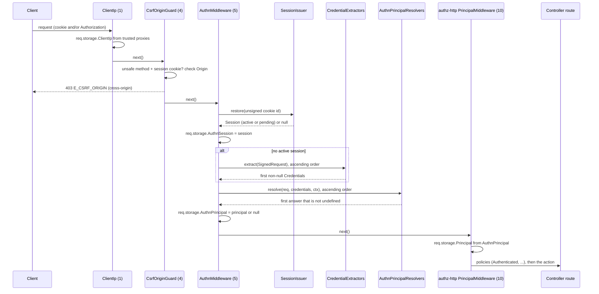

# Request authentication

Three server middlewares find the caller of every request: `ClientIp` (order 1), [`CsrfOriginGuard`](04-csrf-origin-guard.md) (order 4) and `AuthnMiddleware` (order 5). They leave the restored session in `req.storage.AuthnSession` and the authenticated principal, or `null`, in `req.storage.AuthnPrincipal`. Routes read these through [policies](05-policies.md) and [route arguments](06-route-arguments.md); [`@spinajs/authz-http`](../authz-http/README.md) reads the principal for authorization.

## How it works

1. **`ClientIp.before()`** writes `req.storage.ClientIp`: the socket address, or the client address behind trusted proxy hops only. Trust comes from `authn.http.trustProxy`, else `http.trustProxy` (through `proxyTrustOf()`). Every `AuthnContext.ip` the package builds comes from this value, never from Express's `req.ip`.
2. **`CsrfOriginGuard.before()`** refuses a cross-origin unsafe request that carries the session cookie with 403, before any authentication. See [CSRF origin guard](04-csrf-origin-guard.md).
3. **`AuthnMiddleware.authenticate()`** sets `req.storage.AuthnSession` and `req.storage.AuthnPrincipal` to `null`, then builds an `AuthnContext` with `contextOf(req, 'request')`: `ip` from `req.storage.ClientIp` and `userAgent`, each only when it is a string, `now` and purpose `'request'`.
4. **`AuthnMiddleware.restoreSession()`** reads the session cookie (name from `authn.session.cookie`, see [`@spinajs/authn-session`](../authn-session/README.md)):
   - a raw cookie in `req.cookies` is unsigned with `http.cookie.secret` (`cookie-signature`);
   - an Express `s:`-signed cookie is taken from `req.signedCookies`;
   - a bad signature logs a warning with a hashed value and restores nothing;
   - a valid id goes to `SessionIssuer.restore(id)`; an unknown or expired id logs a warning and restores nothing.

   The result, active or pending, goes to `req.storage.AuthnSession`. A restored session sets `Cache-Control: no-store`.
5. **`AuthnMiddleware.extract()`** runs only without an active session: an active session ignores bearer and signature headers. It builds a `SignedRequest` (method, origin-form target, headers from `req.rawHeaders`, body on demand) and asks the [credential extractors](02-credential-extractors.md) in ascending `order`. The first non-null answer is the credentials.
6. **`AuthnMiddleware.principalOf()`** asks the [principal resolvers](03-principal-resolvers.md) in ascending `order`: `KeyPrincipalResolver` (45), `TokenPrincipalResolver` (50), `SessionPrincipalResolver` (100). The first answer that is not `undefined` wins, `null` included; all `undefined` gives `null`.
7. The answer goes to `req.storage.AuthnPrincipal`. A principal sets `Cache-Control: no-store`. An active session that gave no principal (revoked, expired, refused account) is dropped from `req.storage.AuthnSession`, so no route acts on it.
8. Any store or resolver error goes to `next(err)` and fails the request (500). The request never continues as anonymous after an error.
9. `PrincipalMiddleware` of `@spinajs/authz-http` (order 10) runs next and copies `req.storage.AuthnPrincipal` into the authorization principal through its `AuthnPrincipalSource`; see [Principal resolution](../authz-http/03-principal-resolution.md).



## Setup and load order

1. Import `@spinajs/authn-http` in the app entry. Loading `v3/register.js` imports `@spinajs/authn` (its root registers `AuthnService`, the MFA policy, the throttle and the other core services) and registers on the root container:
   - `AuthnMiddleware` as `ServerMiddleware`;
   - `HttpSignatureExtractor`, `AuthorizationBearerExtractor`, `ApiKeyHeaderExtractor` as `CredentialExtractor`;
   - `KeyPrincipalResolver`, `TokenPrincipalResolver`, `SessionPrincipalResolver` as `AuthnPrincipalResolver`;
   - the route argument classes `AuthnIdentityArg`, `AuthnSessionArg`, `AuthnSessionIdArg`, `AuthnSessionDataArg`.
2. `ClientIp` and `CsrfOriginGuard` register themselves with `@Injectable(ServerMiddleware)` when their modules load, which the package entry does.
3. The shipped config file adds `lib/<cjs|mjs>/v3/controllers` and `lib/<cjs|mjs>/cli` under `node_modules/@spinajs/authn-http` (resolved against `WORKSPACE_ROOT_PATH`, else the working directory) to `system.dirs.controllers` and `system.dirs.cli`. The route controllers load only through that scan; importing the package loads none of them.
4. A session issuer must be registered, from [`@spinajs/authn-session`](../authn-session/README.md): `AuthnMiddleware` autoinjects `SessionIssuer`.
5. A cookie parser must fill `req.cookies`. The default `http.middlewares` of `@spinajs/http` contain one; see [Cookies](../http/20-cookies.md).

`HttpServer` fixes its middleware list when it is constructed, and `Controllers` constructs it before scanning the controller directories. When the package loads after that (for example only through the controller scan), `AuthnMiddleware` misses the pipeline and no request is authenticated. The package then logs an error on the `authn-http` logger that names the fix.

`registerAuthnHttpV3(container?)` repeats the registration for another container. It is idempotent; tests call it for a child container that holds their fakes. An app does not need to call it.

## Configuration

| Key | Type | Default | Allowed values | Meaning |
| --- | --- | --- | --- | --- |
| `authn.http.trustProxy` | `string[]` or `integer` or `null` | unset | CIDR or address list, hop count `>= 0`, `null` | Proxies `ClientIp` trusts for `X-Forwarded-For`. `null` or unset falls back to `http.trustProxy`; `0` trusts no proxy. `true` coerces to 1 hop, `false` to 0. |
| `http.trustProxy` | see [Client IP](../http/17-client-ip-and-trust-proxy.md#configuration) | | | Used when `authn.http.trustProxy` is `null` or unset. |
| `authn.http.publicOrigin` | `string` or `null` | unset | `scheme://host[:port]` | The origin clients put in an HTTP signature's `@target-uri`. Unset: signed requests get no principal, and `AuthnMiddleware` warns at boot. |
| `authn.http.hooks.request` | `boolean` | `false` | `true`, `false` | Runs the `authn.request` [action hooks](23-action-hooks.md) on every request once its principal is resolved; a refusal answers 403 `{ code }`. Any value but `true` is off. |
| `http.cookie.secret` | `string` | `@spinajs/http` default | your own secret | Verifies the session cookie signature. Missing: boot fails. The public default: boot fails outside development and test, warns inside them. |
| `authn.session.cookie` | object | see [Session cookie](../authn-session/07-session-cookie.md) | | Cookie name and flags; `AuthnMiddleware` reads the name through `sessionCookieName()`. |

The authn routes have no prefix of their own: `http.controllers.route.prefix` moves them with every other controller.

```ts
export default {
  http: {
    cookie: { secret: process.env.COOKIE_SECRET },
  },
  authn: {
    http: {
      // Behind one reverse proxy.
      trustProxy: 1,
      // Needed only for HTTP message signatures.
      publicOrigin: 'https://api.example.com',
    },
  },
};
```

A `trustProxy` entry that is no address or CIDR, and a malformed `publicOrigin`, fail when the middleware is built, naming the key.

## Services and extension points

| Service | DI token and lifetime | Default implementation | Alternatives | How to replace or extend |
| --- | --- | --- | --- | --- |
| `ClientIp` | `ServerMiddleware` list, `@Injectable(ServerMiddleware)`, `Order` 1 | `ClientIp` | | Subclass and `DI.register(MyClientIp).as(ClientIp)` before `HttpServer` resolves. |
| `AuthnMiddleware` | `ServerMiddleware` list, registered by `registerAuthnHttpV3()` at package load, `Order` 5 | `AuthnMiddleware` | | Prefer adding an [extractor](02-credential-extractors.md) or a [resolver](03-principal-resolvers.md). Protected `authenticate()`, `restoreSession()`, `extract()` and `principalOf()` can be overridden in a subclass registered `.as(AuthnMiddleware)` before `HttpServer` resolves. |
| `SessionIssuer` | autoinjected by `AuthnMiddleware` | `DefaultSessionIssuer` from `@spinajs/authn-session` | | See [`@spinajs/authn-session`](../authn-session/README.md). |
| `CredentialExtractor` | `Array.ofType`, sorted by `order` once in `AuthnMiddleware.resolve()` | three shipped extractors | your own | See [Credential extractors](02-credential-extractors.md). |
| `AuthnPrincipalResolver` | `Array.ofType`, sorted by `order` once in `AuthnMiddleware.resolve()` | three shipped resolvers | your own | See [Principal resolvers](03-principal-resolvers.md). |

The package augments `IActionLocalStoregeContext` of `@spinajs/http` with:

| Field | Written by | Meaning |
| --- | --- | --- |
| `ClientIp?: string` | `ClientIp` | Client address from the trusted proxy chain. |
| `AuthnSession?: Session \| null` | `AuthnMiddleware` | The restored session, pending included; `null` without one. A session here is not authentication. |
| `AuthnPrincipal?: Principal \| null` | `AuthnMiddleware` | The authenticated principal; `null` for anonymous, a pending session or rejected credentials. |

## Important behaviour

- **A pending session is not authentication.** A session waiting for its second factor sets `AuthnSession` but yields no principal, so `Authenticated` fails. With a pending session, bearer credentials are still tried.
- **An active session wins over headers.** With an active session cookie, `Authorization`, `x-api-key` and signature headers are not read.
- **A bad credential never falls through.** A resolver that recognises its credentials answers `null` on failure and resolution stops; no other credential or session is tried.
- **No cookie is re-sent on authenticated requests.** The cookie is a browser-session cookie; the issuer slides the idle expiry server side.
- **Repeated headers are joined.** Headers come from `req.rawHeaders`, so a repeated `Authorization` header reaches the extractors as `a, b`, which no extractor accepts.
- **Raw secrets stay out of logs.** Cookie values and session ids are logged only as a domain-separated sha256, cut to 16 hex characters.
- **Anonymous answers stay cacheable.** `Cache-Control: no-store` is set only when a session or a principal was found.
- Extractors and resolvers are sorted once, when `AuthnMiddleware` resolves; one registered later is not used.

## Best practices

- Set `authn.http.trustProxy` (or `http.trustProxy`) behind a proxy. Without it every client shares the proxy's address, and the login throttle keys on that one address.
- Read the caller with [`@Identity()`](06-route-arguments.md) or `req.storage.AuthnPrincipal`, never with `req.storage.AuthnSession`: a pending session is present there too.
- Keep authorization decisions in [`@spinajs/authz-http`](../authz-http/README.md); this package answers only "who is calling".

## Patterns and antipatterns

```ts
// Don't: a pending (pre-MFA) session passes this check
if (req.storage.AuthnSession) {
  return new Ok(await loadInvoices());
}

// Do: only an authenticated principal counts
@Policy(Authenticated)
@Get('invoices')
public async invoices() {
  return new Ok(await loadInvoices());
}
```

## Examples

### Log every signed-in request with its client address

```ts sample
import '@spinajs/authn-http';
import { ServerMiddleware } from '@spinajs/http';
import type { Request } from '@spinajs/http';
import { Injectable } from '@spinajs/di';
import type * as express from 'express';

@Injectable(ServerMiddleware)
export class SignedInAccessLog extends ServerMiddleware {
  constructor() {
    super();
    // After AuthnMiddleware (5): the principal is known here.
    this.Order = 6;
  }

  public before() {
    return (req: Request, _res: express.Response, next: express.NextFunction) => {
      const principal = req.storage.AuthnPrincipal;
      if (principal) console.log(`${principal.type}:${principal.id} from ${req.storage.ClientIp} ${req.method} ${req.originalUrl}`);
      next();
    };
  }

  public after() {
    return null;
  }
}
```

## Related

- [Server middlewares](../http/15-server-middlewares.md): how `Order` places `ClientIp`, `CsrfOriginGuard` and `AuthnMiddleware` among the `@spinajs/http` middlewares.
- [Client IP and trusted proxies](../http/17-client-ip-and-trust-proxy.md): the `http.trustProxy` setting and `trustedClientAddress()`.
- [`@spinajs/authn`: how a login runs](../authn/01-authentication-flow.md): what `AuthnService.authenticate()` does with the credentials.
- [`@spinajs/authn`: principal and authorization](../authn/07-principal-and-authz.md): the principal shape and how it reaches authz.
- [`@spinajs/authn-session`](../authn-session/README.md): the cookie, the issuer and session expiry.
- [`@spinajs/authz-http`: principal resolution](../authz-http/03-principal-resolution.md): `PrincipalMiddleware` and `AuthnPrincipalSource`, which consume `req.storage.AuthnPrincipal`.
