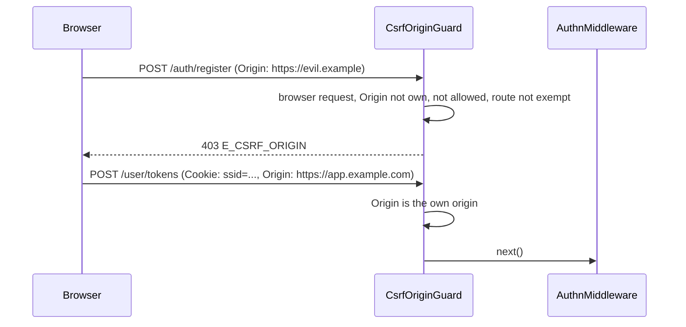

# CSRF origin guard

`CsrfOriginGuard` is the [`@spinajs/http` CSRF guard](../http/23-csrf-guard.md) with what authn-http knows. It refuses cross-site request forgery against cookie sessions and against the anonymous credential posts (login, registration, password reset, passkey and key login, verification, code login, token revocation), which closes login CSRF: a cross-site form cannot sign a victim in as the attacker. It is default-deny: every unsafe request a browser sends is checked, so a new route is protected without being listed. It runs before `AuthnMiddleware` (order 4), so a refused request reaches no controller and restores no session. It does **not** use CSRF tokens.

What it adds to `CsrfGuard`:

- the session cookie (`authn.session.cookie.name`, default `ssid`, bare and with `__Host-`) is an ambient cookie;
- the own origin follows `authn.http.trustProxy`, falling back to `http.trustProxy`;
- every refusal is logged as a rate-limited warning;
- the deprecated `authn.http.csrf.*` keys still work;
- the boot fails when the session cookie is `SameSite=None` without a CSRF defence (see below).

Registering it makes the plain `CsrfGuard` step aside, so one guard runs.

## How it works

1. `CsrfOriginGuard.before()` runs once when `HttpServer` resolves. It normalises the allowed origins, compiles the exempt paths and the proxy trust, so a bad entry fails the boot even while the guard is off. With `http.csrf.enabled: false` or `authn.http.csrf.enabled: false` it adds no handler.
2. Per request, `GET`, `HEAD` and `OPTIONS` pass.
3. A request with neither `Origin` nor `Sec-Fetch-Site` and without the session cookie (or another `http.csrf.ambientCookies` entry) passes: it is a non-browser client (curl, a server-side caller).
4. With an `Origin` header, the request passes when the origin is the app's own or an allowed one. The own origin is the connection scheme plus the `Host` header, or `X-Forwarded-Proto` and `X-Forwarded-Host` from a trusted proxy only.
5. Without `Origin`, the request passes only with `Sec-Fetch-Site: same-origin`.
6. A route marked `@CsrfExempt()` or listed in `http.csrf.exempt` passes. `@spinajs/authn-oidc` marks its back-channel logout route.
7. Otherwise the guard answers **403** with `{ "error": { "code": "E_CSRF_ORIGIN", "message": "Cross-origin request refused" } }` and logs a warning.



## Configuration

| Key | Type | Default | Allowed values | Meaning |
| --- | --- | --- | --- | --- |
| `http.csrf.enabled` | `boolean` | `true` | `true`, `false` | `false` turns the guard off. |
| `http.csrf.allowedOrigins` | `string[]` | `[]` | origins `scheme://host[:port]` | Origins allowed besides the app's own. |
| `http.csrf.exempt` | `string[]` | `[]` | absolute route paths | Paths never refused; see [CSRF guard](../http/23-csrf-guard.md#configuration). |
| `http.csrf.ambientCookies` | `string[]` | `[]` | cookie names | Further ambient cookies; the session cookie is always one. |
| `authn.http.csrf.enabled` | `boolean` | `true` | `true`, `false` | **Deprecated**, removed in the next major: use `http.csrf.enabled`. `false` here or there turns the guard off. |
| `authn.http.csrf.allowedOrigins` | `string[]` | `[]` | origins | **Deprecated**: use `http.csrf.allowedOrigins`. Both lists count. |
| `authn.http.csrf.unauthenticatedRoutes` | `string[]` | not set | absolute paths | **Deprecated and ignored**: every route is checked now. A warning names it at boot. |
| `authn.http.trustProxy` | see [Request authentication](01-request-authentication.md#configuration) | | | Proxies whose `X-Forwarded-Proto` and `X-Forwarded-Host` set the own origin. Falls back to `http.trustProxy`. |
| `authn.session.cookie.name` | `string` | `'ssid'` | | The session cookie the guard looks for; see [`@spinajs/authn-session`](../authn-session/README.md). |
| `authn.session.cookie.sameSite` | | `'strict'` | | `'none'` needs the guard on and `http.csrf.allowedOrigins` set outside development and test. |

A deprecated key that is in use is named in one warning at boot.

```ts
export default {
  authn: {
    http: { trustProxy: ['10.0.0.0/8'] },
  },
  http: {
    csrf: {
      // The admin SPA runs on another origin and sends the session cookie.
      allowedOrigins: ['https://admin.example.com'],
    },
  },
};
```

## `SameSite=None` boot check

With `SameSite=None` the browser sends the session cookie on cross-site requests, so the origin check is the only CSRF defence. Outside development and test, the boot fails with `InvalidOption` when `authn.session.cookie.sameSite` resolves to `none` and either the guard is off or `http.csrf.allowedOrigins` (with the deprecated `authn.http.csrf.allowedOrigins`) is empty. A cross-site embed is the only reason for `none`, and its origin must be listed anyway. The check runs in `CsrfOriginGuard.resolve()`.

## Services and extension points

| Service | DI token and lifetime | Default implementation | Alternatives | How to replace or extend |
| --- | --- | --- | --- | --- |
| `CsrfOriginGuard` | `ServerMiddleware` list, `@Injectable(ServerMiddleware)`, `Order` 4 | `CsrfOriginGuard` | | Turn it off with `http.csrf.enabled: false`, or subclass and `DI.register(Mine).as(CsrfOriginGuard)` before `HttpServer` resolves. |
| `assertSameSiteNoneProtected(input)` | exported function | | | The `SameSite=None` boot check, for code that builds its own guard. |

## Important behaviour

- **Every browser request is checked.** Registration, verification, passkey and key login and challenges, token revocation and any route you add are checked like login, with or without the session cookie.
- **Non-browser clients pass.** A request with neither `Origin` nor `Sec-Fetch-Site` and no session cookie is let through, so scripts and server-to-server calls keep working.
- **A cross-origin SPA must be listed** in `http.csrf.allowedOrigins`, also when it authenticates with a bearer token: the browser sends `Origin` with its posts.
- **`Origin` wins over fetch metadata.** A cross-site `Origin` is refused even with `Sec-Fetch-Site: same-origin`.
- **Origins compare exactly.** Another port, scheme or a longer host is another origin; `Origin: null` is refused.
- **No usable `Host`** (absent, or with a path): only listed origins pass.
- **Rate-limited warnings.** The guard logs every refusal with `event: 'authn-http.csrf-refused'`. The package config ships two `RateLimitFilter` entries in `logger.filters`: at most one line per origin pair a minute and 20 lines a minute in all. The log names the origin and the own origin, never cookies. See [log filters](../log/09-filters.md#ratelimitfilter).
- The guard also covers the OIDC link routes of [`@spinajs/authn-oidc`](../authn-oidc/01-login-flow.md#http-routes). Its back-channel logout route is `@CsrfExempt()`.

## Best practices

- Behind a reverse proxy, set `authn.http.trustProxy` so the own origin comes from `X-Forwarded-Proto` and `X-Forwarded-Host`. Otherwise same-site requests can be refused because the proxy rewrites `Host` or the scheme.
- List only origins you control in `allowedOrigins`; each one may act with the user's session.
- Keep state-changing routes on unsafe methods. The guard never checks `GET`.
- Move `authn.http.csrf.*` to `http.csrf.*` now; the aliases go in the next major.

## Patterns and antipatterns

```ts
// Don't: a state change on GET is never checked by the guard
@Get('logout-everywhere')
public async logoutEverywhere() { /* ... */ }

// Do: unsafe methods are checked
@Del('sessions')
public async logoutEverywhere() { /* ... */ }
```

## Related

- [CSRF guard](../http/23-csrf-guard.md): the general guard, `@CsrfExempt()` and `http.csrf.exempt`.
- [Request authentication](01-request-authentication.md): the middleware order around the guard.
- [CORS](../http/16-cors.md): CORS headers do not replace this check; a CORS preflight is not sent for every cross-site request.
- [`@spinajs/http-socket` principal sources](../http-socket/08-principal-sources.md#origins): the same origin rule for socket handshakes.
