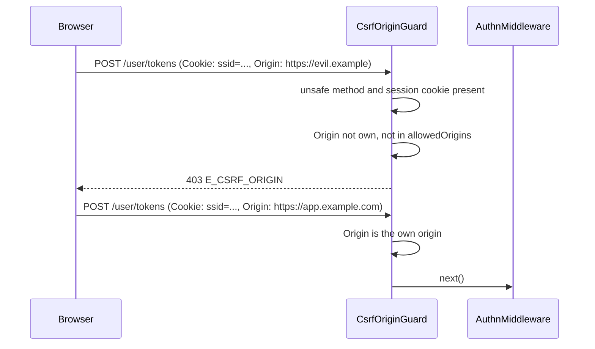

# CSRF origin guard

`CsrfOriginGuard` refuses cross-site request forgery against cookie sessions. A request with an unsafe method that carries the session cookie passes only when its `Origin` is the app's own origin or a listed one. It runs before `AuthnMiddleware` (order 4), so a refused request reaches no controller and restores no session. It does **not** use CSRF tokens.

## How it works

1. `CsrfOriginGuard.before()` runs once when `HttpServer` resolves. It normalises `authn.http.csrf.allowedOrigins` and compiles the proxy trust, so a bad entry fails the boot even while the guard is off. With `authn.http.csrf.enabled: false` it adds no handler.
2. Per request, `GET`, `HEAD` and `OPTIONS` pass.
3. A request whose `Cookie` header carries no session cookie passes. The session cookie name is `authn.session.cookie.name` (default `ssid`), bare or with the `__Host-` prefix.
4. With an `Origin` header, the request passes when the origin is in `allowedOrigins` or equals the app's own origin. The own origin is the connection scheme plus the `Host` header, or `X-Forwarded-Proto` and `X-Forwarded-Host` from a trusted proxy only.
5. Without `Origin`, the request passes only with `Sec-Fetch-Site: same-origin`.
6. Otherwise the guard answers **403** with `{ "error": { "code": "E_CSRF_ORIGIN", "message": "Cross-origin request refused" } }` and logs a warning.



## Configuration

| Key | Type | Default | Allowed values | Meaning |
| --- | --- | --- | --- | --- |
| `authn.http.csrf.enabled` | `boolean` | `true` | `true`, `false` | `false` turns the guard off. Absent means on. |
| `authn.http.csrf.allowedOrigins` | `string[]` | `[]` | origins `scheme://host[:port]` | Origins allowed besides the app's own, which is always allowed. Normalised at boot; an entry that is no origin fails the boot, naming the key. |
| `authn.http.trustProxy` | see [Request authentication](01-request-authentication.md#configuration) | | | Proxies whose `X-Forwarded-Proto` and `X-Forwarded-Host` set the own origin. Falls back to `http.trustProxy`. |
| `authn.session.cookie.name` | `string` | `'ssid'` | | The cookie the guard looks for; see [`@spinajs/authn-session`](../authn-session/README.md). |

```ts
export default {
  authn: {
    http: {
      trustProxy: ['10.0.0.0/8'],
      csrf: {
        // The admin SPA runs on another origin and sends the session cookie.
        allowedOrigins: ['https://admin.example.com'],
      },
    },
  },
};
```

## Services and extension points

| Service | DI token and lifetime | Default implementation | Alternatives | How to replace or extend |
| --- | --- | --- | --- | --- |
| `CsrfOriginGuard` | `ServerMiddleware` list, `@Injectable(ServerMiddleware)`, `Order` 4 | `CsrfOriginGuard` | | Turn it off with `authn.http.csrf.enabled: false`, or subclass and `DI.register(Mine).as(CsrfOriginGuard)` before `HttpServer` resolves. |

## Important behaviour

- **Login is not checked.** `POST /auth/login` without a session cookie passes, since only requests carrying the session cookie are checked.
- **Token, key and signature requests are exempt.** They carry no session cookie.
- **`Origin` wins over fetch metadata.** A cross-site `Origin` is refused even with `Sec-Fetch-Site: same-origin`.
- **Origins compare exactly.** Another port, scheme or a longer host is another origin; `Origin: null` is refused. Default ports are normalised.
- **No usable `Host`** (absent, or with a path): only listed origins pass.
- **Rate-limited warnings.** The guard logs every refusal with `event: 'authn-http.csrf-refused'`. The package config ships two `RateLimitFilter` entries in `logger.filters`: at most one line per origin pair a minute and 20 lines a minute in all. The log names the origin and the own origin, never cookies. See [log filters](../log/09-filters.md#ratelimitfilter).
- The guard also covers the OIDC link routes of [`@spinajs/authn-oidc`](../authn-oidc/01-login-flow.md#http-routes), which carry the session cookie.

## Best practices

- Behind a reverse proxy, set `authn.http.trustProxy` so the own origin comes from `X-Forwarded-Proto` and `X-Forwarded-Host`. Otherwise same-site requests can be refused because the proxy rewrites `Host` or the scheme.
- List only origins you control in `allowedOrigins`; each one may act with the user's session.
- Keep state-changing routes on unsafe methods. The guard never checks `GET`.

## Patterns and antipatterns

```ts
// Don't: a state change on GET is never checked by the guard
@Get('logout-everywhere')
public async logoutEverywhere() { /* ... */ }

// Do: unsafe methods are checked when they carry the session cookie
@Del('sessions')
public async logoutEverywhere() { /* ... */ }
```

## Related

- [Request authentication](01-request-authentication.md): the middleware order around the guard.
- [CORS](../http/16-cors.md): CORS headers do not replace this check; a CORS preflight is not sent for every cross-site request.
- [`@spinajs/http-socket` principal sources](../http-socket/08-principal-sources.md#origins): the same origin rule for socket handshakes.
