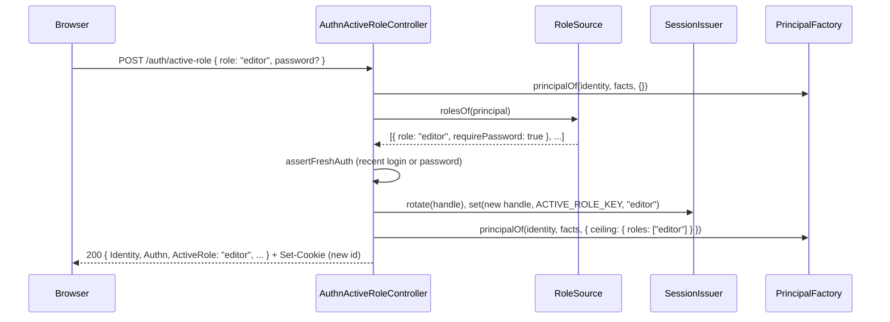

# Active role routes

`AuthnActiveRoleController` lets a session narrow its principal to one role the user holds, for example to act as `editor` instead of `admin`. The role becomes `ceiling.roles` of every later principal of that session, so [`@spinajs/authz`](../authz/README.md) grants at most what that role grants. The group is on while a `RoleSource` is registered (`RbacRoleSource` of [`@spinajs/users`](../users/14-role-switch-and-access-response.md)); otherwise every route answers 404.

## How it works

1. `RoleSourceRegistered` (controller gate) answers 404 `not_found` while no `RoleSource` is registered.
2. `POST /auth/active-role` reads `role`, a non-empty string of at most 256 characters. Otherwise 400 `invalid_role`.
3. It asks `RoleSource.rolesOf()` for the roles of the session's identity **without** the current narrowing, so a narrowed session can switch back. A role not in the list: 403 `role_not_held`.
4. Unless the role entry has `requirePassword: false`, the request needs [fresh authentication](05-policies.md#fresh-authentication): a login within `authn.freshAuth.maxAgeSeconds`, or `password` in the body. A wrong or throttled password: 401 login failure body without `Retry-After`.
5. `SessionIssuer.rotate()` gives the session a new id, then `SessionIssuer.set(handle, ACTIVE_ROLE_KEY, role)` stores the role.
6. The answer is the principal built by `PrincipalFactory` with `ceiling: { roles: [role] }`, extended with kind `role-switch`, plus `ActiveRole`, and the new session cookie.
7. On later requests `SessionPrincipalResolver` narrows the principal to `ceiling.roles = [ActiveRole]`.

## Routes

### `GET /auth/active-role`

| | |
| --- | --- |
| Policies | `[Authenticated, NoTokenAuthPolicy]` |
| 200 | `{ "ActiveRole": string \| null, "Roles": [{ "role": string, "requirePassword": boolean }] }`; `ActiveRole` is `null` before any switch (every held role applies) |
| 403 | `session_required`: not a session principal |

### `POST /auth/active-role`

| | |
| --- | --- |
| Policies | `[Authenticated, NoTokenAuthPolicy, NoImpersonationPolicy]` |
| Request body | `{ "role": string, "password"?: string }` |
| 200 | Principal summary plus extensions (kind `role-switch`) plus `"ActiveRole"`, `Set-Cookie` with the rotated session |
| 400 | `invalid_role` |
| 401 | login failure body (wrong or throttled password), or `unauthenticated` when the session ended meanwhile |
| 403 | `role_not_held`, `fresh_auth_required`, `session_required`, `impersonating` |
| 404 | `not_found`: no `RoleSource` |

## Configuration

| Key | Type | Default | Allowed values | Meaning |
| --- | --- | --- | --- | --- |
| `authn.freshAuth.maxAgeSeconds` | `integer` | `300` | `>= 1` | How recent a login must be to switch to a `requirePassword` role without the password. |

## Services and extension points

| Service | DI token and lifetime | Default implementation | Alternatives | How to replace or extend |
| --- | --- | --- | --- | --- |
| `RoleSource` | optional autoinject; its registration switches the group on | `RbacRoleSource` (`@spinajs/users`) | your own | Extend `RoleSource` from `@spinajs/authn/contracts`, implement `rolesOf(principal)`, register `.as(RoleSource)`. See [`@spinajs/users`: role switch](../users/14-role-switch-and-access-response.md). |
| `PrincipalFactory` | optional autoinject | `UserPrincipalFactory` (`@spinajs/users`) | | See [`@spinajs/users`: principal factory](../users/09-principal-factory.md). |

## Important behaviour

- **The session id rotates** on every switch; the old cookie stops working.
- **Any value but `requirePassword: false` asks for fresh authentication.**
- **No switch while impersonating.** `GET` works for an impersonator, `POST` does not.
- The `ACTIVE_ROLE_KEY` session value is read by `SessionPrincipalResolver` on every request.

## Related

- [Principal resolvers](03-principal-resolvers.md): how the stored role narrows later principals.
- [`@spinajs/users`: role switch and access response](../users/14-role-switch-and-access-response.md): the shipped `RoleSource`.
- [`@spinajs/authz`](../authz/README.md): how `ceiling.roles` limits permissions.
