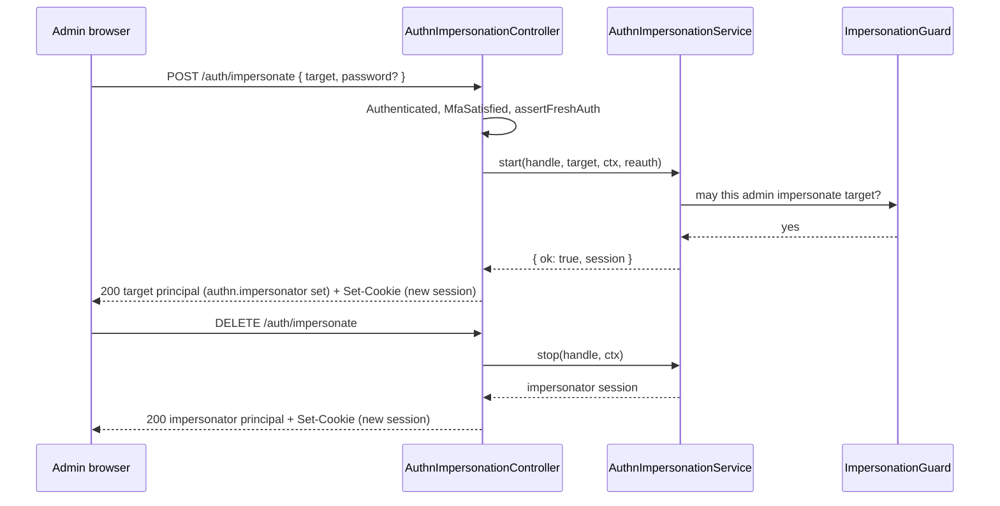

# Impersonation routes

`AuthnImpersonationController` lets an administrator act as another user, inspect the impersonation, and stop it. It drives `AuthnImpersonationService` of [`@spinajs/authn`](../authn/11-impersonation-and-active-role.md). The group is on while an `ImpersonationGuard` is registered (`AuthzImpersonationGuard` of [`@spinajs/users`](../users/13-impersonation-and-credential-admin-guards.md)); otherwise every route answers 404.

## How it works

### Start

1. `ImpersonationGuardRegistered` (controller gate): 404 `not_found` without an `ImpersonationGuard`.
2. Route policies `[Authenticated, MfaSatisfied]`: a principal whose second factor passed, or whom the MFA policy requires none from.
3. The body is checked: `target` is a user id string or `{ type, id }` (`type` at most 64, the id at most 256 characters), otherwise 400 `invalid_target`; a `password` that is no string answers the 401 login failure body; any other key 400 `invalid_field`.
4. The principal must come from an active session: otherwise 403 `session_required`.
5. [Fresh authentication](05-policies.md#fresh-authentication) through `freshAuthOrAnswer()` (over `assertFreshAuth()`), with `password` from the body. A wrong or throttled password: 401 login failure body.
6. `AuthnImpersonationService.start(handle, target, ctx, reauthCredentials)` asks the guard and its own rules (`authn.impersonation.*`). Any refusal: 403 `impersonation_refused`; the service tells no reason.
7. Success issues a **new session** for the impersonation. The answer is the target's principal (with `authn.impersonator`), extended with kind `impersonation`, and the new session cookie.

### Stop

1. `DELETE /auth/impersonate` with policy `Authenticated`. No active impersonation: 400 `not_impersonating`.
2. `AuthnImpersonationService.stop(handle, ctx)` ends the impersonation and issues a **new session** for the impersonator, with its earlier role switch restored.
3. When the impersonator may no longer log in, the impersonation still ends; the new session is revoked, the cookie cleared, and the answer is `{ "Active": false }`.
4. Otherwise the answer is the impersonator's principal, narrowed by its role switch, and the new session cookie.

## Routes

### `GET /auth/impersonate`

| | |
| --- | --- |
| Policies | `Authenticated` |
| 200 | `{ "Active": false }`, or `{ "Active": true, "Impersonator": { type, id }, "Target": { type, id }, "StartedAt"?: ISO }` |

### `POST /auth/impersonate`

| | |
| --- | --- |
| Policies | `[Authenticated, MfaSatisfied]` |
| Request body | `{ "target": string \| { "type": string, "id": string }, "password"?: string }` |
| 200 | Target principal summary plus extensions (kind `impersonation`), `Set-Cookie` with the impersonation session; `{ "Active": false }` with a cleared cookie when the new session yields no principal |
| 400 | `invalid_target`, `invalid_field` |
| 401 | login failure body (wrong or throttled password) |
| 403 | `impersonation_refused`, `session_required`, `impersonating`, `fresh_auth_required`, `mfa_required` |
| 404 | `not_found`: no `ImpersonationGuard` |

### `DELETE /auth/impersonate`

| | |
| --- | --- |
| Policies | `Authenticated` |
| 200 | Impersonator principal summary plus extensions (kind `impersonation`), `Set-Cookie`; or `{ "Active": false }` with a cleared cookie |
| 400 | `not_impersonating` |

## Configuration

| Key | Type | Default | Allowed values | Meaning |
| --- | --- | --- | --- | --- |
| `authn.impersonation.requirePassword` | `boolean` | `true` | | The service checks freshness again; a stale session that passed with the password needs it here too. |
| `authn.impersonation.requireMfa` | `boolean` | `true` | | Enforced by the service. |
| `authn.impersonation.maxMinutes` | `integer` | `60` | | Lifetime of an impersonation; `AuthnImpersonationService.principalOf()`, which `SessionPrincipalResolver` calls on every request, enforces it. |
| `authn.freshAuth.maxAgeSeconds` | `integer` | `300` | `>= 1` | Freshness for starting an impersonation. |

These keys belong to [`@spinajs/authn`](../authn/11-impersonation-and-active-role.md).

## Services and extension points

| Service | DI token and lifetime | Default implementation | Alternatives | How to replace or extend |
| --- | --- | --- | --- | --- |
| `ImpersonationGuard` | its registration switches the group on | `AuthzImpersonationGuard` (`@spinajs/users`) | your own | See [`@spinajs/users`: impersonation and credential admin guards](../users/13-impersonation-and-credential-admin-guards.md). |
| `AuthnImpersonationService` | resolved per call | from `@spinajs/authn` | | See [`@spinajs/authn`: impersonation](../authn/11-impersonation-and-active-role.md). |

## Important behaviour

- **Start and stop each issue a new session**; the earlier cookie stops working.
- **Impersonation is never fresh.** While impersonating, routes that need fresh authentication answer 403 `impersonating`.
- **Credential routes are closed while impersonating**: tokens, keys, MFA enrolment, password change, own sessions, role switch and credential admin.
- Logging out of an impersonation session ends the impersonation and audits `impersonation.end`.

## Related

- [Policies](05-policies.md): `NoImpersonationPolicy` and `MfaSatisfied`.
- [Principal resolvers](03-principal-resolvers.md): an impersonation session gives the target with `authn.impersonator`.
- [`@spinajs/authn`: impersonation](../authn/11-impersonation-and-active-role.md): the service rules and audit.
