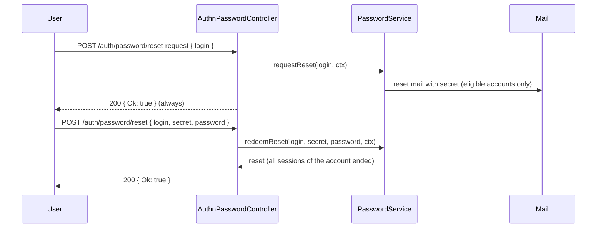

# Password routes

`AuthnPasswordController` serves the password policy, the "forgot password" flow (request a reset mail, redeem the secret) and the signed-in password change, over the `PasswordService` contract. The group is on while a `PasswordService` is registered, which [`@spinajs/authn-local`](../authn-local/README.md) does; otherwise every route answers 404. Hashing, policy rules, secrets and mails live in `@spinajs/authn-local`.

## How it works

### Reset by mail

1. `POST /auth/password/reset-request` with `{ login }`. A missing or over-long login: 400 `invalid_login`.
2. `PasswordService.requestReset(login, ctx)` runs with purpose `'login'`. A throttled request (per login and per client ip): 429 with `Retry-After`.
3. Any other outcome, including an unknown account or a failed mail, answers 200 `{ "Ok": true }`. A thrown error is logged with its name only. The secret travels in the mail only.
4. `POST /auth/password/reset` with `{ login, secret, password, confirmPassword? }`. The new password is checked first (see [New password checks](#new-password-checks)); a missing login or secret: 401 login failure body.
5. `PasswordService.redeemReset(login, secret, password, ctx)` redeems a reset secret, or an invite secret while the account is invite-pending, once:
   - `reset`: 200 `{ "Ok": true }`; every session of the account ends;
   - `rejected`: 400 `password_rejected` with `violations`, before the secret is spent;
   - `throttled`: 401 login failure body with `Retry-After` (keyed on the client ip alone);
   - anything else (wrong, used or expired secret, unknown login): 401 login failure body.

### Change while signed in

1. `PATCH /user/password` with policies `[Authenticated, NoTokenAuthPolicy, NoImpersonationPolicy]` and an active session (otherwise 403 `session_required`).
2. The new password is checked; `oldPassword` missing: 401 login failure body.
3. `PasswordService.change(identity, oldPassword, password, handle, ctx)` runs with purpose `'reauth'`: the old password is the fresh authentication, counted in the `reauth` throttle.
   - `changed`: 200 with the **rotated** session cookie; every other session of the account ends, API tokens stay;
   - `rejected`: 400 `password_rejected` with `violations`;
   - anything else (wrong old password, throttled): 401 login failure body without `Retry-After`.

### New password checks

Applied by `POST /auth/password/reset` and `PATCH /user/password` before the service runs:

| Body | Answer |
| --- | --- |
| `password` missing, not a string or empty | 400 `invalid_password` |
| `password` longer than 1024 characters | 400 `password_rejected` with `violations: ["too_long"]` |
| `confirmPassword` present and different, or not a non-empty string of at most 1024 characters | 400 `password_mismatch` |
| any other key | reset: 401 login failure body; change: 400 `invalid_field` |

## Routes

| Method and path | Request body | 200 | Errors |
| --- | --- | --- | --- |
| `GET /auth/password/policy` | | `{ "minLength": number, "maxLength": number, "pattern"?: string, "description"?: string }` | 404 group off |
| `POST /auth/password/reset-request` | `{ "login" }` | `{ "Ok": true }` | 400 `invalid_login`, `invalid_field`; 429 `throttled` with `Retry-After` |
| `POST /auth/password/reset` | `{ "login", "secret", "password", "confirmPassword"? }` | `{ "Ok": true }` | 400 `invalid_password`, `password_rejected`, `password_mismatch`; 401 login failure body |
| `PATCH /user/password` | `{ "oldPassword", "password", "confirmPassword"? }` | no data, rotated session cookie | 400 as above, `invalid_field`; 401; 403 `session_required`, `impersonating` |

The `password_rejected` body is `{ "error": "password_rejected", "message": "...", "violations": [...] }`; the violations name policy rules and say nothing about the account.

## Services and extension points

| Service | DI token and lifetime | Default implementation | Alternatives | How to replace or extend |
| --- | --- | --- | --- | --- |
| `PasswordService` | optional autoinject; its registration switches the group on | `LocalPasswordService` (`@spinajs/authn-local`) | your own | Implement the `PasswordService` contract of `@spinajs/authn/contracts` and register it `.as(PasswordService)`; see [`@spinajs/authn-local`](../authn-local/README.md). |

## Important behaviour

- **The reset request never tells whether an account exists.** Unknown accounts, mail failures and sends all answer `{ "Ok": true }`.
- **`GET /auth/password/policy` is public**: the reset form needs it before there is a session.
- **A reset ends every session of the account; a change ends every other one** and rotates the current one.
- **Every string is capped at `PASSWORD_HARD_CAP` (1024) characters** before the service sees it.
- No answer and no error message carries a password, a secret or a login.

## Best practices

- Show the rules from `GET /auth/password/policy` on the reset and change forms, and the `violations` of a 400 next to the field.
- Send `confirmPassword` from forms that ask for it twice; the route compares it before the service runs.

## Related

- [`@spinajs/authn-local`](../authn-local/README.md): hashing, the policy, reset and invite secrets, mails.
- [Credential admin routes](16-credential-admin-routes.md): an admin expires a user's password and sends a reset mail.
- [Answers and response extensions](17-answers-and-response-extensions.md#the-shared-401-body): the login failure body.
