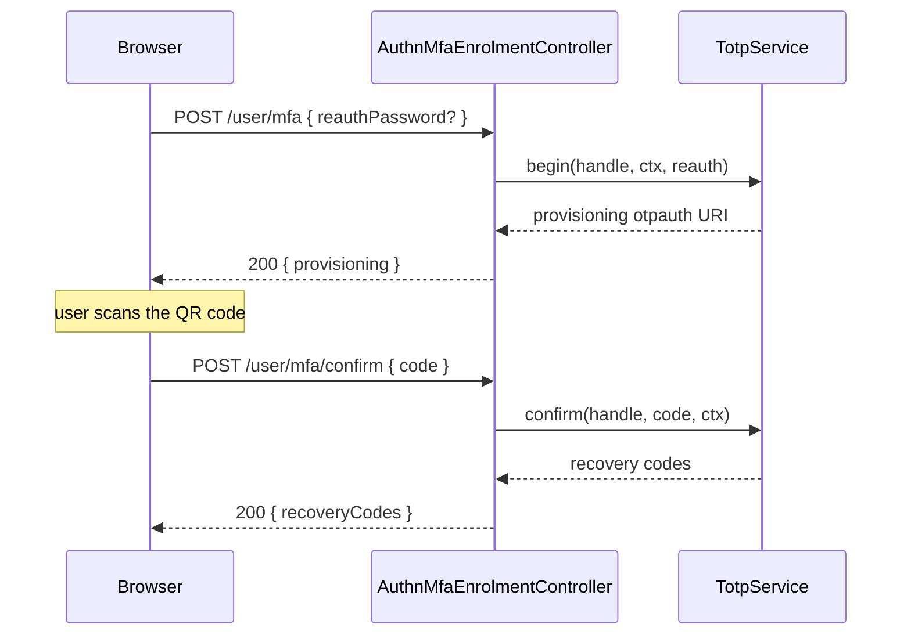

# MFA enrolment routes

`AuthnMfaEnrolmentController` lets a user enrol TOTP, confirm it, disable it and regenerate recovery codes, over the `TotpService` of [`@spinajs/authn-totp`](../authn-totp/README.md). Every route acts on the identity of the caller's own session. The group is on only while login actually asks for TOTP; otherwise every route answers 404.

## How it works

1. **Gate.** `TotpEnrolmentOn` answers 404 `not_found` unless all of these hold:
   - a service is registered under the DI name `TotpService`;
   - `authn.mfa.encryptionKey.secret` is set;
   - the steps of the MFA policy (`authn.mfa.policy.service`) include `@spinajs/authn-totp`'s `TotpMfaStep` (that class, not a subclass);
   - the registered `TotpService` is `@spinajs/authn-totp`'s class.
2. **Who may call.** `GET /user/mfa`, `POST /user/mfa/disable` and `POST /user/mfa/recovery-codes` need `[Authenticated, NoTokenAuthPolicy, NoImpersonationPolicy]` and an active session. `POST /user/mfa` and `POST /user/mfa/confirm` also admit a pending session through `PendingMfaEnrolment`.
3. **`PendingMfaEnrolment`** passes a pending session whose identity is enrolled in none of the configured steps and that the MFA policy does not refuse. Such a session comes from a forced enrolment (`authn.mfa.policy.force` or `forceForRoles`), where enrolling is the only way out. Otherwise it refuses with 403 `enrolment_closed`; the caller hears the 401 of the full-login group, which is declared first.
4. **Fresh authentication.** Begin, disable and recovery-codes need a login within `authn.freshAuth.maxAgeSeconds` or the account password in `reauthPassword`. The field is removed from the body; `TotpService` verifies it for this request only, counted in the `reauth` throttle. A pending session sends no password.
5. **Effect.** The route calls `TotpService.begin()`, `confirm()`, `disable()` or `regenerateRecoveryCodes()`; refusals map to answers as in [Errors](#errors).

## Routes

| Method and path | Request body | 200 |
| --- | --- | --- |
| `GET /user/mfa` | | `{ "steps": [{ "name": string, "enrolled": boolean }] }` for each step of the MFA policy; a begun but unconfirmed enrolment is not enrolled |
| `POST /user/mfa` | `{ "reauthPassword"?: string }` | `{ "provisioning": string }`, the otpauth URI, shown once; a later begin replaces a begun enrolment with a new secret |
| `POST /user/mfa/confirm` | `{ "code": string }` | `{ "recoveryCodes": string[] }`, shown once; each code is single use |
| `POST /user/mfa/disable` | `{ "code": string, "reauthPassword"?: string }` (a TOTP or recovery code) | no data; the secret and recovery codes are removed |
| `POST /user/mfa/recovery-codes` | `{ "reauthPassword"?: string }` | `{ "recoveryCodes": string[] }`, shown once; every older code is void |

Every answer carries `Cache-Control: no-store`.

### Errors

| Status | Body | When |
| --- | --- | --- |
| 401 | `unauthenticated` | No session, the session ended (`no_session`), or a pending session on a route it may not use. A pending session that `PendingMfaEnrolment` refuses (already enrolled, no step configured, refused by the policy) also hears this: the full-login group is declared first, and its refusal is the one reported. |
| 401 | login failure body | A wrong password, a wrong code, a missing or over-long code. `Retry-After` only when the `mfa` throttle refused the code. |
| 403 | `fresh_auth_required` | A stale session without `reauthPassword`. |
| 403 | `session_required`, `impersonating` | A token or key caller; an impersonation (a factor enrolled there would lock the owner out). |
| 404 | `not_found` | The group is off. |
| 409 | `mfa_enrolled`, `mfa_not_begun`, `mfa_not_enrolled` | Begin while enrolled; confirm without a begin; disable while not enrolled. |

## Configuration

| Key | Type | Default | Allowed values | Meaning |
| --- | --- | --- | --- | --- |
| `authn.mfa.steps` | `{ name, service }[]` | | | Must list `TotpMfaStep` of `@spinajs/authn-totp` for the group to be on. |
| `authn.mfa.encryptionKey.secret` | `string` | unset | | Must be set for the group to be on; encrypts TOTP secrets. |
| `authn.mfa.policy.service` | `string` | `'DefaultMfaPolicy'` | registered `MfaPolicy` name | Policy whose `steps()` the gate and `GET /user/mfa` read. |
| `authn.mfa.policy.force`, `authn.mfa.policy.forceForRoles` | `boolean`, `string[]` | `false`, `[]` | | Force enrolment at login; such pending sessions may call begin and confirm. |
| `authn.freshAuth.maxAgeSeconds` | `integer` | `300` | `>= 1` | Freshness for begin, disable and recovery-codes. |

The MFA keys belong to [`@spinajs/authn`](../authn/04-mfa-policy-and-steps.md) and [`@spinajs/authn-totp`](../authn-totp/README.md).

## Services and extension points

| Service | DI token and lifetime | Default implementation | Alternatives | How to replace or extend |
| --- | --- | --- | --- | --- |
| `TotpService` | DI name `'TotpService'`, resolved per call | `TotpService` (`@spinajs/authn-totp/service`) | | Not replaceable here: the gate requires the class of `@spinajs/authn-totp`. |

## Important behaviour

- **No secret leaks.** Only `POST /user/mfa` returns the provisioning URI and only confirm and recovery-codes return recovery codes, once.
- **The session id is not rotated** by any enrolment route.
- **Enrolling here does not finish a forced login.** A pending session that confirmed its enrolment completes the login through [`POST /auth/mfa/verify`](08-login-logout-and-mfa-routes.md) with a code of the new factor. Until then it reaches only begin and confirm.
- **Importing `@spinajs/authn-http` does not load `@spinajs/authn-totp`.** The gate imports it lazily, so an app without TOTP does not register `TotpMfaStep`.

## Related

- [`@spinajs/authn-totp`](../authn-totp/README.md): `TotpService`, `TotpMfaStep` and recovery codes.
- [`@spinajs/authn`: MFA](../authn/04-mfa-policy-and-steps.md): the MFA policy and forced enrolment.
- [Credential admin routes](16-credential-admin-routes.md): an admin resets a user's TOTP.
