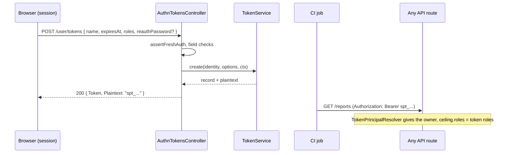

# API token routes

`AuthnTokensController` lets a signed-in user list, create, rotate, narrow and revoke their own API tokens, over the `TokenService` contract. `AuthnTokenRevocationController` adds one public route, [`POST /auth/tokens/revoke`](#post-authtokensrevoke), that revokes a token from its plaintext alone. The group is on while a `TokenService` is registered, which [`@spinajs/authn-token`](../authn-token/README.md) does when a token strategy is listed; otherwise every route answers 404. Tokens then authenticate requests through `Authorization: Bearer` or `x-api-key` (see [Credential extractors](02-credential-extractors.md)).

## How it works

1. `TokenServiceRegistered` (controller gate): 404 `not_found` without a `TokenService`.
2. Every route has `[Authenticated, NoTokenAuthPolicy, NoImpersonationPolicy]` and needs an active session: a token or key caller gets 403 `session_required` (no credential mints or manages credentials), an impersonator 403 `impersonating`, an anonymous caller or a pending session 401.
3. `POST /user/tokens` and `POST /user/tokens/:uuid/rotate` validate their body DTO first (see [Input validation](24-input-validation.md)), which takes `reauthPassword` off the request, then run [`assertFreshAuth()`](05-policies.md#fresh-authentication) in the handler through `freshAuthOrAnswer()`. A stale session without the password: 403 `fresh_auth_required`; a wrong or throttled password: 401 login failure body without `Retry-After`.
4. The body is checked field by field (see the table below); the first bad field answers 400.
5. `TokenService.create(identity, options, ctx)` checks the expiry against the caps, the roles against the owner's, the profile against the profile policy and the scope against the kind. A refused expiry: 400 `invalid_expiry`; anything else refused: 400 `invalid_scope`.
6. The answer is `{ Token, Plaintext }`. The plaintext is shown here once and never again.



## Routes

### `GET /user/tokens`

| | |
| --- | --- |
| 200 | A list of token entries: the caller's live and expired tokens (`Expired` tells them apart); revoked ones are left out |

### `POST /user/tokens`

| | |
| --- | --- |
| Request body | `{ "name", "expiresAt", "roles"?, "profile"?, "kind"?, "scope"?, "reauthPassword"? }` |
| 200 | `{ "Token": <token entry>, "Plaintext": string }` |
| 400 | `invalid_name`, `invalid_expiry`, `invalid_kind`, `invalid_roles`, `invalid_profile`, `invalid_scope`, `invalid_field` (any other key) |
| 401 | login failure body (wrong or throttled `reauthPassword`) |
| 403 | `fresh_auth_required`, `session_required`, `impersonating` |

| Field | Rule |
| --- | --- |
| `name` | Non-blank string of at most 128 characters. |
| `expiresAt` | **Mandatory.** ISO 8601 instant with a zone (`Z` or `+hh:mm`), every field in range (`parseIsoInstant()` of `@spinajs/util`); at most `authn.token.maxTtlDays` ahead (an agent token `authn.token.agentMaxTtlMinutes`), checked by the service. |
| `kind` | `pat` (default), `service` or `agent`. |
| `roles` | At most 64 role names of at most 128 characters; each must be a role the owner holds. |
| `profile` | Non-empty string of at most 128 characters that the profile policy offers. An empty string is refused, not read as "none". |
| `scope` | `{ permissions?: string[], resources?: [{ type, id? }], agent?: boolean }`, no other keys, at most 1000 permissions and 1000 resources of at most 256 characters each. |

### `POST /user/tokens/:uuid/rotate`

Replaces the secret of a live token of the caller and keeps its id, name, roles and expiry. The old secret stops working at once, or after `graceSeconds`.

| | |
| --- | --- |
| Request body | `{ "graceSeconds"?, "reauthPassword"? }` |
| 200 | `{ "Token": <token entry>, "Plaintext": string }`; the new plaintext is shown here once |
| 400 | `invalid_grace`, `invalid_field` (any other key) |
| 401 | login failure body (wrong or throttled `reauthPassword`) |
| 403 | `fresh_auth_required`, `session_required`, `impersonating` |
| 404 | `token_not_found` for any id that is not a live token of the caller |

`graceSeconds` is a whole number from 0 to 604800 (seven days) and defaults to 0. Rotating a token a deployment already uses: rotate with a grace, roll the new secret out, and let the old one lapse.

### `PATCH /user/tokens/:uuid`

Narrows a token. It needs no fresh auth, because it can only reduce what the token may do.

| | |
| --- | --- |
| Request body | `{ "name"?, "roles"?, "expiresAt"? }` |
| 200 | `{ "Token": <token entry> }` |
| 400 | `invalid_name`, `invalid_roles`, `invalid_expiry`, `invalid_scope`, `invalid_field` |
| 403 | `session_required`, `impersonating` |
| 404 | `token_not_found` |

| Field | Rule |
| --- | --- |
| `name` | Non-blank string of at most 128 characters. |
| `roles` | A non-empty list of at most 64 role names of at most 128 characters, each one the token already has (for a token without roles, one the owner holds). Adding a role: 400 `invalid_scope`. |
| `expiresAt` | ISO 8601 instant, as for create, after now and not later than the current expiry. A later one: 400 `invalid_expiry`. |

Any other key, `kind`, `profile` and `scope` included, answers 400 `invalid_field` and changes nothing.

### `DELETE /user/tokens/:uuid`

| | |
| --- | --- |
| 200 | No data; the token stops working on its next request |
| 404 | `{ "error": "token_not_found", "message": "No such token" }` for any id that is not a live token of the caller |

### `POST /auth/tokens/revoke`

Self-revocation by plaintext, RFC 7009 style, from `AuthnTokenRevocationController`. It is for the holder of a leaked secret, so it needs **no session and no cookie**: none of the policies above apply, only the `TokenServiceRegistered` gate. The secret in the body is the authorisation. The [CSRF origin guard](04-csrf-origin-guard.md) checks a browser request like any other; a server or CLI sending no `Origin` is not checked.

| | |
| --- | --- |
| Body | `{ "token": "<plaintext>", "token_type_hint"?: string }`, JSON or form. `token_type_hint` (at most 64 characters) is taken and ignored: the route revokes access tokens only |
| 200 | `{}` whether or not a token was revoked: unknown, malformed, over 1024 characters, a body with any other key, already revoked, or a previous secret whose grace has ended all answer alike |
| 429 | `{ "error": "throttled", "message" }` with `Retry-After`; nothing is revoked |

Every request counts in the `reset` throttle flow keyed on the client ip, before the body is read. That budget is the one the password reset routes use, and `authn.throttle.reset.ip` sets it (`free: 5` by default; raise it if secret scanners call this route in bursts). A previous secret inside its rotation grace revokes the token like the current one. The call audits `token.revoke` with `reason: 'self'` and evicts the validation cache.

```bash
curl -X POST https://api.example.test/auth/tokens/revoke -d token=spt_leaked...
```

### Token entry

`{ "Uuid", "Name", "Kind", "Roles", "Profile", "Scope", "CreatedAt", "ExpiresAt", "LastUsedAt", "LastUsedIp", "Expired" }`: instants as ISO 8601 to the second, absent values `null`, `Roles` always a list. Never the plaintext or its hash. Every answer carries `Cache-Control: no-store`.

## Configuration

| Key | Type | Default | Allowed values | Meaning |
| --- | --- | --- | --- | --- |
| `authn.token.maxTtlDays` | `integer` | `90` | `>= 1` | Longest lifetime of a token. |
| `authn.token.agentMaxTtlMinutes` | `integer` | `1440` | `>= 1` | Longest lifetime of an agent token. |
| `authn.freshAuth.maxAgeSeconds` | `integer` | `300` | `>= 1` | Freshness for creating or rotating a token. |
| `authn.throttle.reset.ip` | backoff params | `free: 5` | see [`@spinajs/authn`](../authn/README.md) | Budget of `POST /auth/tokens/revoke` per client ip, shared with the password reset routes. |

## Services and extension points

| Service | DI token and lifetime | Default implementation | Alternatives | How to replace or extend |
| --- | --- | --- | --- | --- |
| `TokenService` | resolved per call; its registration switches the group on | from `@spinajs/authn-token` | | See [`@spinajs/authn-token`](../authn-token/README.md). |

## Important behaviour

- **The plaintext is shown once**, in the create answer only.
- **Fresh authentication runs in the handler, not as a policy**: http runs every policy of a route at once, so a `FreshAuth` policy would verify a password while the gate answers 404.
- **One answer for every secret.** `POST /auth/tokens/revoke` answers `200 {}` for a live token and for anything else, so it cannot be used to probe which secrets exist.
- **One 404 for every foreign id.** A token of another user answers like an unknown one.
- **A password change keeps API tokens.** An admin revokes them through the [credential admin routes](16-credential-admin-routes.md).

## Best practices

- Give each token the smallest `roles` and `scope` the job needs, and a short `expiresAt`.
- Store the plaintext in the client's secret store at once; it cannot be fetched again.

## Related

- [Action hooks](23-action-hooks.md#refusals-of-the-services): a refusal of `authn.token.create`, `.revoke`, `.rotate` or `.update` answers 403 `{ error: 'action_refused', code }`.
- [`@spinajs/authn-token`](../authn-token/README.md): token format, strategies, profiles and the token CLI.
- [Credential extractors](02-credential-extractors.md) and [Principal resolvers](03-principal-resolvers.md): how a token authenticates a request.
- [`@spinajs/authz`](../authz/README.md): how `ceiling.roles` and the scope limit what a token may do.
