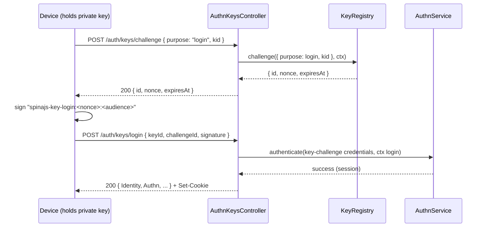

# Key routes

`AuthnKeysController` lets a user register Ed25519 or P-256 public keys, list and revoke them, and log in by signing a challenge, over the `KeyRegistry` contract. The group is on while a `KeyRegistry` is registered ([`@spinajs/authn-keys`](../authn-keys/README.md)) and `authn.keys.challenge.audience` or `authn.keys.assertion.audience` is set; otherwise every route answers 404. Registered keys also authenticate single requests with key assertions or HTTP signatures (see [Credential extractors](02-credential-extractors.md)).

## How it works

### Register a key

1. `POST /auth/keys/challenge` with `{ "purpose": "register" }` from the user's own full session. The challenge is bound to the user.
2. The client signs the challenge and sends `POST /user/keys` with the public JWK and `proof: { challengeId, signature }`.
3. The route takes `reauthPassword` out of the body and runs [`assertFreshAuth()`](05-policies.md#fresh-authentication) in the handler through `freshAuthOrAnswer()`.
4. The body is checked; then `KeyRegistry.register({ ...key, owner: { type: 'user', id } }, ctx)` verifies the key and the proof.
5. The answer is the key entry.

### Log in with a key

1. `POST /auth/keys/challenge` with `{ "purpose": "login", "kid" }`, anonymous. A challenge for an unknown kid looks the same as one for a known kid. Login challenges count against the client ip; a throttled one answers 429 with `Retry-After`.
2. The client signs the challenge and sends `POST /auth/keys/login` with `{ keyId, challengeId, signature }`.
3. The route runs the same `completeLogin()` as [`POST /auth/login`](08-login-logout-and-mfa-routes.md#password-login): it ends a held session, answers the login failure body for missing or malformed fields, calls `AuthnService.authenticate({ kind: 'key-challenge', ... }, ctx)`, and answers with the session cookie and the principal summary (extension kind `login`). Under the default MFA policy a key login asks for no second factor; a policy that asks for one gets 200 `{ "MfaRequired": [...] }` with the pending session cookie.

Clients sign challenges as `@spinajs/authn-keys` defines them: the UTF-8 bytes of `spinajs-key-<purpose>:<nonce>:<audience>`, the raw signature as base64url, the challenge named by its unchanged `id`.

## Routes

| Method and path | Request body | 200 | Errors |
| --- | --- | --- | --- |
| `GET /user/keys` | | list of key entries, revoked and expired ones included and marked | 401, 403 `session_required`, `impersonating` |
| `POST /user/keys` | `{ "jwk", "proof": { "challengeId", "signature" }, "kid"?, "name"?, "expiresAt"?, "reauthPassword"? }` | the key entry | 400 `invalid_key`, `invalid_kid`, `invalid_name`, `invalid_expiry`, `invalid_scope`, `invalid_proof`; 409 `key_taken`; 403 `fresh_auth_required`; 401 login failure body |
| `DELETE /user/keys/:kid` | | no data; the key fails on its next request | 404 `key_not_found` |
| `POST /auth/keys/challenge` | `{ "purpose": "login", "kid" }` or `{ "purpose": "register" }` | `{ "id", "nonce", "expiresAt" }` | 400 `invalid_purpose`, `invalid_kid`; 429 `throttled`; 401/403 for `register` without a user session |
| `POST /auth/keys/login` | `{ "keyId", "challengeId", "signature" }` | principal summary plus extensions and the session cookie, or `{ "MfaRequired" }` | 401 login failure body, `Retry-After` when throttled |

The `/user/keys` routes need `[Authenticated, NoTokenAuthPolicy, NoImpersonationPolicy]` and the active session of a `user` identity. Every answer carries `Cache-Control: no-store`.

Field rules for `POST /user/keys`:

| Field | Rule |
| --- | --- |
| `jwk` | An object of at most 512 characters as JSON; `KeyRegistry` requires an Ed25519 or P-256 public key. |
| `kid` | 1-64 characters of `A-Z a-z 0-9 . _ -`; default: the RFC 7638 thumbprint. |
| `name` | Non-empty, at most 128 characters, no control characters. |
| `expiresAt` | ISO 8601 instant after now. |
| `scope` | Refused (400 `invalid_scope`): a user key takes no scope here. |
| `proof` | `challengeId` (at most 600 characters) and `signature` (at most 128 characters) of a register challenge of this user. |

**Key entry:** `{ "kid", "name", "alg", "jwk", "thumbprint", "scope", "createdAt", "expiresAt", "lastUsedAt", "revokedAt", "revoked", "expired" }`. Instants are ISO 8601 to the second, absent values `null`, and `jwk` holds the public members only (`kty`, `crv`, `x`, and `y` for P-256).

## Configuration

| Key | Type | Default | Allowed values | Meaning |
| --- | --- | --- | --- | --- |
| `authn.keys.challenge.audience` | `string` or `null` | `null` | | What clients put in a challenge's signing input; falls back to `authn.keys.assertion.audience`. The group is off without either. |
| `authn.keys.assertion.audience` | `string` or `null` | `null` | | Audience of key assertions; the challenge fallback. |
| `authn.freshAuth.maxAgeSeconds` | `integer` | `300` | `>= 1` | Freshness for registering a key. |

## Services and extension points

| Service | DI token and lifetime | Default implementation | Alternatives | How to replace or extend |
| --- | --- | --- | --- | --- |
| `KeyRegistry` | resolved per call; its registration switches the group on | from `@spinajs/authn-keys` | | See [`@spinajs/authn-keys`](../authn-keys/README.md). |
| `AuthnService` | resolved per call by key login | `DefaultAuthnService` (`@spinajs/authn`) | | See [`@spinajs/authn`](../authn/README.md). |

## Important behaviour

- **Register challenges count against no throttle here**: each throttle flow is the owner's own budget, which a burst of challenges would spend. Cap the route per ip with `http.throttle` ([Throttling](../http/18-throttling.md)).
- **One 404 for every foreign kid.** A key of another user answers like an unknown one; revoking an already revoked key of the caller changes nothing.
- **Key login ends a held session**, as password login does.

## Related

- [`@spinajs/authn-keys`](../authn-keys/README.md): key formats, assertions, HTTP signatures and challenges.
- [Login, logout and MFA routes](08-login-logout-and-mfa-routes.md): the answers key login shares.
- [Credential extractors](02-credential-extractors.md): `jws-assertion` and `http-signature` credentials from registered keys.
