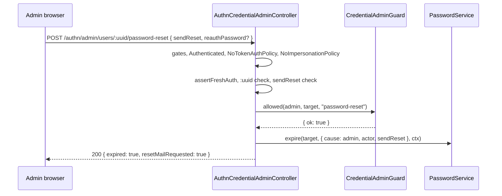

# Credential admin routes

`AuthnCredentialAdminController` lets an administrator act on another user's credentials: expire the password and send a reset mail, reset TOTP, end every session, revoke every API token. A `CredentialAdminGuard` decides who may administer whom; without one the group answers 404. [`@spinajs/users`](../users/13-impersonation-and-credential-admin-guards.md) registers `AuthzCredentialAdminGuard`. No route ever returns a secret.

## How it works

1. **Controller gate.** `CredentialAdminGuardRegistered`: 404 `not_found` without a `CredentialAdminGuard`.
2. **Route group.** Each route's group starts with its own gate, then `[Authenticated, NoTokenAuthPolicy, NoImpersonationPolicy]`:

   | Route | Gate | Needs |
   | --- | --- | --- |
   | `password-reset` | `PasswordServiceRegistered` | a `PasswordService` |
   | `mfa-reset` | `AdminMfaResetOn` | the [MFA enrolment](13-mfa-enrolment-routes.md) group on |
   | `sessions` | `SessionIssuerRegistered` | a `SessionIssuer` |
   | `tokens` | `TokenServiceRegistered` | a `TokenService` |

3. **`admit()`**, in this order, so a refused call changes nothing:
   1. an active session of the admin, else 403 `session_required`;
   2. [fresh authentication](05-policies.md#fresh-authentication) with the admin's password in `reauthPassword`: 403 `fresh_auth_required`, or 401 login failure body without `Retry-After`;
   3. `:uuid` must be a lower-case uuid, else 404 `not_found` (`No such user`);
   4. the route's own body fields (`sendReset` for password reset);
   5. `CredentialAdminGuard.allowed(admin, target, action)`: only `{ ok: true }` passes. Refusals: 403 `forbidden`, `protected_role` or `escalation`, or 404 `not_found`; an unknown code is 403 `forbidden`.
4. **Effect**, with the admin as the audit actor.

## Routes

| Method and path | Request body | 200 | Effect |
| --- | --- | --- | --- |
| `POST /authn/admin/users/:uuid/password-reset` | `{ "sendReset"?: boolean, "reauthPassword"?: string }` | `{ "expired": true, "resetMailRequested": boolean }` | The current password stops working at once. Every session of the user ends, impersonations included, and with `authn.local.reset.revokeTokens` every token. With `sendReset` (default `true`) the password service may send a reset mail. |
| `POST /authn/admin/users/:uuid/mfa-reset` | `{ "reauthPassword"?: string }` | `{ "reset": boolean }` | Removes the TOTP enrolment, confirmed or begun, and its recovery codes; `false` when there was nothing to remove. |
| `DELETE /authn/admin/users/:uuid/sessions` | `{ "reauthPassword"?: string }` | `{ "revoked": number }` | Ends every session of the user, impersonations included; audited as `session.revoke`, reason `admin`. |
| `DELETE /authn/admin/users/:uuid/tokens` | `{ "reauthPassword"?: string }` | `{ "revoked": number }` | Revokes every API and agent token of the user. |

Errors common to all four: 400 `invalid_send_reset` (password reset, `sendReset` not a boolean); 401 `unauthenticated` or the login failure body; 403 `session_required`, `impersonating`, `fresh_auth_required`, `forbidden`, `protected_role`, `escalation`; 404 `not_found` (group or route off, malformed `:uuid`, unknown user). Every answer carries `Cache-Control: no-store`.

`resetMailRequested` echoes `sendReset` only: the password service decides whether a mail goes out (none without a `PasswordMailer`, or for a user it finds not eligible).

## Configuration

| Key | Type | Default | Allowed values | Meaning |
| --- | --- | --- | --- | --- |
| `authn.local.reset.revokeTokens` | `boolean` | `true` | | An admin password reset also revokes every token; see [`@spinajs/authn-local`](../authn-local/README.md). |
| `authn.freshAuth.maxAgeSeconds` | `integer` | `300` | `>= 1` | Freshness the admin needs. |
| `authn.mfa.encryptionKey.secret`, `authn.mfa.policy.service` | | | | Decide whether `mfa-reset` is on, as for the [MFA enrolment routes](13-mfa-enrolment-routes.md#configuration). |

## Services and extension points

| Service | DI token and lifetime | Default implementation | Alternatives | How to replace or extend |
| --- | --- | --- | --- | --- |
| `CredentialAdminGuard` | optional autoinject; its registration switches the group on | `AuthzCredentialAdminGuard` (`@spinajs/users`) | your own | Extend `CredentialAdminGuard` from `@spinajs/authn/contracts`, implement `allowed(actor, target, action)` returning `{ ok: true }` or `{ ok: false, code }`, register `.as(CredentialAdminGuard)`. See [`@spinajs/users`](../users/13-impersonation-and-credential-admin-guards.md). |
| `PasswordService`, `SessionIssuer`, `TokenService`, `TotpService` | optional autoinject or resolved per call | from `@spinajs/authn-local`, `@spinajs/authn-session`, `@spinajs/authn-token`, `@spinajs/authn-totp` | | Each switches its route on. |

## Important behaviour

- **A refused call changes nothing**: fresh authentication, the target check and the guard all run before any effect.
- **`:uuid` is case-sensitive.** An upper-case uuid answers 404, so a case-insensitive user lookup cannot expire a user while the session store revokes nothing.
- **Not while impersonating**, and never from an API token or key.
- **No secret in any answer.** A reset secret travels in the owner's mail only.

## Related

- [`@spinajs/users`: impersonation and credential admin guards](../users/13-impersonation-and-credential-admin-guards.md): the shipped guard and its rules.
- [Password routes](12-password-routes.md), [MFA enrolment routes](13-mfa-enrolment-routes.md), [Session management routes](09-session-management-routes.md), [API token routes](14-api-token-routes.md): the owner's side of each credential.
- [`@spinajs/users-http`: user administration](../users-http/06-user-administration.md): the user admin routes beside these.
