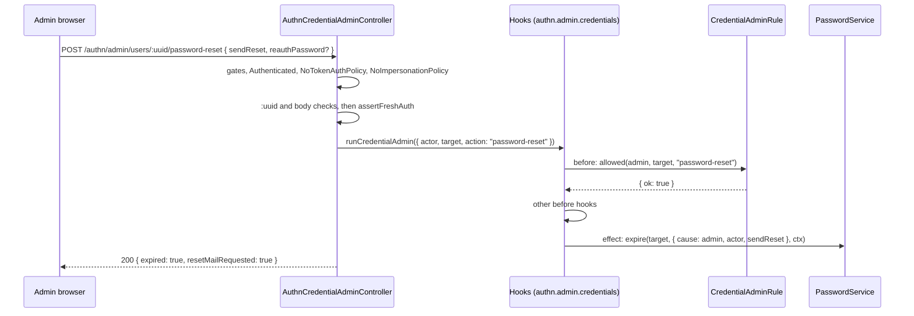

# Credential admin routes

`AuthnCredentialAdminController` lets an administrator act on another user's credentials: expire the password and send a reset mail, reset TOTP, end every session, revoke every API token. A `CredentialAdminRule` decides who may administer whom: the first before hook of the `authn.admin.credentials` [action](23-action-hooks.md). Without one the group answers 404. [`@spinajs/users`](../users/13-impersonation-and-credential-admin-guards.md) registers `AuthzCredentialAdminRule`. No route ever returns a secret.

## How it works

1. **Controller gate.** `CredentialAdminRuleRegistered`: 404 `not_found` unless a `CredentialAdminRule` class is registered as an `ActionHook` (`credentialAdminRuleRegistered()` of `@spinajs/authn/hooks`). A rule registered by a factory does not count: the gate finds it by its class.
2. **Route group.** Each route's group starts with its own gate, then `[Authenticated, NoTokenAuthPolicy, NoImpersonationPolicy]`:

   | Route | Gate | Needs |
   | --- | --- | --- |
   | `password-reset` | `PasswordServiceRegistered` | a `PasswordService` |
   | `mfa-reset` | `AdminMfaResetOn` | `mfaEnrolmentOn()`, as for the [MFA enrolment](13-mfa-enrolment-routes.md) group: a registered `MfaEnrolmentService` whose `enabled(steps)` is true |
   | `sessions` | `SessionIssuerRegistered` | a `SessionIssuer` |
   | `tokens` | `TokenServiceRegistered` | a `TokenService` |

3. **Route arguments**, before the handler: `:uuid` must be a lower-case uuid, else 404 `not_found` (`No such user`); then the body DTO: `sendReset` not a boolean is 400 `invalid_send_reset`, a `reauthPassword` that is no string the 401 login failure body, any other key 400 `invalid_field`.
4. **`admit()`**, in this order, so a refused call changes nothing:
   1. an active session of the admin, else 403 `session_required`;
   2. [fresh authentication](05-policies.md#fresh-authentication) through `freshAuthOrAnswer()` with the admin's password in `reauthPassword`: 403 `fresh_auth_required`, or 401 login failure body without `Retry-After`.
5. **`authn.admin.credentials`**, through `runCredentialAdmin()` of `@spinajs/authn/hooks`. Its input is `{ actor, target, action }`, where `actor` is the admin's whole principal:
   1. the `CredentialAdminRule` runs first (order `-1000`): `allowed(admin, target, action)` must answer `{ ok: true }`. Refusals: 403 `forbidden`, `protected_role` or `escalation`, or 404 `not_found`. They are not audited. An unknown code is 403 `forbidden`;
   2. the other before hooks: a refusal answers 403 `{ error: 'action_refused', code }` and is audited;
   3. a rule that throws or times out answers 403 `{ error: 'action_refused', code: 'hook_error' }`;
   4. an effect no rule admitted is refused 403 `forbidden`. This covers a rule registered after the hooks runner resolved.
6. **Effect**, with the admin as the audit actor.

## Routes

| Method and path | Request body | 200 | Effect |
| --- | --- | --- | --- |
| `POST /authn/admin/users/:uuid/password-reset` | `{ "sendReset"?: boolean, "reauthPassword"?: string }` | `{ "expired": true, "resetMailRequested": boolean }` | The current password stops working at once. Every session of the user ends, impersonations included, and with `authn.local.reset.revokeTokens` every token. With `sendReset` (default `true`) the password service may send a reset mail. |
| `POST /authn/admin/users/:uuid/mfa-reset` | `{ "reauthPassword"?: string }` | `{ "reset": boolean }` | `MfaEnrolmentService.adminReset()`: with `TotpService`, removes the TOTP enrolment, confirmed or begun, and its recovery codes; `false` when there was nothing to remove. |
| `DELETE /authn/admin/users/:uuid/sessions` | `{ "reauthPassword"?: string }` | `{ "revoked": number }` | Ends every session of the user, impersonations included; audited as `session.revoke`, reason `admin`. |
| `DELETE /authn/admin/users/:uuid/tokens` | `{ "reauthPassword"?: string }` | `{ "revoked": number }` | Revokes every API and agent token of the user. |

Errors common to all four: 400 `invalid_send_reset` (password reset, `sendReset` not a boolean), `invalid_field` (any other key); 401 `unauthenticated` or the login failure body; 403 `session_required`, `impersonating`, `fresh_auth_required`, `forbidden`, `protected_role`, `escalation`; 404 `not_found` (group or route off, malformed `:uuid`, unknown user). Every answer carries `Cache-Control: no-store`.

`resetMailRequested` echoes `sendReset` only: the password service decides whether a mail goes out (none without a `PasswordMailer`, or for a user it finds not eligible).

## Configuration

| Key | Type | Default | Allowed values | Meaning |
| --- | --- | --- | --- | --- |
| `authn.http.admin.basePath` | `string` | not set, the routes mount under `authn/admin/users` | a non-empty path without the route prefix | Where the four credential admin routes mount, for example `internal/authn/users`. They move together. |
| `authn.local.reset.revokeTokens` | `boolean` | `true` | | An admin password reset also revokes every token; see [`@spinajs/authn-local`](../authn-local/README.md). |
| `authn.freshAuth.maxAgeSeconds` | `integer` | `300` | `>= 1` | Freshness the admin needs. |
| `authn.mfa.steps`, `authn.mfa.encryptionKey.secret`, `authn.mfa.policy.service` | | | | Decide whether `mfa-reset` is on, as for the [MFA enrolment routes](13-mfa-enrolment-routes.md#configuration). |

## Services and extension points

| Service | DI token and lifetime | Default implementation | Alternatives | How to replace or extend |
| --- | --- | --- | --- | --- |
| `CredentialAdminRule` | an `ActionHook` class (`@Injectable(ActionHook)`); its registration switches the group on | `AuthzCredentialAdminRule` (`@spinajs/users`) | your own | Extend `CredentialAdminRule` from `@spinajs/authn/hooks`, implement `allowed(actor, target, action)` returning `{ ok: true }` or `{ ok: false, code }`, register the class as an `ActionHook`. See [`@spinajs/users`](../users/13-impersonation-and-credential-admin-guards.md). |
| `PasswordService`, `SessionIssuer`, `TokenService`, `MfaEnrolmentService` | optional autoinject or resolved per call | from `@spinajs/authn-local`, `@spinajs/authn-session`, `@spinajs/authn-token`, `@spinajs/authn-totp` (`TotpService`) | | Each switches its route on. |

## Important behaviour

- **A refused call changes nothing**: the target and body checks, fresh authentication, the rule and the other before hooks all run before any effect. A malformed `:uuid` or body costs no re-authentication.
- **Fails closed.** No rule registered: 404. A rule the runner does not hold, or one that throws: 403.
- **`:uuid` is case-sensitive.** An upper-case uuid answers 404, so a case-insensitive user lookup cannot expire a user while the session store revokes nothing.
- **Not while impersonating**, and never from an API token or key.
- **No secret in any answer.** A reset secret travels in the owner's mail only.

## Related

- [Action hooks](23-action-hooks.md): every route runs its effect as `authn.admin.credentials`; a refusal of a hook after the rule, or an `authn.password.expire` refusal of the password reset, answers 403 `{ error: 'action_refused', code }` and changes nothing. A refused `authn.mfa.adminReset` answers 200 `{ reset: false }`.
- [`@spinajs/users`: impersonation and credential admin rules](../users/13-impersonation-and-credential-admin-guards.md): the shipped rule.
- [Password routes](12-password-routes.md), [MFA enrolment routes](13-mfa-enrolment-routes.md), [Session management routes](09-session-management-routes.md), [API token routes](14-api-token-routes.md): the owner's side of each credential.
- [`@spinajs/users-http`: user administration](../users-http/06-user-administration.md): the user admin routes beside these.
