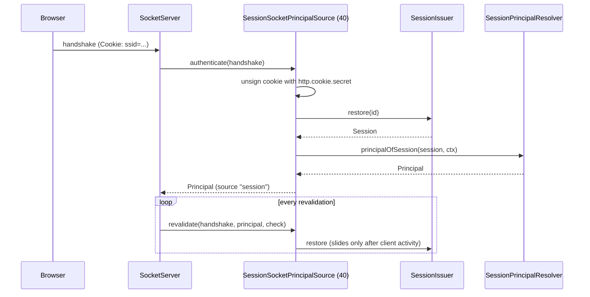

# Socket sessions

The subpath `@spinajs/authn-http/socket` lets a browser's session cookie authenticate a [`@spinajs/http-socket`](../http-socket/README.md) connection, the way it authenticates HTTP requests. It adds `SessionSocketPrincipalSource` and re-exports the policies that work on socket calls. `@spinajs/http-socket` is an optional peer dependency.

## How it works

1. `import '@spinajs/authn-http/socket'` registers `SessionSocketPrincipalSource` with `@Injectable(SocketPrincipalSource)`: name `session`, order 40, before `AuthnCredentialSource` (50) of `@spinajs/http-socket`.
2. On a handshake, `SocketServer` asks the principal sources in ascending order (see [Principal sources](../http-socket/08-principal-sources.md)). `http-socket` has already refused cross-site handshakes.
3. `SessionSocketPrincipalSource.authenticate(handshake)`:
   - without a registered `SessionIssuer`: `null` (the source is inert);
   - reads the session cookie from `handshake.cookies` (name from `authn.session.cookie`) and verifies its signature with `http.cookie.secret`, raw or Express `s:` form. Absent, empty or forged: `null`;
   - `SessionIssuer.restore(id)`; unknown or expired: a warning with a hashed id, `null`;
   - `SessionPrincipalResolver.principalOfSession(session, ctx)` gives the principal, as on HTTP.
4. A pending session gives `null`, so a bearer token is still tried by the next source. An **active** session that gives no principal throws `AuthenticationFailed`: the handshake is refused, as HTTP tries no bearer credentials beside an active session.
5. **Revalidation.** `revalidate()` re-reads the session. When the connection showed client activity since the last check, the session is restored as an HTTP request restores it, which slides its idle expiry. Otherwise it is only read (`peekingSessions()`), so an idle socket still ends at the idle timeout. Logout, revocation and an id rotation close the socket at the next check.

## Policies for socket controllers

| Export of `@spinajs/authn-http/socket` | Effect |
| --- | --- |
| `Authenticated` | As on HTTP: an authenticated principal. |
| `MfaSatisfied` | As on HTTP. |
| `NotLoggedPolicy`, `NoTokenAuthPolicy`, `NoImpersonationPolicy` | As on HTTP. |
| `SessionSocketPrincipalSource` | The source above. |

`NoSession`, `FreshAuth` and `PendingMfaEnrolment` are not exported here: they read `req.storage.AuthnSession`, which no socket call carries. See [Policies](05-policies.md) for each policy.

## Configuration

| Key | Type | Default | Allowed values | Meaning |
| --- | --- | --- | --- | --- |
| `http.cookie.secret` | `string` | | | Verifies the cookie; a missing secret, or the public default outside development and test, throws. |
| `authn.session.cookie` | object | | | Cookie name and flags; see [`@spinajs/authn-session`](../authn-session/README.md). |
| `http.socket.auth.revalidateMs` | `number` | see [`@spinajs/http-socket`](../http-socket/15-configuration.md) | | How far after client activity a revalidation slides the session. |

## Services and extension points

| Service | DI token and lifetime | Default implementation | Alternatives | How to replace or extend |
| --- | --- | --- | --- | --- |
| `SessionSocketPrincipalSource` | `SocketPrincipalSource` list, singleton, registered when the subpath loads | `SessionSocketPrincipalSource` | | Subclass and override `authenticate()`, `revalidate()`, or the protected `sessionId()` and `context()`; register before `SocketServer` resolves. See [Principal sources](../http-socket/08-principal-sources.md#services-and-extension-points). |
| `SessionPrincipalResolver` | autoinjected | `SessionPrincipalResolver` | | See [Principal resolvers](03-principal-resolvers.md). |

## Important behaviour

- **An active session wins over bearer credentials**, as on HTTP; a pending one does not.
- **Only `DefaultSessionIssuer` honours `peekingSessions()`.** With another issuer, every revalidation may slide the session.
- The handshake context uses `handshake.address` as `ip`; `ClientIp` does not run for sockets.

## Related

- [`@spinajs/http-socket`: principal sources](../http-socket/08-principal-sources.md) and [revalidation](../http-socket/09-revalidation.md).
- [Principal resolvers](03-principal-resolvers.md): `principalOfSession()`.
- [`@spinajs/authn-session`](../authn-session/README.md): the issuer and its sliding expiry.
