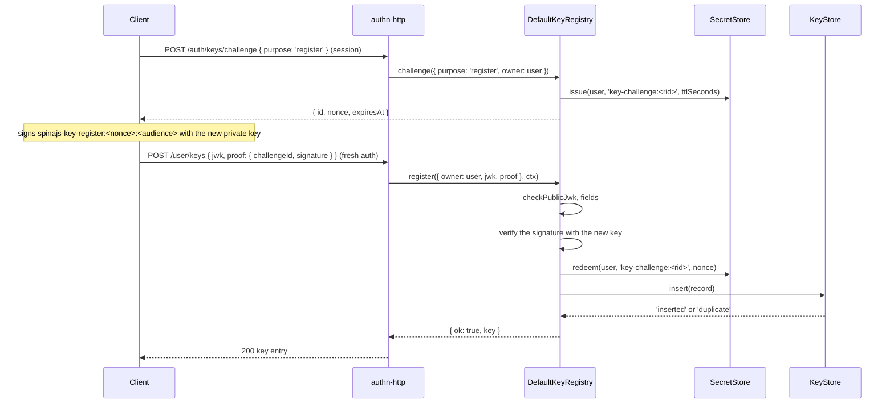

# Key registry

`DefaultKeyRegistry` is the `KeyRegistry` of SpinaJS: it registers, lists and revokes the public keys of users, services and agents, and looks keys up for the strategies. Keys reach it from three sources: `POST /user/keys` in `authn-http` (users, with a proof of possession), the `authn:key-*` CLI (services and agents), and your own code.

## How it works

### Register, `DefaultKeyRegistry.register(reg, ctx)`

1. The owner is checked: `type` is `user`, `service` or `agent`, `id` is 1-64 characters. Anything else throws `TypeError`: a malformed owner is a programming error, not a credential.
2. `checkPublicJwk(reg.jwk, authn.keys.algorithms)` checks the key and keeps only its required members (see [JWS and key material](08-jws-and-key-material.md#how-it-works)). The `kid` defaults to the key's RFC 7638 thumbprint.
3. The fields are checked. Any failure returns `{ ok: false, code: 'invalid_key' }`:
   - the key passes step 2 and its algorithm is in `authn.keys.algorithms`;
   - `kid` is 1-64 of `[A-Za-z0-9._-]`;
   - `expiresAt`, when given, is a valid `Date` after `ctx.now`;
   - `name`, when given, is 1-128 characters with no control characters;
   - `scope`, when given, is a `Ceiling`: only `roles`, `permissions`, `resources` (`{ type, id? }[]`), `expiresAt` and `reason`.
4. The registrant is checked:
   - A `user` key needs `reg.proof`: a signature by the new key over a `register` challenge issued to the same user. `proofHolds()` verifies it and then redeems the challenge. Failure returns `invalid_proof`. See [Challenge login](04-challenge-login.md).
   - A `service` or `agent` key needs `reg.actor`, a `PrincipalRef` whose `<type>:<id>` fits 100 characters. It is stored as `createdBy`. Without one, `register` throws `TypeError`.
5. `KeyStore.insert()` stores the record. A taken `kid` or thumbprint returns `duplicate`.
6. The registry reads the stored record back, publishes a `key.register` success event and returns `{ ok: true, key }`.

Every refusal in steps 3-5 publishes a `key.register` failure event with the code as `reason`.



The routes, their status codes and the fresh-auth rule belong to [`@spinajs/authn-http`](../authn-http/README.md).

### List, revoke, look up

| Method | What it does |
| --- | --- |
| `list(owner)` | Every key of the owner, revoked and expired ones included, through `KeyStore.listByOwner()`. |
| `revoke(owner, kid, ctx, opts?)` | Sets `revokedAt = ctx.now` when the key exists and belongs to `owner` (same type and id). Returns `false` for an unknown or foreign key or a malformed `kid`. Revoking a revoked key returns `true`, keeps the first time, and publishes nothing. Otherwise publishes `key.revoke` with `data: { kid }` and `opts.actor`. |
| `byId(kid)` | The record, revoked and expired ones included, or `null`. A malformed `kid` returns `null` without a store read. |
| `touch(kid, at)` | Stamps `lastUsedAt`, at most once a minute per `kid` per registry instance. The strategies call it after a successful verification. |
| `challenge(req, ctx)` | Issues a register or login challenge. See [Challenge login](04-challenge-login.md). |

### The CLI

The commands run through the `spinajs` bin (`npx spinajs <command>`). They act as the actor `{ type: 'system', id: 'cli' }`.

| Command | Arguments | Options | Effect |
| --- | --- | --- | --- |
| `authn:key-add` | `<ownerType>` (`service` or `agent`), `<ownerId>` | exactly one of `--jwk <json>`, `--file <path>`; `--kid <kid>`, `--name <name>`, `--expires <iso>` | Registers a key and prints its kid, algorithm and thumbprint |
| `authn:key-list` | `<ownerType>` (`user`, `service` or `agent`), `<ownerId>` | none | Prints one line per key: kid, algorithm, name, created, expires, revoked, last used |
| `authn:key-revoke` | `<ownerType>`, `<ownerId>`, `<kid>` | none | Revokes the key; fails with `no key <kid> of <type> <id>` when it is not that owner's |

- `--file` takes a JSON JWK or a PEM `PUBLIC KEY` (SPKI). A PEM with `PRIVATE KEY` is refused.
- `--expires` must be an ISO 8601 instant with `Z` or an offset, such as `2027-05-01T00:00:00Z`. A time without a zone is refused, so the expiry does not depend on the host's time zone.
- A refused registration fails with `key not registered: <code>`.
- `authn:key-add` refuses a `user` owner: a user registers a key through `POST /user/keys` with a proof.

## Configuration

| Key | Type | Default | Allowed values | Meaning |
| --- | --- | --- | --- | --- |
| `authn.keys.algorithms` | `string[]` | `['EdDSA', 'ES256']` | `EdDSA`, `ES256` | Key types `register` accepts |
| `authn.keys.challenge.ttlSeconds` | `integer` | `120` | `1`-`3600` | Lifetime of the register challenge behind a proof |
| `authn.keys.challenge.audience` | `string \| null` | `null` | non-empty string or `null` | Audience of the proof signature; `null` uses `assertion.audience` |

The full table is in [Setup and configuration](01-setup-and-configuration.md#configuration).

## Schema

The registry stores keys through `KeyStore`. The `authn_key` table is in [Key store](03-key-store.md#schema).

## Services and extension points

| Service | DI token and lifetime | Default implementation | Alternatives | How to replace or extend |
| --- | --- | --- | --- | --- |
| Key registry | `KeyRegistry` (`@spinajs/authn/contracts`), singleton; also registered as `DefaultKeyRegistry` | `DefaultKeyRegistry`, injected with `KeyStore`, `SecretStore`, `AuthnThrottle` and every `AuthnEventSink` | none | Subclass `DefaultKeyRegistry`, decorate it `@Injectable(KeyRegistry)`, and import it after `@spinajs/authn-keys` |

Override points of `DefaultKeyRegistry`:

| Member | Override to |
| --- | --- |
| `register`, `revoke`, `challenge` | Add a policy before or after the default, then call `super` |
| `proofHolds(owner, key, proof)` | Change how a user's proof of possession is checked |
| `publish(ctx, event)` | Change how `key.register` and `key.revoke` events reach the sinks |
| `options` | Read the options from somewhere other than `authn.keys` |

The constructor's last parameter takes complete `KeysOptions` (from `keysOptionsOf()`) and bypasses the configuration, for tests.

### Key registry: custom implementation

Keep `DefaultKeyRegistry` and add a policy. This one caps how many usable keys an owner holds:

```ts sample
import { Inject, Injectable } from '@spinajs/di';
import { AuthnEventSink, AuthnThrottle, KeyRegistry, SecretStore } from '@spinajs/authn/contracts';
import type { AuthnContext, KeyRegisterResult, KeyRegistration } from '@spinajs/authn/contracts';
import { DefaultKeyRegistry, KeyStore, isUsableKey } from '@spinajs/authn-keys';

const MAX_USABLE_KEYS = 5;

/** Refuses a sixth usable key per owner, so a stolen session cannot pile up keys. */
@Injectable(KeyRegistry)
@Inject(KeyStore, SecretStore, AuthnThrottle, Array.ofType(AuthnEventSink))
export class CappedKeyRegistry extends DefaultKeyRegistry {
  public async register(reg: KeyRegistration, ctx: AuthnContext): Promise<KeyRegisterResult> {
    const usable = (await this.list(reg.owner)).filter((key) => isUsableKey(key, ctx.now));
    if (usable.length >= MAX_USABLE_KEYS) {
      return { ok: false, code: 'invalid_key' };
    }
    return super.register(reg, ctx);
  }
}
```

Import the file after `@spinajs/authn-keys`: `@Injectable` registers at import time, and the last registration of `KeyRegistry` wins. The early return publishes no event; call `this.publish()` when your audit needs one.

## Important behaviour

- A revoked key fails on the next request: every strategy reads the key through `byId()` and accepts it only when `revokedAt` is unset and `ctx.now` is before `expiresAt`.
- Revoking a key does not end the sessions it logged in through `keys-challenge`.
- The `kid` and the thumbprint are unique across all owners. The same public key cannot be registered twice, not even for another owner.
- `register` checks the key, then the proof, then uniqueness. A duplicate key with a bad proof gets `invalid_proof`, not `duplicate`.
- A failed proof redeems nothing: the challenge stays usable until it expires.
- `revoke` is owner-bound: an `authn-http` caller can only revoke its own keys, and gets the same 404 for a foreign kid as for an unknown one.
- `touch` keeps its last stamp per registry instance, in memory. Each process writes `lastUsedAt` at most once a minute per key, so the column can lag by up to a minute.
- Events carry no key material: `key.register` has `kid`, `thumbprint` and `alg`; `key.revoke` has `kid`.
- `register` and `challenge` throw `TypeError` for a malformed owner or request, and a service or agent registration throws without an `actor`. These are bugs in the caller, never credential failures.

## Best practices

- Give every service key an `expiresAt`, so a forgotten key stops working on its own.
- Name keys after where they live (`name: 'runner eu-1'`). `authn:key-list` shows the name, and `lastUsedAt` tells you which keys are idle.
- Rotate by overlap: register the new key, switch the client, then revoke the old one. See [Rotate a service key](#rotate-a-service-key).
- Use `scope` to cap what a machine key may do, for example `{ roles: ['runner'] }`. A successful verification returns it as the result's `ceiling`.
- Pass a real `actor` when your code registers or revokes service keys. It lands in `createdBy` and in the audit event.

## Patterns and antipatterns

```ts
// Don't: register a user's key on the server's say-so; the registry refuses it with invalid_proof
await registry.register({ owner: { type: 'user', id: userUuid }, actor: admin, jwk } as never, ctx);

// Do: the user signs a register challenge with the new key, through POST /auth/keys/challenge and POST /user/keys
await registry.register({ owner: { type: 'user', id: userUuid }, jwk, proof: { challengeId, signature } }, ctx);
```

```ts
// Don't: reuse one key pair for several runners; the second registration is a duplicate, and one leak exposes all
// Do: one key pair per runner host, each registered under its own name
```

## Examples

### Rotate a service key

```sh
# 1. On the runner host: a new key pair; only the public half leaves the host
openssl genpkey -algorithm ed25519 -out runner-2026-11.pem
openssl pkey -in runner-2026-11.pem -pubout -out runner-2026-11.pub.pem

# 2. Register it next to the old one; the kid defaults to the thumbprint
npx spinajs authn:key-add service runner-1 --file runner-2026-11.pub.pem --name "runner-1 2026-11" --expires 2027-05-01T00:00:00Z

# 3. Deploy the new private key and kid to the runner, then watch "last used" of the old key stop moving
npx spinajs authn:key-list service runner-1

# 4. Revoke the old key; its next request fails
npx spinajs authn:key-revoke service runner-1 <old kid>
```

### Register an agent key from an admin service

```ts sample
import { DI } from '@spinajs/di';
import { KeyRegistry } from '@spinajs/authn/contracts';
import type { KeyRecord, PrincipalRef, PublicJwk } from '@spinajs/authn/contracts';

/** Registers a 90-day key for an automation agent, recording the admin who asked. */
export async function addAgentKey(agentId: string, jwk: PublicJwk, admin: PrincipalRef): Promise<KeyRecord> {
  const now = new Date();
  const registry = await DI.resolve(KeyRegistry);
  const result = await registry.register(
    {
      owner: { type: 'agent', id: agentId },
      actor: admin,
      jwk,
      name: `agent ${agentId}`,
      scope: { roles: ['automation'] },
      expiresAt: new Date(now.getTime() + 90 * 24 * 3600 * 1000),
    },
    { now, purpose: 'request' },
  );
  if (!result.ok) {
    throw new Error(`agent key refused: ${result.code}`);
  }
  return result.key;
}
```

## Related

- [Key store](03-key-store.md): where the records live.
- [Challenge login](04-challenge-login.md): the challenge behind a user's proof of possession.
- [`@spinajs/authn-http`](../authn-http/README.md): `GET`, `POST /user/keys` and `DELETE /user/keys/:kid`.
- [Audit and events](../authn/06-audit-events.md): where `key.register` and `key.revoke` go.
