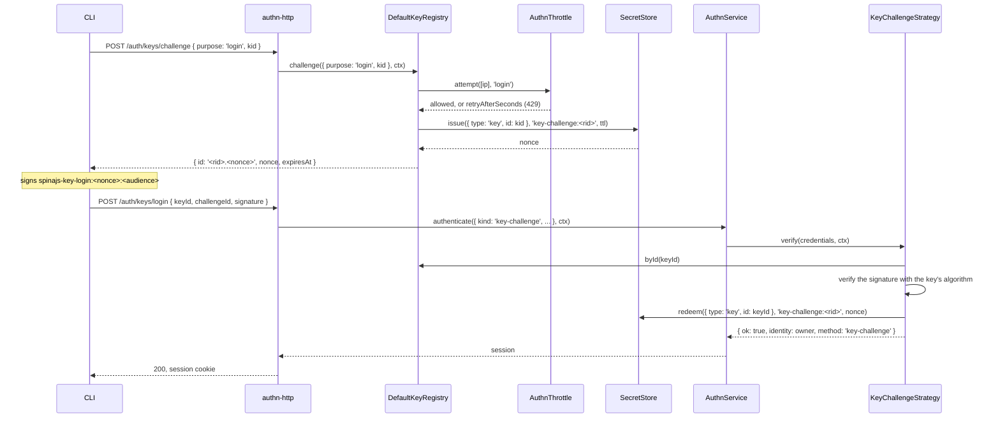

# Challenge login

A challenge is a one-time nonce the server issues and the client signs with its private key. A `register` challenge proves that a user holds the key being registered. A `login` challenge lets a CLI log in with a key and get a session, through the `keys-challenge` strategy (`KeyChallengeStrategy`).

## How it works

### Issue, `DefaultKeyRegistry.challenge(req, ctx)`

1. The request names the purpose:
   - `{ purpose: 'register', owner }`: `owner` must be a `user`, else `InvalidArgument`. Services and agents register without a proof.
   - `{ purpose: 'login', kid }`: when `ctx.ip` is set, the registry first calls `AuthnThrottle.attempt([{ kind: 'ip', value: ctx.ip }], 'login', ctx)`. A refusal returns `{ ok: false, retryAfterSeconds }` and stores nothing.
   - Anything else throws `InvalidArgument`.
2. The challenge is stored for an identity: the user for `register`; for `login`, `loginChallengeIdentity(kid)`, which is `{ type: 'key', id: kid }` for a valid kid and `{ type: 'key', id: <SHA-256 hex of the input> }` otherwise. The registry does not look the kid up.
3. The audience is `authn.keys.challenge.audience`, else `authn.keys.assertion.audience`. When both are `null`, `challenge` throws `InvalidOption`.
4. `newChallengeRid()` makes a 16-character random id (`rid`). `SecretStore.issue(identity, 'key-challenge:<rid>', ttlSeconds)` returns the nonce. A nonce that is not base64url of at least 22 characters (128 bits) throws `UnexpectedServerError`: the `SecretStore` is unfit for challenges.
5. The result is `{ ok: true, challenge: { id: '<rid>.<nonce>', nonce, expiresAt } }`, with `expiresAt = ctx.now + ttlSeconds`.

### Sign, on the client

The client signs the UTF-8 bytes of:

```
spinajs-key-<purpose>:<nonce>:<audience>
```

- `<purpose>` is `register` or `login`.
- `<nonce>` is the `nonce` exactly as received. It is base64url, so it holds no `:`.
- `<audience>` is the service's audience as the client knows it from its own configuration, never from the challenge answer.

The answer is the raw 64-byte signature as unpadded base64url: Ed25519, or ECDSA P-256 over SHA-256 as IEEE P1363 `r || s` (not DER). `signChallenge(challenge, purpose, audience, privateKey, alg)` does this in Node. The client names the challenge by its `id`, unchanged: the id carries the nonce back to the server.

### Log in, `KeyChallengeStrategy.verify(credentials, ctx)`

`authn-http`'s `POST /auth/keys/login` passes `{ kind: 'key-challenge', keyId, challengeId, signature }` to `AuthnService.authenticate()`, which picks this strategy.

1. Another credential kind returns `unsupported_credentials`.
2. `keyId`, `challengeId` and `signature` must be strings, together at most 8,192 characters. Else `invalid_credentials`.
3. `parseChallengeId(challengeId)` splits `<rid>.<nonce>`. `usableKey(registry, keyId, ctx)` reads the key and refuses a revoked or expired one.
4. No usable key, or an unreadable id: the strategy runs one dummy verification (`unknownKeyWork`) and returns `invalid_credentials`, `revoked` or `expired`. Only audit sees the difference.
5. `verifyChallengeSignature(key, nonce, 'login', audience, signature)` checks the signature with the key's own algorithm. A bad signature returns `invalid_credentials` and redeems nothing.
6. `SecretStore.redeem(loginChallengeIdentity(keyId), 'key-challenge:<rid>', nonce)` uses the challenge up. A used, expired or foreign challenge returns `invalid_credentials`.
7. The protected `success()` of `KeyStrategy` calls `KeyRegistry.touch(kid, ctx.now)` when the registry implements it, and returns the key owner as the identity, method `key-challenge`, and the key's `scope` as the ceiling. A failed stamp is logged and never fails the login.

The authn core then runs the MFA policy and issues a session, as for a password login. See [How a login runs](../authn/01-authentication-flow.md).



## Configuration

| Key | Type | Default | Allowed values | Meaning |
| --- | --- | --- | --- | --- |
| `authn.keys.challenge.ttlSeconds` | `integer` | `120` | `1`-`3600` | How long a challenge can be redeemed |
| `authn.keys.challenge.audience` | `string \| null` | `null` | non-empty string or `null` | The `<audience>` of the signing input |
| `authn.keys.assertion.audience` | `string \| null` | `null` | non-empty string or `null` | Used as the challenge audience when `challenge.audience` is `null` |

```ts
authn: {
  strategies: [{ name: 'keys-challenge', service: 'KeyChallengeStrategy' }],
  keys: {
    challenge: { ttlSeconds: 60, audience: 'https://api.example.com' },
  },
}
```

## Services and extension points

| Service | DI token and lifetime | Default implementation | Alternatives | How to replace or extend |
| --- | --- | --- | --- | --- |
| Challenge login strategy | `AuthenticationStrategy`, picked by `service: 'KeyChallengeStrategy'` | `KeyChallengeStrategy` (`name: 'keys-challenge'`, `kinds: ['key-challenge']`, `interactive: true`); extends `KeyStrategy`, `@Autoinject`s `KeyRegistry` and `SecretStore`, or takes them from `KeyChallengeStrategyDeps` | none | Subclass it; see [Custom key strategies](09-custom-key-strategies.md) |
| Challenge storage | `SecretStore` (`@spinajs/authn/contracts`) | `DbSecretStore` in [`@spinajs/authn-orm`](../authn-orm/02-secret-store.md) | any `SecretStore` whose secrets are base64url of 128 bits or more | Register your own `SecretStore`; the registry refuses to issue a challenge with an unfit one |
| Issuing | `KeyRegistry` | `DefaultKeyRegistry.challenge` | none | Override `challenge` in a subclass; see [Key registry](02-key-registry.md#services-and-extension-points) |

## Important behaviour

- A challenge is single use and is redeemed only after the signature holds. A wrong signature burns nothing; the throttle counts it.
- Every challenge stands alone, under its own `rid`. Issuing one never cancels another.
- The purpose is part of the signed bytes. A `login` signature never proves a registration, and a `register` signature never logs in.
- The audience is part of the signed bytes. A service that relays another service's challenge to a client gets a signature the other service refuses.
- A login challenge is bound to its kid. Signing it with another key, or sending it with another `keyId`, fails.
- A login challenge for an unknown kid looks like one for a known kid (A02). A name that is not a valid kid is stored under its SHA-256, so anonymous input never becomes a long identity id.
- Issuing a login challenge counts against the client IP in the `login` throttle flow. Issuing a register challenge counts against nothing here.
- `keys-challenge` is interactive, so the core counts each login attempt before verification. The strategy's account throttle key is `key:<kid>`; an unreadable kid counts under `key:?`. See [Throttling](../authn/05-throttling.md).
- Only `user` identities get sessions. See [How a login runs](../authn/01-authentication-flow.md).
- `KeyChallengeStrategy.resolve()` throws at boot when no audience is set.

## Best practices

- Hard-code or configure the audience on the client. Never read it from the server's answer.
- Keep `challenge.ttlSeconds` short (60-120). A CLI signs within a second.
- Use `keys-challenge` for humans at a terminal who need a session. Machines that call an API per request use [JWS assertions](05-jws-assertions.md) or [HTTP signatures](06-http-signatures.md).

## Patterns and antipatterns

```ts
// Don't: take the audience from the server; a hostile service can then relay another service's challenge
const signature = signChallenge(challenge, 'login', answer.audience, privateKey, 'EdDSA');

// Do: the audience comes from the client's own configuration
const signature = signChallenge(challenge, 'login', config.apiAudience, privateKey, 'EdDSA');
```

## Examples

### Log a CLI in with its key

```ts sample
import { createPrivateKey } from 'node:crypto';
import { readFileSync } from 'node:fs';
import { signChallenge } from '@spinajs/authn-keys';

interface ChallengeAnswer {
  id: string;
  nonce: string;
  expiresAt: string;
}

/** Logs in with an Ed25519 key from a PEM file; returns the Set-Cookie header of the new session. */
export async function keyLogin(baseUrl: string, audience: string, kid: string, pemPath: string): Promise<string> {
  const privateKey = createPrivateKey(readFileSync(pemPath, 'utf8'));
  const json = { 'content-type': 'application/json' };

  const asked = await fetch(`${baseUrl}/auth/keys/challenge`, { method: 'POST', headers: json, body: JSON.stringify({ purpose: 'login', kid }) });
  if (asked.status === 429) {
    throw new Error(`throttled, retry after ${asked.headers.get('retry-after')} s`);
  }
  const challenge = (await asked.json()) as ChallengeAnswer;

  const signature = signChallenge(challenge, 'login', audience, privateKey, 'EdDSA');
  const login = await fetch(`${baseUrl}/auth/keys/login`, { method: 'POST', headers: json, body: JSON.stringify({ keyId: kid, challengeId: challenge.id, signature }) });
  if (login.status !== 200) {
    throw new Error(`key login failed: ${login.status}`);
  }
  return login.headers.get('set-cookie') ?? '';
}
```

### Sign a challenge with OpenSSL 3

For an Ed25519 key in `key.pem`:

```sh
printf 'spinajs-key-login:%s:%s' "$NONCE" "$AUDIENCE" > input.bin
openssl pkeyutl -sign -inkey key.pem -rawin -in input.bin | basenc --base64url | tr -d '=\n'
```

## Related

- [Key registry](02-key-registry.md): how a `register` challenge becomes a user's proof of possession.
- [`@spinajs/authn-http`](../authn-http/README.md): `POST /auth/keys/challenge`, `POST /auth/keys/login`, their bodies and status codes.
- [`@spinajs/authn-orm` single-use secrets](../authn-orm/02-secret-store.md): where challenges are stored.
- [Sessions](../authn-session/README.md) and [MFA](../authn/04-mfa-policy-and-steps.md): what happens after a successful key login.
