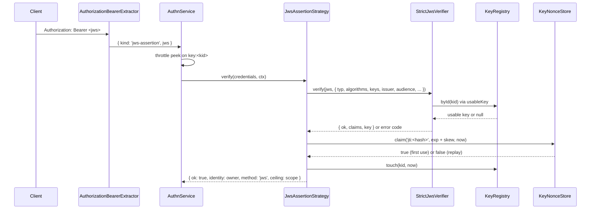

# JWS client assertions

A machine client signs a short-lived compact JWS with its registered key and sends it as `Authorization: Bearer <jws>`. The `keys-jws` strategy (`JwsAssertionStrategy`) verifies it on every request. No session is created.

## How it works

The assertion the client sends:

- Header: exactly `{ "alg": "EdDSA" | "ES256", "kid": "<kid>", "typ": "spinajs-client+jwt" }`, no other member.
- Claims:
  - `iss`: the key owner as `<type>:<id>`, for example `service:runner-1` or `user:<uuid>`. `assertionIssuer(owner)` builds it.
  - `aud`: `authn.keys.assertion.audience`.
  - `iat`, `exp`: integer Unix seconds, `iat < exp`, `exp - iat <= authn.keys.assertion.maxLifetimeSeconds`.
  - `jti`: 1-128 characters, new for every assertion.
  - Other claims are allowed and ignored.
- Signature: the raw 64 bytes (Ed25519, or ES256 as `r || s`), base64url.

The server side:

1. `authn-http`'s `AuthorizationBearerExtractor` reads `Authorization: Bearer <token>`. A compact JWS whose header `typ` equals `authn.keys.assertion.typ` becomes `{ kind: 'jws-assertion', jws }`. Any other JWT stays `bearer`, for [`@spinajs/authn-token`](../authn-token/README.md).
2. `AuthnService.authenticate()` picks `keys-jws`. `JwsAssertionStrategy.throttleKeys()` reads the `kid` from the unverified header; the core peeks at the throttle and counts only a failure. See [Throttling](../authn/05-throttling.md).
3. `JwsAssertionStrategy.verify()` refuses another credential kind (`unsupported_credentials`) and a token over 8,192 characters (`invalid_credentials`).
4. `StrictJwsVerifier.verify()` runs the checks in order; the first failure gives the code (see [JWS and key material](08-jws-and-key-material.md#strictjwsverifier)). The strategy passes it:
   - `typ` and `algorithms` from `authn.keys`;
   - a key lookup that returns only a usable key (`usableKey()`: not revoked, not expired at `ctx.now`);
   - a claims rule that requires the `jti`;
   - an issuer rule: `iss` must equal `assertionIssuer(key.owner)`;
   - `audience`, `skewSeconds` and `maxLifetimeSeconds` from `authn.keys.assertion`.
5. On `unknown_key` the strategy runs one dummy verification (`unknownKeyWork`) and returns `invalid_credentials`, `revoked` or `expired`. Every other code returns `invalid_credentials`.
6. `KeyNonceStore.claim(nonceKey('jti', kid, jti), exp + skewSeconds, ctx.now)` accepts the `jti` once. A replay returns `invalid_credentials`.
7. The protected `success()` of `KeyStrategy` calls `KeyRegistry.touch(kid, ctx.now)` when the registry implements it, and returns the key owner as the identity, method `jws`, and the key's `scope` as the ceiling. A failed stamp is logged and never fails the login.



## Configuration

| Key | Type | Default | Allowed values | Meaning |
| --- | --- | --- | --- | --- |
| `authn.keys.assertion.typ` | `string` | `'spinajs-client+jwt'` | non-empty string | Required header `typ`; also how `authn-http` tells an assertion from a JWT |
| `authn.keys.assertion.audience` | `string \| null` | `null` | non-empty string or `null` | Required `aud`; `keys-jws` does not boot without it |
| `authn.keys.assertion.maxLifetimeSeconds` | `integer` | `300` | `1`-`300` | Largest `exp - iat` |
| `authn.keys.assertion.skewSeconds` | `integer` | `30` | `0`-`300` | Expired when `now >= exp + skew`; not yet valid when `iat > now + skew` |
| `authn.keys.algorithms` | `string[]` | `['EdDSA', 'ES256']` | `EdDSA`, `ES256` | Header `alg` values accepted |

```ts
authn: {
  strategies: [{ name: 'keys-jws', service: 'JwsAssertionStrategy' }],
  keys: {
    assertion: { audience: 'https://api.example.com', maxLifetimeSeconds: 60 },
  },
}
```

## Services and extension points

| Service | DI token and lifetime | Default implementation | Alternatives | How to replace or extend |
| --- | --- | --- | --- | --- |
| Assertion strategy | `AuthenticationStrategy`, picked by `service: 'JwsAssertionStrategy'` | `JwsAssertionStrategy` (`name: 'keys-jws'`, `kinds: ['jws-assertion']`, `interactive: false`); extends `KeyStrategy`, `@Autoinject`s `KeyRegistry`, `JwsVerifier` and `KeyNonceStore`, or takes them from `JwsAssertionStrategyDeps` | none | Subclass it; see [Custom key strategies](09-custom-key-strategies.md) |
| JWS verifier | `JwsVerifier` | `StrictJwsVerifier` | none | See [JWS and key material](08-jws-and-key-material.md#services-and-extension-points) |
| `jti` store | `KeyNonceStore` | `DbKeyNonceStore` | `MemoryKeyNonceStore` | See [Replay protection](07-replay-protection.md) |

## Important behaviour

- A `jti` is accepted once per key until `exp + skewSeconds`. Two keys may use the same `jti`.
- The `jti` is claimed only after the signature and every claim check pass. A forged token cannot use up a real client's `jti`.
- `iss` is bound to the key's owner. A key cannot assert another identity, and a `user` key cannot pose as a `service`.
- The algorithm comes from the key record. A header `alg` that differs from the key's gives `unknown_key`, never a verification with the header's algorithm.
- An unknown, revoked or expired key costs one signature verification, like a known key, and gets the same answer as a bad signature.
- Parallel valid assertions of one key all pass: per-request strategies count only failures (K5).
- The header `kid` drives throttling before anything is verified. A header that cannot be read counts under `key:?`.
- `JwsAssertionStrategy.resolve()` throws at boot when `authn.keys.assertion.audience` is `null`.

## Best practices

- Sign a new assertion for every request, with `exp = iat + 60` and a random `jti` (`crypto.randomUUID()`).
- Keep client clocks synced within `skewSeconds`. An assertion from a fast clock fails as `not_yet_valid`.
- Use the configured audience string verbatim on the client.
- Put the private JWK in the client's secret store, never in the repository.

## Patterns and antipatterns

```ts
// Don't: sign once and reuse; the second request is a replay and fails
const jws = await signer.sign(claims, { typ: 'spinajs-client+jwt' });
for (const job of jobs) await fetch(url(job), { headers: { authorization: `Bearer ${jws}` } });

// Do: one assertion per request
for (const job of jobs) {
  const now = Math.floor(Date.now() / 1000);
  const jws = await signer.sign({ ...base, iat: now, exp: now + 60, jti: randomUUID() }, { typ: 'spinajs-client+jwt' });
  await fetch(url(job), { headers: { authorization: `Bearer ${jws}` } });
}
```

## Examples

### Call an API as a CI runner

```ts sample
import { randomUUID } from 'node:crypto';
import { LocalJwsSigner, assertionIssuer } from '@spinajs/authn-keys';
import type { PrivateJwk } from '@spinajs/authn-keys';

const API = 'https://api.example.com';

/** The runner's private JWK (with its kid) comes from the CI secret store. */
function runnerSigner(): LocalJwsSigner {
  const jwk = JSON.parse(process.env.RUNNER_PRIVATE_JWK ?? 'null') as PrivateJwk | null;
  if (!jwk) {
    throw new Error('RUNNER_PRIVATE_JWK is not set');
  }
  return new LocalJwsSigner([jwk]);
}

export async function reportBuild(buildId: string, status: 'passed' | 'failed'): Promise<number> {
  const now = Math.floor(Date.now() / 1000);
  const jws = await runnerSigner().sign(
    { iss: assertionIssuer({ type: 'service', id: 'runner-1' }), aud: API, iat: now, exp: now + 60, jti: randomUUID() },
    { typ: 'spinajs-client+jwt' },
  );
  const res = await fetch(`${API}/builds/${buildId}`, {
    method: 'PUT',
    headers: { authorization: `Bearer ${jws}`, 'content-type': 'application/json' },
    body: JSON.stringify({ status }),
  });
  return res.status;
}
```

Any JWS library works as a client when it writes exactly the three header members and a raw 64-byte signature.

## Related

- [JWS and key material](08-jws-and-key-material.md): the verifier rules and the signer.
- [Replay protection](07-replay-protection.md): how the `jti` is stored.
- [`@spinajs/authn-http`](../authn-http/README.md): `AuthorizationBearerExtractor` and how a failure answers.
- [`@spinajs/authn-token`](../authn-token/README.md): the `bearer` tokens and JWTs that share the header.
