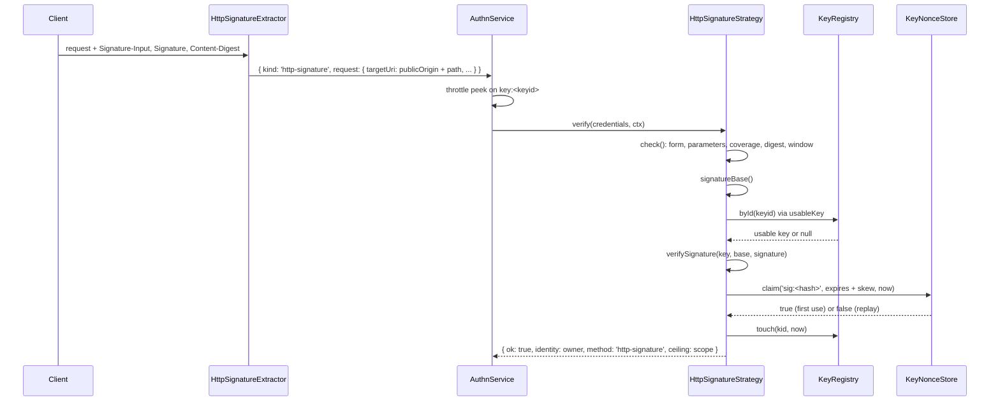

# HTTP message signatures

A client signs each request with its registered key under a strict subset of RFC 9421, and binds the body through an RFC 9530 `Content-Digest`. The `keys-httpsig` strategy (`HttpSignatureStrategy`) verifies the signature, the digest, the time window and the single-use nonce. No session is created.

## How it works

The headers the client sends:

```
Signature-Input: sig1=("@method" "@target-uri" "content-digest");created=1790000000;expires=1790000060;nonce="<random>";keyid="<kid>"
Signature: sig1=:<standard base64 of the raw signature>:
Content-Digest: sha-256=:<standard base64 of SHA-256(body)>:
```

- One signature only, under any label. The `Signature-Input` member must be in canonical RFC 8941 form: single spaces between components, no parameters on components, integers without leading zeros, strings with only `\"` and `\\` escapes.
- Parameters: `created`, `expires`, `nonce` (1-256 characters) and `keyid` are required. `alg` is optional: `ed25519` or `ecdsa-p256-sha256`, and then it must name the key's algorithm. No other parameter is allowed.
- Covered components: `@method` and `@target-uri` always; `content-digest` whenever the request has a body; every name in `authn.keys.httpSignature.requiredComponents`. `@authority`, `@path`, `@query` and any request header except `signature` and `signature-input` may be covered too.
- `Content-Digest` members are `sha-256` or `sha-512`; every member must match the body.
- The signature is the raw 64 bytes (Ed25519, or ES256 as `r || s`) in standard base64, padded.

The server side:

1. `authn-http`'s `HttpSignatureExtractor` sees `Signature` and `Signature-Input` on an origin-form request and builds `{ kind: 'http-signature', request: { method, targetUri, headers, body } }`. `targetUri` is `authn.http.publicOrigin` plus the request path and query, never taken from `Host`. Without `authn.http.publicOrigin` it builds nothing.
2. `AuthnService.authenticate()` picks `keys-httpsig`. `HttpSignatureStrategy.throttleKeys()` reads `keyid` from `Signature-Input`; the core peeks at the throttle and counts only a failure.
3. `HttpSignatureStrategy.verify()` refuses another credential kind (`unsupported_credentials`) and a malformed request object (`invalid_credentials`).
4. `check()` does everything that needs no key. Any failure returns `invalid_credentials`:
   1. `Signature` and `Signature-Input` are strings of at most 8,192 characters;
   2. `parseSignatureInput()` reads exactly one canonical member; `parseByteSequenceDictionary()` reads `Signature`, which has exactly one member under the same label;
   3. the parameters are as listed above;
   4. coverage holds: `@method`, `@target-uri`, `content-digest` with a body, and every required component;
   5. a covered `content-digest` matches the body (`digestMatches()`), or the empty body when the request has none;
   6. the window holds: `created <= now + skewSeconds`, `created < expires`, `expires - created <= maxAgeSeconds`, `now < expires`.
5. `signatureBase()` builds the RFC 9421 §2.5 base: one line `"<name>": <value>` per covered component, then `"@signature-params": <the Signature-Input member value as sent>`. A component it cannot hold (an unknown `@` name, a header that is absent, a value with CR or LF) returns `invalid_credentials`.
6. `usableKey(registry, keyid, ctx)` reads the key. No usable key: one dummy verification (`unknownKeyWork`), then `invalid_credentials`, `revoked` or `expired`.
7. The `alg` parameter, when sent, must name the key's algorithm. `verifySignature()` checks the signature with the key's own algorithm. Failure returns `invalid_credentials`.
8. `KeyNonceStore.claim(nonceKey('sig', kid, nonce), expires + skewSeconds, ctx.now)` accepts the nonce once. A replay returns `invalid_credentials`.
9. The protected `success()` of `KeyStrategy` calls `KeyRegistry.touch(kid, ctx.now)` when the registry implements it, and returns the key owner as the identity, method `http-signature`, and the key's `scope` as the ceiling. A failed stamp is logged and never fails the login.

Derived component values:

| Component | Value |
| --- | --- |
| `@method` | The method, upper case |
| `@target-uri` | `targetUri` as built by the extractor |
| `@authority` | Host and port of `targetUri`, lower case |
| `@path` | Path of `targetUri`, `/` when empty |
| `@query` | Query of `targetUri` with its `?`, `?` when empty |
| a header name | The header value, trimmed |



## Configuration

| Key | Type | Default | Allowed values | Meaning |
| --- | --- | --- | --- | --- |
| `authn.keys.httpSignature.maxAgeSeconds` | `integer` | `300` | `1`-`300` | Largest `expires - created` |
| `authn.keys.httpSignature.skewSeconds` | `integer` | `30` | `0`-`300` | How far `created` may lie in the future; also added to how long a nonce is kept |
| `authn.keys.httpSignature.requiredComponents` | `string[]` | `['@method', '@target-uri', 'content-digest']` | `@method`, `@target-uri`, `@authority`, `@path`, `@query`, lower-case header names | Components every signature must cover; `content-digest` only when there is a body |
| `authn.http.publicOrigin` | `string` | unset | an origin | Owned by `authn-http`; the origin of every `@target-uri` |

```ts
authn: {
  strategies: [{ name: 'keys-httpsig', service: 'HttpSignatureStrategy' }],
  keys: {
    httpSignature: { maxAgeSeconds: 60, requiredComponents: ['@method', '@target-uri', 'content-digest', 'content-type'] },
  },
  http: { publicOrigin: 'https://api.example.com' },
}
```

`@method` and `@target-uri` are required whatever `requiredComponents` lists, and so is `content-digest` for a request with a body.

## Services and extension points

| Service | DI token and lifetime | Default implementation | Alternatives | How to replace or extend |
| --- | --- | --- | --- | --- |
| Signature strategy | `AuthenticationStrategy`, picked by `service: 'HttpSignatureStrategy'` | `HttpSignatureStrategy` (`name: 'keys-httpsig'`, `kinds: ['http-signature']`, `interactive: false`); extends `KeyStrategy`, `@Autoinject`s `KeyRegistry` and `KeyNonceStore`, or takes them from `HttpSignatureStrategyDeps` | none | Subclass it and override `check()` to add rules; see [Custom key strategies](09-custom-key-strategies.md) |
| Nonce store | `KeyNonceStore` | `DbKeyNonceStore` | `MemoryKeyNonceStore` | See [Replay protection](07-replay-protection.md) |

The parsers are exported for clients and custom strategies: `parseSignatureInput`, `parseByteSequenceDictionary`, `signatureBase`, `digestMatches`, `lowerCaseHeaders`.

## Important behaviour

- A nonce is accepted once per key until `expires + skewSeconds`, and only after the signature holds.
- The signature covers the method, the full target URI and, through the digest, the body. A signed request cannot be replayed to another path, method or body.
- `@target-uri` comes from `authn.http.publicOrigin`, so a client signs the URL it calls, and a forged `Host` header changes nothing.
- `expires` is checked without skew: a request at or after `expires` fails.
- The `Signature-Input` text is the `@signature-params` line exactly as sent, so the strategy accepts only canonical text. A client that writes a different but equivalent form fails.
- A covered `content-digest` on a request without a body must match the empty body.
- An unknown, revoked or expired key costs one dummy verification and gets the same answer as a bad signature.
- `HttpSignatureStrategy` needs no audience. The public origin in `@target-uri` binds the signature to this service.

## Best practices

- Set `expires = created + 60` and a random nonce of 16 bytes or more.
- Cover `content-type` too when the server reads it (add it to `requiredComponents`), so a proxy cannot change how the body is parsed.
- Send `Content-Digest` with `sha-256`; it is the shortest member the server checks.
- Build the URL from the same origin string the server has in `authn.http.publicOrigin`.

## Patterns and antipatterns

```ts
// Don't: sign the URL as the client sees it behind an internal hostname; @target-uri will not match
const url = `http://10.0.0.12:3000${path}`;

// Do: sign the public URL the server is configured with
const url = `https://api.example.com${path}`;
```

## Examples

### Sign a JSON POST from a service

```ts sample
import { createHash, randomBytes, sign } from 'node:crypto';
import type { KeyObject } from 'node:crypto';

/** Builds the three headers for an Ed25519 key; `url` is the public URL, origin and path. */
export function signatureHeaders(method: string, url: string, body: Buffer, kid: string, privateKey: KeyObject): Record<string, string> {
  const created = Math.floor(Date.now() / 1000);
  const digest = `sha-256=:${createHash('sha256').update(body).digest('base64')}:`;
  const params = `("@method" "@target-uri" "content-digest");created=${created};expires=${created + 60};nonce="${randomBytes(16).toString('base64url')}";keyid="${kid}"`;
  const base = [`"@method": ${method.toUpperCase()}`, `"@target-uri": ${url}`, `"content-digest": ${digest}`, `"@signature-params": ${params}`].join('\n');
  const signature = sign(null, Buffer.from(base, 'utf8'), privateKey).toString('base64');
  return {
    'content-digest': digest,
    'signature-input': `sig1=${params}`,
    signature: `sig1=:${signature}:`,
  };
}

export async function postInvoice(privateKey: KeyObject, kid: string, invoice: object): Promise<number> {
  const url = 'https://api.example.com/invoices';
  const text = JSON.stringify(invoice);
  const res = await fetch(url, {
    method: 'POST',
    headers: { 'content-type': 'application/json', ...signatureHeaders('POST', url, Buffer.from(text, 'utf8'), kid, privateKey) },
    body: text,
  });
  return res.status;
}
```

For a P-256 key, sign with `sign('sha256', data, { key: privateKey, dsaEncoding: 'ieee-p1363' })`.

## Related

- [Replay protection](07-replay-protection.md): how nonces are stored.
- [JWS and key material](08-jws-and-key-material.md): the key checks and `verifySignature()`.
- [`@spinajs/authn-http`](../authn-http/README.md): `HttpSignatureExtractor` and `authn.http.publicOrigin`.
- [Throttling](../authn/05-throttling.md): per-request strategies count only failures.
