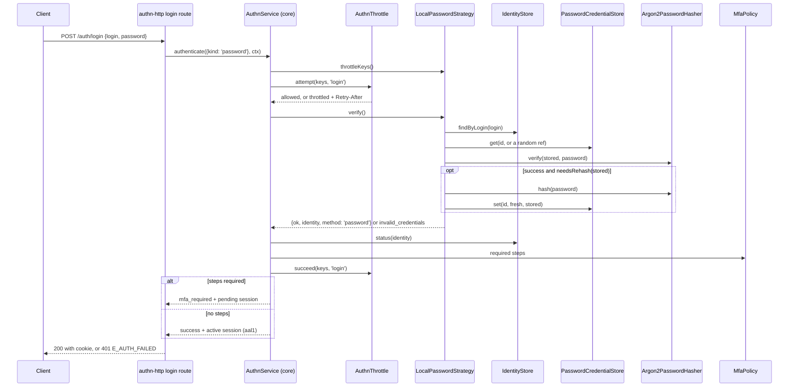

# Password login

`LocalPasswordStrategy` checks a login and password. It is the `local` strategy for credentials of kind `password`, and it is interactive, so a success can start a session. It only verifies: the authn core counts the throttle, checks the account status, asks for MFA, issues the session and audits.

## How it works

The login runs inside `AuthnService.authenticate()` of the authn core. The steps that belong to this package are 3 and 5 to 9.

1. A client posts `{ login, password }` to `POST /auth/login` ([`@spinajs/authn-http`](../authn-http/08-login-logout-and-mfa-routes.md)), or code calls `AuthnService.authenticate({ kind: 'password', login, password }, ctx)`.
2. The core picks the strategies in `authn.strategies` that accept kind `password`: `LocalPasswordStrategy` when it is listed as `{ name: 'local', service: 'LocalPasswordStrategy' }`. A strategy that is not listed never runs.
3. The core asks `LocalPasswordStrategy.throttleKeys(credentials, ctx)`. It answers only an `account` key: the login normalised by `normalizeLogin()` (NFKC, trimmed, lower case). The core prefixes it with `login:`, builds the `account-ip` key itself when `ctx.ip` is set, and adds the `ip` key.
4. The core calls `AuthnThrottle.attempt(keys, 'login')` **before** the password is checked. A refused attempt fails with `throttled` and a `Retry-After`, and no password is verified.
5. `LocalPasswordStrategy.verify()` rejects bad input with one dummy argon2 verify:
   - a credential of another kind: `unsupported_credentials`, so the core tries the next strategy;
   - kind `password` with a non-string `login` or `password`: `invalid_credentials`;
   - a password outside 8 to 128 code points: `invalid_credentials`. This bound is fixed, whatever `authn.local.policy` says.
6. It calls `IdentityStore.findByLogin(login)` with the login as typed, then `PasswordCredentialStore.get(id)`. For an unknown login it reads the store for a fresh random `user` ref, so the work matches a known login.
7. It calls `PasswordHasher.verify(stored, password)`: one argon2 verify on every path. A wrong password, an unknown login, no stored password, or the `!expired` marker all answer `invalid_credentials`.
8. On success, when `PasswordHasher.needsRehash(stored)` is true, it hashes the password again and writes it with `PasswordCredentialStore.set(id, fresh, stored)`, a compare-and-set over the hash it verified. A failed write is logged by error name and the login still succeeds.
9. It answers `{ ok: true, identity, method: 'password' }`.
10. The core checks the identity: it must be of type `user`, and inactive, banned and deleted accounts fail. The client gets one answer for every failure; the reason goes to audit only.
11. The core asks the `MfaPolicy`. `DefaultMfaPolicy` requires steps for method `password` only: the steps the user is enrolled in, or the first configured step under `authn.mfa.policy.force` or `forceForRoles`. A refusal fails the login and keeps the throttle count.
12. The core calls `AuthnThrottle.succeed(keys, 'login')`. With steps required, the result is `mfa_required` with a pending session, and the client finishes with a step such as [TOTP](../authn-totp/03-login-verification.md). Without, the core issues an active session with assurance `aal1`.



The throttle parameters, the status check, the MFA policy and the session are documented in the [authn core](../authn/README.md). The HTTP request and response shapes are in [`@spinajs/authn-http`](../authn-http/08-login-logout-and-mfa-routes.md).

## Configuration

The strategy has no keys of its own. It is switched on by an `authn.strategies` entry:

| Key | Type | Default | Allowed values | Meaning |
| --- | --- | --- | --- | --- |
| `authn.strategies` | `{ name, service }[]` | `[]` | an entry `{ name: 'local', service: 'LocalPasswordStrategy' }` | Lists the strategy. Unlisted, it never runs. The name must be `local`, the strategy's own `name`. |

```ts
// config/authn.ts in your app
export default {
  authn: {
    strategies: [{ name: 'local', service: 'LocalPasswordStrategy' }],
  },
};
```

The login throttle is `authn.throttle.login`, MFA is `authn.mfa.*`; see the [authn core](../authn/README.md). Hashing keys are on [Password hashing](02-password-hashing.md#configuration).

## Services and extension points

| Service | DI token and lifetime | Default implementation | Alternatives | How to replace or extend |
| --- | --- | --- | --- | --- |
| Login strategy | `AuthenticationStrategy`, singleton, `@Injectable(AuthenticationStrategy)` on import; selected by class name from `authn.strategies` | `LocalPasswordStrategy` | none shipped | Subclass, register it with `@Injectable(AuthenticationStrategy)`, and list the subclass name under `service` with `name: 'local'`. Override the protected `rehash()`, `identities()`, `passwords()` or `log()`. |
| Hasher | `PasswordHasher`, injected with `@Autoinject` | `Argon2PasswordHasher` | your `PasswordHasher` | See [Password hashing](02-password-hashing.md#services-and-extension-points). |
| Identity lookup | `IdentityStore`, injected with `@Autoinject` | `UserIdentityStore` from `@spinajs/users` | your `IdentityStore` | See [`@spinajs/users`](../users/07-identity-and-password-stores.md). |
| Stored hash | `PasswordCredentialStore`, injected with `@Autoinject` | `UserPasswordStore` from `@spinajs/users` | your `PasswordCredentialStore` | See [`@spinajs/users`](../users/07-identity-and-password-stores.md). `set()` must support the compare-and-set of `expected`. |
| Policy | `LocalPasswordPolicy`, injected with `@Autoinject` | `LocalPasswordPolicy` | | Injected only so a bad `authn.local.policy` fails at boot; the login does not use it. |

`LocalPasswordStrategy.resolve()` waits for the hasher, so the hasher's dummy hash is made at boot, before the first login.

### Login strategy: custom implementation

Subclass the strategy to act on a rehash, for example to count how many stored hashes an upgrade has rewritten. Keep `verify()` as it is: it owns the timing guarantees.

```ts sample
import { Injectable } from '@spinajs/di';
import { AuthenticationStrategy } from '@spinajs/authn';
import type { IdentityRef } from '@spinajs/authn';
import { LocalPasswordStrategy, PasswordHasher } from '@spinajs/authn-local';

/** Counts hashes rewritten on login, for a dashboard that tracks a pepper rotation. */
@Injectable(AuthenticationStrategy)
export class CountingPasswordStrategy extends LocalPasswordStrategy {
  public static rehashed = 0;

  protected async rehash(hasher: PasswordHasher, id: IdentityRef, password: string, verified: string): Promise<void> {
    await super.rehash(hasher, id, password, verified);
    CountingPasswordStrategy.rehashed++;
  }
}

// config/authn.ts: authn.strategies: [{ name: 'local', service: 'CountingPasswordStrategy' }]
```

For a test without a container, pass the collaborators to the constructor and call `resolve()`: `new LocalPasswordStrategy({ identities, passwords, hasher, log })`. With these `Deps` the strategy takes nothing from the container.

## Important behaviour

- **Equal timing (A02).** Every path spends exactly one argon2 verify: malformed input, an over-long password, an unknown login, a missing or expired hash, and a wrong password. A success adds one hash only when a rehash is due. An unknown login also reads the credential store once, for a ref no cache can know.
- **One failure reason for the client.** `verify()` returns `invalid_credentials` for an unknown login, a wrong password and an expired password alike. The core turns every failure into one HTTP answer.
- **The throttle counts before verification.** A login counts against the `login` flow before the password is checked, so guessing is slowed whether or not the password is right. The throttle is a backoff, never a lockout.
- **The account key is normalised; the lookup is not.** `throttleKeys()` uses `normalizeLogin()`, so `Ada@Acme.com` and `ada@acme.com ` share one key. `findByLogin()` gets the login as typed; case handling there is the identity store's.
- **No key holds the password.** The keys carry the normalised login and the client IP only.
- **Login uses a fixed 8 to 128 bound.** Raising `authn.local.policy.minLength` later does not lock out passwords set under the old value. The policy rule and the blocklist never run at login.
- **Passwords are never trimmed or normalised.** A trailing space is part of the password.
- **The rehash never overwrites a newer password (A30).** The write is a compare-and-set over the hash the login verified. When a reset, set, change or expiry stored a new value meanwhile, the rehash writes nothing and is not retried.
- **A failed rehash does not fail the login.** It is logged with the identity and the error name only, never the message, which may carry the new hash.
- **MFA applies to password logins.** The strategy reports `method: 'password'`, which is what `DefaultMfaPolicy` acts on.

## Best practices

- Pass the client IP from the trusted proxy chain in `ctx.ip`. Without it there is no `ip` or `account-ip` key, and the account key alone gates the login.
- Keep the login lookup case-insensitive in your `IdentityStore` when logins are emails: the throttle already treats them that way.
- Run the `@spinajs/authn-testing` behaviour suites against a custom strategy or store; this package runs A02, A03, A04, A11, A13 and A30 against itself.

## Patterns and antipatterns

```ts
// Don't: answering early for an unknown login makes it measurably faster than a wrong password.
public async verify(c: Credentials, ctx: AuthnContext): Promise<StrategyOutcome> {
  const id = await this.identities().findByLogin(login);
  if (!id) return { ok: false, reason: 'invalid_credentials' };
  // ...
}

// Do: leave verify() to LocalPasswordStrategy and extend around it, as with rehash() above.
```

## Examples

### Check a password from a script without starting a session

```ts sample
import { DI } from '@spinajs/di';
import { IdentityStore, PasswordCredentialStore } from '@spinajs/authn';
import { PasswordHasher } from '@spinajs/authn-local';

/** Confirms a support caller knows the account password; it opens no session and counts no throttle. */
export async function knowsPassword(login: string, password: string): Promise<boolean> {
  const identities = await DI.resolve(IdentityStore);
  const passwords = await DI.resolve(PasswordCredentialStore);
  const hasher = await DI.resolve(PasswordHasher);

  const id = await identities.findByLogin(login);
  const stored = id ? await passwords.get(id) : null;
  return (await hasher.verify(stored, password)) && id !== null;
}
```

This bypasses the throttle and the audit. Expose it only to trusted staff; for anything a client can reach, call `AuthnService.authenticate()` or `reauthenticate()`.

## Related

- [Password hashing](02-password-hashing.md): `verify()`, `needsRehash()` and the dummy hash the strategy relies on.
- [`@spinajs/authn`](../authn/README.md): the login order, the throttle, the status check, the MFA policy and sessions.
- [`@spinajs/authn-http`](../authn-http/08-login-logout-and-mfa-routes.md): `POST /auth/login` and its answers.
- [`@spinajs/authn-totp`](../authn-totp/03-login-verification.md): the step a password login hands over to.
- [`@spinajs/users`](../users/07-identity-and-password-stores.md): the identity and password stores the strategy reads.
