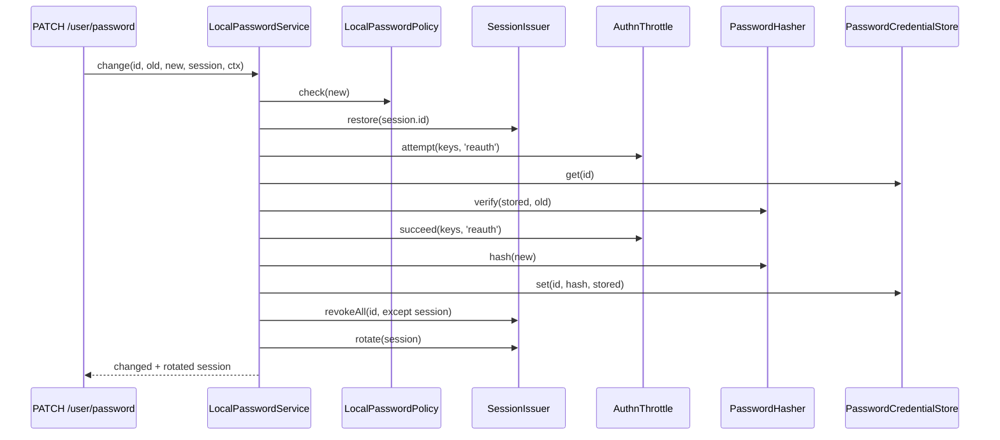

# Change and set

`PasswordService.change()` lets a signed-in user replace their own password by proving the old one. `PasswordService.set()` stores a password without the old one, for account creation, admin tools and the CLI. `LocalPasswordService` implements both.

## How it works

### `change(id, oldPassword, newPassword, session, ctx)`

`PATCH /user/password` in [`@spinajs/authn-http`](../authn-http/12-password-routes.md) calls it with the caller's session.

1. `LocalPasswordPolicy.check(newPassword)`. A violation answers `{ status: 'rejected', violations }` and counts no attempt.
2. `SessionIssuer.restore(session.id)`. The session must exist, be `active` and belong to `id`. Otherwise: `invalid`.
3. A session someone is impersonating answers `invalid`, before the throttle, so an impersonator cannot back off the owner's key.

   The `authn.password.change` [action hooks](16-action-hooks.md) run around steps 4 to 10. A refusal answers `{ status: 'refused', code }` and counts nothing in the throttle.
4. `AuthnThrottle.attempt(keys, 'reauth')` with the keys `account` (`id.id`), `account-ip` (`<id>|<ip>`) and, with `ctx.ip`, `ip`. Refused: `{ status: 'throttled', retryAfterSeconds }`.
5. The old password is verified against the stored hash: one argon2 verify, with the fixed login bound of 8 to 128 code points. Wrong: `invalid`, and the attempt stays counted.
6. `AuthnThrottle.succeed(keys, 'reauth')`.
7. The new hash is written with `PasswordCredentialStore.set(id, hash, verified)`, a compare-and-set over the hash the old password matched. When another write landed first, the change answers `invalid` and stops.
8. `SessionIssuer.revokeAll(id, { except: session, includeImpersonations: true })` ends every other session, including those where the user is the impersonator.
9. `SessionIssuer.rotate(session)` gives the current session a new id.
10. It answers `{ status: 'changed', session }` with the rotated handle. API and agent tokens are untouched.



### `set(id, newPassword, ctx, { actor? })`

1. `LocalPasswordPolicy.check(newPassword)`. A violation answers `{ status: 'rejected', violations }` and stores nothing.

   The `authn.password.set` [action hooks](16-action-hooks.md) run around steps 2 to 5. A refusal hashes the password once, as a set does, stores nothing and answers `{ status: 'refused', code }`.
2. The hash is written unconditionally.
3. `SessionIssuer.revokeAll(id, { includeImpersonations: true })` ends every session.
4. Unless `authn.local.reset.revokeTokens` is `false`, `TokenService.revokeAllFor(id, ctx, { actor })` revokes every API and agent token. With no `TokenService` registered there is nothing to revoke.
5. It answers `{ status: 'set' }`.

`@spinajs/users` calls `set()` when it creates an account with a password, and [`authn:password`](10-cli-commands.md) calls it with the actor `CLI_ACTOR`, `{ type: 'system', id: 'cli' }`.

## Configuration

| Key | Type | Default | Allowed values | Meaning |
| --- | --- | --- | --- | --- |
| `authn.local.reset.revokeTokens` | `true \| false` | `true` | `true`, `false` | `set()` (and reset and admin expiry) also revokes every token. Only an explicit `false` keeps them. |

The `reauth` throttle is `authn.throttle.reauth` in the [authn core](../authn/README.md): 3 free attempts per account, then a delay from 1 s up to 300 s.

## Services and extension points

`change()` and `set()` are methods of `LocalPasswordService`. Its collaborators and how to replace it are on [Password service](11-password-service.md).

## Important behaviour

- **A change keeps every token (H32).** A voluntary change revokes the other sessions and rotates the current one; it never touches API or agent tokens. `set()` does revoke them, unless `revokeTokens` is `false`.
- **The policy runs before the throttle.** A rejected new password does not count against `reauth`, and the old password is not checked.
- **One answer for every failure.** A wrong old password, a wrong or inactive session, an impersonated session and a lost race all answer `{ status: 'invalid' }`. The real reason goes to audit only.
- **The old password check costs one argon2 verify on every path,** like a login. An old password outside 8 to 128 code points is `invalid` even when it is the stored one.
- **The write is a compare-and-set (A30).** When an expiry, reset, set or another change stored a new value between the verify and the write, the change answers `invalid`, audits the reason `stale`, and neither revokes nor rotates any session. It does not retry: the old password no longer matches. Of two changes over the same old password, one lands.
- **An impersonator never changes the target's password,** even when they know the old one.
- **`set()` is not a voluntary change.** It ends every session, including the caller's, when the caller is the identity.
- **Audit failures never fail the call.** See [Audit events](12-audit-events.md).

## Best practices

- Pass the session from the request (`req.storage.AuthnSession.handle` in authn-http), never one looked up by identity: `change()` fails closed on anything but the caller's own active session.
- Send the rotated session back to the client after a change. The old session id is gone.
- Use `set()` only for flows that are not the owner proving the old password: account creation, admin reset, CLI.

## Patterns and antipatterns

```ts
// Don't: set() skips the old-password check and the reauth throttle, and ends the user's own session.
await passwords.set(user, newPassword, ctx);

// Do: a user changing their own password goes through change() with their session.
await passwords.change(user, oldPassword, newPassword, session, ctx);
```

## Examples

### Set a temporary password from an admin tool

```ts sample
import { DI } from '@spinajs/di';
import { PasswordService } from '@spinajs/authn';
import type { IdentityRef, PrincipalRef } from '@spinajs/authn';
import { LocalPasswordPolicy } from '@spinajs/authn-local';

/** Gives a locked-out user a generated password over the phone; every session and token of theirs ends. */
export async function setTemporaryPassword(user: IdentityRef, admin: PrincipalRef): Promise<string> {
  const password = (await DI.resolve(LocalPasswordPolicy)).generate();
  const passwords = await DI.resolve(PasswordService);

  const result = await passwords.set(user, password, { now: new Date(), purpose: 'request' }, { actor: admin });
  if (result.status === 'rejected') {
    throw new Error(`The generated password broke the policy: ${result.violations.join(', ')}`);
  }
  if (result.status === 'refused') {
    throw new Error(`An authn.password.set hook refused the password: ${result.code}`);
  }
  return password;
}
```

## Related

- [Password policy](03-password-policy.md): the `rejected` violations.
- [Password service](11-password-service.md): collaborators, test seam, replacement.
- [Audit events](12-audit-events.md): `password.change` and its reasons.
- [`@spinajs/authn-http`](../authn-http/12-password-routes.md): `PATCH /user/password`.
- [`@spinajs/users`](../users/03-user-actions.md): account creation and admin actions that call `set()`.
