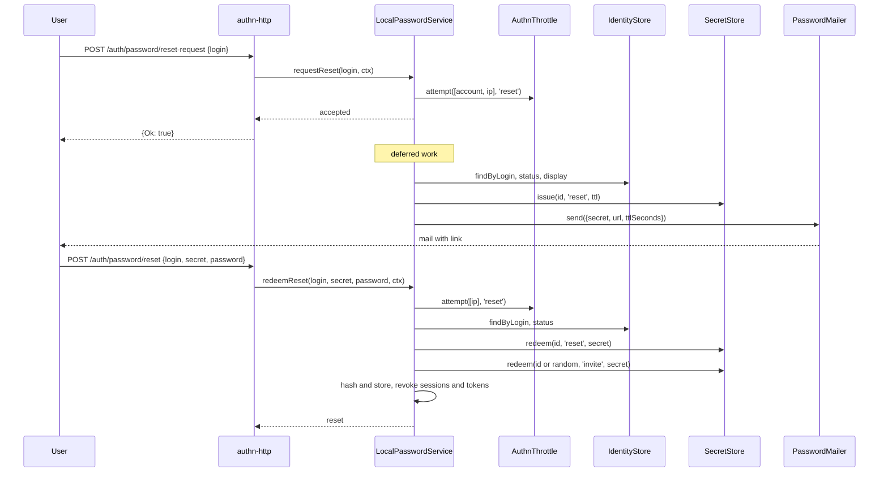

# Reset and invite

A user who forgot their password asks for a reset link, then redeems the secret from the mail with a new password. An invited user sets their first password the same way. `LocalPasswordService` runs both through `requestReset()`, `redeemReset()` and `invite()`. Secrets are single use, live in a `SecretStore`, and travel only in the mail.

## How it works

### `requestReset(login, ctx)`

`POST /auth/password/reset-request` in [`@spinajs/authn-http`](../authn-http/12-password-routes.md) calls it.

1. `AuthnThrottle.attempt(keys, 'reset')` with an `account` key (`normalizeLogin(login)`) and an `ip` key (`ctx.ip`, or `'unknown'`). Refused: `{ status: 'throttled', retryAfterSeconds }` and a `throttle.block` event.
2. The rest is scheduled as deferred work (`DeferredWork`), after `setImmediate`.
3. It answers `{ status: 'accepted' }` at once, for a known and an unknown login alike.
4. Deferred: `IdentityStore.findByLogin(login)`. Unknown: audit `unknown_login`, stop.
5. Deferred: `IdentityStore.status(id)`. The identity must exist, not be deleted or banned, and be active or invite-pending. Otherwise: audit `status`, stop.
6. Deferred: with a `PasswordMailer` registered, `IdentityStore.display(id)`, then `SecretStore.issue(id, 'reset', ttl)`, then `PasswordMailer.send(mail)` at once. Without a mailer, a warning is logged and no secret is issued.
7. Deferred: a `password.reset.request` event.

An error in the deferred work is logged by error name and never reaches the caller.

### `redeemReset(login, secret, newPassword, ctx)`

`POST /auth/password/reset` calls it.

1. `AuthnThrottle.attempt([ip key], 'reset')`: the IP key only, so a link redeemed right after its request is not refused by the account key.
2. `LocalPasswordPolicy.check(newPassword)`. A violation answers `{ status: 'rejected', violations }`, and the secret stays usable.
3. `IdentityStore.findByLogin(login)` and `IdentityStore.status()`. An unknown login is checked as a fresh random ref.
4. Two `SecretStore.redeem()` calls run on every path: purpose `reset`, then purpose `invite` while the identity is invite-pending. Where no real redeem is due, they run on random refs.
5. An unknown or ineligible identity, or no matching secret: `{ status: 'invalid' }`.
6. The new hash is written unconditionally.
7. `SessionIssuer.revokeAll(id, { includeImpersonations: true })` and, unless `authn.local.reset.revokeTokens` is `false`, `TokenService.revokeAllFor()`.
8. A `password.reset` event for purpose `reset`, and `invite.redeem` when the identity was invite-pending. `@spinajs/users` activates the account on `invite.redeem`.
9. It answers `{ status: 'reset', purpose }`, where `purpose` is `'reset'` or `'invite'`.



### `invite(id, ctx, { actor? })`

An admin action: it is not throttled and does not check the identity's status.

1. With a `PasswordMailer`: `SecretStore.issue(id, 'invite', authn.local.invite.ttlSeconds)` and `PasswordMailer.send()` with purpose `invite`.
2. A `password.reset.request` event with `data: { purpose: 'invite' }`: success, or failure `no_mailer`.

The invite secret redeems through `redeemReset()` only while `IdentityStatus.invitePending` is `true`. `@spinajs/users` marks the identity invite-pending and calls `invite()` when it creates an account without a password.

## Configuration

| Key | Type | Default | Allowed values | Meaning |
| --- | --- | --- | --- | --- |
| `authn.local.reset.ttlSeconds` | `integer` | `3600` | `>= 1` | Lifetime of a reset secret. |
| `authn.local.reset.url` | `string` | `''` | a URL | The page that redeems the secret; passed to the mailer as `url`. |
| `authn.local.reset.revokeTokens` | `true \| false` | `true` | `true`, `false` | A reset also revokes every API and agent token. Only an explicit `false` keeps them. |
| `authn.local.invite.ttlSeconds` | `integer` | `900` | `>= 1` | Lifetime of an invite secret. |

```ts
// config/authn.ts in your app
export default {
  authn: {
    local: {
      reset: { url: 'https://app.acme.com/reset-password', ttlSeconds: 1800 },
      invite: { ttlSeconds: 86400 },
    },
  },
};
```

The `reset` throttle is `authn.throttle.reset` in the [authn core](../authn/README.md). Its defaults allow one free request per account, then a delay from 60 s up to one hour, and five per IP, then 10 s up to 15 minutes.

## Services and extension points

| Service | DI token and lifetime | Default implementation | Alternatives | How to replace or extend |
| --- | --- | --- | --- | --- |
| Secret store | `SecretStore`, resolved per call; required for reset and invite | `DbSecretStore` from [`@spinajs/authn-orm`](../authn-orm/02-secret-store.md) | your `SecretStore` | `DI.register(MyStore).as(SecretStore)`. `redeem()` must be constant time and single use. |
| Mailer | `PasswordMailer`, resolved per mail; optional | `EmailPasswordMailer`, registered by `@spinajs/users` | your `PasswordMailer` | See [Password mailer](07-password-mailer.md). |
| Password service | `PasswordService` | `LocalPasswordService` | | See [Password service](11-password-service.md). |

## Important behaviour

- **No account enumeration (A11, SR-04).** `requestReset()` answers `accepted` before any lookup, with the same timing for every login. `redeemReset()` answers `invalid` for every refusal: unknown login, ineligible account, wrong, expired, used or other-purpose secret. The reason goes to audit only.
- **Equal redeem work (A02).** Every redeem path runs exactly two `SecretStore.redeem()` calls, so the timing does not tell a pending invite from a missing login.
- **The secret exists only in the mail (SR-09).** It is issued right before `send()`, never returned to the caller, never put in an event or a log line. Without a mailer no secret is issued.
- **A new request replaces the older secret.** `SecretStore.issue()` voids earlier secrets of the same purpose for that identity.
- **A policy violation does not spend the secret.** The policy runs before the redeem.
- **A reset ends everything.** Every session, including those where the user is the impersonator, and, by default, every token.
- **A reset secret also completes a pending invite.** The redeem publishes `invite.redeem` with `data: { via: 'reset' }`, so an invite that expired can be finished with a reset link.
- **Calls without an IP share one bucket.** `ctx.ip` missing means the key `ip: unknown`, so one such caller can throttle every other. authn-http passes the IP from the trusted proxy chain; set `http.trustProxy` behind a proxy.
- **`invite()` lets a mailer error through.** `requestReset()` and the expiry mail log it instead.

## Best practices

- Set `authn.local.reset.url`. With `''`, `EmailPasswordMailer` builds no link, and its plain-text body carries the bare code.
- Keep the invite lifetime short unless your users need days to accept; the secret is a password-setting credential.
- Call `LocalPasswordService.drain()` in tests and on shutdown, so the deferred reset work finishes.

## Patterns and antipatterns

```ts
// Don't: telling the user whether the account exists undoes the equal answer of requestReset().
const id = await identities.findByLogin(login);
if (!id) return { error: 'No account with this email' };
await passwords.requestReset(login, ctx);

// Do: always show the same message.
await passwords.requestReset(login, ctx);
return { message: 'If the account exists, a reset link is on its way.' };
```

## Examples

### Re-send an invite from an admin screen

```ts sample
import { DI } from '@spinajs/di';
import { PasswordService } from '@spinajs/authn';
import type { IdentityRef, PrincipalRef } from '@spinajs/authn';

/** Mails a fresh invite link; the previous invite secret of this user stops working. */
export async function resendInvite(user: IdentityRef, admin: PrincipalRef, ip?: string): Promise<void> {
  const passwords = await DI.resolve(PasswordService);
  await passwords.invite(user, { now: new Date(), purpose: 'request', ...(ip ? { ip } : {}) }, { actor: admin });
}
```

## Related

- [Password mailer](07-password-mailer.md): what the mail receives and must never do with the secret.
- [Audit events](12-audit-events.md): `password.reset.request`, `password.reset`, `invite.redeem` and their reasons.
- [`@spinajs/authn-orm`](../authn-orm/02-secret-store.md): `DbSecretStore` and the `authn_secret` table.
- [`@spinajs/authn-http`](../authn-http/12-password-routes.md): the reset routes and their answers.
- [`@spinajs/users`](../users/05-lifecycle-mails.md): invites on account creation and the default mailer.
