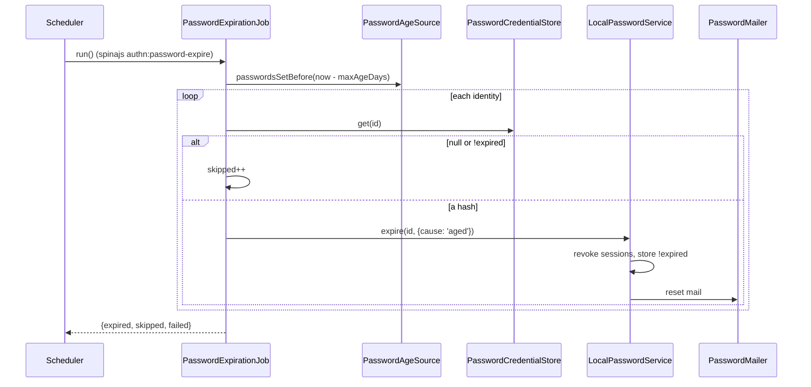

# Password expiry

Expiring a password makes it stop working until the owner sets a new one through a reset. An admin expires one password with `PasswordService.expire()`. `PasswordExpirationJob` expires every password older than `authn.local.expiration.maxAgeDays`; it is off by default and runs only when you call it.

## How it works

### `expire(id, opts, ctx)`

The stored hash is replaced by the marker `!expired` (`EXPIRED_PASSWORD_MARKER`), which never verifies. The rest depends on `opts.cause`:

| Step | `cause: 'admin'` | `cause: 'aged'` |
| --- | --- | --- |
| 1 | Store `!expired` | `SessionIssuer.revokeAll(id, { includeImpersonations: true })` |
| 2 | `SessionIssuer.revokeAll(id, { includeImpersonations: true })` | Store `!expired` |
| 3 | `TokenService.revokeAllFor(id, ctx, { actor })`, unless `authn.local.reset.revokeTokens` is `false` | Tokens are kept (H32) |
| 4 | A `password.change` event with `data: { cause: 'admin', expired: true }` and the `actor` | A `password.change` event with `data: { cause: 'aged', expired: true }` |
| 5 | With `sendReset: true`, a reset mail | Always a reset mail |

The reset mail goes only to an identity that could redeem it: existing, not deleted, not banned, active or invite-pending. A mail failure is logged by error name; the expiry holds and the call does not fail.

`@spinajs/users`' `expirePassword()` calls `expire()` with `cause: 'admin'`.

The `authn.password.expire` [action hooks](16-action-hooks.md) run around every step. For `cause: 'admin'` a refusal changes nothing, audits a `password.change` failure with `data: { cause: 'admin', expired: false }` and rethrows the `ActionRefused` or `ActionHookFailed`. For `cause: 'aged'` the action is not refusable: a refusal is logged and the password expires.

### `PasswordExpirationJob.run(now?)`

1. With `authn.local.expiration.enabled` off: answers `{ idle: 'disabled' }` and does nothing.
2. `maxAgeDays` must be a positive finite number. Otherwise it throws `InvalidOption`.
3. No `PasswordAgeSource` registered: logs a warning and answers `{ idle: 'no_source' }`.
4. `PasswordAgeSource.passwordsSetBefore(now − maxAgeDays)` lists the identities.
5. For each one, `PasswordCredentialStore.get(id)`. `null` (no password) or `!expired` counts as `skipped`.
6. Otherwise `PasswordService.expire(id, { cause: 'aged' }, { now, purpose: 'request' })` and counts `expired`. An error counts `failed`, is logged by error name, and the job goes on.
7. It answers `{ expired, skipped, failed }`.



## Configuration

| Key | Type | Default | Allowed values | Meaning |
| --- | --- | --- | --- | --- |
| `authn.local.expiration.enabled` | `boolean` | `false` | `true`, `false` | Lets the job expire passwords. Off: `run()` does nothing. |
| `authn.local.expiration.maxAgeDays` | `number` | `31` | `> 0`, fractions allowed | A password set longer ago than this is expired by the job. |
| `authn.local.reset.revokeTokens` | `true \| false` | `true` | `true`, `false` | An admin expiry also revokes every token. The aged expiry never does. |
| `authn.local.reset.ttlSeconds` | `integer` | `3600` | `>= 1` | Lifetime of the secret in the reset mail. |

```ts
// config/authn.ts in your app
export default {
  authn: {
    local: {
      expiration: { enabled: true, maxAgeDays: 90 },
    },
  },
};
```

## Services and extension points

| Service | DI token and lifetime | Default implementation | Alternatives | How to replace or extend |
| --- | --- | --- | --- | --- |
| Expiry job | `PasswordExpirationJob`, singleton, `@Injectable()` on import | `PasswordExpirationJob` | | Subclass and `DI.register(MyJob).as(PasswordExpirationJob)`; the `authn:password-expire` command resolves it per run. |
| Age source | `PasswordAgeSource`, `@Autoinject` with `optional: true` | `UserPasswordAgeSource` from `@spinajs/users` | your source | See [Password age source](09-password-age-source.md). |
| Expiry | `PasswordService.expire()` | `LocalPasswordService` | | See [Password service](11-password-service.md). |

A constructor seam reads no configuration: `new PasswordExpirationJob({ ages, passwords, service, enabled?, maxAgeDays?, log? })`. There `enabled` and `maxAgeDays` fall back to `AUTHN_LOCAL_DEFAULTS.expiration`, the schema defaults (`false` and `31`).

## Important behaviour

- **Off by default.** The job does nothing until `authn.local.expiration.enabled` is `true`.
- **The package runs no timer.** Schedule `spinajs authn:password-expire`, or call `run()` from your own scheduler.
- **An expired password never logs in.** `!expired` fails every verify, at the cost of a normal verify. A reset sets a new password and restores login.
- **The aged expiry keeps tokens (H32);** the admin expiry revokes them under `revokeTokens`.
- **Order makes the job retry-safe.** For `aged`, sessions are revoked before the marker is stored. A failed revoke leaves the password unmarked, so the next run tries again. For `admin`, the password dies first and the admin sees any error.
- **Identities without a password are skipped,** with no marker and no mail. An OIDC-only identity listed by mistake gets no reset mail.
- **One failing identity does not stop the run.** Its error is logged by name only, as a store error may carry the hash.
- **A non-positive `maxAgeDays` stops the run** instead of expiring every password at once.

## Best practices

- Run the job daily. Passwords it already expired are skipped, so a rerun sends no second mail.
- Schedule `@spinajs/users`' `notifyPasswordWillExpire()` ahead of the job, so users can change their password before it stops working.
- Register a `PasswordMailer` before you enable the job: without one, users are locked out with no reset mail.

## Patterns and antipatterns

```ts
// Don't: maxAgeDays 0 is refused by the schema and stops the job; it would expire everyone at once.
authn: { local: { expiration: { enabled: true, maxAgeDays: 0 } } }

// Do: a real age, and a mailer so users get their reset link.
authn: { local: { expiration: { enabled: true, maxAgeDays: 90 } } }
```

## Examples

### Expire old passwords from an in-process scheduler

```ts sample
import { DI } from '@spinajs/di';
import { PasswordExpirationJob } from '@spinajs/authn-local';

/** Runs the expiry once a day inside a long-running worker that has no cron. */
export function scheduleDailyExpiry(): ReturnType<typeof setInterval> {
  return setInterval(async () => {
    const job = await DI.resolve(PasswordExpirationJob);
    const result = await job.run();
    console.info(`password expiry: ${result.idle ?? `${result.expired} expired, ${result.skipped} skipped, ${result.failed} failed`}`);
  }, 24 * 60 * 60 * 1000);
}
```

### Expire one password and mail a reset link

```ts sample
import { DI } from '@spinajs/di';
import { PasswordService } from '@spinajs/authn';
import type { IdentityRef, PrincipalRef } from '@spinajs/authn';

/** After a leaked-credentials report: the password stops working and the owner gets a reset link. */
export async function forceReset(user: IdentityRef, securityOfficer: PrincipalRef): Promise<void> {
  const passwords = await DI.resolve(PasswordService);
  await passwords.expire(user, { cause: 'admin', actor: securityOfficer, sendReset: true }, { now: new Date(), purpose: 'request' });
}
```

## Related

- [Password age source](09-password-age-source.md): which passwords the job sees as old.
- [CLI commands](10-cli-commands.md): `authn:password-expire`.
- [Password mailer](07-password-mailer.md): the reset mail after an expiry.
- [Audit events](12-audit-events.md): the `password.change` event with `expired: true`.
- [`@spinajs/users`](../users/03-user-actions.md): `expirePassword()` and the expiry warning mails.
