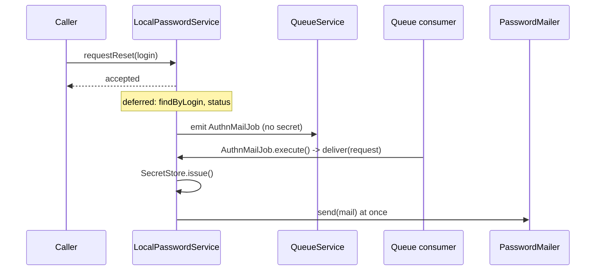

# Mail delivery

Reset and invite mails leave `LocalPasswordService` as an `AuthnMailRequest`: who the mail is for, its purpose, the secret lifetime and when it was asked for. No secret is in it. An `AuthnMailDispatcher` hands the request on, and `LocalPasswordService.deliver()` issues the secret and sends the mail through the `PasswordMailer` in one step, when the request is delivered.

`authn.local.mail.delivery` picks the dispatcher:

| Value | Dispatcher | Where `deliver()` runs | Retries |
| --- | --- | --- | --- |
| `'queue'` (default) | `QueueAuthnMailDispatcher` from `@spinajs/authn-local/queue` | in the queue consumer that runs `AuthnMailJob` | the queue's job retries |
| `'inline'` | `InlineAuthnMailDispatcher` | in this process, after the caller has its answer | none |

## How it works

1. `requestReset()` counts the request against the throttle and answers `accepted`. The login lookup and the status check run afterwards, as deferred work, so known and unknown logins answer alike (A11, SR-04). An unknown or ineligible login dispatches nothing.
2. `invite()` and `expire()` (with `cause: 'aged'` or `sendReset: true`) dispatch in the call. `invite()` returns once the request is dispatched, not when the mail is sent.
3. Without a registered `PasswordMailer` nothing is dispatched: a warning is logged and the event records `no_mailer`.
4. The dispatcher gets `{ identity, purpose, ttlSeconds, requestedAt, lang? }`. `requestedAt` is the real clock, not `ctx.now`.
5. `deliver(request)`:
   - answers `false` and issues nothing when `requestedAt + ttlSeconds` has passed (a job that sat in the queue too long), when no `PasswordMailer` is registered, or when `IdentityStore.display()` gives no `email`;
   - otherwise issues the secret with `SecretStore.issue()`, which voids the older secret of the same purpose, and calls `PasswordMailer.send()` at once.

### Queue delivery

`QueueAuthnMailDispatcher.dispatch()` emits an `AuthnMailJob` through `QueueService`. The job carries only:

| Field | Type | Meaning |
| --- | --- | --- |
| `identityType`, `identityId` | `string` | The identity. |
| `purpose` | `'reset' \| 'invite'` | Which mail. |
| `ttlSeconds` | `number` | Lifetime of the secret the job will issue. |
| `requestedAt` | `string` | ISO 8601 time of the request. |
| `lang` | `string`, optional | Template language. |

`AuthnMailJob` is a `@Job({ runAs: 'system' })`. `execute()` resolves the `PasswordService` of the container it runs in and calls `deliver()`. It answers `{ result: false }` for a dropped request. A retry of a failed job issues a fresh secret, so only the link of the last delivered mail works.



### Who registers the dispatcher

`LocalPasswordService` takes an optional `@Autoinject(AuthnMailDispatcher)` when it is built. Nothing registered: it delivers inline. `@spinajs/users` registers a factory under `AuthnMailDispatcher` (unless the app registered one) that reads `authn.local.mail.delivery` and builds the matching dispatcher, so with users the default is the queue.

Outside development and test, that factory refuses `'queue'` when `queue.routing.AuthnMailJob` (or `queue.default`, without a route) names a connection that `queue.connections` does not define, or one served by `BlackHoleQueueClient`: building the `PasswordService` fails with `InvalidOption` naming `queue.routing.AuthnMailJob`.

## Configuration

| Key | Type | Default | Allowed values | Meaning |
| --- | --- | --- | --- | --- |
| `authn.local.mail.delivery` | `string` | `'queue'` | `'queue'`, `'inline'` | How reset and invite mails are delivered. |
| `queue.routing.AuthnMailJob` | routing option | `{ connection: 'authn-mail' }` | a connection name | Connection the job goes to. |
| `queue.connections` (entry `authn-mail`) | connection | `BlackHoleQueueClient` | any queue client | Shipped so the app boots; it drops every job. Replace it with a real connection. |
| `system.dirs.jobs` | `string[]` | the package's `lib/<cjs or mjs>/queue` | directory paths | Where a consumer finds `AuthnMailJob`. |

```ts
// config/queue.ts in your app
export default {
  queue: {
    connections: [
      { name: 'authn-mail', service: 'StompQueueClient', host: 'ws://mq.internal:61614/ws', defaultQueueChannel: '/queue/authn-mail' },
    ],
  },
};
```

## Running the consumer

Any process that resolves `QueueService` can consume the job; it needs the same `IdentityStore`, `SecretStore` and `PasswordMailer` as the web process.

```ts sample
import { DI } from '@spinajs/di';
import { QueueService } from '@spinajs/queue';
import { AuthnMailJob } from '@spinajs/authn-local/queue';

export async function consumeAuthnMails(): Promise<void> {
  const queue = await DI.resolve(QueueService);
  await queue.consume(AuthnMailJob);
}
```

## Services and extension points

| Service | DI token and lifetime | Default implementation | Alternatives | How to replace or extend |
| --- | --- | --- | --- | --- |
| Dispatcher | `AuthnMailDispatcher`, optional `@Autoinject` of `LocalPasswordService`, set when the service is built | inline, or the `@spinajs/users` factory | `QueueAuthnMailDispatcher`, `InlineAuthnMailDispatcher`, your own | `DI.register(MyDispatcher).as(AuthnMailDispatcher)` before `PasswordService` is first resolved. |

A custom dispatcher must keep the request as it is: it holds no secret, and must not gain one. `drain()` resolves when everything dispatched so far has been delivered or handed on.

## Important behaviour

- **No secret waits anywhere.** The queue holds the identity and the purpose; the secret is issued when the job runs (SR-09). `EmailService.sendDeferred()` refuses a mail with secrets for the same reason.
- **A stale job is dropped**, not sent: past `requestedAt + ttlSeconds` its link could not be redeemed anyway.
- **The shipped `authn-mail` connection is a black hole.** In development and test the mails vanish; set `authn.local.mail.delivery: 'inline'` there, or configure a real connection.
- **`drain()`** of `LocalPasswordService` waits for the deferred lookups and the dispatcher. Call it in tests and on shutdown.

## Related

- [Reset and invite](06-reset-and-invite.md): the flows that dispatch.
- [Password mailer](07-password-mailer.md): what `deliver()` calls.
- [`@spinajs/email` password mails](../email/08-password-mailer.md): the MJML templates the default mailer renders.
