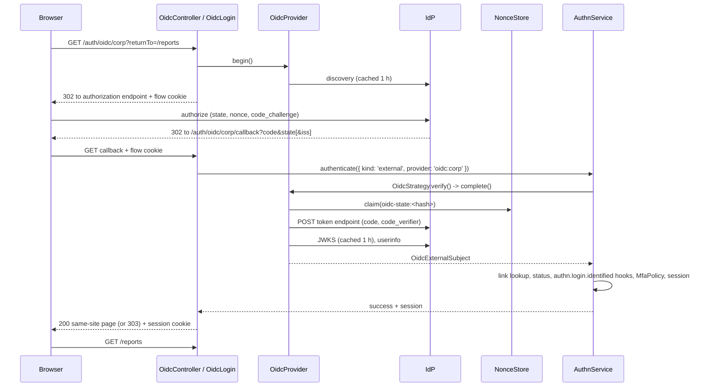

# Login flow

A user signs in at an external identity provider (IdP) and comes back with a session of your app. The flow is the authorization code flow with PKCE S256. Plain OAuth2 (the `github` preset) runs the same flow without an ID token.

## How it works

### Start, `GET /auth/oidc/:provider`

1. `OidcController.begin()` maps the express request to an `OidcRequest` and calls `OidcLogin.begin(provider, req)`.
2. `OidcLogin.begin()` looks up the `OidcStrategy` of the provider name. An unknown name gets the [failure answer](#answers).
3. `OidcProvider.begin()` reads the endpoints: from discovery (`OidcDiscovery.metadata()`), or the fixed endpoints of plain OAuth2.
4. `newFlow()` builds the flow: provider name, a random 32-byte seed, the issue time, the `returnTo` query value when it is an app-relative path, the redirect URI and the mode `login`.
5. `flowSecrets()` derives `state`, `nonce` and the PKCE verifier from the flow (see [Flow cookie](#flow-cookie)).
6. `authorizationUrl()` builds the authorization request: `response_type=code`, `client_id`, `redirect_uri`, `scope`, `state`, `code_challenge`, `code_challenge_method=S256`, and `nonce` for an ID token provider. The provider's `authorizationParams` go in first, so the flow's own parameters always win.
7. The answer is a 302 to the provider, with the flow cookie set. A discovery failure logs a warning and gets the failure answer.

### Callback, `GET /auth/oidc/:provider/callback`

1. `OidcLogin.callback()` reads the flow cookie and the query members `code`, `state`, `iss` and `error`. Each must be one string of at most 4096 characters; a repeated parameter fails the callback.
2. A flow in `link` mode goes to the [account linking](06-account-linking.md) callback. A `login` flow continues here.
3. `OidcLogin` calls `AuthnService.authenticate()` with the credential `{ kind: 'external', provider: 'oidc:<name>', payload: { flow, query } }` and `purpose: 'login'`.
4. The core counts the attempt in the throttle, then calls `OidcStrategy.verify()`. See [How a login runs](../authn/01-authentication-flow.md).
5. `OidcStrategy.verify()` decodes the flow cookie and calls `OidcProvider.complete()`, which checks, in this order:
   - the flow belongs to this provider (mix-up defence);
   - the flow is live: issued at most 60 seconds in the future and less than 600 seconds ago;
   - the `state` query value equals the flow's state (constant-time compare);
   - `NonceStore.claim()` accepts the state as its first use, before any call to the provider;
   - the query carries no `error`, and a non-empty `code`;
   - the RFC 9207 `iss` equals the configured issuer when sent, and is present when discovery advertises `authorization_response_iss_parameter_supported`.
6. `exchangeCode()` posts the code, the redirect URI of the flow and the PKCE verifier to the token endpoint. See [Token exchange](#token-exchange).
7. `validateIdToken()` checks the ID token. See [Security guarantees](09-security.md#id-token-checks).
8. `fetchUserinfo()` reads userinfo when the provider config asks for it. Its `sub` must equal the ID token's.
9. `rawClaims()` merges the claims, `hasRequiredClaims()` checks `requiredClaims`, and `mapClaims()` builds the `OidcExternalSubject`. See [Claims mapping](04-claims-mapping.md).
10. `OidcStrategy.gate()` applies the provider's linking switches. An unlinked subject that no switch admits gives `not_linked`. See [Identity linking](05-identity-linking.md).
11. The core maps the subject to an identity, checks its status, runs the [`authn.login.identified` hooks](07-login-hooks.md), asks the `MfaPolicy` and issues the session.
12. `OidcLogin` clears the flow cookie, sets the session cookie, and moves the client on to `returnTo`, else `authn.oidc.redirects.success`.

Any exception in steps 5 to 10 becomes the strategy outcome `invalid_credentials`. The client sees one [failure answer](#answers) for every reason; the reason goes to the audit only.



### Re-authentication, `GET /auth/oidc/:provider/reauth`

A user who logs in through the provider has no password for a `FreshAuth` route. This route re-authenticates the current active session at the provider and refreshes its `authenticatedAt`:

1. Without an active session (none, or a pending one) it answers the failure. A provider with `idToken: false` cannot start one.
2. It starts a flow of mode `reauth`, bound to the session like a link flow (the cookie member `h`) and keeping an app-relative `returnTo`. The authorization request carries `prompt=login` and `max_age=0`, whatever `authorizationParams` say, so the provider logs the user in again.
3. The callback runs the checks of a login. The ID token must carry `auth_time`, not in the future and not before the flow start minus `clockSkewSeconds`.
4. The session that started the flow must come back. A browser navigation that arrived without the `SameSite=Strict` session cookie takes one same-site hop first, as a link callback does.
5. `AuthnService.reauthenticate(session, credentials, ctx)` with purpose `reauth` decides: the subject must already be linked to the session's identity (no JIT, no link by email), the `reauth` throttle counts, and an impersonation is refused.
6. Success: `SessionIssuer.reissue(h, { authenticatedAt: now })` moves the session to a new id. The answer clears the flow cookie, sets the new session cookie and goes on to `returnTo`, or `redirects.success`, as a login does. Any failure is the usual failure answer and leaves the session as it was.

The `authn.login` and `authn.login.identified` [hooks](07-login-hooks.md) do not run: a re-authentication is no login.

### Token exchange

`exchangeCode()` sends `grant_type=authorization_code`, `code`, `redirect_uri` and `code_verifier` as a form post.

- `client_secret_basic`: the client id and secret are form-encoded, then sent in a `Basic` `Authorization` header (RFC 6749 §2.3.1).
- `client_secret_post`: `client_id` and `client_secret` go in the form.

The answer must be HTTP 200 with a JSON object, `token_type` `Bearer` (any case) and an `access_token` of at most 16384 characters. An ID token provider must also answer an `id_token` of at most 16384 characters. Anything else throws.

### Answers

| Case | Browser navigation | Other client |
| --- | --- | --- |
| Start succeeds | 302 to the provider, flow cookie set | 302 to the provider, flow cookie set |
| Login succeeds | 200 HTML page that moves on to the return path; flow cookie cleared, session cookie set | 303 to the return path; same cookies |
| Any failure | 303 to `authn.oidc.redirects.failure`, no reason in the URL; flow cookie cleared | 401 `{ "error": { "code": "E_AUTH_FAILED", "message": "login or password incorrect" }, "message": "login or password incorrect" }`; flow cookie cleared |
| Throttled | as a failure, plus `Retry-After` | as a failure, plus `Retry-After` |

- A request is a browser navigation when it sends `Sec-Fetch-Mode: navigate`, or an `Accept` header that lists `text/html`.
- Every answer carries `Cache-Control: no-store`.
- The 401 body is the login route's body (`AUTHN_FAILURE_BODY` of `@spinajs/authn/contracts`), so a client cannot tell an OIDC failure from a wrong password.
- The success page is a `<meta http-equiv="refresh">` page with `referrer` `no-referrer`. A `SameSite=Strict` session cookie does not travel on the cross-site redirect chain from the IdP, so the last hop starts on your site.
- A core result `mfa_required` (a custom `MfaPolicy` that asks steps for `oidc` logins) sets the pending session cookie and moves on the same way. By default `DefaultMfaPolicy` asks no step for an `oidc` login; list `oidc` in `authn.mfa.policy.methods` to make it do so.

## Flow cookie

The flow lives in one cookie; the server keeps no flow state until the callback claims the state.

| Attribute | Value |
| --- | --- |
| Name | `__Host-spinajs-oidc` outside development and test; `spinajs-oidc` there |
| Flags | `HttpOnly`, `SameSite=Lax`, `Path=/`, no `Domain`; `Secure` outside development and test; not signed |
| Lifetime | 600 seconds (`OIDC_FLOW_TTL_SECONDS`) |
| Value | base64url JSON `{ v, p, s, t, r, u, m, h? }`: version, provider name, seed, issue time, return path, redirect URI, mode, session binding (link flows only) |

- `state` is SHA-256 over the canonical JSON of every member, so a changed cookie gives a state the IdP never saw.
- `nonce` and the PKCE verifier are SHA-256 values of the seed under separate labels. The challenge is the S256 hash of the verifier.
- The callback claims `oidc-state:<sha256 hex of state>` in `NonceStore`, valid until the flow expires.
- `SameSite=Lax`, not `Strict`: the callback is a cross-site top-level `GET` from the IdP, and `Strict` would leave the cookie out.
- A malformed cookie (over 2048 characters, an unknown member, a provider name or seed of the wrong shape) decodes to nothing, and the callback fails.

## HTTP routes

The controller has the fixed prefix `auth/oidc`.

| Route | Does | Page |
| --- | --- | --- |
| `GET /auth/oidc/:provider` | Starts a login. Optional `?returnTo=/path`; any other query key is refused. | this page |
| `GET /auth/oidc/:provider/callback` | Completes a login or a link flow. | this page, [Account linking](06-account-linking.md) |
| `POST /auth/oidc/:provider/link` | Starts linking for the current session. | [Account linking](06-account-linking.md) |
| `DELETE /auth/oidc/:provider/link` | Removes a link of the current identity. | [Account linking](06-account-linking.md) |
| `GET /auth/oidc/:provider/reauth` | Re-authenticates the current session. Optional `?returnTo=/path`; any other query key is refused. | this page |

`OidcController` is not exported. The package config file adds its `lib/<cjs|mjs>/controllers` directory to `system.dirs.controllers`, and the HTTP server finds it by that scan.

## Configuration

The flow reads these keys; the provider keys are on [Provider configuration](02-provider-configuration.md).

| Key | Type | Default | Allowed values | Meaning |
| --- | --- | --- | --- | --- |
| `authn.oidc.redirects.success` | string | `'/'` | app-relative path | Where a login or link goes when the flow has no `returnTo`. |
| `authn.oidc.redirects.failure` | string | `'/'` | app-relative path | Where a failed browser navigation goes. |
| `authn.http.publicOrigin` | see `authn-http` | unset | `scheme://host[:port]` | The origin of the default redirect URI and `post_logout_redirect_uri`. Set: `Host` and `X-Forwarded-*` are not read. Unset outside development and test: `OidcProviders` warns at boot for each provider without `redirectUri`. |
| `authn.http.trustProxy` | see `authn-http` | `null` | addresses and CIDR ranges | Which peers may set `X-Forwarded-Proto` and `X-Forwarded-Host` for the default redirect URI. `null` or absent: `http.trustProxy`. An entry that is no address or CIDR throws on the first OIDC request. |
| `authn.session.cookie` | object | see `authn-session` | see `authn-session` | The session cookie the callback sets. |

```ts
authn: {
  oidc: {
    redirects: { success: '/app', failure: '/login' },
  },
  http: { publicOrigin: 'https://app.example.com', trustProxy: ['10.0.0.0/8'] },
}
```

## Services and extension points

| Service | DI token and lifetime | Default implementation | Alternatives | How to replace or extend |
| --- | --- | --- | --- | --- |
| Login routes | `OidcController`, found by the controller scan | `OidcController` | none | Not exported. Use `OidcLogin` from your own controller; see [Programmatic API](10-programmatic-api.md). |
| Provider HTTP calls | `OidcHttpClient`, singleton | `FetchOidcHttpClient` | none shipped | See [Provider HTTP client](08-http-client.md). |
| State store | `NonceStore` (`@spinajs/authn/contracts`), per child container | `DbNonceStore` (`@spinajs/authn-orm`) | `MemoryNonceStore` (`@spinajs/authn/nonces`) | See [Nonce store](../authn-orm/04-nonce-store.md). |
| Core flow | `AuthnService` (`@spinajs/authn/contracts`) | `DefaultAuthnService` | none | See [`@spinajs/authn`](../authn/README.md). |
| Session | `SessionIssuer` (`@spinajs/authn/contracts`) | from `@spinajs/authn-session` | session providers | See [Sessions](../authn-session/README.md). |

## Important behaviour

- **Single use.** The state is claimed in `NonceStore` before the code exchange. A replayed callback fails even when the first attempt failed later.
- **One answer.** Every failure, from an unknown provider to a bad signature, gets the same answer. Read the audit (`AuthnService` events) for the reason.
- **Throttle.** The core throttles the callback like any interactive login. `OidcStrategy.throttleKeys()` returns no key: no account is known before verification, and a per-provider key would let one client slow every login. The core adds the `ip` key when `authn-http` set `ClientIp`.
- **Redirect URI.** The flow keeps the redirect URI it sent and sends it unchanged to the token endpoint. Default: `<origin>/auth/oidc/<name>/callback`. The origin is `authn.http.publicOrigin` when set. Otherwise it comes from `Host`, with `X-Forwarded-Proto` and `X-Forwarded-Host` (first value) only from a trusted proxy, and must pass `parseOrigin()`. The first request with an `http` origin outside development and test logs a warning.
- **A malformed origin answers 400.** Without `authn.http.publicOrigin` and the provider's `redirectUri`, a `Host` or trusted `X-Forwarded-Host` that gives no valid origin (a path, credentials, a bad port, nothing, more than 2048 characters) answers `400 { error: { code: 'E_OIDC_ORIGIN' } }` on the routes that start a flow (login, link, reauth). No flow cookie is set and the provider is not called. A well-formed forged `Host` still passes this check: the IdP's exact match of the registered URI refuses it.
- **Return path.** `returnTo` is kept only when it is an app-relative path of at most 1024 printable ASCII characters. A `returnTo` over 1024 characters is refused by the route's query schema and gets the failure answer. Any other value that is no such path falls back to `redirects.success`, so there is no open redirect. See [Route inputs](09-security.md#route-inputs).
- **Flow expiry.** A user who waits more than 10 minutes at the IdP gets the failure answer and must start again.

## Best practices

- Set `authn.http.publicOrigin` in production, or each provider's `redirectUri`, so no redirect URI depends on `Host`.
- Register `<origin>/auth/oidc/<name>/callback` at the IdP exactly. The IdP's exact match is the guard against a forged `Host`.
- Behind a TLS proxy, set `authn.http.trustProxy`. Without it the default redirect URI is `http://…` and the IdP refuses it.
- Import `@spinajs/authn-http` too: it restores the session cookie on later requests and writes `ClientIp` for the `ip` throttle key.
- Link to the start route with a plain `<a href="/auth/oidc/corp?returnTo=/reports">`. It is a top-level navigation, so the failure and success answers are browser answers.

## Patterns and antipatterns

```ts
// Don't: an absolute returnTo is dropped, and the user lands on redirects.success
location.href = '/auth/oidc/corp?returnTo=' + encodeURIComponent('https://app.example.com/reports');

// Do: an app-relative path
location.href = '/auth/oidc/corp?returnTo=' + encodeURIComponent('/reports');
```

```ts
// Don't: fetch() follows the 302 inside the script, so the user never sees the IdP's login page
await fetch('/auth/oidc/corp');

// Do: navigate the window, so the browser goes to the IdP and the callback answers with the browser page
window.location.assign('/auth/oidc/corp');
```

## Examples

### Sign in with the corporate IdP and come back to the page the user asked for

```ts sample
import type { OidcConfig } from '@spinajs/authn-oidc';

const oidc: OidcConfig = {
  providers: {
    corp: {
      issuer: 'https://sso.example.com/realms/corp',
      clientId: 'reports-app',
      clientSecret: { secret: 'env://OIDC_CORP_SECRET' },
    },
  },
  redirects: { success: '/', failure: '/login?sso=failed' },
};

export default {
  authn: {
    strategies: [{ name: 'oidc:corp', service: 'oidc:corp' }],
    oidc,
  },
};

// In the login page: <a href="/auth/oidc/corp?returnTo=/reports/monthly">Sign in with Corp SSO</a>
```

## Related

- [`@spinajs/authn`, How a login runs](../authn/01-authentication-flow.md): the core steps after `verify()`.
- [Nonce store](../authn-orm/04-nonce-store.md): where the state is claimed.
- [`@spinajs/authn-http`](../authn-http/README.md): session restore, `ClientIp`, the CSRF origin guard and `trustProxy`.
- [Security guarantees](09-security.md): every check of this flow in one list.
