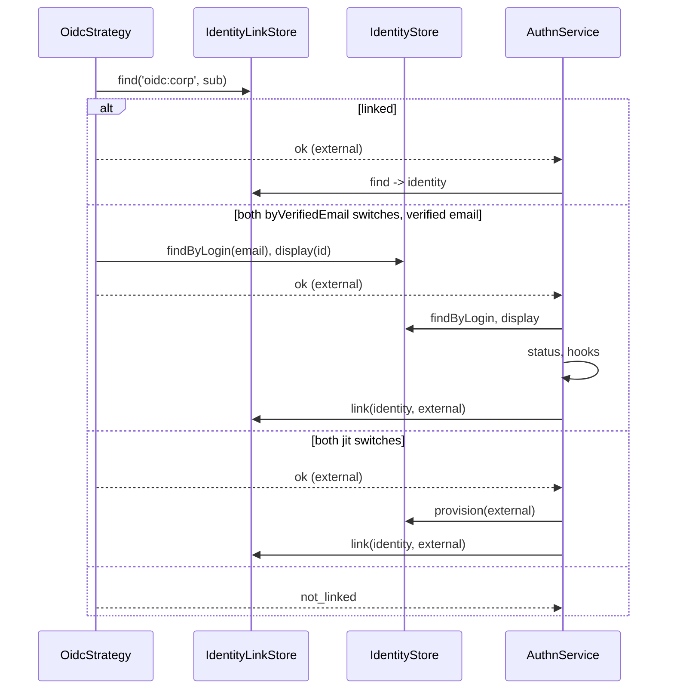

# Identity linking

An OIDC login proves a subject at a provider. Identity linking maps that `(provider, subject)` pair to a local identity: through a stored link, by a verified email, or by creating an account (JIT). Email matching and JIT are off until both a global switch and the provider's own switch are on.

## How it works

`OidcStrategy.verify()` and `DefaultAuthnService` decide together. The strategy repeats the core's decision with the provider's switches, so neither path runs without them.

1. `OidcStrategy.gate()` takes the mapped subject. When the provider's `linking.byVerifiedEmail` is off, it sets `emailVerified: false`, so neither the core nor a hook sees a verified email.
2. `IdentityLinkStore.find('oidc:<name>', subject)` finds a link: the subject passes.
3. No link, and both `byVerifiedEmail` switches on, a verified email, and `IdentityStore.findByLogin(email)` finds an identity whose own stored email (`IdentityStore.display()`) equals it, ASCII case-insensitive: the subject passes.
4. No link, and both `jit` switches on: the subject passes.
5. Otherwise the strategy answers `not_linked`, and the client gets the failure answer.
6. The core's `linked()` repeats steps 2 to 4 with `linkingFor()` of the strategy (the provider's switches). For JIT it calls `IdentityStore.provision(external)`, and only when the store has a `provision` method.
7. A provisioned identity is linked at once, so a retry finds it. The core then checks the identity status and runs the [`ExternalLoginHook`s](07-external-login-hooks.md).
8. An email match is linked only after the hooks pass, so a login a hook refuses leaves no new link. The core audits `identity.link`.



## Configuration

| Key | Type | Default | Allowed values | Meaning |
| --- | --- | --- | --- | --- |
| `authn.linking.jit` | boolean | `false` | | Global JIT switch, read by the core and by `OidcProviders`. |
| `authn.linking.byVerifiedEmail` | boolean | `false` | | Global switch for linking a first login by verified email. |
| `authn.oidc.providers.<name>.linking.jit` | boolean | `false` | | JIT for this provider. No effect without `authn.linking.jit`. |
| `authn.oidc.providers.<name>.linking.byVerifiedEmail` | boolean | `false` | | Email matching for this provider. No effect without `authn.linking.byVerifiedEmail`. |

Only the boolean `true` turns a switch on. A provider switch that is on while its global switch is off logs a warning when `OidcProviders` resolves.

```ts
authn: {
  linking: { jit: false, byVerifiedEmail: true },
  oidc: {
    providers: {
      corp: { issuer: 'https://sso.example.com', clientId: 'app', clientSecret: { secret: 'env://S' }, linking: { byVerifiedEmail: true } },
    },
  },
}
```

## Schema

Links live in `authn_identity` from `@spinajs/authn-orm`. The OIDC strategy writes `provider` as `oidc:<name>` and `subject` as the mapped subject. `(provider, subject)` is unique, and one identity may hold many links. See [Identity links](../authn-orm/03-identity-links.md#authn_identity).

## Services and extension points

| Service | DI token and lifetime | Default implementation | Alternatives | How to replace or extend |
| --- | --- | --- | --- | --- |
| Link store | `IdentityLinkStore` (`@spinajs/authn/contracts`), singleton; required | `DbIdentityLinkStore` (`@spinajs/authn-orm`) | your store | See [Identity links](../authn-orm/03-identity-links.md#services-and-extension-points). |
| Identity store | `IdentityStore` (`@spinajs/authn/contracts`); optional for `OidcProviders` | `UserIdentityStore` (`@spinajs/users`) | your store | Email matching needs `findByLogin` and `display`; JIT needs `provision`. See [Identity and password stores](../users/07-identity-and-password-stores.md). |
| Per-provider switches | `OidcStrategy.linkingFor(external)` | the provider's `linking.*` | none | The core reads it through `linkingSwitchesOf()`. Off for another provider's subject. |

## Important behaviour

- **Two switches, by design.** Adding a provider never opens sign-up or email matching by accident. A JWT issuer of `@spinajs/authn-token` has its own `linking.jit`, so JIT on one OIDC provider opens nothing else.
- **`UserIdentityStore` has no `provision()`.** With `@spinajs/users`, JIT does not create accounts: the login ends in `not_linked`. Add `provision()` in your own identity store for JIT.
- **No `IdentityStore` registered**: email matching in the strategy finds nothing, so only stored links (and JIT, when both switches are on) pass.
- **Only the identity's own stored email decides.** `findByLogin()` also matches login names; the strategy and the core compare the found identity's stored email with the verified email.
- **A provisioned identity stays.** It is linked before the status check and the hooks. A hook that fails the login does not remove it.
- **Presets that never verify email.** `entra` and `github` map no `emailVerified`, so email matching never links their users.

## Best practices

- Start with both switches off and link accounts explicitly from a signed-in session ([Account linking](06-account-linking.md)).
- Turn on `byVerifiedEmail` only for a provider you trust to verify emails, such as your own Keycloak.
- Pair JIT with `requiredClaims` (`hd`, `tid`, a group) so only your organisation's users get accounts.

## Patterns and antipatterns

```ts
// Don't: the provider switch alone does nothing, and boot warns
authn: { linking: { jit: false, byVerifiedEmail: false }, oidc: { providers: { corp: { /* … */ linking: { jit: true } } } } },

// Do: both switches
authn: { linking: { jit: true, byVerifiedEmail: false }, oidc: { providers: { corp: { /* … */ linking: { jit: true } } } } },
```

## Examples

### Create accounts on first login for the company IdP only

```ts sample
import { IdentityStore } from '@spinajs/authn/contracts';
import type { ExternalSubject, IdentityRef, IdentityStatus } from '@spinajs/authn/contracts';
import { Injectable } from '@spinajs/di';
import { randomUUID } from 'node:crypto';

/** A minimal in-memory store that provisions accounts; a real app writes to its user table. */
@Injectable(IdentityStore)
export class ProvisioningIdentityStore extends IdentityStore {
  private readonly emails = new Map<string, string>();

  public async findByLogin(login: string): Promise<IdentityRef | null> {
    for (const [id, email] of this.emails) if (email === login) return { type: 'user', id };
    return null;
  }

  public async status(id: IdentityRef): Promise<IdentityStatus> {
    const exists = this.emails.has(id.id);
    return { exists, active: exists, banned: false, deleted: false };
  }

  public async display(id: IdentityRef): Promise<{ email?: string; name?: string }> {
    return { email: this.emails.get(id.id) };
  }

  public async provision(external: ExternalSubject): Promise<IdentityRef> {
    const id = randomUUID();
    this.emails.set(id, external.email ?? '');
    return { type: 'user', id };
  }
}

export default {
  authn: {
    linking: { jit: true, byVerifiedEmail: false },
    oidc: {
      providers: {
        corp: {
          issuer: 'https://sso.example.com/realms/corp',
          clientId: 'reports-app',
          clientSecret: { secret: 'env://OIDC_CORP_SECRET' },
          requiredClaims: { email_verified: true },
          linking: { jit: true },
        },
      },
    },
  },
};
```

## Related

- [`@spinajs/authn`, How a login runs](../authn/01-authentication-flow.md): step 4 maps the result to an identity.
- [Identity links](../authn-orm/03-identity-links.md): the `authn_identity` store.
- [Account linking](06-account-linking.md): linking from a signed-in session.
- [Identity and password stores](../users/07-identity-and-password-stores.md): `UserIdentityStore` and `provision()`.
