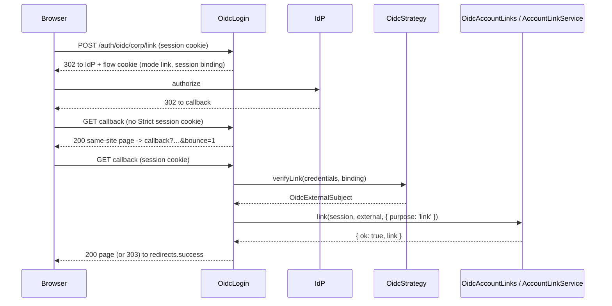

# Account linking

A signed-in user adds or removes a sign-in provider on their own account. Linking runs an OIDC flow bound to the user's session; the core's `AccountLinkService` decides, through the `OidcAccountLinks` adapter.

## How it works

### Start, `POST /auth/oidc/:provider/link`

1. `OidcLogin.beginLink()` answers 404 for an unknown provider, or when no `OidcAccountLinks` is registered.
2. It needs the active session that `authn-http` restored (`req.storage.AuthnSession`). No session, or a pending one, gets the [failure answer](01-login-flow.md#answers).
3. A `Sec-Fetch-Site` header other than `same-origin` or `none` gets the failure answer. `authn-http`'s CSRF origin guard has already checked the `POST`, because it carries the session cookie.
4. `OidcProvider.begin()` builds a flow in `link` mode. It holds `sessionBindingOf(session.id)`, a SHA-256 of the raw session id under its own label, never the session store's key. A link flow keeps no `returnTo`.
5. The answer is a 302 to the provider, with the flow cookie set.

### Callback, `GET /auth/oidc/:provider/callback` with a link flow

1. `OidcLogin.callback()` sees a flow in `link` mode and calls `linkCallback()`.
2. The session cookie is `SameSite=Strict` by default, so it does not come with the cross-site arrival from the IdP. When there is no session, the `state` matches the flow, and the request is a browser navigation, the answer is a same-site page that reloads the callback with `bounce=1`. Nothing is consumed yet. The second request carries the session cookie.
3. No `OidcAccountLinks`, or no active session, gets the failure answer.
4. `OidcStrategy.verifyLink()` checks that the flow is a link flow of this provider, bound to this session. It then runs the same `OidcProvider.complete()` checks as a login: state, single-use claim, code exchange, ID token, userinfo, mapping. No linking switch applies.
5. `OidcAccountLinks.link(session, external, ctx)` runs with `purpose: 'link'`. `CoreOidcAccountLinks` hands it to the core's `AccountLinkService.link()`.
6. A refusal gets the failure answer. Success clears the flow cookie and moves on to `authn.oidc.redirects.success` (same-site page for a browser, else 303). The session cookie is not changed.

### Remove, `DELETE /auth/oidc/:provider/link`

1. `OidcLogin.unlink()` answers 404 for an unknown provider, or without an `OidcAccountLinks` or an `IdentityLinkStore`.
2. No active session that `SessionIssuer.restore()` still finds: 401 with the `E_AUTH_FAILED` body.
3. It lists the identity's links of `oidc:<name>`, narrowed by the optional `?subject=`.
4. None: 404. More than one: 409 `{ "error": { "code": "E_LINK_REFUSED" } }`; name one with `?subject=`.
5. `OidcAccountLinks.unlink(session, linkId, ctx)` runs with `purpose: 'link'`. Success: 204. A refusal or an exception: 403 `E_LINK_REFUSED`.



### Status codes

| Route | Code | When |
| --- | --- | --- |
| `POST …/link` | 302 | The flow started. |
| `POST …/link` | 404 | Unknown provider, or no `OidcAccountLinks`. |
| `POST …/link` | 401, or 303 to `redirects.failure` for a browser | No active session, a cross-site `Sec-Fetch-Site`, or the provider is unreachable. |
| callback | 200 page or 303 | Linked, or the one-time `bounce` page. |
| callback | 401, or 303 to `redirects.failure` | Any failure, including a session that differs from the one that started the flow. |
| `DELETE …/link` | 204 | Unlinked. |
| `DELETE …/link` | 401 | No active session. |
| `DELETE …/link` | 404 | Unknown provider, no `OidcAccountLinks` or link store, or no matching link. |
| `DELETE …/link` | 409 | Several subjects of the provider and no `?subject=`. |
| `DELETE …/link` | 403 | The core refused, for example the last usable credential. |

## Configuration

| Key | Type | Default | Allowed values | Meaning |
| --- | --- | --- | --- | --- |
| `authn.freshAuth.maxAgeSeconds` | integer | `300` | see `@spinajs/authn` | How old the sign-in of the session may be. `AccountLinkService` refuses older sessions, and the OIDC routes send no inline re-authentication. |
| `authn.oidc.redirects.success` | string | `'/'` | app-relative path | Where a linked browser goes. |
| `authn.oidc.redirects.failure` | string | `'/'` | app-relative path | Where a failed browser navigation goes. |

## Services and extension points

| Service | DI token and lifetime | Default implementation | Alternatives | How to replace or extend |
| --- | --- | --- | --- | --- |
| Link adapter | `OidcAccountLinks`, singleton, registered with `@Injectable(OidcAccountLinks)` on import | `CoreOidcAccountLinks` | none shipped | `@Injectable(OidcAccountLinks)` on your subclass of `OidcAccountLinks`, imported after `@spinajs/authn-oidc`: the last registration wins. Without any registration the link routes answer 404. |
| Link rules | `AccountLinkService` (`@spinajs/authn`), `@PerChildInstance()` | `AccountLinkService` | none | `CoreOidcAccountLinks` resolves it per call, in its own container, because it needs an `IdentityStore` that apps may not register. |
| Link store | `IdentityLinkStore`, optional for the controller | `DbIdentityLinkStore` | your store | `DELETE` answers 404 without one. See [Identity links](../authn-orm/03-identity-links.md). |

`OidcAccountLinks` has two abstract methods:

```ts
abstract link(session: SessionHandle, external: ExternalSubject, ctx: AuthnContext, reauth?: Credentials): Promise<OidcLinkResult>;
abstract unlink(session: SessionHandle, linkId: string, ctx: AuthnContext, reauth?: Credentials): Promise<{ readonly ok: boolean }>;
```

`OidcLinkResult` is `{ ok: true, link: IdentityLink }` or `{ ok: false }`.

### Link adapter: custom implementation

Replace the adapter to add a rule on top of the core's, such as one link per provider. Keep the core's checks by delegating to `AccountLinkService`: it enforces the identity's own active session, fresh auth, a subject not linked elsewhere, and never the last usable credential. The adapter only receives subjects whose control the OIDC callback proved.

```ts sample
import { AccountLinkService } from '@spinajs/authn';
import { IdentityLinkStore, SessionIssuer } from '@spinajs/authn/contracts';
import type { AuthnContext, Credentials, ExternalSubject, SessionHandle } from '@spinajs/authn/contracts';
import { OidcAccountLinks } from '@spinajs/authn-oidc';
import type { OidcLinkResult } from '@spinajs/authn-oidc';
import { Autoinject, DI, Injectable } from '@spinajs/di';

/** At most one account per provider: a second Google account cannot be added to the same user. */
@Injectable(OidcAccountLinks)
export class OneLinkPerProvider extends OidcAccountLinks {
  @Autoinject(IdentityLinkStore)
  protected Links!: IdentityLinkStore;

  @Autoinject(SessionIssuer)
  protected Sessions!: SessionIssuer;

  public async link(session: SessionHandle, external: ExternalSubject, ctx: AuthnContext, reauth?: Credentials): Promise<OidcLinkResult> {
    const restored = await this.Sessions.restore(session.id);
    if (!restored) return { ok: false };
    const existing = await this.Links.list(restored.identity);
    if (existing.some((l) => l.provider === external.provider)) return { ok: false };
    return (await DI.resolve(AccountLinkService)).link(session, external, ctx, reauth);
  }

  public async unlink(session: SessionHandle, linkId: string, ctx: AuthnContext, reauth?: Credentials): Promise<{ readonly ok: boolean }> {
    return (await DI.resolve(AccountLinkService)).unlink(session, linkId, ctx, reauth);
  }
}
```

## Important behaviour

- **Bound to the session.** A link flow started by one session completes only for the same session. A link callback without that session fails.
- **Fresh auth.** The core refuses a session whose sign-in is older than `authn.freshAuth.maxAgeSeconds`. The routes send no `reauth` credentials, so the user signs in again first.
- **Never the last credential.** Unlinking is refused when the identity would have no password, no other link and no usable key left.
- **Opaque refusals.** A link refusal never says whether the subject is linked to someone else. The reason goes to the audit.
- **Not throttled.** Link callbacks do not go through the login throttle. `AccountLinkService` audits them.
- **The bounce happens once.** `bounce=1` in the query stops a second bounce, so a missing session fails instead of looping.

## Best practices

- Start linking with an HTML form `POST` from your own page, so the browser follows the 302 to the IdP and sends `Sec-Fetch-Site: same-origin`.
- Show the user's links with `IdentityLinkStore.list(identity)` and offer `DELETE …/link?subject=<subject>` per row when a provider has several.
- Import `@spinajs/authn-http`: without its session middleware, `req.storage.AuthnSession` is empty and every link route fails.

## Patterns and antipatterns

```html
<!-- Don't: the link route is POST only, so a GET link matches no route -->
<a href="/auth/oidc/google/link">Connect Google</a>

<!-- Do: a same-origin form POST, which the CSRF origin guard accepts -->
<form method="post" action="/auth/oidc/google/link"><button>Connect Google</button></form>
```

## Examples

### Remove the Google sign-in from the account page

```ts sample
async function disconnectGoogle(subject?: string): Promise<'removed' | 'pick-one' | 'refused' | 'not-linked' | 'signed-out'> {
  const query = subject !== undefined ? `?subject=${encodeURIComponent(subject)}` : '';
  const res = await fetch(`/auth/oidc/google/link${query}`, { method: 'DELETE', credentials: 'same-origin' });
  switch (res.status) {
    case 204:
      return 'removed';
    case 409:
      return 'pick-one';
    case 403:
      return 'refused'; // the last sign-in method, or the sign-in is not fresh
    case 404:
      return 'not-linked';
    default:
      return 'signed-out';
  }
}
```

## Related

- [`@spinajs/authn`](../authn/README.md): `AccountLinkService` and `authn.freshAuth`.
- [Identity links](../authn-orm/03-identity-links.md): the `authn_identity` table.
- [`@spinajs/authn-http`](../authn-http/README.md): session restore and the CSRF origin guard.
- [Login flow](01-login-flow.md): the callback and answers shared with linking.
