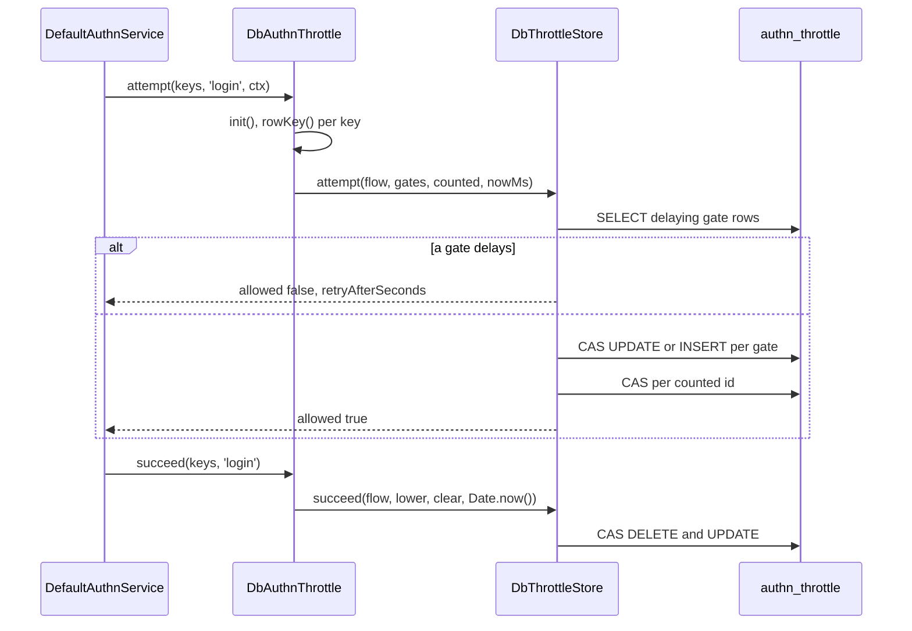

# Database throttle

`DbAuthnThrottle` is the `AuthnThrottle` for apps with several instances. It keeps per-key backoff rows in `authn_throttle`, so every instance sees the same counts and a restart forgets nothing. It never locks an account: a key only waits longer.

The flow rules, key kinds and backoff formula are the same for every throttle and are described in [`@spinajs/authn` Throttling](../authn/05-throttling.md). This page covers what the database store adds.

## Where it runs in the authn flow

The throttle is resolved as `AuthnThrottle`, so every caller below gets `DbAuthnThrottle` once this package is imported and `authn.throttle.service` is unset.

| Caller | Flow | When it calls |
| --- | --- | --- |
| `DefaultAuthnService.authenticate()` ([`@spinajs/authn`](../authn/01-authentication-flow.md)) | `login` | Step 2: `attempt` before verification, or `peek` when every candidate is a per-request strategy; `attempt` again after such a failure. `succeed` on a successful login. |
| `DefaultAuthnService.completeMfa()` | `mfa` | `attempt` before the step verifies; `succeed` when it passes. |
| `DefaultAuthnService.reauthenticate()` | `reauth` | `attempt` before the check; `succeed` when it passes. |
| `LocalPasswordService` ([`@spinajs/authn-local`](../authn-local/README.md)) | `reset`, `reauth` | `requestReset` and `redeemReset` count `reset`; a password change counts `reauth`. |
| `TotpService` ([`@spinajs/authn-totp`](../authn-totp/README.md)) | `mfa` | Confirming and disabling an enrolment. |
| `KeyRegistry` ([`@spinajs/authn-keys`](../authn-keys/README.md)) | `login` | Issuing a login challenge counts the client IP. |

## How it works

### Selection and setup

1. Importing `@spinajs/authn-orm` runs `@PerChildInstance()` and `@Injectable(AuthnThrottle)` on `DbAuthnThrottle`. It is registered under `AuthnThrottle` and as itself.
2. `DefaultAuthnService` takes the throttle named in `authn.throttle.service`. When the key is unset it takes the only registered throttle besides `MemoryAuthnThrottle`, which is `DbAuthnThrottle` once this package is imported.
3. When the authn service resolves, it calls `DbAuthnThrottle.checkConfiguration(configuration)`. Without a hash key (`options.hashKey`, else `authn.audit.hashKey.secret`) it throws `InvalidOption`, unless the app env is development or test.
4. The first `attempt`, `peek` or `succeed`, and every `purge`, call `init()`. It resolves `Configuration` from the container that resolved the throttle (`@Autoinject(Container)`) and reads `authn.throttle` once: it drops `service`, `maxRows` and `memory`, checks the rest and deep-freezes it. It reads `authn.audit.hashKey.secret`; when that is unset it uses a random 32-byte key of the process and logs one warning to the `authn-orm` logger.
5. `DbAuthnThrottle.createStore({ resetAfterMs })` builds one `DbThrottleStore`, with `resetAfterMs` = `authn.throttle.resetAfterSeconds` × 1000.

### Attempt, `attempt(keys, flow, ctx)`

1. `StoreAuthnThrottle.attempt()` (from `@spinajs/authn`) checks the flow and `ctx.now`. `DbAuthnThrottle.nowMs()` accepts only a valid `Date` between the years 1000 and 9999; anything else throws `InvalidArgument`. `DbAuthnThrottle.checkKeys()` throws `InvalidArgument` for any key whose `value` is not a string, whether the flow uses that kind or not.
2. The util `Throttle` turns the keys into gate ids and counted ids with `DbAuthnThrottle.rowKey(flow, key)`: base64url of HMAC-SHA256(hash key, `flow|kind|value`).
3. `DbThrottleStore.attempt()` awaits `ormReady()`. Every 64th attempt of the store instance first runs `purge()`.
4. It reads the gate rows that delay now. If any does, it refuses with the longest wait and counts nothing.
5. It claims each gate in id order with a compare-and-set: an `UPDATE` that matches the attempt count it read, or an `INSERT` for a new key. A stale row (idle for `resetAfterMs` and delaying nobody) counts as zero and is taken over.
6. A lost claim re-reads the delay of this gate and the gates still to claim. A delay refuses; otherwise the claim re-reads the row and tries again, up to 64 times. After 64 lost claims the attempt is refused with a 1-second wait.
7. When a later gate refuses, `undo()` restores the earlier claims in reverse order. Each restore matches the row exactly as this attempt wrote it; a row changed since keeps the count.
8. It counts each counted id (`account-ip`) with the same compare-and-set, up to 64 tries.
9. It resolves `{ allowed: true }`, or `{ allowed: false, retryAfterSeconds }` with `retryAfterSeconds` = max(1, ceil(wait / 1000)).

### Peek, `peek(keys, flow, ctx)`

1. With no gates it resolves `{ allowed: true }` without a query.
2. Otherwise it reads the delaying gate rows, as step 4 above, and writes nothing.

### Success, `succeed(keys, flow)`

1. `StoreAuthnThrottle.succeed()` takes "now" from `Date.now()`, not from a context.
2. For each lower rule, `DbThrottleStore.succeed()` deletes every live `by` row (`account-ip`) with a compare-and-set and keeps the largest count it deleted.
3. It subtracts that count from each target row (`ip`). At 0 it deletes the row; otherwise it sets the next allowed time from the row's last attempt with the new count.
4. It deletes the `clear` rows (`account`), except the ones step 2 already consumed.

### Purge, `purge(now?)`

1. `DbAuthnThrottle.purge(now = new Date())` calls `init()` and `DbThrottleStore.purge(nowMs)`.
2. It selects up to 500 keys that are idle for `resetAfterMs` and delay nobody, ordered by key.
3. It deletes those keys under the same condition and resolves with the number deleted.



## Configuration

`DbAuthnThrottle` reads these keys from the `@spinajs/authn` schema. The schema fills `authn.throttle` in whole, so every key has its default.

| Key | Type | Default | Allowed values | Meaning |
| --- | --- | --- | --- | --- |
| `authn.throttle.service` | `string` | unset | class name of a registered `AuthnThrottle` | Unset: the only throttle besides `MemoryAuthnThrottle`. Read by `DefaultAuthnService`. |
| `authn.throttle.login.account` | `BackoffParams` | `{ free: 5, baseDelayMs: 1000, maxDelayMs: 60000 }` | `free` integer ≥ 0, `baseDelayMs` integer ≥ 0, `maxDelayMs` integer ≥ 1 | Backoff of the account key in the `login` flow. |
| `authn.throttle.login.ip` | `BackoffParams` | `{ free: 20, baseDelayMs: 1000, maxDelayMs: 300000 }` | as above | Backoff of the IP key in the `login` flow. |
| `authn.throttle.mfa.account` | `BackoffParams` | `{ free: 3, baseDelayMs: 1000, maxDelayMs: 300000 }` | as above | `mfa` flow, account key. |
| `authn.throttle.mfa.ip` | `BackoffParams` | `{ free: 20, baseDelayMs: 1000, maxDelayMs: 300000 }` | as above | `mfa` flow, IP key. |
| `authn.throttle.reset.account` | `BackoffParams` | `{ free: 1, baseDelayMs: 60000, maxDelayMs: 3600000 }` | as above | `reset` flow, account key. |
| `authn.throttle.reset.ip` | `BackoffParams` | `{ free: 5, baseDelayMs: 10000, maxDelayMs: 900000 }` | as above | `reset` flow, IP key. |
| `authn.throttle.reauth.account` | `BackoffParams` | `{ free: 3, baseDelayMs: 1000, maxDelayMs: 300000 }` | as above | `reauth` flow, account key. The flow has no IP key. |
| `authn.throttle.resetAfterSeconds` | `number` | `86400` | integer ≥ 1 | A key with no counted attempt for this long, and no running delay, counts as zero and may be purged. |
| `authn.throttle.global` | `BackoffParams \| null` | `null` | `null` or a backoff | One gate shared by every caller, per flow. Off by default. |
| `authn.throttle.maxRows`, `authn.throttle.memory.*` | | | | Read by `MemoryAuthnThrottle` only; `DbAuthnThrottle` ignores them. |
| `authn.audit.hashKey.secret` | `string \| null` | unset | a secret reference, at least 32 characters | HMAC key of the row ids. Unset: a random key per process, refused at boot outside development and test. |

```ts
authn: {
  throttle: {
    service: 'DbAuthnThrottle',
    login: { account: { free: 5, baseDelayMs: 1000, maxDelayMs: 60000 }, ip: { free: 20, baseDelayMs: 1000, maxDelayMs: 300000 } },
    resetAfterSeconds: 86400,
  },
  audit: { hashKey: { secret: process.env.AUTHN_HASH_KEY ?? null } },
}
```

### Constructor options

`new DbAuthnThrottle(params?, options?)`. DI passes nothing.

| Argument | Type | Default | Meaning |
| --- | --- | --- | --- |
| `params` | `ThrottleParams` | unset | Fixed backoff for every flow. Checked in the constructor. With `params`, nothing is read from the configuration. Without it, the throttle needs the container DI injects: one built with `new` throws `InvalidOperation` on first use. |
| `options.hashKey` | `string \| null` | unset | Overrides `authn.audit.hashKey.secret`. `null` or unset without a configuration: the random key of the process. |

`new DbThrottleStore(options)` takes `DbThrottleStoreOptions`:

| Option | Type | Meaning |
| --- | --- | --- |
| `resetAfterMs` | `number` | A row idle this long that delays nobody counts as zero and may be purged. |

## Schema

The rows live in `authn_throttle`, through the `AuthnThrottle` model. See [Models and schema](07-models-and-schema.md#authn_throttle).

| Column | Type | Meaning |
| --- | --- | --- |
| `k` | `varchar(255)`, primary key | base64url(HMAC-SHA256(hash key, `flow\|kind\|value`)). No login or address is stored. |
| `attempts` | `int` | Counted attempts in the current run. |
| `last_attempt_at` | `datetime` | Time of the last counted attempt, from the caller's `ctx.now`. |
| `next_allowed_at` | `datetime` | The key delays every attempt before this time. |
| `updated_at` | `datetime` | Time of the last write. |

## Services and extension points

| Service | DI token and lifetime | Default implementation | Alternatives | How to replace or extend |
| --- | --- | --- | --- | --- |
| Throttle | `AuthnThrottle`, per child container; also registered as `DbAuthnThrottle` | `DbAuthnThrottle` when `authn-orm` is imported and `authn.throttle.service` is unset | `MemoryAuthnThrottle` (`@spinajs/authn`), any `StoreAuthnThrottle` subclass | Name another class in `authn.throttle.service`, or subclass `DbAuthnThrottle` and override `createStore()`. |
| Row store | Not in DI: `DbAuthnThrottle.createStore()` builds it | `DbThrottleStore` | A subclass of `DbThrottleStore` (the seam's return type) | Override `createStore(options)` and return your subclass. To use a store of another kind, extend `StoreAuthnThrottle` instead. |

### `DbAuthnThrottle` members

| Member | Visibility | Meaning |
| --- | --- | --- |
| `attempt(keys, flow, ctx)`, `peek(keys, flow, ctx)`, `succeed(keys, flow)` | public | The `AuthnThrottle` contract and `peek`, from `StoreAuthnThrottle`. |
| `params` | public getter | The `ThrottleParams` in use. Throws `InvalidOption` before `init()`, unless the constructor got `params`. |
| `init()` | public | Reads the configuration once; a failed read is retried on the next call. |
| `checkConfiguration(configuration)` | public | Boot check of the hash key; see step 3 of [Selection and setup](#selection-and-setup). |
| `rowKey(flow, key)` | public | The row id of a key. Throws `InvalidOption` before `init()`, unless the constructor got `params`. |
| `purge(now?)` | public | Deletes up to 500 stale rows; resolves with the count. |
| `createStore(options)` | protected | Builds the `DbThrottleStore`. Override to wrap or replace it. |
| `store()`, `keyId()`, `checkKeys()`, `nowMs()`, `throttleName` | protected | `StoreAuthnThrottle` seams; see [`packages/authn/src/throttle/README.md`](../../packages/authn/src/throttle/README.md). |
| `ConfiguredParams`, `ConfiguredHashSecret`, `Log` | protected | `@Config('authn.throttle')`, `@Config('authn.audit.hashKey.secret')`, `@Logger('authn-orm')`. |

`DbThrottleStore` has the public `ThrottleStore` methods `attempt`, `peek`, `succeed` and `purge(nowMs)`. Its protected `claimKey`, `writeLive`, `insertOrTakeStale` and `undo` are marked `@internal`: they are test seams for interleaving or failing statements, and their parameter types (`StoreTimes`, `ClaimState`, `ClaimWrite`) are not exported from the package entry.

### Throttle: custom implementation

Subclass `DbAuthnThrottle` to keep the configuration and key hashing, and override `createStore()` to wrap the row store. Register the subclass under `AuthnThrottle` and name it in `authn.throttle.service`: with two throttles besides `MemoryAuthnThrottle` registered, an unset key fails the boot.

```ts sample
import { DbAuthnThrottle, DbThrottleStore } from '@spinajs/authn-orm';
import type { DbThrottleStoreOptions } from '@spinajs/authn-orm';
import { AuthnThrottle } from '@spinajs/authn/contracts';
import { Injectable, PerChildInstance } from '@spinajs/di';
import type { KeyedBackoffVerdict, ThrottleGate } from '@spinajs/util';

/** Reports every refused attempt; the counting stays the base store's. */
class ReportingThrottleStore extends DbThrottleStore {
  constructor(options: DbThrottleStoreOptions, private readonly onRefusal: (retryAfterSeconds: number) => void) {
    super(options);
  }

  public override async attempt(flow: string, gates: readonly ThrottleGate[], counted: readonly string[], nowMs: number): Promise<KeyedBackoffVerdict> {
    const verdict = await super.attempt(flow, gates, counted, nowMs);
    if (!verdict.allowed) this.onRefusal(verdict.retryAfterSeconds);
    return verdict;
  }
}

/** Name it in config: authn.throttle.service = 'ReportingDbThrottle'. */
@PerChildInstance()
@Injectable(AuthnThrottle)
export class ReportingDbThrottle extends DbAuthnThrottle {
  protected override createStore(options: DbThrottleStoreOptions): DbThrottleStore {
    return new ReportingThrottleStore(options, (retryAfterSeconds) => this.Log.warn(`throttle refused an attempt for ${retryAfterSeconds}s`));
  }
}
```

## Important behaviour

- Every time decision compares in SQL against a time computed in Node: `ctx.now` in `attempt` and `peek`, `Date.now()` in `succeed`. SQL `now()` is never used. Instances with skewed clocks therefore disagree by that skew.
- Writes are compare-and-set statements without a transaction, because the SQLite driver shares one handle. A lost race only throttles more: a missed undo keeps the count, and a lost success subtracts less.
- Of N parallel attempts on a fresh key, exactly `free` pass; each later delay slot lets one through.
- A delaying row whose datetime does not read back still delays, for 1 second (fail closed).
- The store awaits `ormReady()` before its first statement, which resolves the `Orm` from the root container when no one has. The rows live on the `default` connection of the `AuthnThrottle` model; there is no per-throttle connection.
- The purge runs on every 64th `attempt` of a store instance and deletes at most 500 rows. `peek` and `succeed` never purge. Call `purge()` from a job when attempts are rare and the table must stay small.
- `rowKey` hashes with the key of this process when `authn.audit.hashKey.secret` is unset. Such rows are not shared with other instances and are orphaned by a restart. The random key is shared by every `DbAuthnThrottle` in the process.
- A row's `last_attempt_at` takes the caller's "now", not the later of the stored and the new value.
- Rows carry no run number. A success subtracts every `account-ip` count it consumes, also one older than the current `ip` run.
- `datetime` keeps whole seconds on MySQL and about 3 ms on MSSQL. An undo may then miss, which keeps the extra count, and a `baseDelayMs` below one second is not supported there.

## Best practices

- Set `authn.audit.hashKey.secret` in every deployment. Workers and CLI commands that resolve `DbAuthnThrottle` without booting `AuthnService` skip the boot check and silently use a process key.
- Give a worker that throttles outside the authn service the same hash key as the app (`options.hashKey` or the same configuration), or its rows never meet the app's rows.
- Keep `MemoryAuthnThrottle` for tests and single-instance development; behind a load balancer each instance would count apart.
- Run `DbAuthnThrottle.purge()` in a loop from a maintenance job when the login rate is low; each call deletes at most 500 rows.

## Patterns and antipatterns

```ts
// Don't: a second registered throttle besides the memory one makes the unset key ambiguous; boot fails
@Injectable(AuthnThrottle)
export class ReportingDbThrottle extends DbAuthnThrottle {}
authn: { throttle: {} }

// Do: name the throttle the service should take
authn: { throttle: { service: 'ReportingDbThrottle' } }
```

```ts
// Don't: without the hash key every process keys rows with its own random key; instances never share counts
authn: { audit: { hashKey: { secret: null } } }

// Do: one secret reference of 32+ characters for every instance
authn: { audit: { hashKey: { secret: process.env.AUTHN_HASH_KEY ?? null } } }
```

## Examples

### Purge idle throttle rows from a nightly job

```ts sample
import { DbAuthnThrottle } from '@spinajs/authn-orm';
import { DI } from '@spinajs/di';

export async function purgeIdleThrottleRows(): Promise<number> {
  const throttle = await DI.resolve(DbAuthnThrottle);
  let removed = 0;
  for (let batch = await throttle.purge(); batch > 0; batch = await throttle.purge()) {
    removed += batch;
  }
  return removed;
}
```

### Check the login backoff in an integration test

With fixed `params` and an explicit `hashKey`, the throttle reads no configuration. The default `login.account` backoff lets 5 attempts through; the sixth at the same instant waits 1 second.

```ts sample
import { DbAuthnThrottle } from '@spinajs/authn-orm';
import { DEFAULT_THROTTLE_PARAMS } from '@spinajs/authn/contracts';

export async function retryAfterSixthAttempt(login: string): Promise<number> {
  const throttle = new DbAuthnThrottle(DEFAULT_THROTTLE_PARAMS, { hashKey: 'integration-test-hash-key-0123456789' });
  const ctx = { now: new Date('2026-01-01T00:00:00Z'), purpose: 'login' as const };
  const keys = [{ kind: 'account', value: login }];

  for (let i = 0; i < 5; i++) {
    await throttle.attempt(keys, 'login', ctx);
  }
  const sixth = await throttle.attempt(keys, 'login', ctx);

  return sixth.allowed ? 0 : sixth.retryAfterSeconds; // 1
}
```

## Related

- [`@spinajs/authn` Throttling](../authn/05-throttling.md): key kinds, the backoff formula, per-request strategies and the `account-ip` rule.
- [`@spinajs/authn-local`](../authn-local/README.md), [`@spinajs/authn-totp`](../authn-totp/README.md), [`@spinajs/authn-keys`](../authn-keys/README.md): the strategy packages that count into this throttle.
- [`@spinajs/util` throttle](../util/10-throttle.md) and [custom throttle stores](../util/11-custom-throttle-stores.md): the `ThrottleStore` contract `DbThrottleStore` implements.
- [Models and schema](07-models-and-schema.md): the `AuthnThrottle` model, the `default` connection and driver gaps.
- [Audit sink](06-audit-sink.md): `authn.audit.hashKey.secret` is shared with `LogAuthnAuditSink`'s hashes.
