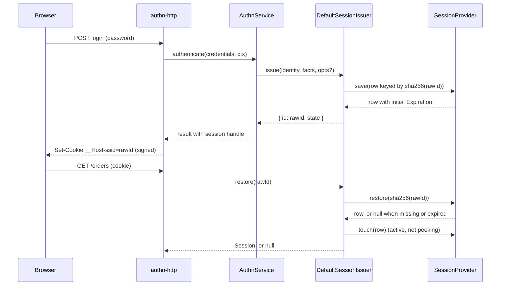

# Issuing and restoring sessions

`DefaultSessionIssuer` is the `SessionIssuer` of `@spinajs/authn`. It creates a session after a login, turns the session cookie back into a `Session` on every request, and re-keys the session when its privileges change. Use it through the `SessionIssuer` token; `AuthnService` and `@spinajs/authn-http` already call it for logins, MFA, logout and role switches.

## How it works

### Issue a session

`AuthnService` calls `issue(identity, facts, opts?)` after a successful login ([How a login runs](../authn/01-authentication-flow.md)).

1. `DefaultSessionIssuer.issue()` draws a raw id: 16 random bytes (`crypto.randomBytes`), base64url, 22 characters.
2. It builds a `UserSession` row keyed by `storageKeyOf(rawId)`, the sha256 hex of the raw id. The row holds the subject, the impersonator from `facts.impersonator`, `Creation` = now, and in `Data` the authentication facts and a last-seen time.
3. With `opts.pending` (MFA steps still required) the row is `pending`, its `Expiration` is now + `authn.session.pendingTtlSeconds`, and `Data` keeps the step names. Without it the row is `active` with no `Expiration`.
4. `SessionProvider.save()` stores the row. An active row without `Expiration` gets its initial expiration from the [expiration strategy](03-expiration-strategies.md) there.
5. `issue` returns the `SessionHandle` `{ id: rawId, state }`. The raw id lives only in memory and in the cookie; no store ever holds it.

### Restore a session on each request

`AuthnMiddleware` of `@spinajs/authn-http` reads the signed session cookie and calls `restore(rawId)`.

1. `restore()` answers `null` for an id that is not a string, is empty, or is longer than 128 characters.
2. It reads the row with `SessionProvider.restore(storageKeyOf(rawId))`. The store answers `null` for a missing or expired row.
3. A row without readable authentication facts answers `null`.
4. An active session is refreshed, unless the call runs inside `peekingSessions()`. The refresh is one `SessionProvider.touch()`, which renews the expiration through the strategy and writes the last-seen time. It runs only when the last-seen time is `authn.session.touchThresholdSeconds` (default 60) old, or when the strategy would move the expiry by at least that much or move it back. Otherwise the restore writes nothing. A pending session is never refreshed.
5. A session that `SessionProvider.isExpired()` finds expired after the renewal (a renewal capped at `Creation + maxLifetime` lands in the past once `maxLifetime` was lowered) is deleted and the answer is `null`.
6. `resolveSession()` builds the class registered as `Session` (see [Custom session class](08-custom-session-class.md)) from the handle, the identity, the facts and the public data. The facts carry `sessionHandle`, a one-way value from the storage key (see [Revocation and the session list](02-revocation-and-session-list.md#handles)).



### Rotate, elevate, reissue and write data

- `rotate(h)` re-keys the session under a fresh raw id and keeps its data, `Creation` and `Expiration`. Use it against session fixation; the role switch of `@spinajs/authn-http` rotates.
- `elevate(h, facts)` turns a pending session into an active `aal2` session under a fresh id. It drops the pending steps, takes `method`, `strategy`, `mfa` and `authenticatedAt` from `facts` (the stored values otherwise), and lets the store give the row its initial active expiration. `AuthnService.completeMfa()` calls it.
- `reissue(h, change)` moves an active session to a fresh id with `change` merged into its facts: `assurance: 'aal2'` raises it (a change never lowers it), `mfa` and `authenticatedAt` replace the stored values when given. Data, subject, impersonator, `Creation` and `Expiration` are kept. A pending session is refused. `AuthnService.stepUp()` calls it.
- `set(h, key, value)` writes one data entry, then checks the row still exists. The write goes through `SessionProvider.touch()`, the store's update-only write, so it also renews the expiration of an active session.
- `peek(rawId)` is `restore` without the refresh: it neither slides the idle deadline nor writes the last-seen time. It is a method of `DefaultSessionIssuer`, not of the `SessionIssuer` contract. `peekingSessions(fn)` makes every `DefaultSessionIssuer.restore()` inside `fn` behave like `peek`, including restores made by code that `fn` calls. Another `SessionIssuer` implementation ignores it.

`rotate`, `elevate` and `reissue` all run the same move:

1. Save the copy under the new storage key.
2. A copy that the store finds already expired (an `elevate` of a session older than `maxLifetime`, whose initial expiration is capped at `Creation + maxLifetime`) deletes both rows and throws `InvalidOperation('Unknown or expired session')`.
3. Read the old row, then delete it. When the old row is gone (a logout or ban in the meantime) or another call deleted it first, the copy is deleted and the call throws `InvalidOperation('Unknown or expired session')`.
4. Return the new handle. The caller sends the new cookie.

## Configuration

| Key | Type | Default | Allowed values | Meaning |
| --- | --- | --- | --- | --- |
| `authn.session.pendingTtlSeconds` | integer | `300` | 1 or more | Lifetime of a pending (pre-MFA) session, counted from `issue`, never extended by use |
| `authn.session.service` | string | `'MemorySessionStore'` (shipped config; the schema has no default) | a registered `SessionProvider` class name | The store, see [Session stores](04-session-stores.md) |
| `authn.session.hashIds` | boolean | `true` | `true` only | Session ids are always stored hashed; the schema refuses `false` |

The expiration keys are on [Expiration strategies](03-expiration-strategies.md#configuration), the cookie keys on [Session cookie](07-session-cookie.md#configuration).

```ts
authn: {
  session: {
    service: 'RedisSessionStore',
    pendingTtlSeconds: 180,
  },
},
```

## Services and extension points

| Service | DI token and lifetime | Default implementation | Alternatives | How to replace or extend |
| --- | --- | --- | --- | --- |
| Session issuer | `SessionIssuer` (from `@spinajs/authn/contracts`), registered by `@Injectable(SessionIssuer)` on import; `@PerChildInstance()`: one per container, so a child container builds its own issuer, which reads that container's `authn.session` (store, `pendingTtlSeconds`) | `DefaultSessionIssuer` | `MemorySessionIssuer` of `@spinajs/authn-testing` for tests | Subclass and register as `SessionIssuer`: [Extending the session issuer](09-extending-the-session-issuer.md) |
| Store | `SessionProvider`, picked by name from `authn.session.service` through `@AutoinjectService` | `MemorySessionStore` | `DbSessionStore`, `RedisSessionStore`, `DynamoDbSessionProvider` | [Session stores](04-session-stores.md), [Writing a session store](05-writing-a-session-store.md) |
| Restored session | `Session` (from `@spinajs/authn/contracts`), built per restore by `resolveSession()` | `Session` | Your subclass | [Custom session class](08-custom-session-class.md) |

Exports used with the issuer:

| Export | Value | Use |
| --- | --- | --- |
| `SESSION_IP_KEY` | `'Ip'` | Data key of the client IP; `@spinajs/authn-http` writes it with `set` after a login, `list` shows it |
| `SESSION_USER_AGENT_KEY` | `'UserAgent'` | Data key of the client user agent, written and shown like `SESSION_IP_KEY` |
| `SESSION_PENDING_STEPS_KEY` | `'authn:pendingSteps'` | In `restore(...).data` of a pending session only: the MFA steps it waits for, a frozen non-empty array. Absent when the session was issued with no steps. `set` refuses it |
| `storageKeyOf(rawId)` | sha256 hex of `rawId` | The key a store sees for a raw id |
| `sessionHandleOf(storageKey)` | sha256 hex of a domain-separated storage key | The handle `list` shows and `AuthnFacts.sessionHandle` carries |
| `peekingSessions(fn)` | `Promise` of `fn()` | Runs `fn` with every `DefaultSessionIssuer.restore()` in it working as `peek` |

## Important behaviour

- **Hashed ids.** A store holds only `sha256(rawId)`. A stored hash used as a cookie value is hashed again and finds nothing, so a leaked store row does not give a working cookie.
- **Facts are the issuer's.** `AuthnFacts.sessionHandle` passed to `issue` is ignored; the handle is always derived from the storage key. The impersonator comes from the row, not from the stored facts.
- **Reserved data keys.** `set` throws `InvalidArgument` for a key that starts with `authn:` and for `Subject`, `State` and `Impersonator`. Data can therefore never change the subject, the state or the assurance of a session.
- **Hidden entries.** `Session.data` holds every entry except those starting with `authn:`; a pending session also gets `SESSION_PENDING_STEPS_KEY`.
- **Errors.** `rotate`, `elevate`, `reissue` and `set` throw `InvalidArgument('Malformed session handle')` for a handle whose id is not a string of 1 to 128 characters, and `InvalidOperation('Unknown or expired session')` for a missing or expired row. `elevate` throws `InvalidOperation('Only a pending session can be elevated')` for an active session, and `reissue` throws `InvalidOperation('Only an active session can be reissued')` for a pending one. `restore` and `peek` never throw for a bad id; they answer `null`.
- **Revocation wins.** `restore`, `set`, `rotate`, `elevate` and `reissue` write through update-only `touch` or check the old row before keeping a copy. A logout or ban that lands in parallel is never undone. Of parallel rotations, elevations or reissues of one session exactly one succeeds.
- **Lifetime is kept.** `rotate` keeps `Creation` and `Expiration`, so rotating never resets the lifetime. A pending session's TTL counts from `issue`; `set` and `rotate` never extend it.
- **At most one write per threshold window.** A `restore` of an active session calls `touch` only when the last-seen time or the expiry moves by `authn.session.touchThresholdSeconds` (default 60). Most requests read the row and write nothing. As a result, the stored idle deadline can trail the last request by up to the threshold, so a sliding session can expire up to that much earlier than it would with a write on every request. Set `touchThresholdSeconds: 0` to write on every restore.
- **Pending sessions** yield no principal in `@spinajs/authn-http` and are not shown by `list`.
- **No request context.** The issuer takes no request. The client IP and user agent reach the session only through `set`.

## Best practices

- Run background checks of a session (a socket sweep, a job that validates a stored handle) inside `peekingSessions()` or through `peek()`, so they do not count as user activity.
- Log `session.facts.sessionHandle`, never `session.handle.id`: the raw id is a bearer credential.
- Define a typed key with `sessionKey()` from `@spinajs/authn/contracts` and read it with `Session.get()`, instead of reading `Session.data` by string.
- Raise a live session through `AuthnService.stepUp()` (`POST /auth/mfa/step-up`), which verifies the factor and then calls `reissue`; never call `reissue` without a verified factor. Call `rotate` after any other change of privileges your app adds on top of authn, and send the new cookie.

## Patterns and antipatterns

```ts
// Don't: a background check that calls restore slides the idle timeout, so an idle tab never logs out
const session = await sessions.restore(rawId);

// Do: validate without counting it as activity (issuer: DefaultSessionIssuer)
const session = await issuer.peek(rawId);
// or, for code you do not control:
await peekingSessions(() => revalidateSocket(rawId));
```

```ts
// Don't: switch the identity of a live session through its data; set refuses these keys
await sessions.set(handle, 'Subject', { type: 'user', id: otherUserUuid });

// Do: issue a new session for the other identity and end the old one, as impersonation does
const next = await sessions.issue({ type: 'user', id: otherUserUuid }, facts);
await sessions.revoke(handle);
```

## Examples

### Remember the warehouse a picker works in

```ts sample
import '@spinajs/authn-session';
import { DI } from '@spinajs/di';
import { SessionIssuer, sessionKey } from '@spinajs/authn/contracts';
import type { Session, SessionHandle } from '@spinajs/authn/contracts';

const Warehouse = sessionKey('Warehouse', (raw) => (typeof raw === 'string' && /^WH-\d{3}$/.test(raw) ? raw : undefined));

/** Stores the choice on the server side of the session; the cookie does not change. */
export async function chooseWarehouse(handle: SessionHandle, code: string): Promise<void> {
  const sessions = await DI.resolve(SessionIssuer);
  await sessions.set(handle, Warehouse.name, code);
}

/** Reads it back from the session AuthnMiddleware restored for this request. */
export function currentWarehouse(session: Session | null): string | undefined {
  return session?.get(Warehouse);
}
```

## Related

- [`@spinajs/authn`](../authn/01-authentication-flow.md): when a login issues a pending or an active session, and when MFA elevates it.
- [`@spinajs/authn-http`](../authn-http/README.md): reads the cookie, restores the session per request and sends the new cookie after a rotation.
- [Expiration strategies](03-expiration-strategies.md): what `save` and `touch` set as the expiration.
- [Session cookie](07-session-cookie.md): the cookie that carries the raw id.
