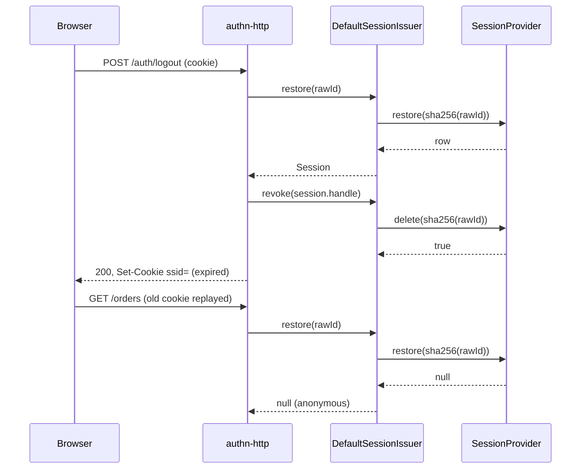

# Revocation and the session list

`DefaultSessionIssuer` ends sessions on the server: one session (logout), every session of an identity (ban, password reset, "sign out everywhere"), or one session picked from the device list. Revocation deletes the store row, so the next request with that cookie finds nothing.

## How it works

### Log out: `revoke(handle)`

1. `revoke(h)` computes the storage key of `h.id`. A malformed handle (an id that is not a string of 1 to 128 characters) answers `false`.
2. It calls `SessionProvider.delete(storageKey)`.
3. It answers `true` only when this call removed a row. The store's delete is one atomic operation, so of parallel revokes of one session exactly one gets `true`.

`POST /auth/logout` of `@spinajs/authn-http` calls `revoke` with the session of the cookie, pending sessions included, and clears the cookie with [`clearSessionCookie`](07-session-cookie.md).



### End every session of an identity: `revokeAll(subject, opts?)`

1. `revokeAll()` calls `SessionProvider.deleteBySubject(subject, { includeImpersonations, except })`. `except` is the storage key of `opts.except`.
2. The store deletes every row whose `Subject` is the subject, and with `includeImpersonations: true` also every row whose `Impersonator` is the subject.
3. It answers the number of live sessions deleted.

Callers in the monorepo:

| Caller | Options | When |
| --- | --- | --- |
| `revokeUserSessions()` of `@spinajs/users` | `includeImpersonations: true` | Ban, deactivation, deletion |
| `@spinajs/authn-local` password change and reset | see [`@spinajs/authn-local`](../authn-local/README.md) | The change keeps the current session; the reset ends all |
| `AuthnImpersonationService.endFor()` of `@spinajs/authn` | `includeImpersonations: true` | A subject or impersonator found banned, inactive or deleted |
| `DELETE /user/sessions` of `@spinajs/authn-http` | `except: current` | "Sign out on all other devices" |

### List the devices: `list(subject, opts?)`

1. `list()` calls `SessionProvider.listBySubject(subject)`: live rows whose `Subject` is the subject. Sessions in which someone impersonates the subject are included (their `Subject` is the subject); sessions the subject impersonates from are not.
2. It keeps active rows only; pending sessions are never listed.
3. Each entry is `{ handle, createdAt, lastSeenAt, ip?, userAgent?, current? }`. `lastSeenAt` is the last-seen time the issuer records (at most once a minute), or `createdAt` when missing. `ip` and `userAgent` come from the `SESSION_IP_KEY` and `SESSION_USER_AGENT_KEY` data entries. `current: true` marks the row of `opts.current`.

`GET /user/sessions` of `@spinajs/authn-http` returns this list for the caller.

### End one listed session: `revokeHandle(subject, handle)`

1. `revokeHandle()` answers `false` for a handle that is not a string.
2. It lists the subject's rows, as `list` does, and deletes the first row whose `Subject` is the subject and whose handle equals `handle`.
3. It answers `true` when it found that row, `false` otherwise.

`DELETE /user/sessions/:handle` of `@spinajs/authn-http` calls it with the caller as subject. A handle of another user's session finds no row and answers `false`; the subject can never end a session it only impersonates from.

### Handles

A handle is `sessionHandleOf(storageKey)`: sha256 hex of a domain-separated prefix plus the storage key. It is one-way from the storage key, which is one-way from the raw id. A handle is safe to show to the user, to log and to put in a URL; it cannot be turned back into a cookie or a store key. The same value is `AuthnFacts.sessionHandle` of the restored session and the `session` of authn audit events.

## Services and extension points

| Service | DI token and lifetime | Default implementation | Alternatives | How to replace or extend |
| --- | --- | --- | --- | --- |
| Session issuer | `SessionIssuer`, singleton | `DefaultSessionIssuer` | | [Extending the session issuer](09-extending-the-session-issuer.md) |
| Subject matching and deletion | `SessionProvider.deleteBySubject()` and `listBySubject()` of the configured store | `MemorySessionStore` | the shipped stores | [Writing a session store](05-writing-a-session-store.md) |

## Important behaviour

- **Server-side.** Revocation deletes the row. A copied or replayed cookie stops working at once, on every server that shares the store. `MemorySessionStore` is per process, so it revokes only in that process.
- **Count of live sessions.** `MemorySessionStore.deleteBySubject()` also removes matching expired rows, but counts only the live ones.
- **Impersonation.** Revoking the impersonator with `includeImpersonations: true` reaches the session in which it acts as someone else, because the row indexes `Impersonator`.
- **No IDOR.** `revokeHandle` checks the owner: the handle alone never ends a session.
- **Deleting a user.** Call `revokeAll` before you delete a user. A session row references the subject by `IdentityRef`, not by a foreign key, so no `ON DELETE CASCADE` reaches it (see the `user_sessions` table of [`@spinajs/session-provider-db`](../session-provider-db/02-session-table-and-migrations.md)).
- **Revocation during a rotation.** A revocation that lands while `rotate`, `elevate` or `set` runs stays in force; see [Issuing and restoring sessions](01-issuing-and-restoring-sessions.md#important-behaviour).

## Best practices

- Pass `includeImpersonations: true` whenever the identity may no longer act (ban, deactivation, compromised account), so it cannot keep acting through an impersonation it started.
- Pass `except` with the caller's own handle for "sign out on all other devices", so the caller keeps the session that made the request.
- Show the user `handle`, `createdAt`, `lastSeenAt`, `ip` and `userAgent` from `list`; never derive anything from the raw cookie.

## Patterns and antipatterns

```ts
// Don't: delete rows in the store directly; a raw id is never a store key, so this deletes nothing
await store.delete(rawIdFromCookie);

// Do: go through the issuer, which hashes the id
await sessions.revoke({ id: rawIdFromCookie, state: 'active' });
```

## Examples

### Lock a compromised account out on every device

```ts sample
import '@spinajs/authn-session';
import { DI } from '@spinajs/di';
import { SessionIssuer } from '@spinajs/authn/contracts';

/** Called by the fraud check: ends the user's sessions and any impersonation they run. */
export async function lockOut(userUuid: string): Promise<number> {
  const sessions = await DI.resolve(SessionIssuer);
  return sessions.revokeAll({ type: 'user', id: userUuid }, { includeImpersonations: true });
}
```

### Let a user end a session from the device list

```ts sample
import '@spinajs/authn-session';
import { DI } from '@spinajs/di';
import { SessionIssuer } from '@spinajs/authn/contracts';
import type { Session } from '@spinajs/authn/contracts';

/** `handle` comes from a row of `list`; a handle of another user's session answers false. */
export async function endDevice(caller: Session, handle: string): Promise<boolean> {
  const sessions = await DI.resolve(SessionIssuer);
  return sessions.revokeHandle(caller.identity, handle);
}
```

## Related

- [Impersonation and the active role](../authn/11-impersonation-and-active-role.md): impersonation start and end issue a new session and revoke the old one.
- [`@spinajs/users`](../users/03-user-actions.md): ban, deactivation and deletion end the user's sessions.
- [`@spinajs/users-http`](../users-http/07-lifecycle-and-sessions.md): admin routes that list and end a user's sessions.
- [Writing a session store](05-writing-a-session-store.md): what `deleteBySubject` and `listBySubject` must match.
