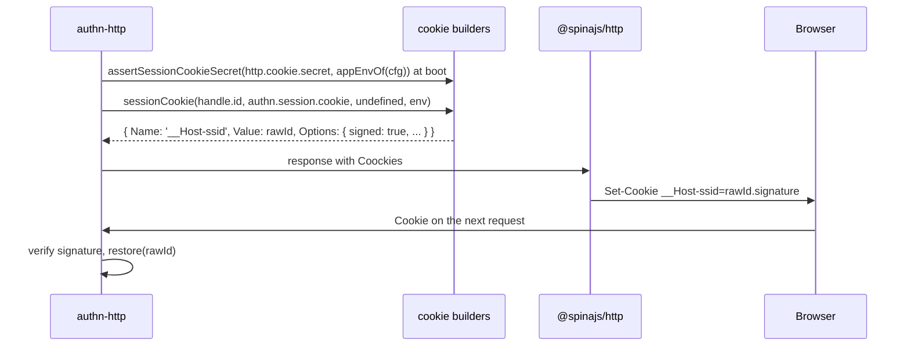

# Session cookie

The session cookie carries the raw session id to the browser. This package builds it: name, flags, signing, the cleared variant for logout, and the boot check of the signing secret. `@spinajs/authn-http` sends it on login, MFA completion and role switch, reads it on every request, and clears it on logout. Use the builders directly only when you write your own login route or another transport.

## How it works

### Build the cookie

1. `sessionCookie(rawId, config, expiration?, env?)` returns `{ Name, Value: rawId, Options }`, the shape of the `Coockies` response option of `@spinajs/http`.
2. `sessionCookieName(config, env)` gives the name: `config.name` (default `ssid`), prefixed `__Host-` when `hostPrefix` is on.
3. `sessionCookieOptions(config, maxAge, env)` builds the options:
   1. every key of `config` except `name` and `hostPrefix` is copied (`domain`, `path`, `priority` and other express options);
   2. then the security flags are set over them: `httpOnly: true`, `secure` from the `secure` flag, `sameSite` from config or `'strict'`, `maxAge`;
   3. with `hostPrefix` on: `secure: true`, `path: '/'`, and `domain` removed, as browsers require for the prefix.
4. `sessionCookie` adds `signed: true`; `@spinajs/http` signs the value with `http.cookie.secret`.
5. `maxAge` comes from `expiration` through `cookieMaxAge()`; with no `expiration` the cookie is a browser-session cookie. `@spinajs/authn-http` passes none, so its cookie has no `Max-Age` and the server enforces the timeouts.

`clearSessionCookie(config, env)` returns the same name and flags with an empty value, `maxAge: 0` and `signed: false`.

### Flags and the app env

A flag (`hostPrefix`, `secure`) of `'auto'` or unset is on unless the app env is development or test. `true` or `'true'` turns it on. `false` or `'false'` turns it off. Any other value counts as on.

The env is the `env` argument, which callers get from `appEnvOf(configuration)`: the env the configuration resolved from `--env`, `APP_ENV` or `NODE_ENV`. When none of them was set and the configuration fell back to development, `appEnvOf` answers `undefined`, and an absent env means production. The builders never read `NODE_ENV` themselves.

| App env | `'auto'` flags | Cookie |
| --- | --- | --- |
| `development`, `test` | off | `ssid`, not `Secure`, `HttpOnly`, `SameSite=Strict` |
| any other, or none named | on | `__Host-ssid`, `Secure`, `Path=/`, `HttpOnly`, `SameSite=Strict` |

### Check the signing secret

`assertSessionCookieSecret(secret, env)` throws `InvalidOption` when:

- the secret is missing or empty: `'http.cookie.secret is not set; session cookies cannot be signed'`;
- the secret is `PUBLIC_DEFAULT_COOKIE_SECRET`, the value `@spinajs/http` ships, and the env is not development or test.

`@spinajs/authn-http` calls it when its middleware and its socket session source start, so a deployment with the public secret fails at boot.



## Configuration

| Key | Type | Default | Allowed values | Meaning |
| --- | --- | --- | --- | --- |
| `authn.session.cookie.name` | string | `'ssid'` | non-empty | Base name, before any `__Host-` prefix |
| `authn.session.cookie.hostPrefix` | boolean or string | `'auto'` | `true`, `false`, `'true'`, `'false'`, `'auto'` | Emit `__Host-<name>`; forces `Secure`, `Path=/` and no `Domain` |
| `authn.session.cookie.secure` | boolean or string | `'auto'` | `true`, `false`, `'true'`, `'false'`, `'auto'` | The `Secure` flag; ignored (always on) while `hostPrefix` is on |
| `authn.session.cookie.sameSite` | string or boolean | `'strict'` | `true`, `false`, `strict`, `lax`, `none` in any letter case | The `SameSite` attribute, passed to express as given |
| `authn.session.cookie.<other>` | any | | express cookie options | `domain`, `path`, `priority` and others pass through to express. `httpOnly` and `signed` cannot be changed |
| `http.cookie.secret` | string | `'1234adreewD'` (public) | non-empty; not the public default outside development and test | Signs the cookie; owned by [`@spinajs/http`](../http/20-cookies.md#configuration) |

```ts
authn: {
  session: {
    cookie: { name: 'shop_sid', hostPrefix: 'auto', secure: 'auto', sameSite: 'lax' },
  },
},
http: {
  cookie: { secret: process.env.COOKIE_SECRET },
},
```

## Services and extension points

The builders are plain functions; there is nothing to register. Call them from your own route to stay consistent with `@spinajs/authn-http`.

| Export | Signature | Use |
| --- | --- | --- |
| `sessionCookie` | `(rawId, config?, expiration?, env?) => ISessionCookieDescriptor` | The signed session cookie |
| `clearSessionCookie` | `(config?, env?) => ISessionCookieDescriptor` | The expired cookie that clears it on logout |
| `sessionCookieName` | `(config?, env?) => string` | The name to read from `req.cookies` |
| `sessionCookieOptions` | `(config?, maxAge?, env?) => Record<string, unknown>` | The options alone |
| `cookieMaxAge` | `(expiration: DateTime \| undefined) => number \| undefined` | Milliseconds until `expiration`, never negative; `undefined` for none |
| `sessionCookieMaxAge` | `(session: ISession) => number \| undefined` | `cookieMaxAge(session.Expiration)` |
| `appEnvOf` | `(config: Configuration) => string \| undefined` | The app env as authn reads it; `undefined` means production |
| `assertSessionCookieSecret` | `(secret, env?) => void` | The boot check above |
| `SESSION_COOKIE_BASE_NAME` | `'ssid'` | Default base name |
| `PUBLIC_DEFAULT_COOKIE_SECRET` | `'1234adreewD'` | The public secret `@spinajs/http` ships |
| `ISessionCookieConfig`, `SessionCookieFlag`, `ISessionCookieDescriptor` | types | The `authn.session.cookie` shape, a flag value, the built cookie |

## Important behaviour

- **No production env, production cookie.** A deployment that names no env gets `Secure` and `__Host-`, and the public secret fails boot. Only an env source that names development or test relaxes them.
- **`secure: false` alone does not relax the cookie** while `hostPrefix` resolves on. For plain http on localhost, name the env (`APP_ENV=development`).
- **Cannot be downgraded.** The security flags are set after the passthrough keys, so `httpOnly: false` in config has no effect.
- **The cookie value is the raw id**, the bearer credential of the session. The store holds only its hash.
- **The cleared cookie is unsigned**, with an empty value and the same name, path and flags, so the browser replaces and drops the signed one.

## Best practices

- Set `http.cookie.secret` from a secret source in every deployment, and set `APP_ENV` or `NODE_ENV` explicitly.
- Keep `sameSite: 'strict'`. `'lax'` also sends the cookie on top-level navigations from other sites; choose it only when such a navigation must arrive signed in.
- Leave `hostPrefix` on outside development: it stops a sibling subdomain from planting a session cookie.

## Patterns and antipatterns

```ts
// Don't: hand-build the cookie; a missing flag or a forgotten prefix slips through
res.cookie('ssid', handle.id, { httpOnly: true });

// Do: use the builder with the configured block and the resolved env
const cookie = sessionCookie(handle.id, config.get('authn.session.cookie', {}), undefined, appEnvOf(config));
```

## Examples

### Send the session cookie from your own login route

```ts sample
import { DI } from '@spinajs/di';
import { Configuration } from '@spinajs/configuration';
import { appEnvOf, sessionCookie } from '@spinajs/authn-session';
import type { ISessionCookieConfig, ISessionCookieDescriptor } from '@spinajs/authn-session';
import type { SessionHandle } from '@spinajs/authn/contracts';

/** The cookie for the `Coockies` response option, with the same flags authn-http sends. */
export async function cookieFor(handle: SessionHandle): Promise<ISessionCookieDescriptor> {
  const config = await DI.resolve(Configuration);
  const cookieConfig = config.get<ISessionCookieConfig>('authn.session.cookie', {}) ?? {};
  return sessionCookie(handle.id, cookieConfig, undefined, appEnvOf(config));
}
```

## Related

- [`@spinajs/http`](../http/20-cookies.md): cookie parsing and signing with `http.cookie.secret`.
- [`@spinajs/authn-http`](../authn-http/README.md): sends, reads and clears this cookie.
- [Environments](../configuration/02-environments.md): how the app env is resolved.
- [Configuration and boot checks](../authn/13-configuration-and-boot-checks.md#app-env): the rule that an unnamed env is production.
