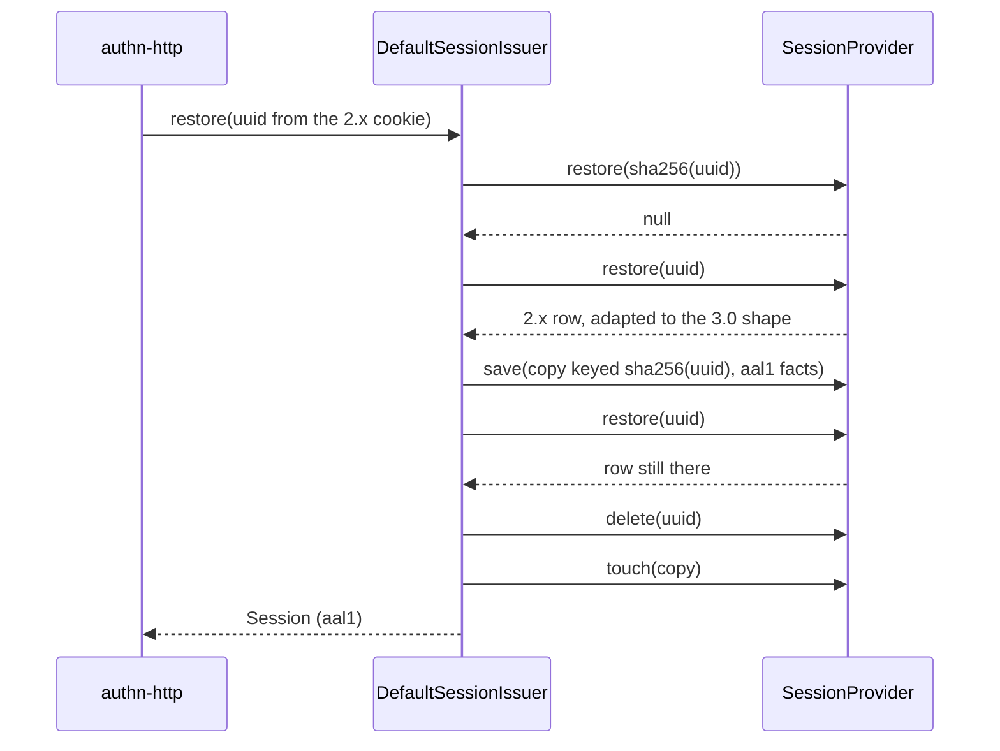

# 2.x session migration

Users signed in under SpinaJS 2.x stay signed in after the upgrade. A 2.x session row is keyed by its raw id and keeps its identity in `Data`. The issuer finds it by the raw id on its first request, re-saves it under the sha256 key, and deletes the raw row. Until then, revocation and the device list already reach it.

## How it works

### What a 2.x row is

- `SessionId` is the raw id, a lowercase uuid v4; `isLegacySessionId(id)` tests for exactly that shape. A 3.0 raw id (22 base64url characters) and a 3.0 storage key (64 hex characters) never match it.
- There is no `Subject`, `Impersonator` or `State`. `Data` holds `User` (the `users.Uuid`), `Authorized` (`true` after 2FA) and `Impersonator`: the `LEGACY_IDENTITY_KEYS`.
- `adaptLegacySession(row)` gives the 3.0 view of any row. A row with a `Subject` comes back as is. A 2.x row gets `Subject: { type: 'user', id: User }`, `Impersonator` from `Impersonator`, and `State: 'active'` only when `Authorized` is exactly `true`, else `'pending'`. A 2.x row without a non-empty `User` is `null` (absent). The result keeps the row's prototype.

Every store passes rows through `adaptLegacySession()`, so `restore`, `listBySubject` and `deleteBySubject` see 2.x rows in the 3.0 shape.

### First request with a 2.x cookie

1. `DefaultSessionIssuer.restore(rawId)` finds nothing under `sha256(rawId)`. The raw id is a uuid v4, so it calls `migrate(rawId)`. Parallel first uses in one process share one migration.
2. `migrateOnce()` reads the row under the raw id. Not found: another process may have migrated it, so it reads `sha256(rawId)` once more and returns that.
3. A row whose `Data` carries a non-empty `ActiveRole` (a role of the removed 2.x RBAC model, which 3.0 would read as a role ceiling) is deleted and never migrated: that user must log in again.
4. The copy drops the `User`, `Authorized`, `Impersonator`, `Logged` and `TwoFactorAuth` entries and keeps the rest of `Data`. It gets facts `{ method: 'password', strategy: 'local', assurance: 'aal1', mfa: [], authenticatedAt: Creation }`: 2.x data cannot show that MFA passed.
5. A pending row (never passed 2FA) keeps no MFA steps, and its expiration is capped at now + `authn.session.pendingTtlSeconds`. An active row keeps its 2.x expiration.
6. The copy is saved under `sha256(rawId)` with the original `Creation`, subject and impersonator.
7. When the raw row is gone by now (a revocation got there first), the copy is deleted and the answer is `null`. Otherwise the raw row is deleted.
8. `restore` continues as for any session: the active session is touched, so the expiration strategy renews it, capped at `Creation + maxLifetime`. A row already past `maxLifetime` is deleted and the answer is `null`.



### Revocation and listing before the migration

| Issuer call | Reaches an unmigrated 2.x row by |
| --- | --- |
| `revoke(h)` | With a uuid v4 `h.id`, also deleting the raw row |
| `revokeAll(subject, opts)` | The store matching `Data` `User` (and `Impersonator` with `includeImpersonations`) |
| `list(subject)` | The store's `listBySubject`; the row is listed under the handle of its future hashed key, so the handle does not change on migration |
| `revokeHandle(subject, handle)` | The same handle; it deletes the raw row and its hashed copy, so an interrupted migration leaves nothing |

## Configuration

| Key | Type | Default | Allowed values | Meaning |
| --- | --- | --- | --- | --- |
| `authn.session.pendingTtlSeconds` | integer | `300` | 1 or more | Cap on the remaining life of a migrated pending row |
| `authn.session.expiration.maxLifetime` | integer | `480` | 1 or more | Minutes from the 2.x `Creation`; an older row does not come back, even for one request |

## Services and extension points

| Service | DI token and lifetime | Default implementation | Alternatives | How to replace or extend |
| --- | --- | --- | --- | --- |
| Row adapter | function `adaptLegacySession(row)` | | | Call it in every read path of a [custom store](05-writing-a-session-store.md) |
| Id test | function `isLegacySessionId(id)` | | | |
| Migration | protected `DefaultSessionIssuer.migrate()` / `migrateOnce()` | | | [Extending the session issuer](09-extending-the-session-issuer.md) |

Store-specific steps (the `user_sessions` migrations, the Redis boot sweep) are in each store's docs: [session table and migrations](../session-provider-db/02-session-table-and-migrations.md), [2.x sessions and the boot sweep](../session-provider-redis/02-legacy-session-sweep.md).

## Important behaviour

- **Only uuid v4 falls back.** Any other cookie value is looked up by its hash only, so a stored hash can never be used as an id.
- **Migrated sessions are `aal1`** with no MFA step in their facts, so authorization conditions on `principal.authn.assurance` treat them as single-factor.
- **No pending steps.** A migrated pending session exposes no `SESSION_PENDING_STEPS_KEY`; `@spinajs/authn-http` then asks the MFA policy for the steps, and the flow never elevates on an empty list.
- **Fail closed.** A revocation that races the migration wins: the copy is dropped.
- **A ban right after the upgrade works.** The store's `deleteBySubject` matches 2.x rows by their `Data` entries before any of them is migrated.
- **No 2.x reader sees a logged-in row.** The migrated row drops `Logged`, `TwoFactorAuth` and the identity entries, so a 2.x instance still running beside 3.0 does not treat it as signed in.

## Best practices

- Run the store's own upgrade step before 3.0 serves traffic: the `user_sessions` migrations of `DbSessionStore`, the boot sweep of `RedisSessionStore`. Without them a ban may miss 2.x rows.
- Use `revokeAll` or `revokeHandle` for 2.x users as for any other: both reach unmigrated rows.

## Patterns and antipatterns

```ts
// Don't: look a 2.x row up by its raw id in your own code after the upgrade; it may already live under the hash
const row = await store.restore(uuidFromOldCookie);

// Do: let the issuer find and migrate it
const session = await sessions.restore(uuidFromOldCookie);
```

## Examples

### Check whether a stored row still waits for migration

```ts sample
import { adaptLegacySession, isLegacySessionId } from '@spinajs/authn-session';
import type { ISession } from '@spinajs/authn-session';

/** For an upgrade report: rows still keyed by a 2.x raw id, with the owner they map to. */
export function pendingMigration(rows: ISession[]): { owner: string; active: boolean }[] {
  return rows
    .filter((row) => isLegacySessionId(row.SessionId))
    .map((row) => adaptLegacySession(row))
    .filter((row): row is ISession => row !== null)
    .map((row) => ({ owner: row.Subject.id, active: row.State === 'active' }));
}
```

## Related

- [Session stores](04-session-stores.md): `restore` returns 2.x rows in the 3.0 shape.
- [Revocation and the session list](02-revocation-and-session-list.md): handles and revocation.
- [Migration guide](../authz/migration-guide.md): the whole 2.x to 3.0 upgrade.
