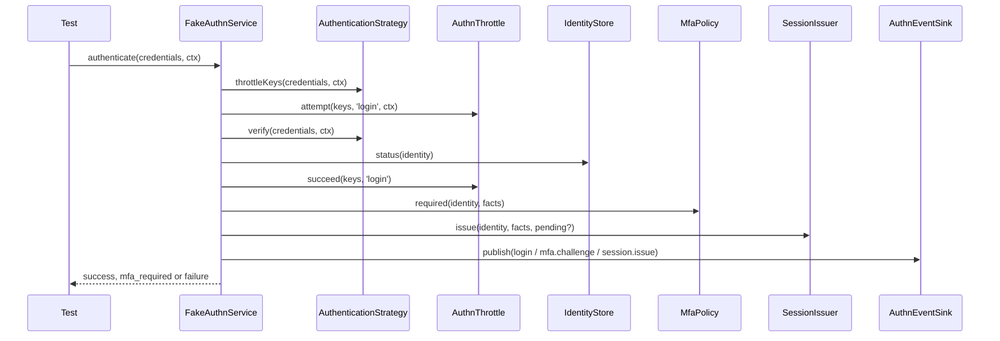

# Fake authentication service

`FakeAuthnService` runs the authentication flow (login, MFA completion, re-authentication, principal building) over the contracts you hand it. Use it to log a test user in when your code needs a session, a result or a `Principal`, and as the `service` port of a behaviour harness for a package that does not own `AuthnService`.

It is a test double. It is **not** the `AuthnService` that `@spinajs/authn` registers, and it reads no config: everything comes from its constructor.

## How it works

`authenticate(credentials, ctx)`:

1. Picks the first strategy whose `kinds` include `credentials.kind`. None: publishes a `login` failure event and answers `unsupported_credentials`.
2. Builds the throttle keys from `strategy.throttleKeys()`. Account keys get a `login:` prefix for an interactive strategy, or a `request:` prefix and the client IP for a per-request one. An `ip` key is added when `ctx.ip` is set.
3. Counts the attempt in the `login` flow:
   - interactive strategy, or a throttle without `peek`: `throttle.attempt()` before `verify`;
   - per-request strategy with a throttle that has `peek` (`FakeBackoffThrottle`): `peek()` before `verify`, and `attempt()` only after a failure.

   A refusal publishes `throttle.block` and answers `{ status: 'failure', reason: 'throttled', retryAfterSeconds }`.
4. Calls `strategy.verify()`. A failed outcome publishes a `login` failure with the strategy's reason and answers that reason.
5. Resolves the identity: the outcome's `identity`, or for an `external` subject an existing link, then a verified-email match, then JIT provisioning. Email matching needs `linking.byVerifiedEmail` and the strategy's own `linkingFor().byVerifiedEmail`; JIT needs `linking.jit`, the strategy's `linkingFor().jit` and `IdentityStore.provision`. A new match is linked through the link store. No identity: answers `not_linked`.
6. Checks `IdentityStore.status()`. An unknown, deleted, banned or inactive identity publishes a failure with that reason and answers `invalid_credentials`.
7. For an interactive login, with `hooks` given, runs the rest of the login (steps 8 to 10) through `authn.login.identified`, as the core does: the input carries `identity`, `strategy`, `method`, `external` (an external login only), `attributes` and `ctx`, and only `attributes` is mutable. A refusal publishes a `login` failure with reason `hook:<code>`, a hook that throws or times out one with `hook_error`; both answer `invalid_credentials`. The fake runs no other action.
8. Calls `throttle.succeed(keys, 'login')`.
9. Per-request strategy: publishes `token.use` and answers success with no session, carrying the outcome's `ceiling`, `delegation` and `attributes`.
10. Interactive strategy: asks `MfaPolicy.required()`. Steps required: issues a pending session, publishes `mfa.challenge` and answers `mfa_required` with `pending` and `steps`. Otherwise: issues a session, publishes `login` and `session.issue`, and answers success with `session` and `facts.sessionHandle`.

`completeMfa(pending, step, response, ctx)` restores the pending session, finds the step (or every step with `verifyRecovery` when `step` is `'recovery'`), counts in the `mfa` flow, verifies, then elevates the session to `aal2` with `mfa: [step]`. A wrong code, an unknown step or a session that is not pending answers `invalid_credentials`.

`reauthenticate(session, credentials, ctx)` needs an active session, counts in the `reauth` flow and answers `true` only when the strategy verifies the session's own identity. It changes no session.

`principalOf(result)` passes the identity, the session's stored facts (or the result's facts with `authenticatedAt: new Date()` when there is no session), the `ceiling` and the `attributes` to the `PrincipalFactory`.



## Configuration

`FakeAuthnService` takes one `FakeAuthnServiceDeps` object.

| Key | Type | Default | Allowed values | Meaning |
| --- | --- | --- | --- | --- |
| `strategies` | `readonly AuthenticationStrategy[]` | required | any strategies | Tried in order; the first whose `kinds` match runs |
| `throttle` | `AuthnThrottle` | required | `FakeBackoffThrottle`, `RecordingThrottle`, your own | Counts `login`, `mfa` and `reauth` attempts |
| `identities` | `IdentityStore` | required | `FakeIdentityStore`, your own | Status checks, email matching, JIT provisioning |
| `links` | `IdentityLinkStore` | required | `MemoryLinkStore`, your own | External subject links |
| `linking` | `{ jit: boolean; byVerifiedEmail: boolean }` | required | booleans | Global linking switches; each also needs the strategy's own switch |
| `policy` | `MfaPolicy` | required | `EnrolledMfaPolicy`, your own | Which steps a login must pass |
| `steps` | `readonly MfaStep[]` | required | `FakeMfaStep`, your own | Steps `completeMfa` can verify |
| `sessions` | `SessionIssuer` | required | `MemorySessionIssuer`, your own | Issues, restores and elevates sessions |
| `sinks` | `readonly AuthnEventSink[]` | required | `RecordingEventSink`, your own | Every event goes to every sink; the array is read at publish time |
| `principals` | `PrincipalFactory` | required | `RecordingPrincipalFactory`, your own | Builds the `Principal` |
| `hooks` | `Hooks` (`@spinajs/hooks`) | none | a `DefaultHooks` over your `ActionHook`s | Runs `authn.login.identified` for interactive logins; without it no hook runs |

## Services and extension points

| Service | DI token and lifetime | Default implementation | Alternatives | How to replace or extend |
| --- | --- | --- | --- | --- |
| Authentication flow | `AuthnService` contract; not registered by the kit | `FakeAuthnService` | The real `AuthnService` of `@spinajs/authn` | Subclass and override the protected members below |

Protected members meant for subclasses:

| Member | Default | Override to |
| --- | --- | --- |
| `countBeforeVerify` | `true` | `false` claims the throttle slot only after `verify`. It exists to prove that rule A05 catches that bug |
| `statusReason(status)` | `unknown_identity`, `deleted`, `banned`, `inactive` or `null` | Refuse more statuses, or report other audit reasons |
| `audit(ctx, event)` | Adds `at`, `ip` and `userAgent` from `ctx`, then publishes to every sink | Filter or enrich events |
| `d` | The constructor deps | Read the wired fakes from a subclass |

### Authentication flow: custom implementation

Subclass when your test needs a status rule the fake does not have, for example refusing identities with a pending invite.

```ts sample
import type { IdentityStatus } from '@spinajs/authn/contracts';
import {
  EnrolledMfaPolicy,
  FakeAuthnService,
  FakeBackoffThrottle,
  FakeIdentityStore,
  FakeStrategy,
  MemoryLinkStore,
  MemoryPasswordCredentialStore,
  MemorySessionIssuer,
  RecordingEventSink,
  RecordingPrincipalFactory,
  DEFAULT_THROTTLE,
} from '@spinajs/authn-testing';

class InviteAwareAuthnService extends FakeAuthnService {
  protected override statusReason(st: IdentityStatus): string | null {
    return st.invitePending ? 'invite_pending' : super.statusReason(st);
  }
}

const identities = new FakeIdentityStore();
const passwords = new MemoryPasswordCredentialStore();
export const service = new InviteAwareAuthnService({
  strategies: [FakeStrategy.password({ identities, passwords })],
  throttle: new FakeBackoffThrottle(DEFAULT_THROTTLE),
  identities,
  links: new MemoryLinkStore(),
  linking: { jit: false, byVerifiedEmail: false },
  policy: new EnrolledMfaPolicy([]),
  steps: [],
  sessions: new MemorySessionIssuer(),
  sinks: [new RecordingEventSink()],
  principals: new RecordingPrincipalFactory(),
});
```

## Important behaviour

- Every status refusal answers `invalid_credentials`; only the event carries the real reason. Your code cannot tell a banned user from a wrong password, by design.
- It links an external subject before it checks the identity status. The core `AuthnService` does not.
- Failures never throw; they come back as `{ status: 'failure', reason }`. Only a throttled failure carries `retryAfterSeconds`.
- `completeMfa` with a session that is not pending answers `invalid_credentials` without publishing an event.
- A throttled `reauthenticate` answers `false`, like a wrong password, and publishes nothing.
- Per-request successes carry no session, so `principalOf` stamps `authenticatedAt` with `new Date()`, which follows an installed `FakeClock`.

## Best practices

- Seed users with `fakeSeedPort(identities, passwords)` and the kit users (`ALICE`, `BOB`, `CAROL`, `DAVE` from [test helpers](07-test-helpers.md#kit-users-and-values)), so passwords match the hash `FakeStrategy.password` checks.
- Assert results with `expectSuccess`, `expectMfaRequired`, `expectFailure` and `expectThrottled`; the first two narrow the result type for the next lines.
- Keep the `RecordingEventSink` in a variable and assert on `events.ofType('login')` when a test cares about audit.

## Patterns and antipatterns

```ts
// Don't: a failed login does not throw, so this test passes for a wrong password too
await service.authenticate(pw(ALICE.login, 'typo'), clock.ctx());

// Do: assert the result
expectSuccess(await service.authenticate(pw(ALICE.login, ALICE.password), clock.ctx()));
```

## Examples

### Log in a user who has MFA

```ts sample
import 'mocha';
import assert from 'node:assert/strict';
import {
  ALICE,
  DEFAULT_THROTTLE,
  EnrolledMfaPolicy,
  FakeAuthnService,
  FakeBackoffThrottle,
  FakeClock,
  FakeIdentityStore,
  FakeMfaStep,
  FakeStrategy,
  MemoryLinkStore,
  MemoryPasswordCredentialStore,
  MemorySessionIssuer,
  RecordingEventSink,
  RecordingPrincipalFactory,
  expectMfaRequired,
  expectSuccess,
  fakeSeedPort,
  pw,
} from '@spinajs/authn-testing';

describe('admin console', () => {
  it('admits a user after the TOTP step', async () => {
    const clock = new FakeClock();
    const identities = new FakeIdentityStore();
    const passwords = new MemoryPasswordCredentialStore();
    const totp = new FakeMfaStep({ name: 'totp' });
    const events = new RecordingEventSink();
    const service = new FakeAuthnService({
      strategies: [FakeStrategy.password({ identities, passwords })],
      throttle: new FakeBackoffThrottle(DEFAULT_THROTTLE),
      identities,
      links: new MemoryLinkStore(),
      linking: { jit: false, byVerifiedEmail: false },
      policy: new EnrolledMfaPolicy([totp]),
      steps: [totp],
      sessions: new MemorySessionIssuer(),
      sinks: [events],
      principals: new RecordingPrincipalFactory(),
    });

    const alice = await fakeSeedPort(identities, passwords).user({ login: ALICE.login, password: ALICE.password });
    totp.enrol(alice);

    const first = await service.authenticate(pw(ALICE.login, ALICE.password), clock.ctx());
    expectMfaRequired(first);
    assert.deepEqual(first.steps, ['totp']);

    const done = await service.completeMfa(first.pending, 'totp', totp.nextCode(alice), clock.ctx());
    expectSuccess(done);
    assert.equal(done.facts.assurance, 'aal2');
    assert.equal(events.ofType('mfa.verify').length, 1);
  });
});
```

## Related

- [Fakes](01-fakes.md): the pieces this service runs over.
- [Behaviour runner](04-behaviour-runner.md#build-the-service-port-from-the-fakes): use it as the `service` port.
- [`@spinajs/authn`](../authn/README.md): the real `AuthnService` and its login flow.
