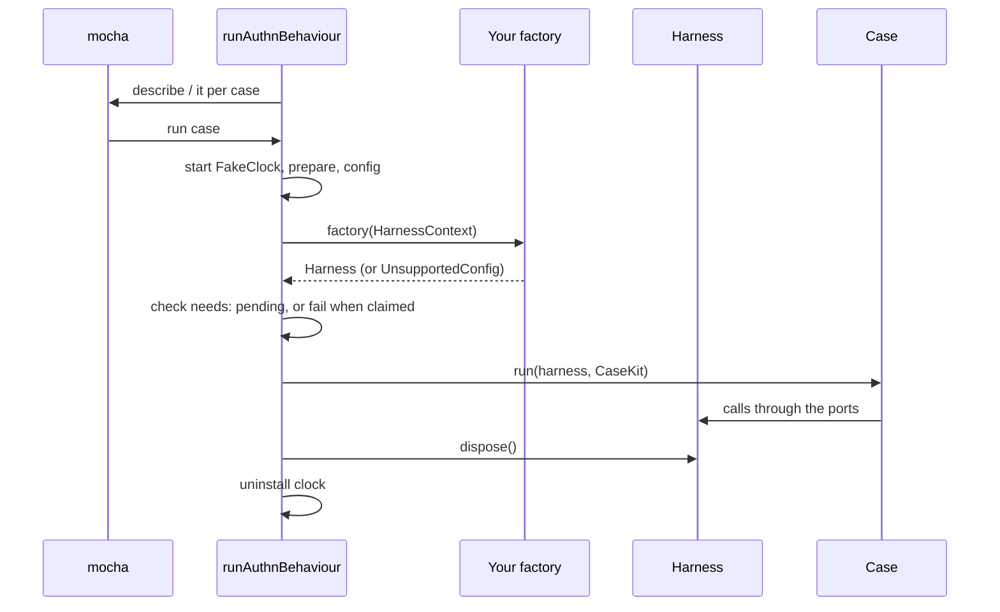

# Behaviour runner

`runAuthnBehaviour(ids, factory, options?)` registers the behaviour rules you name as mocha tests and runs each case against a harness your factory builds. Use it to check a whole authn stack (an `AuthnService`, an HTTP layer, a boot) against the security rules every SpinaJS authn package follows. The rules themselves are listed in [Behaviour rules](05-behaviour-rules.md).

## How it works

1. `runAuthnBehaviour` validates `ids`, `claim` and `facets` synchronously, through `planCases`. An unknown rule id, a duplicate id, or a claim or facet outside the requested rules throws at registration, before mocha runs anything.
2. It registers one `describe` (title `'authn behaviour'` by default), one nested `describe` per rule (`<id> <rule title>`) and one `it` per case. `facets` limits the cases to those facets.
3. For each case, `executeCase` sets the case timeout and starts a fresh `FakeClock`, installed on `Date` unless `fakeDate: false`. A kit clock left installed by an abandoned case is uninstalled first.
4. It runs the case's `prepare` step when it has one (for example starting a JWKS server), then computes the case config.
5. It calls your factory with a `HarnessContext`: `rule`, `facet`, `caseName`, `clock` and `config`.
6. It checks the case's `needs` against the harness. A need is missing when the port is absent, the clock is not installed (`fakeDate`), the MFA step lacks recovery methods (`mfa.recovery`) or a route builder is absent (`http.routes.<name>`). A factory that throws `UnsupportedConfig(keys)` counts as missing `config:<key>`.
7. A missing need **fails** a claimed case (`claimed facet <facet> misses: ...`) and makes any other case **pending**: its title gets ` [pending: missing <needs>]` and mocha skips it.
8. Otherwise it runs the case with the harness and a `CaseKit` (`clock`, `ctx()`, `config`, `prepared`, `jar()`).
9. On every exit path it calls `harness.dispose()` and the prepared resource's `close()`, each bounded to 5 s, then uninstalls the clock. A cleanup error fails the case, attached to the case's own error when there is one.
10. After the suite it prints one line per pending case: `authn-testing pending: <case> → <reason>`.



## Harness factory

`HarnessFactory` is `(ctx: HarnessContext) => Harness | Promise<Harness>`, called once per case. Rules for the factory:

- Apply `ctx.config`. `authn.*` keys mean what the `authn.*` config of `@spinajs/authn` means, secrets are the values themselves, and `authn.throttle` merges over `DEFAULT_THROTTLE` (`throttleParams(ctx.config)` does the merge). Without overrides, run the defaults.
- A config key you cannot apply: throw `new UnsupportedConfig(keys)`. The case goes pending, or fails when claimed.
- Return only the ports you have. A case whose needs you lack goes pending; it never passes silently.
- Every port shares one container: the `seed` users are the ones `service` authenticates, `events` sees what `service` publishes.
- `dispose()` releases everything the factory made.
- Fresh state per case comes from `DI.uncache(<your types>)`. Never call `DI.clearCache()`, and do not rely on `DI.child()` alone: a root singleton resolved through a child stays in the root.

### Ports

Each port is an optional member of `Harness`. The contract types come from `@spinajs/authn/contracts`; the port interfaces are exported by this package.

| Port | Type | What the cases do with it |
| --- | --- | --- |
| `service` | `AuthnService` | Log in, complete MFA, re-authenticate, build principals |
| `seed` | `SeedPort` | Create users your identity store finds by login, with passwords hashed your way; set status flags |
| `sessions` | `SessionIssuer` | Issue, restore, rotate, elevate and revoke sessions |
| `sessionStorage` | `SessionStoragePort` | List storage keys; plant a 2.x session row |
| `throttle` | `ThrottlePort` | The throttle and the `ThrottleParams` it was built with |
| `events` | `EventsPort` | Read and clear the published events |
| `sinks` | `readonly EventsPort[]` | At least two sinks registered with `Array.ofType` (A21) |
| `logs` | `LogsPort` | Lines the log audit sink wrote |
| `spy` | `VerifySpyPort` | Count `verify` calls over all strategies |
| `mfa` | `MfaPort` | The `MfaStep`, enrol an identity, get a valid code, read recovery codes |
| `mfaStorage` | `MfaStoragePort` | The stored MFA secret and recovery codes as kept at rest |
| `password` | `PasswordService` | Check, set, change and reset passwords |
| `passwordStore` | `PasswordCredentialStore` | Read the stored hash |
| `hasher` | `HasherPort` | Hash with the app's or other argon2 parameters and pepper; peak concurrent hashes |
| `outbox` | `OutboxPort` | The raw secret of the newest reset or invite mail |
| `secrets` | `SecretStore` | Issue and redeem single-use secrets |
| `secretStorage` | `SecretStoragePort` | The stored secret rows |
| `tokens` | `TokenService` | Create, validate and revoke API and agent tokens |
| `keys` | `KeyRegistry` | Register, list and revoke public keys |
| `keyProofs` | `KeyProofPort` | Sign a key challenge in your format |
| `assertion` | `AssertionPort` | The audience and issuer of client assertions |
| `jws` | `JwsPort` | The JWS verifier and signer |
| `links` | `IdentityLinkStore` | External identity links |
| `accountLinks` | `AccountLinkPort` | Link and unlink an external subject from a session |
| `external` | `ExternalPort` | Credentials for an external subject |
| `oidc` | `OidcPort` | Play the fake identity provider, with ID token tampering |
| `impersonation` | `ImpersonationPort` | Start and stop impersonation; the principal of a session |
| `guard` | `GuardPort` | Allow or deny impersonation |
| `targetGuard` | `GuardPort` | Allow or deny credential admin actions on a target (A25) |
| `roles` | `RolesPort` | Grant roles the role source gives a principal |
| `attributed` | `AttributedPort` | Credentials of strategies that return `KIT_ATTRIBUTES` |
| `principals` | `PrincipalsPort` | Calls made to the `PrincipalFactory` |
| `lifecycle` | `LifecyclePort` | Ban or deactivate an identity |
| `metadata` | `MetadataPort` | Read and write identity metadata as owner or admin; plant raw rows |
| `identityMeta` | `IdentityMetaPort` | The users package's public metadata write action |
| `boot` | `BootPort` | Boot an app with given strategies, env and secrets; run the config check |
| `actors` | `ActorsPort` | Create an admin with or without the `users:credentials` right |
| `http` | `HttpPort` | Send HTTP requests to the app; see [HTTP port](06-http-port.md) |

### Facets, claims and pending cases

Every case has a facet `<rule>/<kind>`, for example `A07/store`, and a list of `needs`. The kinds are `core`, `store`, `http`, `local`, `argon2`, `external`, `step`, `totp`, `token`, `jwt`, `keys`, `jws`, `oidc`, `api`, `identity`, `flow`, `lifecycle`, `boot` and `config`. A facet groups the cases one implementation answers for: `A07/store` checks a session store, `A07/http` the HTTP layer over it.

- `claim`: the facets, or whole rule ids, your package owns. A claimed case with a missing need or an unsupported config fails and names what is missing.
- `facets`: register only these facets; the others of the requested rules are not registered at all.
- Unclaimed cases you cannot serve go pending, visible in the title and in the summary.

## Configuration

### `RunOptions`

| Key | Type | Default | Allowed values | Meaning |
| --- | --- | --- | --- | --- |
| `claim` | `readonly (Facet \| RuleId)[]` | `[]` | facets or rule ids among the requested rules | Cases of these facets or rules fail on a missing need |
| `facets` | `readonly Facet[]` | every facet of the ids | facets of the requested rules | Register only these facets |
| `fakeDate` | `boolean` | `true` | `true`, `false` | `false` leaves `Date` real; cases needing `fakeDate` go pending, or fail when claimed |
| `clockStart` | `Date` | now, truncated to seconds | any date | Start time of every case clock |
| `timeoutMs` | `number` | `10000` per case | milliseconds | Every case gets at least this timeout; timing cases set 600 s themselves |
| `title` | `string` | `'authn behaviour'` | any | Title of the outer `describe` |

Mocha's own timeout for a case is the case timeout plus 12 s, so the kit's timeout error and cleanup come first.

### Case config (`ConfigOverrides`)

The config a case asks your factory to apply. Keys mirror the `authn.*` config of `@spinajs/authn`; see [`@spinajs/authn`](../authn/README.md) for their meaning.

| Key | Type | Meaning in the kit |
| --- | --- | --- |
| `env` | `'development' \| 'test' \| 'production' \| 'staging'` | App environment of the case |
| `authn.strategies` | `{ name, service }[]` | Listed strategies |
| `authn.local.hasher.maxConcurrent` | `number` | Parallel argon2 operations |
| `authn.local.pepper` | `{ secret: string \| null; version: number }` | Password pepper; the secret is the value itself |
| `authn.local.policy` | `{ minLength, maxLength, rule, blocklist }` | `blocklist` means a blocklist hook that refuses exactly these strings |
| `authn.local.reset` | `{ ttlSeconds, revokeTokens }` | Reset secret lifetime; whether a reset revokes tokens |
| `authn.local.invite.ttlSeconds` | `number` | Invite secret lifetime |
| `authn.session.expiration` | `{ ttl, maxLifetime }` | Sliding expiration capped at `maxLifetime`, both in minutes |
| `authn.session.pendingTtlSeconds` | `number` | Pending session lifetime |
| `authn.mfa.policy.force` | `boolean` | Every password login needs an MFA step |
| `authn.mfa.totp.recoveryCodes` | `number` | Recovery codes per enrolment |
| `authn.throttle` | `Partial<ThrottleParams>` | Merged over `DEFAULT_THROTTLE` per flow and key |
| `authn.freshAuth.maxAgeSeconds` | `number` | Fresh authentication window |
| `authn.token` | `{ maxTtlDays, agentMaxTtlMinutes }` | Token lifetimes |
| `authn.jwt.issuers` | `JwtIssuerOverride[]` | JWT issuers; each has its own `linking.jit` switch, off when left out |
| `authn.keys.assertion` | `{ maxLifetimeSeconds, skewSeconds }` | Client assertion limits |
| `authn.linking` | `{ jit, byVerifiedEmail }` | Applies globally and to the provider under test |
| `authn.impersonation` | `{ requirePassword, requireMfa, maxMinutes, clockSkewSeconds }` | Impersonation limits |
| `authn.http.trustProxy` | `number \| string[] \| null` | Trusted proxy hops or addresses |
| `authn.http.csrf` | `{ enabled, allowedOrigins }` | Origin check for cookie-authenticated unsafe requests |
| `http.cors.origins` | `string[] \| null` | CORS allow list |

### `DEFAULT_THROTTLE`

| Flow | Key | `free` | `baseDelayMs` | `maxDelayMs` |
| --- | --- | --- | --- | --- |
| `login` | `account` | 5 | 1000 | 60000 |
| `login` | `ip` | 20 | 1000 | 300000 |
| `mfa` | `account` | 3 | 1000 | 300000 |
| `mfa` | `ip` | 20 | 1000 | 300000 |
| `reset` | `account` | 1 | 60000 | 3600000 |
| `reset` | `ip` | 5 | 10000 | 900000 |
| `reauth` | `account` | 3 | 1000 | 300000 |

`resetAfterSeconds` is `86400`, `global` is `null`. `UNTHROTTLED` (`free` one billion, delays 1 ms) turns a key off in a case config.

### Environment variables

| Key | Type | Default | Allowed values | Meaning |
| --- | --- | --- | --- | --- |
| `AUTHN_TESTING_SUMMARY` | string | unset | `off` | `off` silences the pending summary printed after a suite |
| `AUTHN_TESTING_TIMING_FLOOR_MS` | number | `2` under CI, else `0.5` | non-negative number | Noise floor of the timing comparison |
| `AUTHN_TESTING_TIMING_RETRIES` | integer | `4` under CI, else `2` | non-negative integer | Extra attempts of a timing comparison |
| `CI` | string | unset | any; `0` and `false` count as off | Switches the timing defaults above |

## Time rules

Each case installs a `FakeClock` that fakes `Date` only. Timers, `performance.now()` and `process.hrtime` stay real. Code under test must:

1. take "now" from `ctx.now` wherever a contract passes an `AuthnContext`;
2. elsewhere read `Date` (directly or through luxon) at call time;
3. never let SQL compute "now" for secret, session or throttle decisions; pass the Node time as a query parameter;
4. never capture `Date` at module load in code that decides expiry;
5. bound retry loops by count, not by elapsed time.

Pool idle timers that read `Date.now()` stop aging while the clock is frozen. `SessionIssuer`, `SecretStore`, `MfaStep` and `AuthnThrottle.succeed` take no `ctx`, so they compute "now" from `Date`.

## Services and extension points

| Service | DI token and lifetime | Default implementation | Alternatives | How to replace or extend |
| --- | --- | --- | --- | --- |
| Harness | none; your `HarnessFactory` | none | the fakes, your real services | Return the ports you implement |
| Rule registry | `AUTHN_RULES` (`ReadonlyMap<RuleId, AuthnRule>`) | the rules A01 to A31 | none | Read-only; `runAuthnBehaviour` and `planCases` run only these rules |
| Single case run | `executeCase`, `settleCase` | none | none | Run one `PlannedCase` inside your own `it` or outside mocha |

### Build the service port from the fakes

A package that ships a strategy but no `AuthnService` builds the `service` port from the [fakes](01-fakes.md) and its own strategy. This harness serves the A02, A05, A06 and A09 core and store facets:

```ts sample
import 'mocha';
import {
  EnrolledMfaPolicy,
  FakeAuthnService,
  FakeBackoffThrottle,
  FakeIdentityStore,
  FakeMfaStep,
  FakeStrategy,
  MemoryLinkStore,
  MemoryPasswordCredentialStore,
  MemorySessionIssuer,
  RecordingEventSink,
  RecordingPrincipalFactory,
  UnsupportedConfig,
  fakeSeedPort,
  runAuthnBehaviour,
  throttleParams,
} from '@spinajs/authn-testing';
import type { Facet, Harness, HarnessContext } from '@spinajs/authn-testing';

function harness(ctx: HarnessContext): Harness {
  const unsupported = Object.keys(ctx.config.authn ?? {}).filter((k) => k !== 'throttle');
  if (ctx.config.env || ctx.config.http || unsupported.length > 0) {
    throw new UnsupportedConfig(unsupported.map((k) => `authn.${k}`));
  }
  const identities = new FakeIdentityStore();
  const passwords = new MemoryPasswordCredentialStore();
  const sessions = new MemorySessionIssuer();
  const params = throttleParams(ctx.config);
  const throttle = new FakeBackoffThrottle(params);
  const events = new RecordingEventSink();
  const step = new FakeMfaStep();
  const local = FakeStrategy.password({ identities, passwords });
  const service = new FakeAuthnService({
    strategies: [local],
    throttle,
    identities,
    links: new MemoryLinkStore(),
    linking: { jit: false, byVerifiedEmail: false },
    policy: new EnrolledMfaPolicy([step]),
    steps: [step],
    sessions,
    sinks: [events],
    principals: new RecordingPrincipalFactory(),
  });
  return {
    service,
    seed: fakeSeedPort(identities, passwords),
    sessions,
    throttle: { throttle, params },
    events,
    spy: { verifyCalls: () => local.verifyCalls.length },
    mfa: { step, enrol: async (id) => step.enrol(id), code: async (id) => step.nextCode(id) },
  };
}

const OWNED: Facet[] = ['A05/store', 'A06/store'];

runAuthnBehaviour(['A02', 'A05', 'A06', 'A09'], harness, {
  title: 'login flow over the kit fakes',
  claim: OWNED,
});
```

Cases needing ports it lacks (`attributed`, `http`, `external`) or config it does not apply go pending here and are listed after the suite.

### Run one case yourself

`planCases(ids, options)` returns the `PlannedCase` list `runAuthnBehaviour` would register. `settleCase(planned, factory, options)` runs one outside mocha and resolves `{ status: 'passed' | 'pending' | 'failed', title, error? }`. Use it to prove a rule catches a bug: the case passes on your implementation and fails on a deliberately broken copy.

```ts
const [planned] = planCases(['A05']).filter((p) => p.kase.name === 'A05 a throttled login verifies nothing');
assert.equal((await settleCase(planned, harness)).status, 'passed');
assert.equal((await settleCase(planned, brokenHarness)).status, 'failed');
```

## Important behaviour

- Validation errors throw while mocha loads the spec file, not inside a test.
- A pending case is never a pass: its title carries the reason and the summary repeats it. Claim the facets you own so a missing port fails instead.
- `PENDING_TRANSCRIPTION` lists rules registered without cases; it is empty, so every rule A01 to A31 (no A28 or A29) has its cases. A requested rule in that set shows one pending case, or one failing case when claimed.
- `runAuthnBehaviour` uses the mocha globals `describe`, `it` and `after`. Call it at the top level of a spec file, or inside a `describe`, never inside an `it`.
- The case clock fakes `Date` for the whole process while the case runs, not only for the code behind the harness.

## Best practices

- Claim every facet your package owns. Leave the others unclaimed, so they stay visible as pending without failing your build.
- Throw `UnsupportedConfig` with the exact keys you cannot apply; the pending reason then names them as `config:<key>`.
- Raise `timeoutMs` when your password hashing is slow. The timing cases allow 600 s on their own; `timingTimeoutMs` computes a bound from the per-call time.
- Read the `needs` of each case in [Behaviour rules](05-behaviour-rules.md) before you decide which ports to build.

## Patterns and antipatterns

```ts
// Don't: clearing the whole container breaks every singleton the app registered before the suite
dispose: async () => DI.clearCache(),

// Do: uncache only the types that hold state
dispose: async () => {
  DI.uncache(MyAuthnService);
  DI.uncache(MySessionIssuer);
},
```

```ts
// Don't: a store that takes "now" from SQL ignores the case clock
await db.query('UPDATE authn_secret SET used_at = now() WHERE id = ?', [id]);

// Do: pass the Node time
await db.query('UPDATE authn_secret SET used_at = ? WHERE id = ?', [new Date(), id]);
```

## Examples

### Run only your store facets

```ts sample
import 'mocha';
import { FakeIdentityStore, MemoryLinkStore, MemoryPasswordCredentialStore, fakeSeedPort, runAuthnBehaviour } from '@spinajs/authn-testing';

runAuthnBehaviour(
  ['A19'],
  () => ({
    links: new MemoryLinkStore(),
    seed: fakeSeedPort(new FakeIdentityStore(), new MemoryPasswordCredentialStore()),
  }),
  { title: 'link store', facets: ['A19/store'], claim: ['A19/store'] },
);
```

## Related

- [Behaviour rules](05-behaviour-rules.md): every rule, its facets and needs.
- [Conformance suites](03-conformance-suites.md): fixed-facet wrappers over this runner.
- [HTTP port](06-http-port.md): the `http` port and its route builders.
- [`@spinajs/authz-testing`](../authz-testing/README.md): the behaviour fixtures for authorization.
