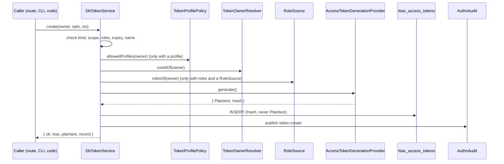

# Issuing and revoking tokens

`DbTokenService` is the `TokenService` of `@spinajs/authn` over the `rbac_access_tokens` table. It mints personal (`pat`), `service` and `agent` tokens, lists and revokes them, and sweeps old rows. Use it from your own code, or through the token routes of [`@spinajs/authn-http`](../authn-http/README.md) and the [CLI](06-cli-commands.md), which both call it.

Validation of a presented token (`validate`) is described in [API token authentication](02-token-authentication.md).

## How it works

### Create, `create(owner, opts, ctx)`

1. The protected `checkFormat()` checks the token format: `authn.token.length` must be an integer of at least 32, and `authn.token.prefix` plus the base64url body must fit in 1024 characters. A failure throws `InvalidOption`.
2. `ctx.now` must be a valid `Date`, or `create` throws `InvalidOperation`. Every timestamp comes from `ctx.now`, never from the database clock.
3. Every field of `opts` is checked as `unknown`, so a caller that bypasses the types gets a refusal, not a corrupt row:
   - `kind` must be `pat`, `service` or `agent`.
   - `kind: 'agent'` needs `scope.agent === true` and no `roles` or `profile`; any other kind must not set `scope.agent: true`.
   - `roles` and `scope` are parsed; see [Token roles, scopes and agent tokens](03-token-scopes.md).
   - `profile` must be one of `TokenProfilePolicy.allowedProfiles(owner)`.
   
   Any failure returns `{ ok: false, code: 'invalid_scope' }`.
4. `expiresAt` must be a real `Date` strictly after `ctx.now` and at most `authn.token.maxTtlDays` ahead; for an agent token also at most `authn.token.agentMaxTtlMinutes` ahead. Otherwise the result is `{ ok: false, code: 'invalid_expiry' }`. Both caps are read at call time.
5. `name` is trimmed and must be 1 to 128 characters, or `create` throws `InvalidArgument`.
6. `TokenOwnerResolver.rowIdOf(owner)` finds the owner's row id. An unknown owner throws `InvalidOperation`.
7. When a `RoleSource` was injected, every requested role must be one the owner holds, or the result is `invalid_scope`. Without a `RoleSource`, the roles are stored as given.
8. The `AccessTokenGenerationProvider` named by `authn.token.generation.service` mints `{ Plaintext, Hash }`. The plaintext must start with the prefix, carry at least the configured length of base64url and fit in 1024 characters, or `create` throws `UnexpectedServerError` and stores nothing.
9. A new `AccessToken` row is inserted with the hash, never the plaintext.
10. A `token.create` event goes through `AuthnAudit.publishIn` to every `AuthnEventSink`.
11. The result is `{ ok: true, plaintext, record }`. The plaintext is never stored, logged or returned again.



### List, `list(owner)`

1. `rowIdOf(owner)`; an unknown owner gets `[]`.
2. It answers every row of the owner with `RevokedAt` unset: live and expired tokens, never revoked ones.
3. Each row becomes a `TokenRecord`: the `Uuid` as `id`, never the row id, the hash or the plaintext.

### Revoke, `revoke(owner, id, ctx, { actor }?)`

1. It answers `false` for an empty or non-string `id` and for an unknown owner.
2. It finds the unrevoked row with that `Uuid` **and** that owner, so one owner cannot revoke another's token.
3. It sets `RevokedAt` to `ctx.now` with `WHERE RevokedAt IS NULL`. Of two concurrent revokes only one answers `true`.
4. It publishes `token.revoke` with `{ token, kind }` and the optional `actor`, and answers `true`. The row stays until the [sweep](#sweep-deleteexpirednow).

### Revoke by id, `revokeById(id, ctx, { actor }?)`

The operator variant behind `authn:token-delete`. It is not part of the `TokenService` contract.

1. It revokes the unrevoked row with that `Uuid`, whoever owns it, under the same conditional update.
2. It looks the owner up with `TokenOwnerResolver.refOf`. A failing lookup is logged; the revocation stands and the event goes out without an `identity`.

### Revoke all, `revokeAllFor(owner, ctx, { actor }?)`

1. It sets `RevokedAt` on every unrevoked row of the owner, agent tokens acting for the owner included.
2. It publishes one `token.revoke` with `{ count }` and answers the count. An unknown owner answers `0` and publishes nothing.

Password resets call it when `authn.local.reset.revokeTokens` is on (the default).

### Sweep, `deleteExpired(now)`

Housekeeping behind `authn:token-delete-expired`. It is not part of the `TokenService` contract.

1. `now` must be a valid `Date`, or it throws `InvalidOperation`.
2. It selects the ids of rows with `ExpiresAt <= now`, and of revoked rows, through the model, so the cutoff is written in the column's format.
3. It deletes them in batches of 500 ids and answers the count. Rows without an expiry are kept.

## Configuration

| Key | Type | Default | Allowed values | Meaning |
| --- | --- | --- | --- | --- |
| `authn.token.maxTtlDays` | `integer` | `90` | `>= 1` | Longest expiry of any token, from `ctx.now`. Read at each `create`. |
| `authn.token.agentMaxTtlMinutes` | `integer` | `1440` | `>= 1` | Longest expiry of an agent token. The `maxTtlDays` cap still applies. |
| `authn.token.prefix` | `string` | `'spt_'` | non-empty | Prefix every minted token must carry; checked after generation. See [Token generation](07-token-generation.md). |
| `authn.token.length` | `integer` | `32` | `>= 32` | Random bytes per token; checked against the minted plaintext. |
| `authn.token.defaultTtlDays` | `integer` | `30` | `>= 1` | Not read by `DbTokenService`, which never fills in an expiry. The CLI uses it; see [CLI commands](06-cli-commands.md). |

The `authn.token` section comes from the `@spinajs/authn` schema and is filled in whole with its defaults; this package also ships the same values in its config file.

```ts
authn: {
  token: { maxTtlDays: 90, agentMaxTtlMinutes: 1440, prefix: 'spt_', length: 32 },
}
```

## Services and extension points

| Service | DI token and lifetime | Default implementation | Alternatives | How to replace or extend |
| --- | --- | --- | --- | --- |
| Token service | `TokenService` (`@spinajs/authn/contracts`); singleton; `@Injectable(TokenService)` when the package loads | `DbTokenService` | none shipped | Subclass `DbTokenService` and register it with `@Injectable(TokenService)` after the import; a single resolve takes the last registration. |
| Owner mapping | `TokenOwnerResolver`; `@Autoinject` property `Owners`, checked | `UsersTableTokenOwnerResolver` | none | See [Token owner resolver](08-token-owner-resolver.md). |
| Profile policy | `TokenProfilePolicy`; `@Autoinject` property `Profiles`, checked | `NoTokenProfilesPolicy` | none | See [Token profile policy](09-token-profile-policy.md). |
| Owner status | `IdentityStore` (`@spinajs/authn/contracts`); `@Autoinject` property `Identities`, checked | none in this package | `@spinajs/users`' `UserIdentityStore` | Register one before `TokenService` is resolved; without it resolving `DbTokenService` fails. |
| Role check at create | `RoleSource` (`@spinajs/authn/contracts`); optional `@Autoinject` property `Roles`, set only when one is registered when `DbTokenService` is resolved | none in this package | `@spinajs/users`' `RbacRoleSource` | `DI.register(Mine).as(RoleSource)` before `TokenService` is first resolved. |
| Token algorithm | `AccessTokenGenerationProvider`, by the class name in `authn.token.generation.service`; `@AutoinjectService` property `Generator` | `SecureRandomTokenProvider` | none | See [Token generation](07-token-generation.md). |
| Audit | `AuthnAudit` (`@spinajs/authn/audit`); `@Autoinject` property `Audit`, delivering to every `AuthnEventSink` | none in this package | `@spinajs/authn-orm`'s `DbAuthnAuditSink`, the authn log sink | Register a sink with `@Injectable(AuthnEventSink)`. |
| ORM | `Orm`; `@Autoinject` property | `@spinajs/orm` | none | Resolving `DbTokenService` boots the ORM, so a CLI run that builds only this service can query `rbac_access_tokens`. |

`DbTokenService` also has three methods outside the contract that shipped code finds by duck typing: `touch` (used by `TokenStrategy`), `revokeById` (used by `authn:token-delete`) and `deleteExpired` (used by `authn:token-delete-expired`). A replacement that drops them loses the last-use stamp and those two commands.

### Token service: custom implementation

Extend `DbTokenService` when you need a side effect around a contract method, such as notifying the owner. Override the method, call `super`, and keep its result. `ownerHolds` and `publish` are protected and can be overridden too.

```ts sample
import { DbTokenService } from '@spinajs/authn-token';
import { TokenService } from '@spinajs/authn/contracts';
import type { AuthnContext, IdentityRef, TokenCreateOptions, TokenCreateResult } from '@spinajs/authn/contracts';
import { Injectable } from '@spinajs/di';

/** Tells the owner by mail whenever a token is minted for their account. */
@Injectable(TokenService)
export class NotifyingTokenService extends DbTokenService {
  public async create(owner: IdentityRef, opts: TokenCreateOptions, ctx: AuthnContext): Promise<TokenCreateResult> {
    const result = await super.create(owner, opts, ctx);
    if (result.ok) {
      await this.notifyOwner(owner, result.record.name, result.record.expiresAt);
    }
    return result;
  }

  protected async notifyOwner(owner: IdentityRef, name: string, expiresAt: Date): Promise<void> {
    // Send the mail through your mailer here; never include the plaintext.
    console.info(`token "${name}" created for ${owner.id}, expires ${expiresAt.toISOString()}`);
  }
}
```

The collaborators are `@Autoinject` properties of `DbTokenService`, so the subclass inherits them and needs no constructor. The constructor takes one optional argument, an `AuthnAuditor` (for example `AuthnAudit.over(sinks)`) that receives the events instead of the container's `AuthnAudit`, for tests.

## Important behaviour

- **Plaintext once.** Only the SHA-256 hex digest is stored, in a column hidden from `dehydrate()`. `TokenRecord`, events and logs never carry the plaintext or the hash.
- **Expiry is mandatory.** There is no "never expires" token; `expiresAt` is required by the type and checked at run time. A non-finite cap (a broken config that skipped the schema) refuses every expiry.
- **Refusals vs throws.** A bad kind, scope, role, profile or expiry is a result (`invalid_scope`, `invalid_expiry`). A bad name (`InvalidArgument`), an unknown owner or an invalid `ctx.now` (`InvalidOperation`), a token format outside the limits (`InvalidOption`), a broken generator (`UnexpectedServerError`) or a database error throws.
- **Events never undo a write.** `token.create` and `token.revoke` are published after the row is written. `AuthnAudit` runs the sinks concurrently, each bounded by `authn.audit.sinkTimeoutMs`; a sink that fails or times out is logged, and the caller still gets the plaintext or `true`. A refused create and a failed revoke publish nothing.
- **Revocation keeps the row.** `revoke` and `revokeAllFor` only set `RevokedAt`; `deleteExpired` removes the row later.
- **`service` tokens.** In this package a `service` token behaves like a `pat`; the kind is stored and reported. Both belong to a user owner under the default resolver.
- **Rotation.** There is no rotate call. Create the new token, deploy it, then revoke the old one; both work in between.

## Best practices

- Pass `ctx.now` from one clock read per request; `create` stores `CreatedAt` and checks the expiry against it, not against the database.
- Pass an `actor` to `revoke` and `revokeAllFor` when someone other than the owner acts (an admin, a job), so the audit tells them apart. The CLI uses `{ type: 'system', id: 'cli' }`.
- Schedule `authn:token-delete-expired`; expired and revoked rows are refused on use but stay in the table until swept.
- Keep `maxTtlDays` short for `pat` tokens and issue `agent` tokens per task; see [Token roles, scopes and agent tokens](03-token-scopes.md).

## Patterns and antipatterns

```ts
// Don't: the plaintext ends up in log files or a remote log store.
const result = await tokens.create(owner, opts, ctx);
if (result.ok) log.info(`created ${result.plaintext}`);

// Do: hand the plaintext to the caller once, log only the token id.
if (result.ok) {
  log.info({ tokenId: result.record.id }, 'token created');
  return result.plaintext;
}
```

```ts
// Don't: revoke() is owner-bound; an admin passing their own identity revokes nothing.
await tokens.revoke(adminIdentity, tokenId, ctx);

// Do: pass the token's owner, and the admin as the actor.
await tokens.revoke(ownerIdentity, tokenId, ctx, { actor: { type: 'user', id: adminIdentity.id } });
```

## Examples

### Revoke every token of a user who left the company

```ts sample
import { TokenService } from '@spinajs/authn/contracts';
import { DI } from '@spinajs/di';

/** Ends all API and agent tokens of the user; the HR job is recorded as the actor. */
export async function offboard(userUuid: string): Promise<number> {
  const tokens = await DI.resolve(TokenService);
  return await tokens.revokeAllFor(
    { type: 'user', id: userUuid },
    { now: new Date(), purpose: 'request' },
    { actor: { type: 'system', id: 'hr-offboarding' } },
  );
}
```

### List a user's tokens that expire within a week

```ts sample
import { TokenService } from '@spinajs/authn/contracts';
import type { TokenRecord } from '@spinajs/authn/contracts';
import { DI } from '@spinajs/di';

const WEEK_MS = 7 * 86_400_000;

/** The live tokens a reminder mail should mention; expired ones are listed too, so they are filtered out. */
export async function expiringSoon(userUuid: string, now = new Date()): Promise<TokenRecord[]> {
  const tokens = await DI.resolve(TokenService);
  const all = await tokens.list({ type: 'user', id: userUuid });
  return all.filter((t) => t.expiresAt > now && t.expiresAt.getTime() - now.getTime() <= WEEK_MS);
}
```

## Related

- [API token authentication](02-token-authentication.md): how `validate` and `TokenStrategy` use the stored rows.
- [Token roles, scopes and agent tokens](03-token-scopes.md): what `roles`, `scope`, `profile` and `kind` do.
- [Token storage and migrations](05-token-storage.md): the table the service writes.
- [`@spinajs/authn` audit events](../authn/06-audit-events.md): the sinks that receive `token.create` and `token.revoke`.
- [`@spinajs/authn-http`](../authn-http/README.md): `POST /user/tokens` (fresh auth required) and `DELETE /user/tokens/:uuid` over this service.
