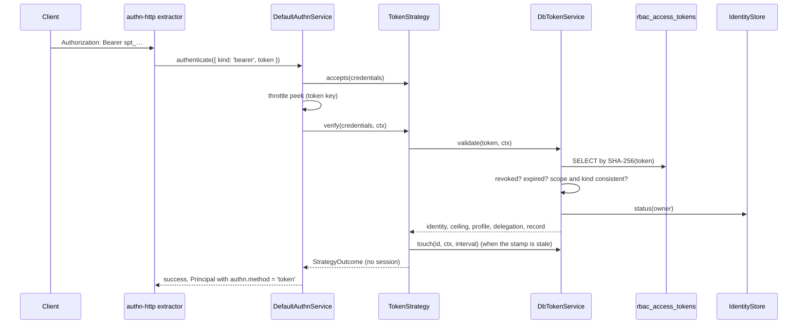

# API token authentication

`TokenStrategy` authenticates a request that carries an API token. It is a per-request (non-interactive) strategy named `token` for credentials of kind `bearer`: it never starts a session, and every request is checked again against the database.

## How it works

1. [`@spinajs/authn-http`](../authn-http/README.md) builds the credential `{ kind: 'bearer', token }` from `Authorization: Bearer <token>` or from the `authn.token.headerName` header (`x-api-key`). The header extractors take a value from the API-key header only when it starts with `authn.token.prefix`.
2. `DefaultAuthnService` picks the strategies listed in `authn.strategies` that take `bearer` and whose `accepts(credentials)` is `true`. `TokenStrategy.accepts` is `true` only for a string of at most 1024 characters that starts with `authn.token.prefix`. A JWT or any other value gets `false`, so `JwtBearerStrategy` can take it; see [JWT bearer](04-jwt-bearer.md).
3. The core peeks at the throttle with the keys from `TokenStrategy.throttleKeys`; see [Throttling](#throttling).
4. `TokenStrategy.verify` reads the credential once, then calls `TokenService.validate(token, ctx)`.
5. `DbTokenService.validate` runs these checks in order. The first one that fails ends the attempt:

   | Check | Failure reason |
   | --- | --- |
   | `raw` is a non-empty string and `ctx.now` a valid `Date` | `invalid_credentials` |
   | a row with `Token = hash(raw)` exists, using `AccessTokenGenerationProvider.hash` | `invalid_credentials` |
   | `RevokedAt` is unset | `revoked` |
   | `ExpiresAt` is set and later than `ctx.now` | `expired` |
   | `Kind` is `pat`, `service` or `agent` | `invalid_credentials` |
   | the stored `Scope` is well-formed and agrees with `Kind`; an agent row has no roles and no profile | `invalid_credentials` |
   | `TokenOwnerResolver.refOf(user_id)` finds the owner | `invalid_credentials` |
   | `IdentityStore.status(owner)` is existing, active, not banned, not deleted | `invalid_credentials` |
   | a pinned `Profile` is still in `TokenProfilePolicy.allowedProfiles(owner)` | `invalid_credentials` |

6. On success `validate` answers the identity, `method: 'token'`, the ceiling, the profile, the delegation for an agent token, and the `TokenRecord`. What each one holds is in [Token roles, scopes and agent tokens](03-token-scopes.md).
7. `TokenStrategy` stamps the last use (see [Last-use stamp](#last-use-stamp)), then returns the outcome: `identity`, `method: 'token'`, `ceiling`, `delegation`, and `attributes: { profile }` for a pinned token. The `TokenRecord` is not passed on.
8. The core resets the throttle key and turns the result into a `Principal` with `authn.method = 'token'` and `authn.strategy = 'token'`. No session is issued.

The caller sees the same HTTP 401 for every failure; the reason (`revoked`, `expired`, `invalid_credentials`) goes to audit only. See [Authentication flow](../authn/01-authentication-flow.md).



### Last-use stamp

1. `TokenStrategy.stamp` skips the write when the record's `lastUsedAt` is younger than `authn.token.lastUsedUpdateInterval` seconds.
2. Otherwise it calls `DbTokenService.touch(id, ctx, interval)`. `touch` sets `LastUsedAt = ctx.now` and `LastUsedIp = ctx.ip` (cut to 64 characters, `NULL` when the context has no IP) with `WHERE LastUsedAt IS NULL OR LastUsedAt < now - interval`.
3. Of several requests that race past the same stale read, only one writes.
4. A failing stamp is logged; the request still succeeds. A `TokenService` without `touch` gets no stamps.

### Throttling

`TokenStrategy.throttleKeys` answers two keys for a token in its format, and `[]` for any other value:

- `account`: `token:` plus the first 32 hex characters of `SHA-256('authn-token-throttle:' + token)`.
- `account-ip`: the same id plus `|` and `ctx.ip`.

The core drops the strategy's `account-ip` key and builds its own from the `account` key and `ctx.ip`, and turns the `account` key of a per-request strategy into `request:<id>|<ip>`. The keys never contain the token or its stored hash. The core only reads the throttle before verifying and counts after a failure, so parallel requests with a valid token never back off, while a repeated invalid token does (K5). The rules and the `login` flow limits are in [Throttling](../authn/05-throttling.md).

## Configuration

| Key | Type | Default | Allowed values | Meaning |
| --- | --- | --- | --- | --- |
| `authn.strategies` | `{ name, service }[]` | `[]` | | Must contain `{ name: 'token', service: 'TokenStrategy' }`, or the strategy never runs. Owned by `@spinajs/authn`. |
| `authn.token.prefix` | `string` | `'spt_'` | non-empty | Format gate: a value without it is not a token. Read at each call. |
| `authn.token.length` | `integer` | `32` | `>= 32` | Checked with the prefix at boot (`TokenStrategy.resolve`): tokens must fit in 1024 characters. |
| `authn.token.headerName` | `string` | `'x-api-key'` | non-empty | Header `authn-http` reads a token from when `Authorization` gives none. Not read by this package. |
| `authn.token.lastUsedUpdateInterval` | `number` | `60` | `>= 0` | Seconds between `LastUsedAt` writes for one token. `0` writes on every use. Read at each call. |

```ts
authn: {
  strategies: [{ name: 'token', service: 'TokenStrategy' }],
  token: { prefix: 'spt_', headerName: 'x-api-key', lastUsedUpdateInterval: 60 },
}
```

## Services and extension points

| Service | DI token and lifetime | Default implementation | Alternatives | How to replace or extend |
| --- | --- | --- | --- | --- |
| Token strategy | `AuthenticationStrategy`; singleton; `@Injectable(AuthenticationStrategy)` when the package loads | `TokenStrategy` | none | Selected by `authn.strategies` through its class name. Subclass it, register with `@Injectable(AuthenticationStrategy)` and list your class name as the `service` of the `token` entry. |
| Token service | `TokenService`; `@Autoinject` property `Tokens`, checked | `DbTokenService` | none | See [Issuing and revoking tokens](01-token-service.md#services-and-extension-points). |
| Last-use recorder | `TokenUseRecorder` interface, found by duck typing on the `TokenService` | `DbTokenService.touch` | none | Implement `touch(id, ctx, intervalSeconds)` on your `TokenService`. |

### Token strategy: custom implementation

Subclass `TokenStrategy` to add a check that only applies to API tokens, such as refusing tokens from outside the company network. Override `verify`, call `super`, and turn a success into a failure when your rule says no. The strategy's `name` stays `token`, so the `authn.strategies` entry keeps that name and names your class as the service.

```ts sample
import { TokenStrategy } from '@spinajs/authn-token';
import { AuthenticationStrategy } from '@spinajs/authn/contracts';
import type { AuthnContext, Credentials, StrategyOutcome } from '@spinajs/authn/contracts';
import { Injectable } from '@spinajs/di';

const OFFICE_NETWORK = '10.20.';

/** API tokens work only from the office network; config: { name: 'token', service: 'OfficeTokenStrategy' }. */
@Injectable(AuthenticationStrategy)
export class OfficeTokenStrategy extends TokenStrategy {
  public async verify(c: Credentials, ctx: AuthnContext): Promise<StrategyOutcome> {
    const outcome = await super.verify(c, ctx);
    if (outcome.ok && !(ctx.ip ?? '').startsWith(OFFICE_NETWORK)) {
      return { ok: false, reason: 'invalid_credentials' };
    }
    return outcome;
  }
}
```

Both `TokenStrategy` and the subclass are registered; only the class named in `authn.strategies` runs. The `@Autoinject(TokenService)` property of `TokenStrategy` is inherited, so the subclass needs no constructor.

## Important behaviour

- **Checked on every request.** Revocation, expiry, the owner's status and a pinned profile are read from the database on each use; a banned owner or a revoked token stops working on the next request. There is no cache.
- **Revocation before expiry.** A revoked token answers `revoked` even after it expired.
- **Rows without an expiry fail.** A `NULL` `ExpiresAt` reads as `expired`, never as eternal.
- **Stored data is distrusted.** A row edited outside `create` (an unknown `Kind`, a malformed `Scope`, an agent row with roles) fails closed with `invalid_credentials` rather than reading as "no limits".
- **No I/O for foreign values.** A value without the prefix gets `unsupported_credentials` and no throttle keys without touching the database, so the core passes it on to `JwtBearerStrategy`.
- **The prefix is part of the format.** Changing `authn.token.prefix` makes every token minted with the old prefix fail the format gate, here and in the `authn-http` extractors.
- **One read of the credential.** `verify`, `accepts` and `throttleKeys` read `credentials.token` once, so a getter cannot answer differently after the format check.
- **A broken config fails the request.** A `bearer` value is matched against the prefix outside the error guard, so a refused `authn.token` section fails a token request instead of passing the value on.
- **No events from the strategy.** `TokenStrategy.verify` and `DbTokenService.validate` publish nothing; the core publishes `token.use` for every success and failure, with the reason.
- **Boot.** Resolving `TokenStrategy` resolves `TokenService` with the strict check; `DbTokenService` in turn fails to resolve when no `IdentityStore`, `TokenOwnerResolver` or `TokenProfilePolicy` is registered. `TokenStrategy.resolve()` also fails boot on a prefix and length over 1024 characters.

## Best practices

- Keep `lastUsedUpdateInterval` above `0` for busy tokens; every stamp is a database write.
- Read `principal.authn.method === 'token'` in authorization conditions when a rule must not apply to API tokens, instead of checking `ceiling`.

## Examples

### Authenticate a bearer token outside HTTP

A queue consumer or a socket handshake can run the same check as the HTTP middleware.

```ts sample
import { AuthnService } from '@spinajs/authn/contracts';
import type { Principal } from '@spinajs/authn/contracts';
import { DI } from '@spinajs/di';

/** The principal of an API token sent in a socket handshake, or null when it is refused. */
export async function principalOfToken(token: string, ip: string): Promise<Principal | null> {
  const authn = await DI.resolve(AuthnService);
  const result = await authn.authenticate({ kind: 'bearer', token }, { now: new Date(), purpose: 'request', ip });
  if (result.status !== 'success') {
    return null;
  }
  return await authn.principalOf(result);
}
```

## Related

- [Issuing and revoking tokens](01-token-service.md): where the rows come from.
- [Token roles, scopes and agent tokens](03-token-scopes.md): the ceiling and delegation `validate` answers.
- [JWT bearer](04-jwt-bearer.md): the other `bearer` strategy.
- [`@spinajs/authn` strategies](../authn/03-strategies.md): the strategy registry and `authn.strategies`.
- [`@spinajs/authn-http`](../authn-http/README.md): the `Authorization` and API-key header extractors.
