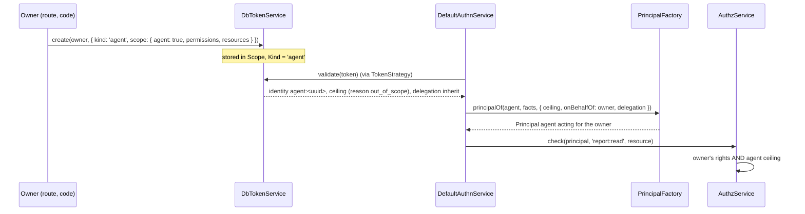

# Token roles, scopes and agent tokens

A token can only narrow what its owner may do. `roles`, `scope` and `profile` set at create become a **ceiling** on the principal, and an `agent` token becomes a delegate acting for its owner. This package stores and checks the limits; [`@spinajs/authz`](../authz/README.md) enforces them on every permission check.

## How it works

1. `DbTokenService.create` parses the limits from `TokenCreateOptions`:
   - `roles`: a non-empty list of non-empty role names without commas. Duplicates are dropped; the joined list must fit the 512-character `Roles` column. With a registered `RoleSource`, each role must be one the owner holds.
   - `scope.permissions`: up to 1000 non-empty permission globs (`project:read`, `report:*`).
   - `scope.resources`: up to 1000 `{ type, id? }` refs, `type` non-empty, `id` a string when present.
   - `scope.agent`: `true` exactly when `kind` is `agent`.
   - `profile`: one role name from `TokenProfilePolicy.allowedProfiles(owner)`.
   
   A value that breaks a rule refuses the token with `invalid_scope`. Unknown keys in `scope` are dropped.
2. The row stores `Roles`, `Profile`, `Kind` and the JSON `Scope`.
3. `DbTokenService.validate` reads them back. A stored `Scope` with an unknown key, a malformed entry, or an `agent` flag that disagrees with `Kind` fails the token (`invalid_credentials`) instead of reading as "no limits".
4. `validate` builds the ceiling and, for an agent token, the delegation:

   | Kind | Identity | `ceiling` | Delegation | `attributes.profile` |
   | --- | --- | --- | --- | --- |
   | `pat`, `service` | the owner | `roles`, `permissions`, `resources` that were set; no `ceiling` at all when none was | none | the pinned profile, when set |
   | `agent` | `{ type: 'agent', id: <token Uuid> }` | `permissions` and `resources` that were set, `reason: 'out_of_scope'`, never `roles` | `{ onBehalfOf: owner, mode: 'inherit' }` | never |

5. `TokenStrategy` passes them to the core, and the `PrincipalFactory` (for example [users' `UserPrincipalFactory`](../users/09-principal-factory.md)) puts them on the `Principal`.
6. At check time authz applies them:
   - **`ceiling.permissions`**: a permission that no glob matches is denied, with the ceiling's `reason` (`ceiling` by default, `out_of_scope` for an agent).
   - **`ceiling.resources`**: each ref covers itself and its descendants. A check on a resource outside all of them is denied; a list query is limited to rows under them. `[]` covers nothing.
   - **`ceiling.roles`**: [`@spinajs/authz-rbac`](../authz-rbac/README.md) keeps only the owner's assignments of those roles, after removing `authz.token.excludedRoles` and the roles its `TokenRolePolicy` drops. A role the owner lacks grants nothing. Without `ceiling.roles`, the owner's roles go through the same filter.
   - **Agent delegation**: under `inherit` the models run as the owner, narrowed by the agent's ceiling, so the agent never gets more than its owner.

See the [check flow](../authz/storage-and-check-flow.md#4-engine-pipeline) for where the ceiling and the delegation run, and [Concepts](../authz/01-check-flow.md#concepts) for globs and resource trees.



## Configuration

| Key | Type | Default | Allowed values | Meaning |
| --- | --- | --- | --- | --- |
| `authn.token.agentMaxTtlMinutes` | `integer` | `1440` | `>= 1` | Longest expiry of an agent token; `authn.token.maxTtlDays` applies too. |
| `authz.token.excludedRoles` | `string[]` | `[]` | role names or `prefix.*` | Owned by `authz-rbac`: roles a token principal never uses. |
| `authz.token.rolePolicy.service` | `string` | `'OwnRolesTokenRolePolicy'` | a registered `TokenRolePolicy` class name | Owned by `authz-rbac`: narrows a token principal's roles further. |

## Services and extension points

| Service | DI token and lifetime | Default implementation | Alternatives | How to replace or extend |
| --- | --- | --- | --- | --- |
| Role check at create | `RoleSource` (`@spinajs/authn/contracts`); optional `@Autoinject` property of `DbTokenService`, set when a `RoleSource` is registered when the service is built | none in this package | `@spinajs/users`' `RbacRoleSource` | `DI.register(Mine).as(RoleSource)` before `TokenService` is first resolved; `rolesOf()` must answer `{ role }[]`. |
| Profile policy | `TokenProfilePolicy` | `NoTokenProfilesPolicy` (no profiles) | none | See [Token profile policy](09-token-profile-policy.md). |
| Check-time role rules | `TokenRolePolicy` (`@spinajs/authz-rbac`) | `OwnRolesTokenRolePolicy` | yours | Configure `authz.token.rolePolicy.service`; see [`@spinajs/authz-rbac`](../authz-rbac/README.md). |

## Important behaviour

- **Roles only narrow.** The `RoleSource` refusal at create is defence in depth. The check-time rule in authz-rbac is the authoritative one: a role stored without a `RoleSource`, or one the owner lost later, grants nothing.
- **`roles: []` is refused.** A token that grants nothing is a mistake; omit `roles` for no role ceiling.
- **Empty scope lists are kept.** `permissions: []` or `resources: []` stays `[]` and covers nothing; an absent list means no limit.
- **A pat or service token with `scope: {}`** or `{ agent: false }` gets no ceiling.
- **Agent tokens carry no roles or profile.** Create refuses them, and validate fails a row that has them.
- **The owner's status decides for agents too.** `validate` checks the owner through `IdentityStore` on every use; a banned owner stops their agent tokens at once. The core does not check the `agent` identity itself.
- **Agent tokens are revoked with their owner.** `revokeAllFor(owner)` includes them; only the owner (or `revokeById`) can revoke one.
- **A profile is re-checked on every use.** When the policy stops offering a profile, tokens pinned to it fail with `invalid_credentials`.
- **Authorization rules can tell token callers apart.** The principal carries `authn.method = 'token'`; authz-rbac recognises token principals by it.

## Best practices

- Prefer `scope.permissions` and `scope.resources` over roles for integrations: they name exactly what the token may do, whatever roles the owner gains later.
- Give an agent token the shortest expiry that covers its task, and one resource ref per task.
- Show users the roles and profiles they may pick from `GET /user/tokens/roles` and `GET /user/tokens/profiles` of [`@spinajs/users-http`](../users-http/03-own-account.md); create accepts exactly those.

## Patterns and antipatterns

```ts
// Don't: a role ceiling the owner may not hold. With users' RoleSource the create is refused;
// without it the token is stored but the role grants nothing.
await tokens.create(owner, { name: 'ops', kind: 'pat', expiresAt, roles: ['admin'] }, ctx);

// Do: limit the token to the permissions it needs.
await tokens.create(owner, { name: 'ops', kind: 'pat', expiresAt, scope: { permissions: ['deployment:read'] } }, ctx);
```

## Examples

### Give an assistant read access to one project for an hour

```ts sample
import { TokenService } from '@spinajs/authn/contracts';
import { DI } from '@spinajs/di';

/** An agent token that may only read reports inside one project, acting for the signed-in user. */
export async function reportAssistantToken(userUuid: string, projectId: string): Promise<string> {
  const tokens = await DI.resolve(TokenService);
  const now = new Date();
  const result = await tokens.create(
    { type: 'user', id: userUuid },
    {
      name: `report assistant for ${projectId}`,
      kind: 'agent',
      expiresAt: new Date(now.getTime() + 60 * 60_000),
      scope: { agent: true, permissions: ['report:read'], resources: [{ type: 'project', id: projectId }] },
    },
    { now, purpose: 'request' },
  );
  if (!result.ok) {
    throw new Error(`agent token refused: ${result.code}`);
  }
  return result.plaintext;
}
```

### A CI token limited to deployments

```ts sample
import { TokenService } from '@spinajs/authn/contracts';
import { DI } from '@spinajs/di';

const DAY_MS = 86_400_000;

/** A service token that can create and read deployments, nothing else, for 60 days. */
export async function ciToken(userUuid: string): Promise<string> {
  const tokens = await DI.resolve(TokenService);
  const now = new Date();
  const result = await tokens.create(
    { type: 'user', id: userUuid },
    { name: 'github actions', kind: 'service', expiresAt: new Date(now.getTime() + 60 * DAY_MS), scope: { permissions: ['deployment:create', 'deployment:read'] } },
    { now, purpose: 'request' },
  );
  if (!result.ok) {
    throw new Error(`token refused: ${result.code}`);
  }
  return result.plaintext;
}
```

## Related

- [Issuing and revoking tokens](01-token-service.md): the create flow and its refusals.
- [API token authentication](02-token-authentication.md): where the ceiling is read back.
- [`@spinajs/authz` concepts](../authz/01-check-flow.md#concepts): principals, ceilings, delegation and permission globs.
- [`@spinajs/authz-rbac`](../authz-rbac/README.md): the token role rules applied at check time.
- [`@spinajs/users` principal factory](../users/09-principal-factory.md): how the agent principal is built.
