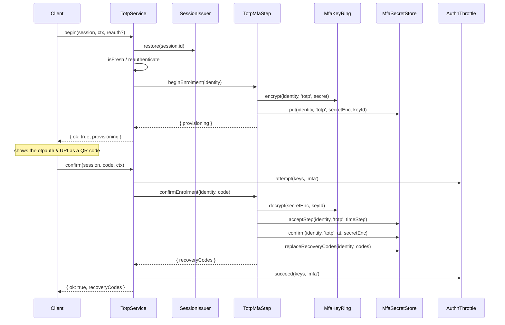

# Enrolment

The owner of an account adds TOTP in two calls: `TotpService.begin` creates a secret and returns its `otpauth://` URI, and `TotpService.confirm` checks a first code from the authenticator app and returns the recovery codes. Until confirmation, the enrolment is pending and login does not ask for it.

## How it works

### Begin, `TotpService.begin(session, ctx, reauth?)`

1. `TotpService` restores the session through `SessionIssuer.restore(session.id)`. A missing, ended or impersonated session gives `{ ok: false, code: 'no_session' }`. The identity always comes from the session, never from the caller.
2. A pending session passes only while the identity is enrolled in no MFA step: neither TOTP nor any other `MfaStep` of the app. Otherwise `no_session`.
3. It checks fresh auth with `isFresh(facts, ctx.now, authn.freshAuth.maxAgeSeconds)`. A stale active session passes when `reauth` is given and `AuthnService.reauthenticate` accepts it. A stale pending session is never re-authenticated. Failure: `not_fresh`.
4. The `authn.mfa.enrol.begin` [action hooks](10-action-hooks.md) run; a refusal throws.
5. `TotpMfaStep.beginEnrolment(identity)` checks the identity with `identityKey` of `@spinajs/authn-orm/identity` (throws `InvalidArgument` for a bad one) and draws a 20-byte random secret.
6. `MfaKeyRing.encrypt` encrypts the secret under the current key; see [Encryption keys](07-encryption-keys.md).
7. It builds the `otpauth://` URI with `issuer`, `algorithm`, `digits` and `period` of `authn.mfa.totp`. The label is the identity's email from `IdentityStore.display`, else its name, else `id.id`.
8. `MfaSecretStore.put` writes a pending row, or replaces an earlier pending one. It never overwrites a confirmed row: then the step throws `TotpAlreadyEnrolled` and the service answers `enrolled`.
9. Result: `{ ok: true, provisioning }`. The secret appears only inside `provisioning`, returned once.

### Confirm, `TotpService.confirm(session, code, ctx)`

1. `TotpService` restores the session: any active or pending session that is not impersonated. Confirm needs no fresh auth.
2. It reads the enrolment state with `TotpMfaStep.enrolment(identity)`. A pending session whose identity is enrolled in another MFA step answers `no_session`. `'confirmed'` answers `enrolled` and `'none'` answers `not_begun`; neither counts into the throttle.
3. The `authn.mfa.enrol.confirm` [action hooks](10-action-hooks.md) run; a refusal throws and counts nothing.
4. It counts the attempt into the `mfa` throttle under `identityThrottleKeys(identity, ctx)` of `@spinajs/authn/contracts`: `account` (`id`), `account-ip` (`id|ip`) and, with `ctx.ip`, `ip`, the keys `AuthnService.completeMfa` uses. A refusal answers `{ ok: false, code: 'throttled', retryAfterSeconds }`.
5. `TotpMfaStep.confirmEnrolment(identity, code)` decrypts the pending secret and checks the code inside `window`. A wrong code throws `TotpInvalidCode`.
6. `MfaSecretStore.acceptStep` spends the code's time step, so the same code cannot log in afterwards.
7. `MfaSecretStore.confirm(id, 'totp', undefined, secretEnc)` confirms only the cipher text the code was checked against. A `begin` that replaced it in between throws `TotpEnrolmentChanged`; another confirmation that won throws `TotpAlreadyEnrolled`.
8. The step issues `authn.mfa.totp.recoveryCodes` recovery codes; see [Recovery codes](04-recovery-codes.md).
9. The service resets the `mfa` throttle keys, publishes `mfa.enrol` with outcome `success` and returns `{ ok: true, recoveryCodes }`.



### Results

| Method | `ok: false` codes | Meaning |
| --- | --- | --- |
| `begin` | `no_session` | No usable session: gone, impersonated, or pending while the identity is enrolled. |
| | `not_fresh` | The login is older than `authn.freshAuth.maxAgeSeconds` and no valid `reauth` was given. |
| | `enrolled` | TOTP is already confirmed. Disable it first. |
| `confirm` | `no_session` | The session is gone or impersonated, or it is pending and the identity is enrolled in another MFA step. |
| | `not_begun` | No pending enrolment. |
| | `invalid_code` | Wrong code, a spent time step, or a `begin` replaced the secret meanwhile. |
| | `enrolled` | Already confirmed, another confirmation won, or the recovery codes could not be stored (regenerate them). |
| | `throttled` | The `mfa` throttle refused the attempt; `retryAfterSeconds` says when to retry. |

The results are values, not exceptions. `TotpService` throws for a fault, such as a missing `SessionIssuer` or a secret that does not decrypt, and for a refusal by an action hook (`ActionRefused`, or `ActionHookFailed` for a failed hook), which no result code covers; see [Action hooks](10-action-hooks.md).

### Forced enrolment at first login

With `authn.mfa.policy.force` (or a role of `forceForRoles`), `DefaultMfaPolicy` of `@spinajs/authn` requires the first configured step even when the user has not enrolled. The password login then leaves a pending session.

1. The pending session calls `begin` and `confirm`. Both accept it while the identity is enrolled in no MFA step.
2. `confirm` does not elevate the session. It spends the code's time step.
3. The client completes the login with `AuthnService.completeMfa` and a code of a **later** time step; see [The TOTP step at login](03-login-verification.md).

### HTTP routes

`@spinajs/authn-http` mounts these routes over the registered `MfaEnrolmentService`, which the root entry of this package registers as `TotpService`. They answer 404 unless `TotpService.enabled()` is true for the steps of the configured MFA policy: `authn.mfa.steps` lists `TotpMfaStep` itself, not a subclass, and `authn.mfa.encryptionKey.secret` is set. Status codes and bodies: [MFA enrolment routes](../authn-http/13-mfa-enrolment-routes.md).

| Route | Body | Calls |
| --- | --- | --- |
| `GET user/mfa` | | `MfaStep.enrolled` of each listed step; `{ steps: [{ name, enrolled }] }` |
| `POST user/mfa` | `{ reauthPassword? }` | `TotpService.begin` |
| `POST user/mfa/confirm` | `{ code }` | `TotpService.confirm` |
| `POST user/mfa/disable` | `{ code, reauthPassword? }` | `TotpService.disable`; see [Disable and admin reset](05-disable-and-reset.md) |
| `POST user/mfa/recovery-codes` | `{ reauthPassword? }` | `TotpService.regenerateRecoveryCodes`; see [Recovery codes](04-recovery-codes.md) |

## Configuration

| Key | Type | Default | Allowed values | Meaning |
| --- | --- | --- | --- | --- |
| `authn.mfa.totp.issuer` | `string` | `'SpinaJS'` | non-empty | Issuer in the URI. |
| `authn.mfa.totp.algorithm` | `string` | `'SHA1'` | `'SHA1'`, `'SHA256'`, `'SHA512'` | Algorithm in the URI and the code check. |
| `authn.mfa.totp.digits` | `number` | `6` | 6 to 10 | Code length in the URI and the code check. |
| `authn.mfa.totp.period` | `number` | `30` | 1 to 300 | Seconds per time step. |
| `authn.mfa.totp.window` | `number` | `1` | 0 to 10 | Time steps accepted on each side when confirming. |
| `authn.freshAuth.maxAgeSeconds` | `number` | `300` | positive integer | Maximum login age for `begin`. |

All keys: [Turning TOTP on](01-setup.md#configuration).

## Services and extension points

| Service | DI token and lifetime | Default implementation | Alternatives | How to replace or extend |
| --- | --- | --- | --- | --- |
| Owner service | `MfaEnrolmentService` (`@spinajs/authn/contracts`), singleton | `TotpService` | none shipped | Construct it with `TotpServiceDeps` for tests; see [Wiring and testing](09-wiring-and-testing.md). |
| Session lookup | `SessionIssuer`, from `@spinajs/authn-session` | `DefaultSessionIssuer` | | Optional `@Autoinject`; `deps.sessions` overrides it. |
| Re-authentication | `AuthnService` of `@spinajs/authn` | `DefaultAuthnService` | | Optional `@Autoinject`, used only for a stale active session with `reauth`; `deps.authn` overrides it. |
| Throttle | `AuthnThrottle` of `@spinajs/authn` | the registered throttle | `DbAuthnThrottle` | Optional `@Autoinject`; `deps.throttle` overrides it. |
| Audit | `AuthnAudit` of `@spinajs/authn/audit`, over every registered `AuthnEventSink` | `AuthnAudit` | | `deps.sinks` replaces it with `AuthnAudit.over(sinks)`. |
| Action hooks | `Hooks` of `@spinajs/hooks` | `DefaultHooks` | | `@Autoinject`; `deps.hooks` overrides it. Register an `ActionHook`; see [Action hooks](10-action-hooks.md). |

## Important behaviour

- `begin` replaces a pending enrolment with a new secret. The URI of the earlier `begin` stops working.
- `begin` and `confirm` are race-safe. `put` never overwrites a confirmed row, and `confirm` confirms only the cipher text the code was checked against. Of two parallel confirmations, one returns the recovery codes and the other answers `enrolled`.
- `begin` publishes no audit event, except `mfa.enrol` with outcome `failure` and the reason `hook:<code>` or `hook_error` when an action hook refuses it; a hook refusal of `confirm` is audited the same way. `confirm` publishes `mfa.enrol` with outcome `success` or `failure` and a `reason` (`enrolled`, `not_begun`, `invalid_code`, `throttled`), plus `throttle.block` when throttled.
- When the step confirms the enrolment but cannot store the recovery codes, `confirm` answers `enrolled` and audits `mfa.enrol` as a success with reason `recovery_codes_not_issued`. The owner then calls `regenerateRecoveryCodes`.
- No result and no event carries the secret, a code or a recovery code, except the one `provisioning` and the one `recoveryCodes` that hand them out.
- An impersonated session can neither begin nor confirm: a factor enrolled there would lock the owner out.
- A code is digits only: whitespace is removed, then exactly `digits` digits must remain. Anything else is `invalid_code` without a store read.

## Best practices

- Show the `recoveryCodes` of `confirm` right away and ask the user to store them; they are not shown again.
- Pass `reauth` (the account password as `{ kind: 'password', login, password }`) to `begin` when your UI asks for it, so a stale session does not need a new login.
- Set `ctx.ip` from the trusted proxy chain: it is part of the `mfa` throttle keys.

## Patterns and antipatterns

```ts
// Don't: the step API has no session, freshness, throttle or audit checks
await step.beginEnrolment({ type: 'user', id: req.params.uuid });

// Do: let TotpService take the identity from the caller's own session
const result = await totp.begin(session.handle, { now: new Date(), purpose: 'reauth', ip });
```

## Examples

### Confirm an enrolment and show the recovery codes

```ts sample
import { TotpService } from '@spinajs/authn-totp';
import type { SessionHandle } from '@spinajs/authn/contracts';
import { DI } from '@spinajs/di';

const MESSAGES: Record<string, string> = {
  invalid_code: 'The code does not match. Check the time on your phone and try again.',
  not_begun: 'Start the enrolment first.',
  enrolled: 'Two-factor authentication is already on.',
  throttled: 'Too many attempts. Try again later.',
  no_session: 'Please sign in again.',
};

export async function confirmTotp(session: SessionHandle, code: string, ip: string): Promise<{ codes: readonly string[] } | { error: string }> {
  const totp = await DI.resolve(TotpService);
  const result = await totp.confirm(session, code, { now: new Date(), purpose: 'reauth', ip });
  if (result.ok) {
    return { codes: result.recoveryCodes };
  }
  return { error: MESSAGES[result.code] ?? 'Enrolment failed.' };
}
```

## Related

- [The TOTP step at login](03-login-verification.md): what the confirmed enrolment does at the next login.
- [Recovery codes](04-recovery-codes.md): the codes `confirm` returns.
- [`@spinajs/authn`](../authn/README.md): fresh auth, `MfaPolicy`, the `mfa` throttle and audit events.
- [`@spinajs/authn-http` MFA enrolment routes](../authn-http/13-mfa-enrolment-routes.md): the `user/mfa*` routes.
