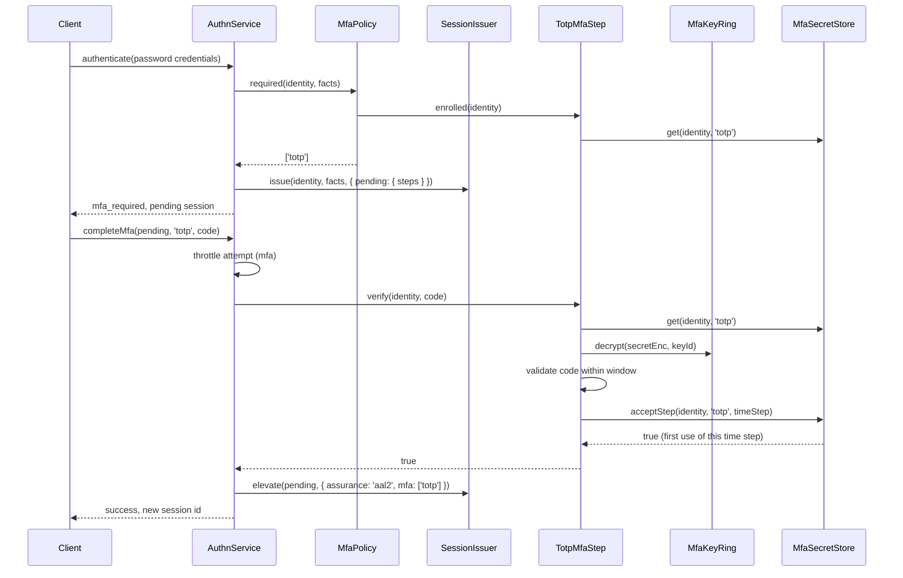

# The TOTP step at login

Once a user has a confirmed enrolment, a password login stops at a pending session, and `AuthnService.completeMfa` calls `TotpMfaStep.verify` with the code from the authenticator app. A passing code upgrades the session to `aal2`. Each code works once, and codes from up to `window` time steps away are accepted for clock drift.

## How it works

1. **First factor.** The client posts the password (`POST auth/login` in `@spinajs/authn-http`). `AuthnService.authenticate` verifies it through the password strategy of `@spinajs/authn-local`.
2. **Policy.** `MfaPolicy.required(identity, facts)` asks every listed step whether the identity is enrolled. `DefaultMfaPolicy` asks for password logins only; `TotpMfaStep.enrolled` is true once the enrolment is confirmed.
3. **Pending session.** With steps required, `SessionIssuer.issue` makes a *pending* session that yields no principal, and the result is `mfa_required`. Over HTTP the answer is `{ MfaRequired: ['totp'], MfaEnrol: [] }` with the pending session cookie; `MfaEnrol` is `['totp']` while a forced user has not enrolled.
4. **Second factor.** The client posts the code (`POST auth/mfa/verify` with `{ code, step? }`). `AuthnService.completeMfa(pending, 'totp', code, ctx)` restores the pending session and counts the attempt into the `mfa` throttle. A refused attempt fails with `throttled` and is not checked.
5. `completeMfa` asks the policy again for the required steps, checks `TotpMfaStep.enrolled` and calls `TotpMfaStep.verify(identity, code)`.
6. **Code check.** `verify` removes whitespace and requires exactly `digits` digits; anything else is `false` with no store read. It reads the row with `MfaSecretStore.get` and returns `false` unless the enrolment is confirmed.
7. `MfaKeyRing.decrypt` decrypts the secret with the key whose id the row stores. A row that does not decrypt throws `UnexpectedServerError`, never a wrong-code answer.
8. `otpauth` validates the code against the current time step and `window` steps on each side. A match gives its time step: the current counter plus the match offset.
9. **Replay check.** `MfaSecretStore.acceptStep(identity, 'totp', timeStep)` stores the time step when it is above the last accepted one. It returns `false` for that step and every older one, so `verify` returns `false`.
10. **Upgrade.** On `true`, `completeMfa` checks that the account is still active, calls `SessionIssuer.elevate` with `{ assurance: 'aal2', mfa: ['totp'] }` (new session id, same data), resets the `mfa` throttle keys and publishes `mfa.verify` and `login` events.
11. A wrong code, a spent time step or a step error fails with `invalid_credentials`, keeps the throttle count and leaves the session pending.



A lost device takes the recovery path instead: `completeMfa(pending, 'recovery', code, ctx)`; see [Recovery codes](04-recovery-codes.md).

## Configuration

| Key | Type | Default | Allowed values | Meaning |
| --- | --- | --- | --- | --- |
| `authn.mfa.totp.digits` | `number` | `6` | 6 to 10 | Required code length. |
| `authn.mfa.totp.period` | `number` | `30` | 1 to 300 | Seconds per time step. |
| `authn.mfa.totp.window` | `number` | `1` | 0 to 10 | Time steps accepted before and after the current one. `0` accepts the current step only. |
| `authn.mfa.totp.algorithm` | `string` | `'SHA1'` | `'SHA1'`, `'SHA256'`, `'SHA512'` | HMAC algorithm. |

The `mfa` throttle budget, the pending session lifetime and `authn.mfa.policy` belong to `@spinajs/authn`: see [`@spinajs/authn`](../authn/README.md).

## Services and extension points

| Service | DI token and lifetime | Default implementation | Alternatives | How to replace or extend |
| --- | --- | --- | --- | --- |
| TOTP step | `MfaStep` (one of `Array.ofType(MfaStep)`), singleton; picked by `authn.mfa.steps[].service` | `TotpMfaStep` (`name: 'totp'`, `storesSecrets: true`) | none shipped | Construct it with `TotpMfaStepDeps`; see [Wiring and testing](09-wiring-and-testing.md). |
| Secret store | `MfaSecretStore`; `DbMfaSecretStore` is `@PerChildInstance()` | `DbMfaSecretStore` after `import '@spinajs/authn-totp/db'` | `MemoryMfaSecretStore` | See [Secret store](06-secret-store.md). |

`TotpMfaStep` methods that login uses:

| Method | Returns | Notes |
| --- | --- | --- |
| `enrolled(id)` | `Promise<boolean>` | True only for a confirmed enrolment. |
| `enrolment(id)` | `Promise<'none' \| 'pending' \| 'confirmed'>` | For admin tools and diagnostics; never exposes the secret. |
| `verify(id, response)` | `Promise<boolean>` | Takes a TOTP code only, never a recovery code. True once per time step. |
| `verifyRecovery(id, code)` | `Promise<boolean>` | Takes a recovery code only; see [Recovery codes](04-recovery-codes.md). |

## Important behaviour

- **Replay protection.** A code works once. After a code of time step T, every code of T or older is refused, also inside `window`. Of two parallel `verify` calls with one code, one returns `true`; `acceptStep` is one conditional write.
- **Drift.** With `window: 1` and `period: 30`, a code from the previous or next 30-second step passes. Accepting a code from the next step spends the current step too.
- **Enrolment spends a step.** `confirmEnrolment` spends the time step of its code. A forced first login needs a code of a later step to complete.
- A pending (unconfirmed) enrolment never passes `verify` and does not spend the code.
- `verify` refuses a recovery code; `verifyRecovery` refuses a TOTP code. Neither touches the store for input of the wrong shape.
- A secret that does not decrypt (a removed key, a damaged row) is a server fault: `verify` throws `UnexpectedServerError`. `completeMfa` audits it as `step_error` and answers the wrong-code failure.
- A user banned or deleted between the two factors gets no session: `completeMfa` revokes the pending one.
- `completeMfa` and `TotpService.confirm` and `disable` count into one `mfa` throttle budget per account and IP.

## Best practices

- Keep `window` at `1` or `0`. A window of `w` accepts `2w + 1` codes per attempt, so each extra step gives a guesser two more matches per throttle slot.
- When the app lists more than one MFA step, send `step: 'totp'` with the code; without `step`, `POST auth/mfa/verify` takes the first pending step.
- Tell users that a code works once: a second sign-in in the same 30 seconds needs the next code.

## Patterns and antipatterns

```ts
// Don't: verify() alone skips the throttle, the pending-session check and the session upgrade
if (await totpStep.verify(identity, code)) grantAccess();

// Do: complete the login through AuthnService
const result = await authn.completeMfa(pendingHandle, 'totp', code, { now: new Date(), purpose: 'login', ip });
```

## Examples

### Complete a login with a TOTP code

```ts sample
import { AuthnService } from '@spinajs/authn/contracts';
import type { SessionHandle } from '@spinajs/authn/contracts';
import { DI } from '@spinajs/di';

export async function completeTotpLogin(pending: SessionHandle, code: string, ip: string): Promise<SessionHandle | null> {
  const authn = await DI.resolve(AuthnService);
  const result = await authn.completeMfa(pending, 'totp', code, { now: new Date(), purpose: 'login', ip, session: pending });
  if (result.status !== 'success' || !result.session) {
    return null;
  }
  return result.session;
}
```

## Related

- [`@spinajs/authn`](../authn/README.md): `AuthnService.completeMfa`, `DefaultMfaPolicy` and the `mfa` throttle.
- [`@spinajs/authn-local`](../authn-local/README.md): the password strategy of the first factor.
- [`@spinajs/authn-session`](../authn-session/README.md): pending sessions and `elevate`.
- [`@spinajs/authn-http` login and MFA routes](../authn-http/08-login-logout-and-mfa-routes.md): `POST auth/login`, `POST auth/mfa/verify` and `POST auth/mfa/recovery`.
- [`@spinajs/authn-orm` MFA store](../authn-orm/05-mfa-store.md): `acceptStep` in SQL.
