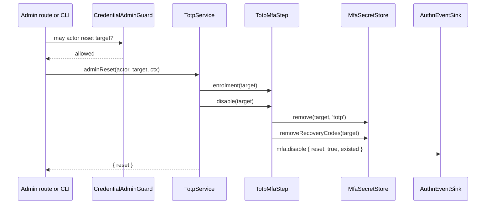

# Disable and admin reset

The owner turns TOTP off with `TotpService.disable`, which needs fresh auth and a valid TOTP or recovery code. An administrator or operator removes it with `TotpService.adminReset`, which never returns a secret. Both remove the enrolment and every recovery code.

## How it works

### Disable, `TotpService.disable(session, code, ctx, reauth?)`

1. `TotpService` restores the session. It must be active and not impersonated; a pending session answers `no_session`.
2. It checks fresh auth: a login within `authn.freshAuth.maxAgeSeconds`, or a `reauth` credential that `AuthnService.reauthenticate` accepts. Otherwise it audits `mfa.disable` with reason `not_fresh` and answers `not_fresh`, without counting into the `mfa` throttle.
3. `TotpMfaStep.enrolled(identity)` must be true; otherwise `not_enrolled`.
4. It counts the attempt into the `mfa` throttle under the same keys as login. A refusal answers `throttled` with `retryAfterSeconds`.
5. It tries the code as a TOTP code (`TotpMfaStep.verify`), then as a recovery code (`TotpMfaStep.verifyRecovery`). Neither passing answers `invalid_code`.
6. On success it resets the `mfa` throttle keys and calls `TotpMfaStep.disable(identity)`: `MfaSecretStore.remove` and `MfaSecretStore.removeRecoveryCodes`.
7. It audits `mfa.disable` with outcome `success` and returns `{ ok: true }`.

Over HTTP, `POST user/mfa/disable` with `{ code, reauthPassword? }` calls it.

### Admin reset, `TotpService.adminReset(actor, target, ctx)`

1. `TotpMfaStep.enrolment(target)` reads the state before the reset: `'none'`, `'pending'` or `'confirmed'`.
2. `TotpMfaStep.disable(target)` removes the enrolment and the recovery codes.
3. It publishes `mfa.disable` with outcome `success`, `identity: target`, `actor` and `data: { reset: true, existed }`.
4. It returns `{ reset: true }` when a confirmed or pending enrolment existed, else `{ reset: false }`.

`adminReset` does **not** check who may reset whom. The caller applies the target guard first: `@spinajs/authn-http` mounts it as `POST authn/admin/users/:uuid/mfa-reset` behind the registered `CredentialAdminGuard` (`AuthzCredentialAdminGuard` of `@spinajs/users` checks `users:credentials`), and the `authn:mfa-reset` command runs it as the actor `{ type: 'system', id: 'cli' }`. See [CLI and QR codes](08-cli-and-qr.md).



### Results of `disable`

| Code | Meaning |
| --- | --- |
| `no_session` | The session is gone, pending or impersonated. |
| `not_fresh` | The login is too old and no valid `reauth` was given. |
| `not_enrolled` | No confirmed TOTP enrolment. |
| `invalid_code` | Neither a valid TOTP code nor an unused recovery code. Counted into the throttle. |
| `throttled` | The `mfa` throttle refused the attempt; see `retryAfterSeconds`. |

## Configuration

| Key | Type | Default | Allowed values | Meaning |
| --- | --- | --- | --- | --- |
| `authn.freshAuth.maxAgeSeconds` | `number` | `300` | positive integer | Maximum login age for `disable` without `reauth`. Owned by `@spinajs/authn`. |

## Services and extension points

| Service | DI token and lifetime | Default implementation | Alternatives | How to replace or extend |
| --- | --- | --- | --- | --- |
| Owner service | `TotpService` (class name), singleton | `TotpService` | none shipped | See [Wiring and testing](09-wiring-and-testing.md). |
| Audit sinks | `Array.ofType(AuthnEventSink)` of `@spinajs/authn` | every registered sink | `DbAuthnAuditSink` of `@spinajs/authn-orm` | Register another `AuthnEventSink`, or pass `deps.sinks`. |

## Important behaviour

- `adminReset` resolves only the step and the audit sinks, so a CLI process needs no `SessionIssuer`, `AuthnService` or throttle.
- `adminReset` never returns or logs a secret, a code or a recovery code.
- A failed `disable` changes nothing: the enrolment and the codes stay.
- A recovery code used to disable is spent, then removed with the rest.
- `TotpMfaStep.disable` also removes a pending (unconfirmed) enrolment.

## Best practices

- Call `adminReset` only after your own target guard; it trusts its caller.
- After an admin reset, tell the user to enrol again and to delete the old authenticator app entry: its codes no longer match anything.

## Patterns and antipatterns

```ts
// Don't: removes the TOTP row but leaves the recovery codes and writes no audit event
await mfaSecretStore.remove(target, 'totp');

// Do: removes both and audits the reset with the actor
await totpService.adminReset(actor, target, { now: new Date(), purpose: 'request' });
```

## Examples

### Reset MFA from a support tool after the guard passed

```ts sample
import { TotpService } from '@spinajs/authn-totp';
import type { PrincipalRef } from '@spinajs/authn/contracts';
import { DI } from '@spinajs/di';

export async function supportResetMfa(supportAgent: PrincipalRef, userUuid: string): Promise<string> {
  const totp = await DI.resolve(TotpService);
  const { reset } = await totp.adminReset(supportAgent, { type: 'user', id: userUuid }, { now: new Date(), purpose: 'request' });
  return reset ? 'MFA removed; the user can enrol again.' : 'The user had no MFA enrolment.';
}
```

## Related

- [Recovery codes](04-recovery-codes.md): accepted by `disable` in place of a TOTP code.
- [CLI and QR codes](08-cli-and-qr.md): `authn:mfa-reset`.
- [`@spinajs/authn-http` MFA enrolment routes](../authn-http/13-mfa-enrolment-routes.md): `POST user/mfa/disable`. The admin reset route: [`@spinajs/authn-http`](../authn-http/README.md).
- [`@spinajs/authn`](../authn/README.md): fresh auth, `CredentialAdminGuard` and audit events.
