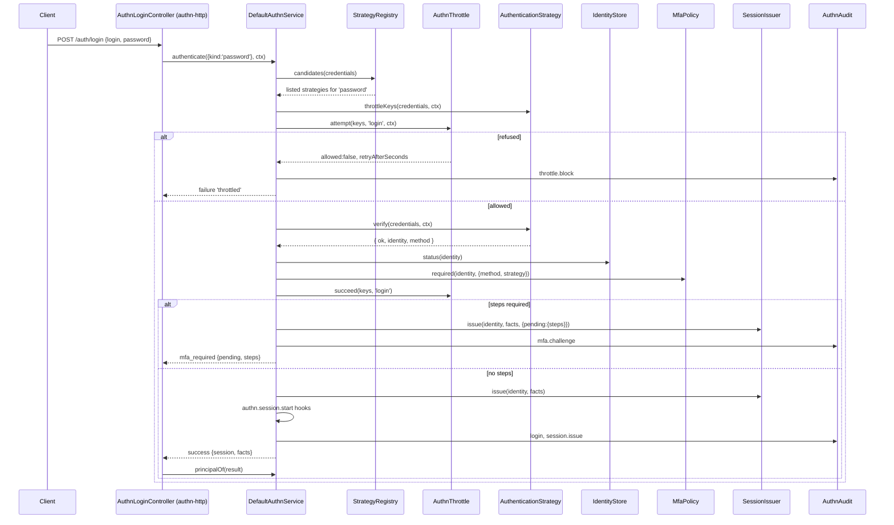
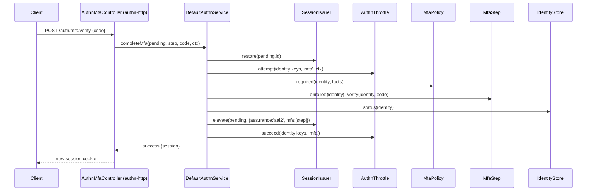

# Authentication flow

`AuthnService` turns credentials into a result: a session, a pending MFA session, a per-request success, or one opaque failure. `DefaultAuthnService` is the implementation. Every login method, HTTP route and CLI command goes through it.

Use this page to see what runs, in which order, and what each step can refuse. The strategies, the MFA policy, the throttle and the audit sinks have their own pages.

## How it works

`AuthnService` has five entry points:

| Method | Called by | Result |
| --- | --- | --- |
| `authenticate(credentials, ctx)` | A login route, the request middleware for tokens and keys, your code | `AuthenticationResult`: `success`, `mfa_required` or `failure` |
| `completeMfa(pending, step, response, ctx)` | The MFA route, with the pending session | `success` with an `aal2` session, or `failure` |
| `stepUp(session, step, response, ctx)` | The step-up route, with an active session | `success` with an `aal2` session under a new id, or `failure` |
| `reauthenticate(session, credentials, ctx)` | `FreshAuthCheck`, routes that ask for the password again | `true` or `false` |
| `principalOf(result)` | Whoever got a `success` | The `Principal` that authorization uses |

`strategies()` returns the listed strategies in list order.

### Login: `authenticate`

A login (any `ctx.purpose` but `request`) first runs the `authn.login` [action hooks](14-action-hooks.md). A refusal, or a hook that throws, answers `invalid_credentials` and audits a `login` failure (`hook:<code>` or `hook_error`) before anything is counted or verified. A hook may change the credentials, never the context. Per-request credentials skip it.

1. **Pick the candidates.** `StrategyRegistry.candidates(credentials)` returns the strategies of `authn.strategies` whose `kinds` include `credentials.kind`, in list order. A strategy with an `accepts(credentials)` method that does not return `true` is left out. No candidate: the result is `unsupported_credentials`, nothing is counted, and a `login` failure event is audited.
2. **Build the throttle keys.** Each candidate's `throttleKeys(credentials, ctx)` gives its keys. The service rewrites them (see [Throttle keys](05-throttling.md#keys-the-service-builds)) and adds the shared `ip` key and, when `authn.throttle.global` is set, the `global` key. A strategy that throws or returns malformed keys fails the attempt with `invalid_credentials`, before any verify.
3. **Ask the throttle.** When every candidate is per-request (`interactive: false`) and the throttle has `peek`, the service only peeks: nothing is counted yet. Otherwise `AuthnThrottle.attempt(keys, 'login', ctx)` counts the attempt **before** the credentials are checked, once, with the union of the candidates' keys. A refusal returns `{ status: 'failure', reason: 'throttled', retryAfterSeconds }` and audits `throttle.block`. A refused attempt is neither verified nor counted.
4. **Verify.** `verifyWith` calls `verify(credentials, ctx)` on each candidate in order. Only an `unsupported_credentials` answer passes the credentials to the next candidate. Any other answer stops the loop. A strategy that throws, or answers a shape the contract does not allow, fails the attempt with `invalid_credentials`.
5. **Resolve the identity** (`accept`). A strategy answers either an `identity` or an `external` subject. An external subject resolves through the `IdentityLinkStore`: an existing link, else a link by verified email, else JIT provisioning, else `not_linked`. See [Account linking](10-account-linking.md#linking-at-login).
6. **Check the identity.** An interactive strategy must answer a `user` identity, since only users get sessions. Then `IdentityStore.status()` must report the identity as existing, active, not banned and not deleted. For a delegation (agent tokens), the status of the identity it acts for is checked. Identities of type `service` and `agent` are not asked: their strategies vouch for them.
7. **Run `authn.login.identified`.** For an interactive strategy, the [action hooks](14-action-hooks.md) of `authn.login.identified` run with the identity, the strategy, the method, the external subject of an external login and the attributes. A refusal, or a hook that throws, fails the login with `invalid_credentials` and no session; a hook may replace the attributes. A link by verified email is written only after they pass.
8. **Per-request strategy: finish.** `AuthnThrottle.succeed(keys, 'login')` resets the answering strategy's keys, a `token.use` or `key.use` success is audited, and the result is a `success` with no session.
9. **Interactive strategy: ask the MFA policy.** `MfaPolicy.required(identity, { method, strategy })` returns the steps still to pass. A policy that throws fails the login, and the throttle keeps the count.
10. **Reset the throttle.** Only now `AuthnThrottle.succeed(keys, 'login')` runs, so a login the policy refuses cannot be told apart from a wrong password by its backoff.
11. **Issue the session.** With steps: `SessionIssuer.issue(identity, facts, { pending: { steps } })`, an `mfa.challenge` event, and `{ status: 'mfa_required', pending, steps }`. Without: an active `aal1` session, then step 12.
12. **Start the session.** The `authn.session.start` [action hooks](14-action-hooks.md#authnsessionstart) run on the active session (`kind: 'login'`); a ceiling a hook sets is stored as its `ActiveRole`. A refusal, a hook that fails or a ceiling an `ActiveRole` cannot hold revokes the session, audits a `login` failure (`hook:<code>` or `hook_error`) and answers `invalid_credentials`. Otherwise: `login` and `session.issue` events, and a `success` that carries the session and `facts.sessionHandle`.

A per-request attempt that fails at step 4 to 6 is counted now, with `attempt(keys, 'login', ctx)`. When that count refuses, the answer becomes `throttled`.



### Second factor: `completeMfa`

1. `SessionIssuer.restore(pending.id)` must return a `pending` session. Otherwise the result is `invalid_credentials` (audit reason `not_pending`), and nothing is counted.
2. `AuthnThrottle.attempt(keys, 'mfa', ctx)` counts the attempt, keyed by the identity id, the identity id with the IP, and the IP. A refusal is `throttled` with `retryAfterSeconds`.
   The `authn.mfa.verify` [action hooks](14-action-hooks.md) run around the steps below. A refusal answers as a wrong code does (audit reason `hook:<code>`), and the session stays pending.
3. The policy is asked again with `MfaPolicy.required`: the session does not keep the steps it was issued with. The required steps are alternatives; passing any one is enough.
4. The step must be one of the required steps and the identity must be enrolled in it. Then `MfaStep.verify(identity, response)`. With step `recovery` (`RECOVERY_STEP`), the first enrolled step that has `verifyRecovery` checks the code.
5. The identity status is read again. An identity banned, deactivated or deleted between the two steps gets no session, and the pending session is revoked.
6. `SessionIssuer.elevate(pending, { assurance: 'aal2', mfa: [step] })` turns the session active and rotates its id. `AuthnThrottle.succeed(keys, 'mfa')` resets the keys.
7. The `authn.session.start` [action hooks](14-action-hooks.md#authnsessionstart) run on the elevated session (`kind: 'mfa'`), as in step 12 of a login. A refusal revokes it and answers `invalid_credentials`, audited as a `login` failure.
8. `mfa.verify` and `login` successes are audited. The result is a `success` with the new session.



### Step-up of an active session: `stepUp`

An `aal1` session meets a route behind `MfaSatisfied`: its login method needed no second factor, or the identity enrolled after the login. `stepUp` raises the session without a new login.

1. `SessionIssuer.restore(session.id)` must return an `active` session that is not an impersonation: the target's factor must not raise the session an impersonator acts in. Otherwise the result is `invalid_credentials` (audit reason `not_active` or `impersonation`), and nothing is counted.
2. A session already at `aal2` answers `success` with the same handle. Nothing is verified, counted or reissued.
3. `AuthnThrottle.attempt(keys, 'mfa', ctx)` counts the attempt with the identity keys, as in `completeMfa`. The `authn.session.stepUp` [action hooks](14-action-hooks.md) run around the steps below; a refusal answers as a wrong code does, with no reissue.
4. The step must be one of `MfaPolicy.steps()` that the identity is enrolled in, whatever its login method. With step `recovery`, the first enrolled step that has `verifyRecovery` checks the code, which works once.
5. The identity status is read again. A banned, deactivated or deleted identity gets nothing, and its session is revoked.
6. `SessionIssuer.reissue(session, { assurance: 'aal2', mfa: [step] })` moves the session and its data to a new id. `AuthnThrottle.succeed(keys, 'mfa')` resets the keys.
7. `mfa.verify` and `session.rotate` (reason `step_up`) successes are audited. The result is a `success` with the new session.

### Re-authentication: `reauthenticate`

1. The session must be `active` and must not be an impersonation. The target's password must not let an impersonator act as the target.
2. Only interactive candidates count: a token or a key the client holds does not show that the user is present.
3. `AuthnThrottle.attempt(keys, 'reauth', ctx)` counts the attempt with the identity keys. A refusal answers `false`. The `authn.reauth` [action hooks](14-action-hooks.md) run around the steps below; a refusal answers `false`.
4. The strategy verifies. The verified identity must be the session's own identity, a delegation never is. Its status must still allow a login.
5. `AuthnThrottle.succeed(keys, 'reauth')`, a `reauth` success event, and `true`.

A success changes no session fact and does not rotate the session id. It counts for the current request only. [Fresh authentication](09-fresh-authentication.md) wraps it.

### Principal: `principalOf`

1. A result with a session: `SessionIssuer.restore` must return an active session of the same identity, or `principalOf` throws `InvalidOperation`. The facts come from the session.
2. A result without a session (per-request): the facts are the result's facts with `authenticatedAt` set to the time of the call.
3. A delegation: the identity it acts for becomes `onBehalfOf`, through the same `PrincipalFactory`.
4. `PrincipalFactory.principalOf(identity, facts, { ceiling, onBehalfOf, delegation, attributes })` builds the principal. See [Principal and authorization](07-principal-and-authz.md).

### Requests after the login

The HTTP layer is in [`@spinajs/authn-http`](../authn-http/README.md): its `AuthnMiddleware` restores the session cookie, or extracts token and key credentials and calls `authenticate` with purpose `request`. It writes the principal to `req.storage.AuthnPrincipal`. Session principals go through `AuthnImpersonationService.principalOf`, see [Impersonation](11-impersonation-and-active-role.md).

## Results and failure reasons

The caller sees an `AuthnFailure`. The real reason goes to the audit event only, so the answer never tells whether an account exists. `@spinajs/authn-http` answers every failure with one 401 body.

| `AuthnFailure` | When |
| --- | --- |
| `invalid_credentials` | Wrong credentials, and every refusal after a verified credential |
| `throttled` | The throttle refused; `retryAfterSeconds` is set |
| `unsupported_credentials` | No listed strategy takes the credentials |
| `expired`, `revoked` | A strategy reported it for its credential (a token, a key) |
| `not_linked` | An external subject maps to no identity |

Audit reasons the core writes:

| Flow | Event | Reasons |
| --- | --- | --- |
| `authenticate` | `login`, `token.use`, `key.use` | `unsupported_credentials`, `strategy_error`, `strategy_contract`, the strategy's own reason, `not_linked`, `non_user_session`, `unknown_identity`, `deleted`, `banned`, `inactive`, `hook:<code>`, `hook_error`, `policy_error`, `mfa_step_not_listed`, `mfa_enrolment_mismatch`, `store_error` |
| `authenticate`, `completeMfa`, `stepUp`, `reauthenticate` | `throttle.block` | `throttled` |
| `completeMfa` | `mfa.verify` | `not_pending`, `no_steps`, `unknown_step`, `not_enrolled`, `no_recovery_step`, `invalid_code`, `step_error`, `store_error`, `session_error`, `hook:<code>`, `hook_error` |
| `completeMfa` | `login` | `unknown_identity`, `deleted`, `banned`, `inactive` |
| `stepUp` | `mfa.verify` | `not_active`, `impersonation`, `no_steps`, `unknown_step`, `not_enrolled`, `no_recovery_step`, `invalid_code`, `step_error`, `store_error`, the status reasons, `session_error`, `hook:<code>`, `hook_error` |
| `reauthenticate` | `reauth` | `not_active`, `impersonation`, `unsupported_credentials`, `other_identity`, the strategy's own reason, the status reasons, `store_error`, `hook:<code>`, `hook_error` |

An error thrown by a strategy or a store is audited by its class name only (`data.error`). Its message may echo the credential. A failing action hook is audited as `hook_error` with `data.hook` (the hook class) and `data.failure` (`error`, `timeout` or `depth`).

## Services and extension points

| Service | DI token and lifetime | Default implementation | Alternatives | How to replace or extend |
| --- | --- | --- | --- | --- |
| `AuthnService` | `AuthnService`, per child container | `DefaultAuthnService` | `FakeAuthnService` in [`@spinajs/authn-testing`](../authn-testing/README.md) | Subclass `DefaultAuthnService`, declare `@PerChildInstance()` again and register it with `@Injectable(AuthnService)`; a single resolve takes the last registration |

`DefaultAuthnService` needs these neighbours at boot. A missing one fails the boot, also when only per-request strategies are listed:

| Neighbour | How it is found | Provided by |
| --- | --- | --- |
| `IdentityStore`, `PrincipalFactory` | Required registration | [`@spinajs/users`](../users/README.md), or your own |
| `SessionIssuer` | Required registration | [`@spinajs/authn-session`](../authn-session/README.md) |
| `MfaPolicy` | Named by `authn.mfa.policy.service` | `DefaultMfaPolicy` |
| `AuthnThrottle` | Named by `authn.throttle.service`, or picked | `MemoryAuthnThrottle`, `DbAuthnThrottle` |
| `IdentityLinkStore` | Optional | [`@spinajs/authn-orm`](../authn-orm/README.md) |
| `StrategyRegistry`, `AuthnAudit` | Built in | `@spinajs/authn` |

## Important behaviour

- Bad credentials never throw. They return a `failure`. A store or policy error after a verified credential also returns `invalid_credentials`: a rejection would tell a right password apart from a wrong one.
- An interactive attempt is counted before verify. A per-request attempt is counted after a failure only, when the throttle can `peek`. Parallel requests with one valid token then never back off.
- The candidates share one count: the union of their keys is counted once. A success resets only the answering strategy's keys.
- A login the MFA policy refuses keeps its count in the throttle.
- `DefaultAuthnService` is one instance per container, so a child container reads its own `authn.strategies`.
- The service never puts a login, a password, a code or a raw session id into an event. Sessions appear by their hashed handle.
- `completeMfa` refuses an active session and `stepUp` a pending one: `elevate` only completes a login, `reissue` only raises a live session.

## Best practices

- Pass `ctx.ip` from the trusted-proxy chain only. Without it, the `ip` key is missing and per-IP backoff does nothing.
- Pass a fresh `ctx.now` for every call. The throttle refuses a missing or invalid date.
- Hand the session of every `success` and `mfa_required` result to your cookie issuer. Login and MFA completion rotate the id; the old one stops working.
- Call `principalOf` only with a `success` result. It throws `InvalidArgument` for anything else.

## Patterns and antipatterns

```ts
// Don't: a failure reason in the answer tells an attacker which accounts exist
if (result.status === 'failure') return { error: result.reason };

// Do: one answer for every failure, plus Retry-After when throttled
if (result.status === 'failure') return { status: 401, retryAfter: result.reason === 'throttled' ? result.retryAfterSeconds : undefined };
```

```ts
// Don't: verify a password yourself and then issue a session; no throttle, no MFA, no audit
const ok = await hasher.verify(stored, password);

// Do: go through the service
const result = await authn.authenticate({ kind: 'password', login, password }, ctx);
```

## Examples

### Log a user in from code, with a second factor

```ts sample
import { DI } from '@spinajs/di';
import { AuthnService, RECOVERY_STEP } from '@spinajs/authn';
import type { AuthnContext, Principal } from '@spinajs/authn';

export async function signIn(login: string, password: string, ip: string, askCode: (steps: readonly string[]) => Promise<{ step: string; code: string }>): Promise<Principal | null> {
  const authn = await DI.resolve(AuthnService);
  const ctx: AuthnContext = { ip, now: new Date(), purpose: 'login' };

  let result = await authn.authenticate({ kind: 'password', login, password }, ctx);
  if (result.status === 'mfa_required') {
    // `step` is one of result.steps, or RECOVERY_STEP with a recovery code.
    const { step, code } = await askCode([...result.steps, RECOVERY_STEP]);
    result = await authn.completeMfa(result.pending, step, code, { ...ctx, now: new Date(), session: result.pending });
  }
  return result.status === 'success' ? authn.principalOf(result) : null;
}
```

### Authenticate an API token outside HTTP

```ts sample
import { DI } from '@spinajs/di';
import { AuthnService } from '@spinajs/authn';
import type { Principal } from '@spinajs/authn';

export async function principalOfToken(token: string): Promise<Principal | null> {
  const authn = await DI.resolve(AuthnService);
  const result = await authn.authenticate({ kind: 'bearer', token }, { now: new Date(), purpose: 'request' });
  return result.status === 'success' ? authn.principalOf(result) : null;
}
```

## Related

- [Strategies](03-strategies.md): the candidates and their contract.
- [MFA policy and steps](04-mfa-policy-and-steps.md): what `MfaPolicy.required` decides.
- [Throttling](05-throttling.md): the keys and the backoff.
- [Audit events](06-audit-events.md): where every event goes.
- [`@spinajs/authn-http`](../authn-http/README.md): the routes and the middleware that call this service.
