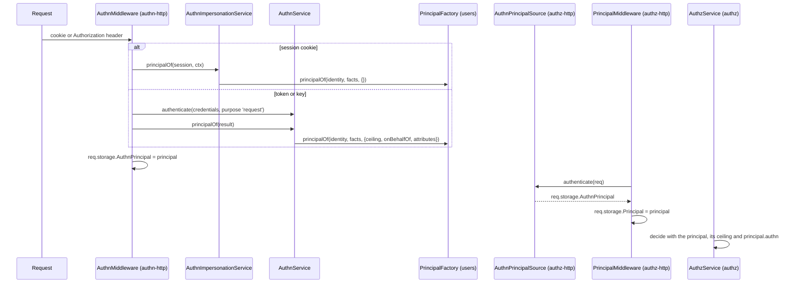

# Principal and authorization

Authentication ends in a `Principal`: who is calling, how they signed in, and what limits apply. Authorization decides with it. `@spinajs/authn` defines the type and the `PrincipalFactory` that builds it; `@spinajs/authz` imports the type from `@spinajs/authn/contracts` and never the services.

## How it works

1. **Build.** `AuthnService.principalOf(result)` (tokens, keys, a fresh login) and `AuthnImpersonationService.principalOf(session, ctx)` (every request on a session) call `PrincipalFactory.principalOf(identity, facts, extra)`. `@spinajs/users` registers `UserPrincipalFactory`, which loads the user and refuses deleted, inactive or banned users.
2. **Narrow.** `extra.ceiling` carries a token's roles or scope. After a role switch, `@spinajs/authn-http` rebuilds the session principal with `ceiling.roles = [ActiveRole]` (`activeRoleCeiling`). A delegation (an agent token) sets `onBehalfOf` and `delegation`.
3. **Hand over.** `AuthnMiddleware` in [`@spinajs/authn-http`](../authn-http/README.md) writes the principal to `req.storage.AuthnPrincipal` (`IAuthnPrincipalStorage`). A pending pre-MFA session, a missing credential or a refused one leaves `null`.
4. **Pick up.** `AuthnPrincipalSource` in `@spinajs/authz-http` (a `PrincipalSource` named `authn`, order 50) returns `req.storage.AuthnPrincipal`. `PrincipalMiddleware` runs after `AuthnMiddleware` and stores the chosen principal in `req.storage.Principal`.
5. **Decide.** The authz engine decides with this principal. Its `ceiling` and its delegation can only narrow the answer: a delegate gets at most what the principal it acts for has. Conditions can read `principal.authn.*`, for example the assurance level or the strategy. See [`@spinajs/authz`](../authz/README.md).



## The `Principal`

| Field | Meaning |
| --- | --- |
| `type`, `id` | `user`, `service`, `agent`, `anonymous`, `unattended`, `system`, `link`, `group` or an app type; for users `id` is `users.Uuid` |
| `authenticated` | `false` for anonymous and unattended callers |
| `source` | Where it came from: `session`, `token`, `link`, `runAs`, `queue`, or an app value |
| `onBehalfOf`, `delegation` | The principal an agent acts for; `intersect` (default) or `inherit` |
| `companions` | Other identities that speak in the same request, such as the signed-in user behind a link |
| `ceiling` | The most this principal may do: `roles`, `permissions` (globs), `resources`, `expiresAt`, and the deny `reason` |
| `attributes` | Facts ABAC conditions may read. `PrincipalFactory` and attribute providers win over the strategy's attributes |
| `identity` | The `User` model or an app object; opaque to authz |
| `authn` | `AuthnFacts`, below |

`AuthnFacts`:

| Field | Meaning |
| --- | --- |
| `method` | `password`, `token`, `jws`, `http-signature`, `oidc`, … as the strategy reported it |
| `strategy` | The configured strategy name: `local`, `token`, `oidc:google` |
| `assurance` | `aal2` after a passed MFA step, else `aal1` |
| `mfa` | The steps passed: `['totp']` |
| `authenticatedAt` | The login time for a session; the time of the call for a per-request credential |
| `impersonator` | The actor, while impersonating |
| `sessionHandle` | The hashed session handle, never the raw id |

### Helpers

| Export | Use |
| --- | --- |
| `SYSTEM`, `UNATTENDED` | Frozen singletons. The engine recognises them by identity, not by shape |
| `principalKey(ref)` | An injective `type:id` key for caches and invalidation tags |
| `ceilingHash(ceiling)` | A canonical serialization of a ceiling, so two principals with different ceilings never share a cached decision |

## Services and extension points

| Service | DI token and lifetime | Default implementation | Alternatives | How to replace or extend |
| --- | --- | --- | --- | --- |
| `PrincipalFactory` | `PrincipalFactory`; required by `DefaultAuthnService` and `AuthnImpersonationService` | None in the core | `UserPrincipalFactory` ([`@spinajs/users`](../users/README.md)) | `@Injectable(PrincipalFactory)` on your class |

### PrincipalFactory: custom implementation

An app without `@spinajs/users`, such as a machine-only service, registers its own factory:

```ts sample
import { Injectable } from '@spinajs/di';
import { PrincipalFactory } from '@spinajs/authn';
import type { AuthnFacts, Ceiling, IdentityRef, Principal } from '@spinajs/authn';

@Injectable(PrincipalFactory)
export class ServicePrincipalFactory extends PrincipalFactory {
  async principalOf(id: IdentityRef, facts: AuthnFacts, extra: { ceiling?: Ceiling; onBehalfOf?: Principal; delegation?: 'inherit' | 'intersect'; attributes?: Readonly<Record<string, unknown>> }): Promise<Principal> {
    return {
      type: id.type,
      id: id.id,
      authenticated: true,
      source: facts.method === 'token' ? 'token' : 'session',
      attributes: { ...(extra.attributes ?? {}) },
      authn: facts,
      ...(extra.ceiling ? { ceiling: extra.ceiling } : {}),
      ...(extra.onBehalfOf ? { onBehalfOf: extra.onBehalfOf, delegation: extra.delegation ?? 'intersect' } : {}),
    };
  }
}
```

Keep `extra.ceiling`: dropping it lifts the limits of a token. `DefaultMfaPolicy` (with `forceForRoles`) and `AuthnImpersonationService` call the factory too.

## Important behaviour

- A pending pre-MFA session yields no principal: authorization sees an anonymous caller, or none.
- An impersonation principal is the target, with `authn.impersonator` set to the actor.
- A ceiling only narrows. A token role the owner lacks grants nothing.
- An ended or refused session resolves to `null`, never to another identity.

## Best practices

- Write authorization conditions on `principal.authn.assurance` for actions that need a second factor, instead of checking sessions in controllers.
- Use `principalKey` and `ceilingHash` when you cache anything per principal.

## Related

- [Authentication flow](01-authentication-flow.md#principal-principalof): when `principalOf` runs.
- [Impersonation and the active role](11-impersonation-and-active-role.md): the session principal on every request.
- [`@spinajs/users`](../users/README.md): `UserPrincipalFactory` and attribute providers.
- [`@spinajs/authz`](../authz/README.md): how the principal is evaluated.
