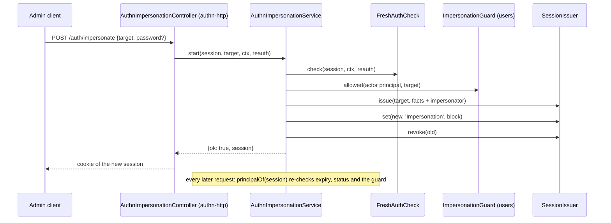

# Impersonation and the active role

An authorized actor, typically an admin, can act as another user. Who may impersonate whom is an authorization question, answered by an `ImpersonationGuard`. How an impersonation lives on a session, how it ends and what it audits is `AuthnImpersonationService`. The active-role switch narrows a session to one role and shares the same session data, so it is described here too.

## How it works

### Start: `start(session, target, ctx, reauth?)`

The service refuses at the first failed check, in this order. The reason goes to an `impersonation.start` failure event; the caller gets `{ ok: false }`.

| Check | Reason |
| --- | --- |
| The session is an active session | `not_active` |
| An `ImpersonationGuard` is registered | `no_guard` |
| The session is not an impersonation already | `nested` |
| The login is within `authn.session.expiration.maxLifetime` | `session_lifetime` |
| The target is an identity ref, not the actor, and a `user` | `invalid_target`, `self`, `non_user_target` |
| The session is `aal2`, when `authn.impersonation.requireMfa` | `mfa_required` |
| The actor may still log in | `unknown_identity`, `deleted`, `banned`, `inactive` |
| The session is fresh or `reauth` re-authenticates it, when `authn.impersonation.requirePassword` | `not_fresh` |
| The target may log in | `target_<status>` |
| `ImpersonationGuard.allowed(actor, target)` consents | the guard's code (`forbidden`, `protected_role`, `escalation`), or `guard_error` |

Then the `authn.impersonation.start` [action hooks](14-action-hooks.md) run around the steps below. A refusal, or a hook that fails, answers `{ ok: false }` with reason `hook:<code>` or `hook_error`, and the actor keeps its session.

1. `SessionIssuer.issue(target, facts)` creates a session for the target. It keeps the actor's method, strategy, assurance, MFA steps and login time, and sets `facts.impersonator` to the actor.
2. `SessionIssuer.set(new, 'Impersonation', { startedAt, actorRoles? })` writes the impersonation block. `actorRoles` holds the actor's active role at the start.
3. `SessionIssuer.revoke(old)` ends the actor's session. When it does not answer `true`, a parallel start or a revocation got there first: the new session is revoked too and the start fails with `revoked`.
4. `impersonation.start` is audited and `{ ok: true, session }` returned.

The guard gets the actor as a principal narrowed by the actor's own role switch.

### Every request: `principalOf(session, ctx)`

`@spinajs/authn-http` calls it for every request on an active session. It answers the principal, or `null` after ending the session.

`session` is either the `Session` the request already restored or a bare `SessionHandle`. A `Session` is used as it is, and every check below still runs on it. Only a handle is restored through `SessionIssuer.restore`. `AuthnMiddleware` passes its restored `Session`, so a request restores its session once.

For a session that is not an impersonation:

1. Past `authn.session.expiration.maxLifetime` from the login: the session is revoked, `session.expire` (reason `session_lifetime`) is audited, `null`.
2. The identity may no longer log in: `null`.
3. Otherwise `PrincipalFactory.principalOf(identity, facts, {})`.

For an impersonation, the impersonation ends (the session is revoked and the end audited) when:

| Condition | Event | Reason |
| --- | --- | --- |
| The block cannot be read, or its start lies ahead of now or before the login by more than `clockSkewSeconds` | `impersonation.end` | `invalid_block` |
| `authn.impersonation.maxMinutes` passed since the start | `impersonation.expire` | `max_minutes` |
| `authn.session.expiration.maxLifetime` passed since the actor's login | `impersonation.end` | `session_lifetime` |
| The actor or the target may no longer log in | `impersonation.end` | `impersonator_<status>`, `target_<status>` |
| The guard no longer consents | `impersonation.end` | the guard's code, or `guard_error` |

Otherwise the principal is the target, with `principal.authn.impersonator` set. A session issued with an impersonator but no block takes its login time as the start, with no actor ceiling.

### Stop: `stop(session, ctx)`

1. The session must be a live impersonation (`not_active`, `not_impersonating`, or an ending from the table above).
2. The impersonator must still be allowed to log in; otherwise the impersonation ends and `stop` returns `null`.
3. The `authn.impersonation.stop` [action hooks](14-action-hooks.md) run around this step and the next. They cannot keep the impersonation: a refusal or a failing hook is logged and the stop goes on.
   A new session for the impersonator is issued with its own facts. The active role from the block is written back as its `ActiveRole`.
4. The old session is revoked, with the same race rule as `start`. `impersonation.end` is audited and the new handle returned.

`endFor(impersonator, { except? })` revokes every session of an identity, the impersonations it runs included. Call it when you ban or deactivate an identity or change or reset its password. It audits nothing itself.



### The active role

A role switch narrows a session to one role. `@spinajs/authn-http` stores it under `ACTIVE_ROLE_KEY` (`ActiveRole`) and rotates the session. `activeRoleCeiling(session)` turns it into `{ roles: [role] }`; an empty value narrows to no role. The session principal is rebuilt with that ceiling. The roles to pick from come from a `RoleSource`; without one the role switch is off.

## Configuration

| Key | Type | Default | Allowed values | Meaning |
| --- | --- | --- | --- | --- |
| `authn.impersonation.requirePassword` | `boolean` | `true` | `true`, `false` | `start` needs a fresh session or `reauth`. Off only when `false` |
| `authn.impersonation.requireMfa` | `boolean` | `true` | `true`, `false` | The actor's session must be `aal2`. Off only when `false` |
| `authn.impersonation.maxMinutes` | `integer` | `60` | ≥ 1 | Longest impersonation |
| `authn.impersonation.clockSkewSeconds` | `integer` | `30` | 0 to 300 | Tolerance for a block whose start disagrees with the session through clock drift between instances |

```ts
authn: { impersonation: { requirePassword: true, requireMfa: true, maxMinutes: 30, clockSkewSeconds: 30 } }
```

`authn.session.expiration.maxLifetime` (an [`@spinajs/authn-session`](../authn-session/README.md) key, in minutes) also bounds every session and every impersonation, counted from the login.

## Services and extension points

| Service | DI token and lifetime | Default implementation | Alternatives | How to replace or extend |
| --- | --- | --- | --- | --- |
| `AuthnImpersonationService` | Class token, per child container | `AuthnImpersonationService` | None | Not meant to be replaced. Needs `SessionIssuer`, `IdentityStore` and `PrincipalFactory` |
| `ImpersonationGuard` | `ImpersonationGuard`, optional | None: every start is refused | `AuthzImpersonationGuard` ([`@spinajs/users`](../users/README.md)) | `@Injectable(ImpersonationGuard)`; answer `{ ok: true }` or `{ ok: false, code }` |
| `RoleSource` | `RoleSource`, optional | None: the role switch is off | `RbacRoleSource` ([`@spinajs/users`](../users/README.md)) | `@Injectable(RoleSource)`; see [Integration hooks](12-integration-hooks.md#rolesource) |

`AuthzImpersonationGuard` needs `user:impersonate` and refuses a target whose rights the actor does not strictly cover, or who holds a protected role. See [`@spinajs/users`](../users/README.md).

## Important behaviour

- A start and a stop each issue a new session and revoke the old one, so the id rotates. Only the call whose revoke ended the old session keeps its new one: of parallel starts or stops, one passes.
- An ended impersonation resolves to `null`, never to the impersonator: a request cannot rotate its own cookie.
- An impersonation session is never fresh, and `reauthenticate` refuses it: the target's password cannot serve as the impersonator's proof.
- The login time stays the actor's, so the impersonation session is not fresh because it is new, and `maxLifetime` counts from the actor's login.
- The guard is asked again on every request. Revoking `user:impersonate` ends running impersonations.

## Best practices

- Keep `requireMfa` and `requirePassword` on in production.
- Call `endFor` from every code path that bans, deactivates or resets an identity, so its impersonations end at once.
- Hand the session `start` and `stop` return to your cookie issuer: the old id no longer works.

## Examples

### Act as a user from a support tool

```ts sample
import type { AuthnContext, AuthnImpersonationService, IdentityRef, Principal, SessionHandle } from '@spinajs/authn';

export async function actAs(svc: AuthnImpersonationService, session: SessionHandle, target: IdentityRef, ctx: AuthnContext): Promise<{ as: Principal; back: SessionHandle } | null> {
  const started = await svc.start(session, target, ctx);
  if (!started.ok) return null;
  const as = await svc.principalOf(started.session, ctx);
  const back = await svc.stop(started.session, ctx);
  return as && back ? { as, back } : null;
}
```

With the defaults, the actor's session must be `aal2` and fresh. Pass a `reauth` credential as the fourth argument of `start` when it is not fresh.

## Related

- [`@spinajs/authn-http`](../authn-http/README.md): `GET`, `POST` and `DELETE /auth/impersonate`, and the active-role routes.
- [`@spinajs/users`](../users/README.md): the guard and the role source.
- [Session contract](08-session-contract.md): the `Impersonation` and `ActiveRole` keys.
- [Audit events](06-audit-events.md): `impersonation.start`, `impersonation.end`, `impersonation.expire`.
