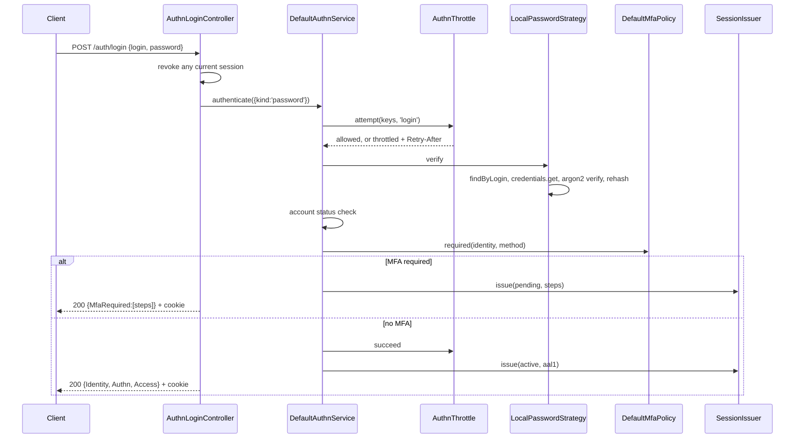

# Authentication internals: storage and login flow

This page describes where authentication data lives and how a request becomes a `Principal`.
It is a map of the current code, with file references, for people working on the authn packages.
For configuration and usage, read [the authn guide](./README.md). For permissions, read
[the authz internals page](../authz/storage-and-check-flow.md).

Three facts shape everything below:

- Sessions are opaque ids stored on the server. Authn never issues its own JWTs and has no refresh
  tokens.
- API tokens are random `spt_` strings. The database keeps only their SHA-256 hash.
- JWTs are only accepted, from external issuers configured in `authn.jwt.issuers`.

Paths below are relative to `packages/`.

## Contents

- [Tables](#tables)
- [Store ports](#store-ports)
- [Password hashing](#password-hashing)
- [Request middleware](#request-middleware)
- [Local password login](#local-password-login)
- [MFA step](#mfa-step)
- [Sessions and the cookie](#sessions-and-the-cookie)
- [Authenticating later requests](#authenticating-later-requests)
- [Logout](#logout)
- [Other credential types](#other-credential-types)
- [Principal shape](#principal-shape)
- [Known gaps](#known-gaps)

## Tables

### `users`

Created by [RBACInitial_2022_06_28_01_13_00.ts:8-19](../../packages/users/src/migrations/RBACInitial_2022_06_28_01_13_00.ts#L8-L19).

| Column | Type | Notes |
|---|---|---|
| `Id` | int, PK, autoincrement | Internal key, `@Hidden` on the model |
| `Uuid` | varchar(36) | Unique `user_uuid_idx`. This is the identity id everywhere else |
| `Email` | varchar(64) | Unique |
| `Password` | varchar(128) | See below |
| `Login` | varchar(64) | Unique `user_login_idx` |
| `IsActive` | bool, default 0 | |
| `CreatedAt` | datetime | |
| `DeletedAt` | datetime | Soft delete |
| `LastLoginAt` | datetime | Not written by 3.0 code |
| `RegisteredAt` | datetime, nullable | Added by `RBACRegisteredAt_2026_07_28_00_00_00` |
| `PasswordSetAt` | datetime, nullable | Added by `UsersPasswordSetAt_2026_10_04_00_00_00`, backfilled for rows with a password |

`Password` holds one of:

- an argon2id PHC string, prefixed `$sp<version>$` when a pepper is used;
- `!none` for an account without a password (`NO_PASSWORD`, `users/src/models/User.ts:218`);
- `!expired` for an expired password (`EXPIRED_PASSWORD_MARKER`, `authn-local/src/hasher.ts:11`).

The 2.x `Role` column is copied into `authz_assignment` by `AuthzRbacUserRoles_2026_10_01_00_01_00`
and dropped by `AuthzRbacDropUserRole_2026_10_01_00_02_00` (both in `authz-rbac/src/migrations`).
The drop refuses while a role in the column has no live assignment.

### `users_metadata`

Same migration, lines 21-28. Columns `Id`, `Key` varchar(255), `Type`
enum(number|float|string|json|boolean|datetime), `Value` text, `user_id` (FK to `users.Id`,
`ON DELETE CASCADE`). Unique on `(user_id, Key)`.

It still holds the ban state, `user:invite:pending` and app keys. 2FA and reset secrets were moved
out by `AuthnFromUserMetadata_2026_10_02_00_01_00`
([lines 146-207](../../packages/authn-orm/src/migrations/AuthnFromUserMetadata_2026_10_02_00_01_00.ts#L146-L207)):
`2fa:*` becomes encrypted `authn_mfa` rows, live `user:pwd_reset:token` values become `authn_secret`
rows, and the old keys are deleted. The migration refuses to run without
`authn.mfa.encryptionKey.secret`.

### authn-orm tables

Created by [AuthnInitial_2026_10_02_00_00_00.ts](../../packages/authn-orm/src/migrations/AuthnInitial_2026_10_02_00_00_00.ts).
Identity columns hold `"<type>:<id>"`, for example `user:<Uuid>` (`authn-orm/src/identity.ts`).
None of these tables has a foreign key to `users`.

| Table | Lines | Columns and keys |
|---|---|---|
| `authn_identity` | 12-25 | `id` PK, `identity_type`, `identity_id`, `provider`, `subject`, `email`, `email_verified`, `attributes`, `linked_at`, `last_used_at`. Unique `(provider, subject)`, index `(identity_type, identity_id)`. Links to external providers (OIDC, JWT) |
| `authn_throttle` | 27-33 | `k` PK (HMAC-SHA256 of the throttle key), `attempts`, `last_attempt_at`, `next_allowed_at`, `updated_at` |
| `authn_audit` | 35-50 | `id`, `at`, `type`, `outcome`, `identity`, `actor`, `strategy`, `reason`, `ip`, `user_agent`, `session`, `data`. Indexes on `at` and `(identity, at)` |
| `authn_secret` | 52-62 | `id`, `identity`, `purpose`, `secret_hash` (SHA-256, unique), `expires_at`, `used_at`, `created_at`. Reset, invite and key-challenge secrets |
| `authn_mfa` | 64-72 | PK `(identity, step)`, `secret_enc`, `key_id`, `confirmed_at`, `last_step` bigint, `created_at` |
| `authn_recovery_code` | 74-80 | `id`, `identity`, `code_hash` (SHA-256), `used_at` |
| `authn_nonce` | 82-85 | `k` PK, `expires_at`. Single-use OIDC state, JWS `jti` and signature nonces |

`authn_mfa.secret_enc` is AES-256-GCM in the form `v1.<iv>.<tag>.<ct>`, with AAD `identity|step`
(`authn-orm/src/mfa/cipher.ts`). `last_step` stops TOTP code replay.

### Token, key and session tables

**`rbac_access_tokens`** — `authn-token/src/migrations/RbacHttpTokenInitial_2026_08_11_01_00_00.ts:7-23`,
extended by `RbacHttpTokenProfile_2026_08_21_00_00_00` and `AuthnTokenScope_2026_10_02_00_00_00`.
Columns `Id`, `Uuid`, `Name`, `Token` (SHA-256 hex, unique), `Roles`, `Profile`, `Scope`, `Kind`
(`pat` | `service` | `agent`, default `pat`), `ExpiresAt`, `RevokedAt`, `CreatedAt`, `LastUsedAt`,
`LastUsedIp`, `user_id` (FK to `users.Id`, cascade). A null `ExpiresAt` is backfilled as
`CreatedAt + maxTtlDays`.

**`authn_key`** — `authn-keys/src/migrations/AuthnKeys_2026_10_02_00_00_00.ts:7-23`. `kid` PK,
`owner_type`, `owner_id`, `alg` (EdDSA or ES256), `jwk`, `thumbprint` (unique), `scope`, `name`,
`expires_at`, `revoked_at`, `last_used_at`, `created_by`, `created_at`.

**`user_sessions`** — `session-provider-db/src/migrations/`. Created by
`UserSessionDBSqlMigration_2022_06_28_01_20_00` and reshaped by `UserSessionIdHash_2026_10_02_00_00_00`:

| Column | Notes |
|---|---|
| `SessionId` | varchar(64) PK, sha256 hex of the raw session id |
| `Subject` | `type:id` of the identity |
| `ImpersonatorId` | Set during impersonation |
| `State` | `pending` or `active` |
| `CreatedAt`, `Expiration` | datetime |
| `Data` | json |
| `UserId` | nullable FK to `users.Id`, cascade |

## Store ports

The interfaces are in `authn/src/contracts/` unless noted.

| Port | DB implementation | Memory implementation |
|---|---|---|
| `IdentityStore` (`identity.ts:12`) | `UserIdentityStore` (`users/src/identity/identity-store.ts:16`). Looks up by Email or Login, case-folded, runs as SYSTEM. No `provision` | — |
| `PasswordCredentialStore` (`identity.ts:23`) | `UserPasswordStore` (`users/src/identity/password-store.ts:17`). Reads and writes `users.Password` with compare-and-set | — |
| `SessionIssuer` (`session.ts:11`) | `DefaultSessionIssuer` (`authn-session/src/issuer.ts:103`) | — |
| `SessionProvider` (`authn-session/src/contracts.ts:48`) | `DbSessionStore`, `RedisSessionStore`, `DynamoDbSessionProvider` | `MemorySessionStore` |
| `AuthnThrottle` (`throttle.ts:12`) | `DbAuthnThrottle` (`authn-orm`) | `MemoryAuthnThrottle` |
| `SecretStore` (`secrets.ts:4`) | `DbSecretStore` (`authn-orm`). 32 random bytes, only the SHA-256 is stored | — |
| `IdentityLinkStore` (`link.ts:14`) | `DbIdentityLinkStore` (`authn-orm`) | — |
| `MfaSecretStore` (`authn-totp/src/store/store.ts:18`) | `DbMfaSecretStore`, over `authn-orm`'s `DbMfaStore` | `MemoryMfaSecretStore` |
| `KeyStore`, `KeyNonceStore` (`authn-keys`) | `OrmKeyStore`, `DbKeyNonceStore` | `MemoryKeyStore`, `MemoryKeyNonceStore` |
| `TokenService` | `DbTokenService` (`authn-token/src/service/token-service.ts:135`) | — |
| `AuthnEventSink` | `DbAuthnAuditSink` (`authn-orm`) | `LogAuthnAuditSink` |

`users` adds two sinks: `UserAccountSink` writes `PasswordSetAt` and activates invited accounts, and
the queue sink re-emits `UserLogged` and `UserLoginFailed`.

Defaults to watch:

- `authn.session.service` defaults to `MemorySessionStore` (`authn-session/src/config/session.ts:4`).
  Sessions are lost on restart and not shared between nodes until an app picks a persistent store.
- When `authn.throttle.service` is unset, the only registered non-memory throttle wins
  (`authn/src/service/default-authn-service.ts:134-137`). Without `authn-orm` that is the memory one.

## Password hashing

[`Argon2PasswordHasher`](../../packages/authn-local/src/hasher.ts#L58):

- argon2id with the library defaults: m=65536 (64 MiB), t=3, p=4. Not configurable.
- Optional pepper (`authn.local.pepper`): argon2 hashes HMAC-SHA256(password, pepper). Older
  peppers go in `previous`, and the version prefix on the stored hash picks the right one.
- At most 8 hash operations run at once (`authn.local.hasher.maxConcurrent`).
- An unknown account or an unreadable stored hash still verifies a dummy hash, so response timing
  does not reveal whether the account exists.
- A hash with outdated parameters is rewritten on a successful login, with compare-and-set
  (`authn-local/src/strategy.ts:106-123`).

## Request middleware

Every request passes these server middlewares, in order:

| Order | Middleware | Job |
|---|---|---|
| 1 | `ClientIp` (`authn-http/src/middleware/client-ip.ts`) | Sets `req.storage.ClientIp` from the trusted proxy chain |
| 4 | `CsrfOriginGuard` (`authn-http/src/middleware/csrf.ts`) | Checks `Origin` or `Sec-Fetch-Site` on unsafe methods that carry the session cookie |
| 5 | `AuthnMiddleware` (`authn-http/src/middleware/authn.ts`) | Resolves `req.storage.AuthnPrincipal` |
| 10 | `PrincipalMiddleware` (`authz-http/src/principals/middleware.ts`) | Builds `req.storage.Principal` for authz |

Requests without the session cookie, including the login itself, skip the CSRF origin check.

## Local password login

`POST /auth/login`, handled by
[`AuthnLoginController.login`](../../packages/authn-http/src/v3/controllers/AuthnLoginController.ts#L35-L62).



1. The controller revokes and audits any session the caller already holds.
2. It reads `{login, password}`, or the 2.x names `Email` and `Password`. Each value is capped at
   1024 characters (`PASSWORD_HARD_CAP`).
3. [`DefaultAuthnService.authenticate`](../../packages/authn/src/service/default-authn-service.ts#L216-L240)
   picks the strategy for the credential kind, here `LocalPasswordStrategy` (name `local`,
   interactive).
4. It builds throttle keys (`keysFor`, lines 547-569): `login:<NFKC, trimmed, lower-cased login>`,
   that key plus the IP, the IP alone, and an optional global key.
5. `throttle.attempt(..., 'login')` counts the attempt **before** the password is checked. The
   throttle is exponential backoff, `min(base * 2^(n - free), max)`, never a lockout. Login
   defaults: per account 5 free attempts, then 1 s growing to 60 s; per IP 20 free attempts, then
   1 s growing to 300 s. A refusal fails with `throttled` and a `Retry-After` header.
6. `LocalPasswordStrategy.verify` (`authn-local/src/strategy.ts:89-111`) requires a length of 8 to
   128, calls `IdentityStore.findByLogin`, then `PasswordCredentialStore.get` (a random uuid stands
   in for an unknown login), then verifies the hash and rehashes if needed. It returns
   `{ok, identity:{type:'user', id:<Uuid>}, method:'password'}`.
7. `accept` (lines 403-454) requires type `user` for interactive logins and refuses unknown,
   deleted, banned or inactive accounts. The client always sees `invalid_credentials`; the real
   reason goes to audit only.
8. [`DefaultMfaPolicy.required`](../../packages/authn/src/flow/default-mfa-policy.ts#L59-L83)
   applies to the `password` method only. It returns the steps the user has enrolled in, adds the
   first configured step under `force` or `forceForRoles`, and refuses the login when the user has
   a confirmed enrolment in a step that `authn.mfa.steps` no longer lists.
9. `throttle.succeed` runs only after the MFA policy passes.
10. With MFA required, the issuer creates a pending session (TTL `pendingTtlSeconds`, default
    300 s), and the response is 200 `{MfaRequired:[steps]}` with the cookie.
11. Without MFA, the issuer creates an active session with facts
    `{method, strategy:'local', assurance:'aal1', mfa:[], authenticatedAt}`. The controller stamps
    the IP and user agent into it and answers 200 with
    `{Identity:{type,id}, Authn:{method,strategy,assurance,mfa,authenticatedAt,impersonator?}}`,
    plus extensions such as users' `Access`, the cookie and `Cache-Control: no-store`.

No breach or blocklist check runs at login. The `PasswordBlocklist` hook
(`authn-local/src/policy.ts`) runs only when a password is set, changed or reset, and no
implementation ships.

## MFA step

`POST /auth/mfa/verify` with `{code, step?}`, or `POST /auth/mfa/recovery` with `{code}`
(`authn-http/src/v3/controllers/AuthnMfaController.ts`). Both need a pending session and call
`AuthnService.completeMfa` (`default-authn-service.ts:258-315`):

1. Throttle flow `mfa`: per account 3 free attempts, then 1 s growing to 300 s.
2. `MfaStep.verify` or `verifyRecovery`.
3. The account status is checked again.
4. `sessions.elevate` turns the pending session active with `assurance:'aal2'` and `mfa:[step]`,
   and rotates the session id. A new cookie is returned.

`TotpMfaStep` (`authn-totp/src/step/totp-step.ts`) uses `otpauth` with a 160-bit secret.
`verify` accepts a code within the window and then spends that time step and every older one
through `authn_mfa.last_step`. Recovery codes are single use. Defaults: SHA1, 6 digits, 30 s
period, window 1, 10 recovery codes. TOTP is off until the app adds the step to `authn.mfa.steps`.

## Sessions and the cookie

[`DefaultSessionIssuer`](../../packages/authn-session/src/issuer.ts):

- The raw id is 16 random bytes in base64url. It exists only in the cookie and in memory.
- The storage key is sha256(raw id) in hex. A stored row cannot be turned back into a usable cookie.
- The row holds the subject, the impersonator, the state, creation and expiry, and `Data` with
  `authn:facts`, `authn:lastSeenAt`, `authn:pending`, `Ip` and `UserAgent`.
- Session lists show a handle, sha256(`'spinajs:authn-session:handle\0'` + key), never the key.
- Expiry is `SlidingCappedExpiration`: 30 min idle, at most 480 min in total. `restore` slides the
  idle deadline.
- `rotate` and `elevate` re-key the row.
- A 2.x uuid session id is found by its raw value once and migrated to the hashed key.

The cookie (`authn-session/src/cookie.ts`) is named `ssid`, or `__Host-ssid` when `hostPrefix` is
`'auto'` outside development and test. It is httpOnly, Secure (auto), `SameSite=strict`, has no
max-age, and is signed with `http.cookie.secret`. Boot fails when that secret is missing or is the
public default outside development and test.

## Authenticating later requests

`AuthnMiddleware.authenticate` (`authn-http/src/middleware/authn.ts:120-135`):

1. Unsigns the cookie and calls `SessionIssuer.restore(rawId)`. The result goes to
   `req.storage.AuthnSession`.
2. Without an active session, it runs the extractors; the first answer wins:
   - `HttpSignatureExtractor`;
   - `AuthorizationBearerExtractor`: `spt_` is an API token, a JWS with the assertion `typ` is a
     key assertion, any other JWT is an external bearer JWT;
   - `ApiKeyHeaderExtractor` (`x-api-key`).
3. The resolvers run in order, and the first answer that is not `undefined` becomes
   `req.storage.AuthnPrincipal`:
   - `KeyPrincipalResolver` (45) and `TokenPrincipalResolver` (50) call `authenticate` with purpose
     `request`, then `principalOf`;
   - `SessionPrincipalResolver` (100) gives nothing for a pending session. Otherwise
     `AuthnImpersonationService.principalOf` enforces the lifetime, re-checks the account status,
     ends every session of a refused identity, and narrows `ceiling.roles` after an active-role
     switch.
4. authz-http's `AuthnPrincipalSource` copies the result into `req.storage.Principal`.

Route guards: the `Authenticated`, `FreshAuth`, `MfaSatisfied` and `NoSession` policies in
`authn-http/src/policies/v3/`.

## Logout

`POST /auth/logout` (`AuthnLoginController.ts:72-82`) needs a session. It deletes the session row,
audits `logout` (and `impersonation.end` while impersonating), clears the cookie and sends
`Clear-Site-Data: "cache","cookies","storage"`.

Related: `GET /user/sessions`, `DELETE /user/sessions/:handle` and revoke-others in
`AuthnSessionsController`. A password change or reset calls `revokeAll` (including impersonations)
and rotates the current session.

## Other credential types

### API tokens (`authn-token`)

- Format `spt_` + 32 random bytes in base64url.
- `TokenStrategy` handles bearer `spt_` values. It is not interactive and counts only failures in
  the throttle.
- `DbTokenService.validate` looks the token up by `sha256(token)`, checks `RevokedAt` and
  `ExpiresAt` (null counts as expired), the owner status and the profile. The token's roles,
  permissions and resources become the principal's ceiling.
- A `Kind=agent` token yields an `agent:<uuid>` principal with `onBehalfOf` the owner and
  `delegation:'inherit'`.
- Limits: `maxTtlDays` 90, default 30 days, agent tokens at most 1440 minutes.
- Managed at `/user/tokens`.

### External JWT

`JwtBearerStrategy` (`authn-token/src/jwt/JwtBearerStrategy.ts`) verifies with jose: issuer,
audience, algorithms, clock skew and a required `exp`, against a remote JWKS or a local key set.
It returns the external subject `{provider:'jwt:<iss>', subject: sub}`, mapped to an identity
through `authn_identity`. It never links by email.

### OIDC (`authn-oidc`)

1. `GET /auth/oidc/:provider` redirects to the provider and sets a flow cookie (`spinajs-oidc`, or
   `__Host-spinajs-oidc` outside development; `SameSite=lax`, 600 s). State, nonce and the PKCE
   verifier derive from a seed in that cookie.
2. `GET /auth/oidc/:provider/callback` claims the state once in the nonce store, checks the
   RFC 9207 `iss`, exchanges the code with PKCE, validates the ID token and nonce, optionally
   matches the userinfo `sub`, and maps the claims.
3. The identity resolves from an existing `authn_identity` link. Matching by verified email or JIT
   provisioning happens only when both the global and the provider switch allow it, and
   `UserIdentityStore` has no `provision`.
4. No MFA is asked for, since the method is not `password`. The session cookie is set and the
   browser goes to `returnTo`.

Linking an account: `POST` and `DELETE /auth/oidc/:provider/link`. Details: [oidc.md](./oidc.md).

### Keys (`authn-keys`)

- `JwsAssertionStrategy` (per request): a bearer JWS with `typ` `spinajs-client+jwt`, `iss` the
  owner, the configured `aud`, `exp` at most 300 s ahead and a single-use `jti`.
- `HttpSignatureStrategy` (per request): an RFC 9421 subset over `@method`, `@target-uri`,
  `content-digest` when a body is present, created and expires, a single-use nonce and the key id.
- `KeyChallengeStrategy` (interactive, issues a session): `POST /auth/keys/challenge`, then
  `POST /auth/keys/login` with `{keyId, challengeId, signature}` over
  `spinajs-key-login:<nonce>:<audience>`.
- The principal is the key owner, with the key's scope as its ceiling. Keys are managed at
  `/user/keys`.

Passwordless email codes, magic links and WebAuthn are not implemented.

## Principal shape

Defined in `authn/src/contracts/principal.ts` and re-exported by `authz/src/contracts/principal.ts`.

```ts
interface Principal {
  type: 'user' | 'anonymous' | 'unattended' | 'system' | 'service' | 'link' | 'agent' | 'group';
  id: string;                  // users.Uuid for users
  authenticated: boolean;
  source: 'session' | 'token' | 'identity' | 'runAs' | string;
  onBehalfOf?: Principal;
  delegation?: 'intersect' | 'inherit';
  companions?: Principal[];
  ceiling?: { roles?; permissions?; resources?: ResourceRef[]; expiresAt?; reason? };
  attributes: Record<string, unknown>;
  identity?: unknown;          // the User model, opaque to authz
  authn?: { method; strategy; assurance: 'aal1' | 'aal2'; mfa: string[]; authenticatedAt; impersonator?; sessionHandle? };
}
```

`UserPrincipalFactory` (`users/src/principal/user-principal-factory.ts`) builds user principals: it
loads the user by `Uuid` as SYSTEM with metadata, refuses deleted, inactive or banned users, and
merges strategy attributes with every `PrincipalAttributeProvider` (provider values win). Agent
tokens get `{type:'agent', onBehalfOf: <owner principal>, delegation, ceiling}`.

## Known gaps

- `users.LastLoginAt` is never written.
- Sessions default to the in-memory store.
- Login does not check breached or blocklisted passwords, and no blocklist implementation ships.
- WebAuthn and passwordless login are not implemented.
