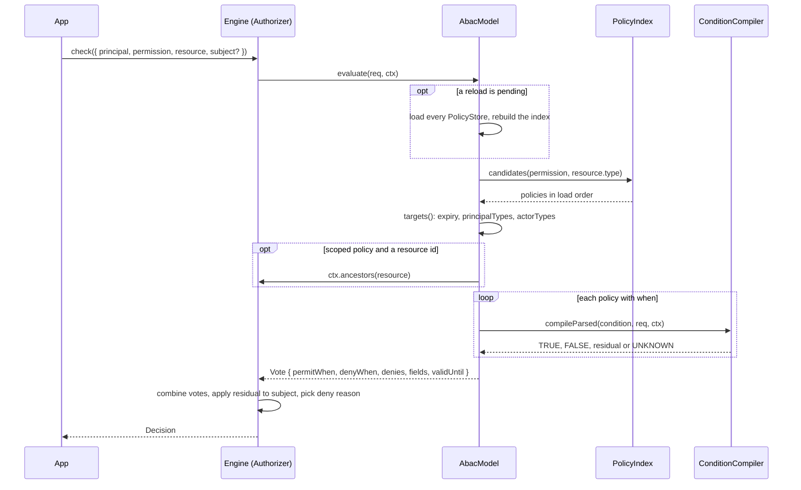

# The ABAC model

`AbacModel` is the `AuthorizationModel` that votes from ABAC policies: permit and deny rules that target permissions, types and scopes, and hold when their condition holds. Use it next to RBAC for rules that depend on attributes: MFA level, time, IP, resource fields, scope settings.

The engine, the combination of votes and the decision are core concepts: see [`@spinajs/authz`](../authz/01-check-flow.md#concepts). This page covers what the ABAC model adds.

## How it works

### Boot

1. The app registers an `AbacModel` instance as `AuthorizationModel` and an `AbacContributor` over it as `AuthzContributor`, in the domain's container, before the domain's `AuthzService` first resolves. No package does this for you.
2. The host calls `AbacModel.init(ctx)`:
   - it fails with `AuthzConfigError` when `authz.<name>.connection` is set ([Database policy store](06-database-policy-store.md#migration));
   - without the `functions` option it takes every `ConditionFunction` registered in root DI (the built-ins when none);
   - without the `stores` option it builds the stores `authz.<name>.stores` names (`storesFromConfig`, [Policy stores](05-policy-stores.md));
   - it loads every store and checks each policy with `loadPolicy`, its condition included. A bad policy fails init with `AuthzConfigError` naming `abac policy "<id>"`.
3. After every model's init the permission registry is complete. The first `applies(permission, type)` builds the `PolicyIndex`: an exact permission must be registered (else `UnknownPermission`, B02), a glob expands over the registry, and an id used twice fails.
4. `AbacContributor.contribute()` returns `AbacModel.contribution()` to the host's boot checks:
   - rule 7: every exact permission of a policy is registered and allows each of the policy's `resourceTypes`;
   - rule 10: every scope type a policy names (`scope.type`, or `scope.<type>.*` in its condition) is returned as an ancestor by some adapter or scope resolver.
5. Boot rule 12 asks `listSupport` for every `list: true` permission the model routes ([Lists](04-lists.md)).

### A check

1. `AuthzService.check` (or `can`, `assert`) runs the engine pipeline. The route plan of `(permission, type)` contains the model when `applies()` answered `true`: some policy can match that pair.
2. `AbacModel.evaluate(req, ctx)` waits for a pending reload first, so a request sees every policy change published before it arrived.
3. `PolicyIndex.candidates(permission, type)` returns the policies that name the permission and whose `resourceTypes` admit the type, in load order.
4. `targets()` drops a policy that has expired (`expiresAt <= now`), whose `principalTypes` match neither the principal's type nor a companion's, or whose `actorTypes` miss the actor (the principal when the request has no actor).
5. No policy left: the vote is `permitWhen: FALSE`, `denyWhen: FALSE`. The model has no opinion.
6. Each remaining policy gets a filter from its scope, `scopeFilter`:
   - no scope, or `$global`: `TRUE`;
   - a request with an id: `TRUE` when a node of `ctx.ancestors(resource)` (`[self, parent, ..., $global]`) matches the scope type, and its id when the scope has one; else `FALSE` and the policy drops. Unknown ancestors make the vote fail;
   - a type-level request (no id): the residual `{ op: 'under', scopes: [scope] }`;
   - the `$global` resource itself: `FALSE` for a scoped policy.
7. A policy with `when` compiles its condition through the domain's `ConditionCompiler` ([Conditions](03-conditions.md)). The result is `TRUE`, `FALSE`, a residual on the row, or UNKNOWN:
   - `FALSE`: the policy drops;
   - otherwise the policy's filter is `scope AND condition`;
   - a condition that needs the row it was not given: a deny applies wherever its scope holds, with reason `needs_subject` (fail closed, B19); a permit permits nothing; a permit that reads `scope.<type>.*` on a request without id makes the vote fail (B39).
8. `vote()` builds the `Vote` (table below).
9. The engine combines the votes of every routed model, evaluates the residual against the `subject` when given, and reports the deny reason with the lowest `(priority, sortKey)`: see [Check flow](../authz/storage-and-check-flow.md#check-flow).

A vote that fails (a store load, unknown ancestors, a missing scope attribute) makes the model indeterminate, and the engine counts it as a deny ([Combining](../authz/storage-and-check-flow.md#5-combining)).



### The vote

| Vote field | Value |
| --- | --- |
| `model` | The model's `name` (`'abac'` by default). |
| `permitWhen` | OR of the filters of the permit policies that apply; `FALSE` when none. |
| `denyWhen` | OR of the filters of the deny policies that apply; `FALSE` when none. |
| `denies` | One entry per applying deny: `{ when, reason }`, reason `{ code: policy.reason ?? 'policy', policy: id, priority: policy.priority ?? 500, sortKey: id }`, or `{ code: 'needs_subject', policy: id, sortKey: id }`. |
| `fields` | `read` and `write`: the union over the permits whose filter is `TRUE`; with none, the intersection over all permits. A permit without `fields` gives `*`. `hide`: the union of `fields.hide` of the denies. |
| `validUntil` | The earliest `expiresAt` among the applying policies. |
| `cacheable` | `false` when a condition read `env.*` or another value the decision cache cannot key. |

## Configuration

`new AbacModel(options)` takes:

| Option | Type | Default | Meaning |
| --- | --- | --- | --- |
| `name` | `string` | `'abac'` | Model name in votes, routes and `combine`. The model reads `authz.<name>.*`. |
| `stores` | `readonly PolicyStore[]` | the stores `authz.<name>.stores` names | Where the policies come from ([Policy stores](05-policy-stores.md)). |
| `functions` | `readonly ConditionFunction[]` | every `ConditionFunction` in root DI | Functions a condition may call, for the checks at load. |
| `retryMs` | `number` | `1000` | First wait after a failed reload, doubled up to 60 s. Not a positive number: `AuthzConfigError`. |

The config keys `authz.<name>.stores` and `authz.<name>.policies` are on [Policy stores](05-policy-stores.md#configuration). When `authz.combine` lists models, add the ABAC model's name:

```ts
authz: {
  combine: { default: { algorithm: 'deny-overrides', models: ['rbac', 'abac'] } },
}
```

Without `models` an entry routes every model of the domain. A model no entry routes only produces a boot warning.

## Services and extension points

| Service | DI token and lifetime | Default implementation | Alternatives | How to replace or extend |
| --- | --- | --- | --- | --- |
| ABAC model | `AuthorizationModel`; an instance the app registers in the domain container | `AbacModel` | `FsAbacModel` of authz-fs, named `fs-abac` | Subclass `AbacModel`, or register a second instance with another `name`. |
| Boot refs | `AuthzContributor`; an instance the app registers next to the model | `AbacContributor(model)` | `FsAbacContributor` of authz-fs | Subclass `AuthzContributor` and map `model.contribution()`. |
| Condition functions | `ConditionFunction`, read with `Array.chainOf` | built-ins of `@spinajs/authz` | your own | See [Conditions](03-conditions.md#services-and-extension-points). |
| Policy stores | `PolicyStore`, passed in `stores` | `ConfigPolicyStore` | `MemoryPolicyStore`, `DbPolicyStore`, your own | See [Policy stores](05-policy-stores.md). |

`AbacModel` methods meant for overriding: `init`, `applies` and `evaluate` (call `super`). Its other public methods serve the host and the admin handlers: `listSupport`, `listPlan`, `listProblem`, `summarize`, `validate`, `contribution`, `invalidate`, `preload`, `version`, `dispose`.

### ABAC model: custom implementation

authz-fs subclasses `AbacModel` to make boot errors name the config key a policy came from. The same pattern fits an app that keeps policies in its own files.

```ts sample
import { DI } from '@spinajs/di';
import { AuthorizationModel, AuthzConfigError, AuthzContributor } from '@spinajs/authz';
import type { ModelInitContext, Policy } from '@spinajs/authz';
import { AbacContributor, AbacModel, ConfigPolicyStore } from '@spinajs/authz-abac';

// Boot errors point at the file the security team edits.
export class FilePoliciesModel extends AbacModel {
  constructor(policies: readonly Policy[], private readonly file: string) {
    super({ stores: [new ConfigPolicyStore(policies)] });
  }

  override async init(ctx: ModelInitContext): Promise<void> {
    try {
      await super.init(ctx);
    } catch (e) {
      if (e instanceof AuthzConfigError) throw new AuthzConfigError(`${this.file}: ${e.message}`, { cause: e });
      throw e;
    }
  }
}

export function wireFilePolicies(policies: readonly Policy[]): void {
  const model = new FilePoliciesModel(policies, 'security/policies.json');
  DI.register(() => model).as(AuthorizationModel);
  const contributor = new AbacContributor(model);
  DI.register(() => contributor).as(AuthzContributor);
}
```

## Important behaviour

- **Reloads.** `invalidate(tags)` starts a reload on `*`, `policy`, `policy:<id>` or `model:<name>`. The host calls it for every `AuthzChange` on the `ChangeBus`; `AuthzAdmin` publishes `policy` and `policy:<id>` after a policy write.
- **Config-only models never reload.** A model whose stores are all `ConfigPolicyStore` ignores invalidations.
- **While a reload is pending**, `applies()` answers `true` for every pair, so a new policy on a pair the model did not route yet applies at once. `version()` changes, so the host rebuilds the routes.
- **One load at a time.** Invalidations during a load start the next load when it lands.
- **A failed reload** rejects the requests waiting for it. Routing falls back to the last good index, so only this model's pairs are indeterminate. The model retries on its own after `retryMs`, doubling to 60 s; the timer does not keep the process alive.
- **`version()`** is `<hash>#<generation>`, with `~` appended while a reload is pending. The hash covers the loaded policies, not the stores' own `version()`.
- **Sync capability.** `capabilities.sync` is `'always'` only when every store is a `ConfigPolicyStore` and no policy has `when` or `scope`; otherwise `'never'`, and `filterNow` cannot use the model.
- **`dispose()`** stops reloads and retries.
- **Summaries.** `summarize` lists the permissions the principal's permit policies give, for `summary` and `covers`. A scoped permit, a permit matched only through a companion or `actorTypes`, and a permit that is false now but reads the session (`actor.*`, `env.*`, `principal.*` beyond `id`, `type` and `attributes`, or a function) are listed `conditional`. Deny policies add no entry.

## Best practices

- Register the model and its contributor together; without the contributor the boot checks of rules 7 and 10 do not see the policies.
- Give every policy a `reason`; a deny without one reports the generic code `policy`.
- Use `priority` below 500 for denies the user should see first, such as `mfa_required`.
- Keep a model over `ConfigPolicyStore` only, without conditions or scopes, when you need `filterNow`.

## Patterns and antipatterns

```ts
// Don't: two models with one name fail the domain's boot
DI.register(() => new AbacModel()).as(AuthorizationModel);
DI.register(() => new AbacModel({ stores: [written] })).as(AuthorizationModel);

// Do: one model over every store
DI.register(() => new AbacModel({ stores: [fromConfig, written] })).as(AuthorizationModel);
```

## Examples

### Deny admin writes without MFA, on top of RBAC

```ts sample
import { DI } from '@spinajs/di';
import { AuthorizationModel, AuthzContributor } from '@spinajs/authz';
import { AbacContributor, AbacModel, ConfigPolicyStore } from '@spinajs/authz-abac';

export function wireMfaRule(): void {
  const abac = new AbacModel({
    stores: [
      new ConfigPolicyStore([
        {
          id: 'mfa-admin-writes',
          effect: 'deny',
          permissions: ['users:update', 'users:delete'],
          when: { not: { attr: 'principal.authn.assurance', eq: 'aal2' } },
          reason: 'mfa_required',
          priority: 100,
        },
      ]),
    ],
  });
  DI.register(() => abac).as(AuthorizationModel);
  const contributor = new AbacContributor(abac);
  DI.register(() => contributor).as(AuthzContributor);
}
```

Under `deny-overrides` this deny beats any RBAC permit (B18), and the decision reports `mfa_required`.

## Related

- [Policies](02-policies.md): what a policy holds and how it targets requests.
- [Conditions](03-conditions.md): how `when` is evaluated.
- [Lists](04-lists.md): list support and list plans.
- [`@spinajs/authz`](../authz/README.md): the engine, combination and `AuthzService`.
- [Check flow](../authz/storage-and-check-flow.md#check-flow): the engine pipeline around `evaluate`.
- [`@spinajs/authz-rbac`](../authz-rbac/README.md): the RBAC model the ABAC votes combine with.
- [`@spinajs/authz-fs`](../authz-fs/README.md): builds an `AbacModel` named `fs-abac` for filesystem policies.
