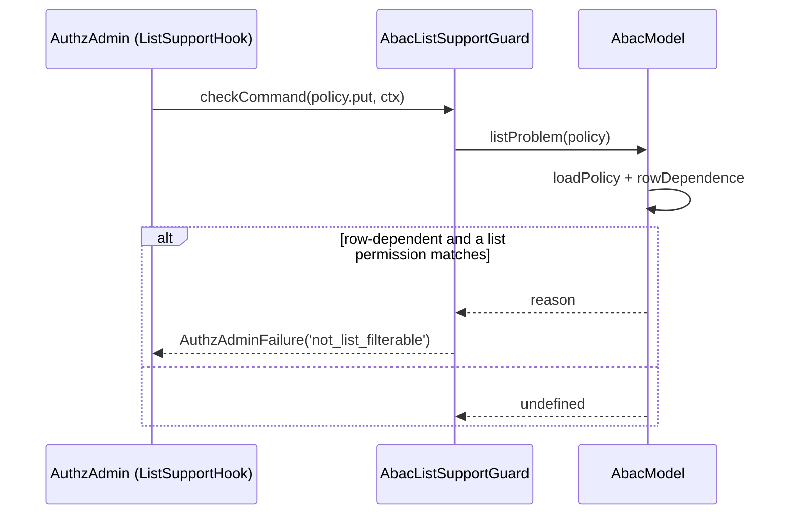

# Lists

For a `list: true` permission the ABAC model decides its policies before the list query runs, from the principal, the actor and the request env. A permit that holds lists every row; a deny that holds lists none. The model never adds a per-row term to a list filter.

How an access plan becomes a query is the adapter's business: see [Access lists](../authz-orm/01-access-lists.md) for `.accessible()`.

## How it works

### At boot (rule 12)

1. For every `list: true` permission and type the model routes, the host calls `AbacModel.listSupport(permission, type)`.
2. It answers `true` when every candidate policy of that pair is decided without the row, else `{ reason }`, and the domain fails to boot with that reason.
3. `rowDependence(policy)` says why a policy needs the row:
   - a `scope` other than `$global`: `applies under <type>:<id> only`;
   - a condition that reads `resource.*`, in an `attr` or in a function arg: `reads resource.* in its condition`;
   - a condition that reads `scope.<type>.*` for a type other than `$global`: `reads scope.<type>.* in its condition`.

The message reads: `abac policy "<id>" (source: <store>) <why>, so <permission> on "<type>" is not list-filterable`.

### On a list

1. The engine calls `AbacModel.listPlan(req, ctx)` for each list plan, after any pending reload.
2. For each candidate policy that `targets()` the principal and actor, a policy without `when` holds; one with `when` is compiled and must come out `TRUE` (holds) or `FALSE` (skipped). Anything else throws.
3. The plan:
   - a deny holds: `{ kind: 'deny-all', reason }`, the reason with the lowest `(priority, sortKey)`;
   - else a permit holds: `{ kind: 'all' }`, with `validUntil` at the earliest `expiresAt` of the policies that held;
   - else `{ kind: 'abstain' }`.

### At write time

1. While `AuthzAdmin` checks a batch, the core's `ListSupportHook`, a before hook on `authz.admin.command`, runs every `ListSupportGuard` along the domain's container lineage on each `policy.put` and `rule.put`. `AbacListSupportGuard` checks `policy.put` only.
2. It calls `AbacModel.listProblem(policy)` on every `AbacModel` of the domain. When the policy needs the row and matches a `list: true` permission, the command fails with `AuthzAdminFailure('not_list_filterable')` on the field `policy`.



## Configuration

A permission takes part only when it is declared `list: true` in `authz.permissions` ([Config](../authz/04-host-boot-and-configuration.md#configuration)). List permissions combine with `deny-overrides` only.

## Services and extension points

| Service | DI token and lifetime | Default implementation | Alternatives | How to replace or extend |
| --- | --- | --- | --- | --- |
| Write-time list check | `ListSupportGuard`; `@Singleton`, registered at import | `AbacListSupportGuard` | none | Add your own `ListSupportGuard` for other rules; this one stays registered. |

`rowDependence` and `notListFilterable` are exported for tools that want the same check and message.

## Important behaviour

- **Lists and checks agree.** A policy that could answer differently per row is refused for a list permission, so `.accessible()` never lists a row a check of it would deny.
- **Env decides the plan.** A condition on `env.*` (MFA, IP, time) holds or fails for the whole list.
- **`resourceTypes` matter.** A row-dependent policy is fine on a list permission when its `resourceTypes` exclude the listed type.
- **Single-object checks are unaffected.** A row-dependent policy works for checks of permissions without `list: true`.

## Best practices

- Split a rule into a list permission and a row permission when it must read the row: `invoice:read` (list) and `invoice:open` (checked per row).
- Put scope-dependent rules on RBAC assignments at a scope; the RBAC list term filters by ancestor ([List filter term](../authz-rbac/01-list-filter-term.md)).

## Patterns and antipatterns

```ts
// Don't: invoice:read is list: true, and this reads the row; boot fails
{ id: 'own-invoices', effect: 'permit', permissions: ['invoice:read'],
  when: { attr: 'resource.owner_id', eq: { ref: 'principal.id' } } }

// Do: decide on the principal; row ownership belongs to RBAC relations or a row permission
{ id: 'finance-reads-invoices', effect: 'permit', permissions: ['invoice:read'],
  when: { attr: 'principal.attributes.dept', eq: 'finance' } }
```

## Examples

### Hide every invoice from a session without MFA

```ts
authz: {
  permissions: { 'invoice:read': { list: true } },
  abac: {
    policies: [
      { id: 'invoices-need-mfa', effect: 'deny', permissions: ['invoice:read'],
        when: { not: { attr: 'principal.authn.assurance', eq: 'aal2' } }, reason: 'mfa_required' },
    ],
  },
}
```

A check of one invoice and a list both deny with `mfa_required`; the list plan is `deny-all`.

## Related

- [The ABAC model](01-abac-model.md): checks of single objects.
- [Conditions](03-conditions.md): which attributes are read before the query.
- [Access lists](../authz-orm/01-access-lists.md): `.accessible()` renders the plan.
- [Policy administration](07-policy-administration.md): the other checks of `policy.put`.
