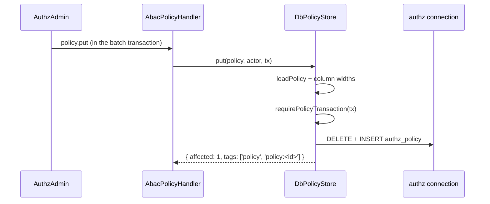

# Database policy store

`DbPolicyStore` is the `PolicyStore` that keeps ABAC policies in the table `authz_policy`, through the ORM record `PolicyRecord` on the connection alias `authz`. Use it when policies change at run time through `AuthzAdmin` (`policy.put`, `policy.delete`) instead of living in config.

## How it works

### Reads

1. `AbacModel.init` refuses a left-over `authz.<model>.connection` key, then builds its stores: the ones passed in `stores`, else those `authz.<model>.stores` names (`storesFromConfig`).
2. `DbPolicyStore.load()` reads through `PolicyRecord`, and a model loads its policies at domain boot, so resolve the `Orm` (or `OrmMigrator`, which resolves it) before the domain boots. Neither the model nor the store is built by DI, so neither injects it; a read before the `Orm` resolved fails with the `AuthzConfigError` below.
3. It reads every `PolicyRecord` row, sorts them by id in code-unit order and maps each with `recordToPolicy` (source `'db'`).
4. `version()` hashes the same rows (SHA-256, first 16 hex characters), so it changes with every write, also one made by another process.
5. A JSON column that does not parse fails the read with `AuthzConfigError` naming `authz_policy`.

### Writes

1. `AuthzAdmin` runs `policy.put` or `policy.delete` in its batch transaction. `AbacPolicyHandler` has validated the policy before ([Policy administration](07-policy-administration.md)); `AuthzAdmin` bumps `authz_version` in the same transaction.
2. `put(policy, actor, tx, now)` checks the policy with the model's loader (shape, globs, condition grammar; function names are the model's business) and the column widths.
3. `requirePolicyTransaction(tx, where)` accepts only the `AuthzTx` driver of an open transaction on the connection of `authz_policy`.
4. `put` deletes the row with that id, then inserts the new one (`policyToRecord`). A `UniqueViolation` from a concurrent write becomes `AuthzAdminFailure('conflict')`.
5. `delete(id, tx)` reads only the id, so a row whose JSON no longer parses can still be deleted. It answers `affected: 0` for an unknown id.
6. Both return the change tags `['policy', 'policy:<id>']`, on which `AbacModel` reloads.



### Errors on the way

`requirePolicyTransaction` maps the ORM's errors to `AuthzConfigError`, naming `PolicyRecord` or the alias:

| Cause | Message |
| --- | --- |
| `tx.driver` is no ORM driver | `AuthzTx.driver must be the OrmDriver of an AuthzAdmin transaction` |
| No open transaction | `stores write only inside an AuthzAdmin transaction, and none is in scope` |
| Transaction on another connection | `the AuthzTx runs on connection X, but authz_policy is on connection Y (db.Aliases.authz)` |
| `Orm` not resolved | `PolicyRecord: the Orm is not resolved yet; resolve it (await DI.resolve(Orm)) ...` |
| Alias maps to no connection | `PolicyRecord: no ORM connection answers to "authz"; set db.Aliases.authz` |

`put` also throws `AuthzConfigError` for an id over 64 characters, a reason, scope type or scope id over 64, or an actor key over 100. Through `AuthzAdmin` the policy handler refuses the same values earlier, as `AuthzAdminFailure('invalid_command')` naming the command field.

## Configuration

| Key | Type | Default | Allowed values | Meaning |
| --- | --- | --- | --- | --- |
| `db.Aliases.authz` | `string` | `'default'` | a connection name | The connection of `authz_policy` and its migration. The package config sets the default; the app's value wins. |
| `authz.abac.stores` | `string[]` | `['ConfigPolicyStore']` | `ConfigPolicyStore`, `DbPolicyStore` | Stores `new AbacModel()` builds when no `stores` option is passed. |
| `authz.abac.policies` | `Policy[]` | `[]` | policy objects | Policies `ConfigPolicyStore` reads. |
| `authz.abac.connection` | none | none | none | Removed. The schema accepts it only so `AbacModel.init` can fail with an `AuthzConfigError` naming `db.Aliases.authz`. |

A model with another name reads `authz.<name>.*` (`stores`, `policies`, and fails on `connection`); the schema checks `authz.abac` only.

```ts sample
const config = {
  db: { Aliases: { authz: 'authz-db' } },
  authz: {
    abac: { stores: ['ConfigPolicyStore', 'DbPolicyStore'] },
  },
};

export default config;
```

## Schema

### `authz_policy`

Created by `AuthzAbac_2026_10_01_00_00_00` on `authz`. Read and written through `PolicyRecord`.

| Column | Type | Meaning |
| --- | --- | --- |
| `id` | str(64), PK | Policy id. |
| `effect` | str(8) | `permit` or `deny`. |
| `permissions` | text, `@Json` | Permission globs. |
| `resource_types` | text, `@Json`, null | Resource types the policy targets. |
| `principal_types` | text, `@Json`, null | Principal types the policy targets. |
| `actor_types` | text, `@Json`, null | Actor types the policy targets. |
| `scope_type` | str(64), default `$global` | Scope type; `$global` with an empty id is no scope. |
| `scope_id` | str(64), default `''` | Scope id; empty is the bare type. |
| `condition` | text, `@Json`, null | The `when` condition tree. |
| `fields` | text, `@Json`, null | Field set. |
| `reason` | str(64), null | Deny reason code. |
| `priority` | int, null | Deny priority (model default 500). |
| `expires_at` | datetime, null | Expiry. |
| `created_by` | str(100), null | Principal key of the actor. |
| `created_at` | datetime | Write instant. |

Index `authz_policy_scope` on `(scope_type, scope_id)`. A `null` in a `@Json` column is SQL `NULL`.

## Services and extension points

| Service | DI token and lifetime | Default implementation | Alternatives | How to replace or extend |
| --- | --- | --- | --- | --- |
| Policy store | `PolicyStore`; registered by the app (no decorator) | none registered | `ConfigPolicyStore`, `DbPolicyStore`, `MemoryPolicyStore` | Pass stores to `new AbacModel({ stores })`, and register the writable one as `PolicyStore` so `AuthzAdmin` can write. |

`AuthzAdmin` writes through the store registered as `PolicyStore`. A model built from `authz.abac.stores` registers none, so `policy.put` and `policy.delete` fail with `AuthzConfigError` ([Policy administration](07-policy-administration.md#how-it-works)).

Public exports of this feature: `DbPolicyStore`, `PolicyRecord`, `PolicyFields`, `PolicyValues`, `AUTHZ_POLICY_TABLE`, `POLICY_ID_MAX_LENGTH`, `POLICY_TEXT_MAX_LENGTH`, `POLICY_ACTOR_MAX_LENGTH`, `requirePolicyTransaction`, `policyToRecord`, `recordToPolicy`, `hydrateRecords`, `policyTags`.

### Policy store: custom implementation

Extend `DbPolicyStore` to add a rule before a write, and keep the base checks and transaction rule by calling `super`.

```ts sample
import { AuthzConfigError } from '@spinajs/authz';
import type { AuthzTx, PrincipalRef } from '@spinajs/authz';
import type { Policy } from '@spinajs/authz-abac';
import { DbPolicyStore } from '@spinajs/authz-abac';

// Stored policies may only deny; permits stay in reviewed config.
export class DenyOnlyPolicyStore extends DbPolicyStore {
  override async put(policy: Omit<Policy, 'source'>, actor: PrincipalRef | undefined, tx: AuthzTx, now?: Date): Promise<{ readonly affected: number; readonly tags: readonly string[] }> {
    if (policy.effect !== 'deny') throw new AuthzConfigError(`policy ${policy.id}: only deny policies may be stored`);
    return super.put(policy, actor, tx, now);
  }
}
```

## Important behaviour

- **No constructor arguments.** `new DbPolicyStore()` reads the `authz` alias through `PolicyRecord`; it has no driver or connection option.
- **Import before the ORM boots.** The ORM binds `PolicyRecord` when it boots, so import `@spinajs/authz-abac` before the `Orm` resolves. After a migration run that creates `authz_policy` once the ORM booted, call `orm.reloadTableInfo({ strict: true })` before the store reads.
- **Strict table check.** With `db.StrictTableCheck` on, the `Orm` boot fails until `authz_policy` exists on the connection `db.Aliases.authz` names.
- **One bad row stops every reload.** A row that does not parse fails `load` and `version`; the model keeps routing on its last good index and retries with backoff.
- **Order and version** do not depend on the database collation: rows are sorted in code.
- **Same connection as the batch.** `AuthzAdmin` must run its batch on the `authz` connection (`DbAuthzAdminBackend` does), or every write is refused.

## Best practices

- Keep `db.Aliases.authz` the same for every authz package; `authz-rbac`, `authz-orm` and `authz-abac` each ship the default `'default'`.
- Register exactly one writable store as `PolicyStore` per domain.

## Patterns and antipatterns

```ts
// Don't: the removed key fails AbacModel.init
authz: { abac: { connection: 'authz-db', stores: ['ConfigPolicyStore', 'DbPolicyStore'] } }

// Do: map the alias
db: { Aliases: { authz: 'authz-db' } },
authz: { abac: { stores: ['ConfigPolicyStore', 'DbPolicyStore'] } }
```

## Examples

### Let admins add deny policies at run time

With `authz.models: ['AbacModel']` and the `authz.abac.stores` config above, the domain's boot builds the model over those stores; `AuthzAdmin` writes still need the writable store registered as `PolicyStore` (`DI.register(DbPolicyStore).as(PolicyStore)`). Built by hand and listed as a named factory, one store instance serves both:

```ts sample
import { DI } from '@spinajs/di';
import { Configuration } from '@spinajs/configuration';
import { AuthorizationModel } from '@spinajs/authz';
import { AbacModel, ConfigPolicyStore, DbPolicyStore, PolicyStore } from '@spinajs/authz-abac';

// Config: authz: { models: ['AppAbacModel'] }
export async function registerAbacWithDbPolicies(): Promise<void> {
  const configuration = await DI.resolve(Configuration);
  const written = new DbPolicyStore();
  const fromConfig = new ConfigPolicyStore(configuration.get<unknown[]>('authz.abac.policies') ?? []);
  const abac = new AbacModel({ stores: [fromConfig, written] });

  DI.register(Object.defineProperty(() => abac, 'name', { value: 'AppAbacModel' })).as(AuthorizationModel);
  DI.register(() => written).as(PolicyStore);
}
```

Then an admin writes a policy through `AuthzAdmin`:

```ts
await authz().admin().execute(actor, [
  { kind: 'policy.put', policy: { id: 'freeze-invoices', effect: 'deny', permissions: ['invoice:update'], reason: 'frozen' } },
]);
```

## Migration

`authz.abac.connection` and the store's `driver` argument are gone; two helpers were renamed.

| Removed | Use instead |
| --- | --- |
| `authz.abac.connection` (`authz.<model>.connection`) | `db.Aliases.authz` |
| `new DbPolicyStore(driver)` | `new DbPolicyStore()` |
| `policyToRow` | `policyToRecord` |
| `rowToPolicy` | `recordToPolicy` |

Before:

```ts
// config
authz: { abac: { connection: 'authz-db', stores: ['ConfigPolicyStore', 'DbPolicyStore'] } }

// code
const written = new DbPolicyStore(driver);
```

After:

```ts
// config
db: { Aliases: { authz: 'authz-db' } },
authz: { abac: { stores: ['ConfigPolicyStore', 'DbPolicyStore'] } }

// code
const written = new DbPolicyStore();
```

## Related

- [Policy stores](05-policy-stores.md): the `PolicyStore` contract and the other stores.
- [Policy administration](07-policy-administration.md): the handler that calls `put` and `delete`, and the writable store registration.
- [Policies](02-policies.md): what a row holds, as a policy.
- [AuthzAdmin](../authz/10-authz-admin.md): the batch that runs `policy.put` and `policy.delete`.
- [Database storage of authz-rbac](../authz-rbac/02-database-storage.md): `DbAuthzAdminBackend` and the other tables on `authz`.
