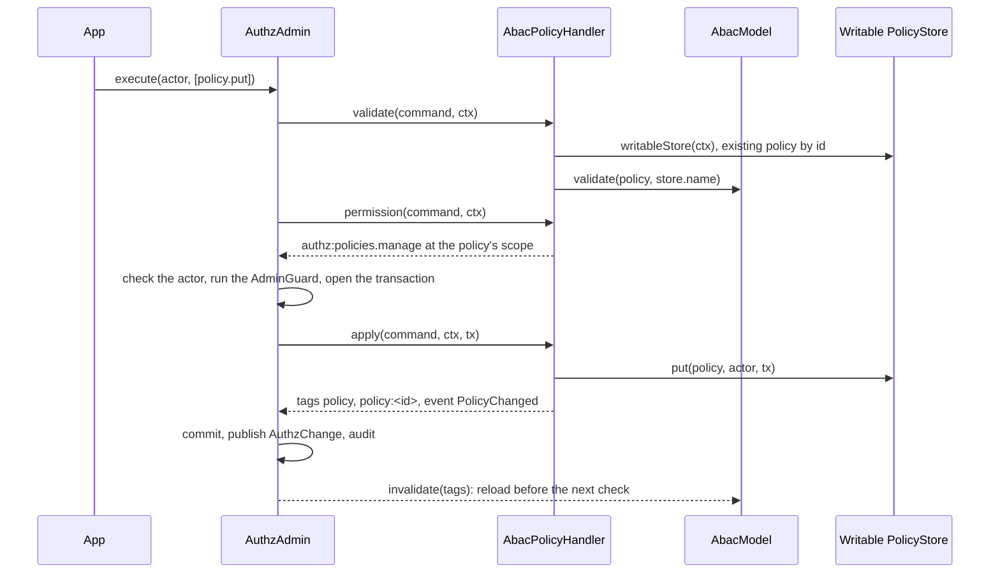

# Policy administration

Importing `@spinajs/authz-abac` plugs ABAC policies into `AuthzAdmin`: the commands `policy.put` and `policy.delete`, the query `policies`, and the policy part of `scope.forget`. Use them to add, change and remove policies at run time, with permission checks, one transaction per batch, audit and reloads.

The batch pipeline itself (validation, permission, guard, transaction, change publication) is the core's: see [AuthzAdmin](../authz/10-authz-admin.md).

## How it works

### The writable store

Every command and query works on the domain's one writable store: the `MemoryPolicyStore` or `DbPolicyStore` registered as `PolicyStore` along the domain's container lineage (`writableStore(ctx)`). Register the same instance you pass to `new AbacModel({ stores })`, or the model never reads what the commands write.

- `ConfigPolicyStore` registrations are skipped.
- None registered: `AuthzConfigError`. `scope.forget` then has nothing to forget and goes on.
- Two writable stores: `AuthzConfigError`, since a command could not tell which one the model reads.
- `MemoryPolicyStore` writes need the memory transaction of `MemoryAuthzAdminBackend`; `DbPolicyStore` writes need the ORM transaction of `DbAuthzAdminBackend` on the `authz` connection.

### `policy.put`

1. **Validate** (outside the transaction), `AbacPolicyHandler.validate`:
   1. `readPolicy` checks the shape: an object, `id` a non-empty string of at most 64 characters, `effect`, non-empty `permissions`, no `source`, and `expiresAt` a `Date` after now or `null`.
   2. Every `AbacModel` of the domain runs `validate(policy, store.name)`: the checks of a load with the model's functions, registered permissions, and an id no other store's policy uses. A domain without an `AbacModel` fails with `AuthzConfigError`.
   3. For a `DbPolicyStore`: `reason`, scope type and scope id fit 64 characters, the actor key 100.
   4. A policy with this id at another scope: the actor must also hold the permission at the old scope.
   5. Then the command validators run, among them the core's `ListSupportValidator`, whose `AbacListSupportGuard` refuses a policy that would make a `list: true` permission need the row ([Lists](04-lists.md#at-write-time)).
2. **Permission**: `AbacPolicyHandler.permission` asks for `authz:policies.manage` at the policy's scope, `$global` when it has none. `AuthzAdmin` checks it.
3. **Apply** (in the transaction), `AbacPolicyHandler.apply`: it reads the current row inside the transaction and checks the old scope again, since another batch may have moved it. Then it writes: `DbPolicyStore.put`, or `MemoryPolicyStore.put` of a frozen copy with an undo on rollback. A `$global` scope is stored as no scope.
4. **Result**: `{ id, affected: 1, tags: ['policy', 'policy:<id>'], events: [PolicyChanged] }`. After the commit `AuthzAdmin` publishes the tags, and every `AbacModel` that reads the store reloads.



### `policy.delete`

1. `validate` loads the policy by id from the writable store; none: `not_found` on the field `id`.
2. `permission` asks for `authz:policies.manage` at the stored policy's scope.
3. `apply` reads the row in the transaction. Gone already (an earlier command of the batch): `affected: 0`, no tags, no event. Else it checks the permission at the row's current scope again and deletes it.
4. A delete does not need an `AbacModel` in the domain.

### `policies` query

`AuthzAdmin.list(actor, { kind: 'policies', scope?, page? })` checks `authz:policies.read` at `scope` (`$global` when absent), then `AbacPolicyReader.list`:

- `scope` given: the policies whose scope is exactly that node; `$global` lists the unscoped ones. No `scope`: all of them.
- Sorted by id; `page` defaults to `{ limit: 50, offset: 0 }`; the answer is `{ items, total }`, items as copies.
- A malformed `scope` or `page`: `invalid_query`.

### `scope.forget`

`AbacScopeForgetter.forget(scope, ctx, tx)` deletes the writable store's policies whose scope is exactly the node, in the batch's transaction, with one `PolicyChanged` (`op: 'delete'`) each. Policies scoped to the type (`{ type: 'project' }`) or to an ancestor stay. authz-orm runs `scope.forget` when it deletes an `@AccessResource` row.

## Configuration

The admin permissions are not registered by any package. Declare them in `authz.permissions`, or map the commands to your own with `authz.admin.permissions` ([AuthzAdmin](../authz/10-authz-admin.md)).

| Operation | Default permission | Resource | `authz.admin.permissions` key |
| --- | --- | --- | --- |
| `policy.put` | `authz:policies.manage` | the policy's scope; also the old one on a move | `policy.put` or `policy.*` |
| `policy.delete` | `authz:policies.manage` | the stored policy's scope | `policy.delete` or `policy.*` |
| `list` of `policies` | `authz:policies.read` | the query's `scope` | `list.policies` |
| `scope.forget` | `authz:scope.forget` | the node | `scope.forget` |

```ts
authz: {
  permissions: {
    'authz:policies.manage': { types: ['org', 'project'] },
    'authz:policies.read': { types: ['org', 'project'] },
  },
}
```

## Services and extension points

All four register in root DI when the package is imported.

| Service | DI token and lifetime | Default implementation | Alternatives | How to replace or extend |
| --- | --- | --- | --- | --- |
| Write handler of `policy.put`, `policy.delete` | `AuthzWriteHandler`; `@Singleton` | `AbacPolicyHandler` | none | Not meant to be replaced; add rules with an `AuthzCommandValidator` (below). |
| Reader of `policies` | `AuthzAdminReader`; `@Singleton` | `AbacPolicyReader` | none | Not replaceable: a second reader that claims `policies` makes `list` fail with `AuthzConfigError`. |
| Scope forgetter | `ScopeForgetter`; `@Singleton`, read with `Array.chainOf` | `AbacScopeForgetter` | none | Add your own `ScopeForgetter` for other data; this one stays. |
| List-support guard | `ListSupportGuard`; `@Singleton` | `AbacListSupportGuard` | none | See [Lists](04-lists.md). |
| Writable store | `PolicyStore`; an instance the app registers | none | `MemoryPolicyStore`, `DbPolicyStore` | Register exactly one per domain lineage. |

### Command validator: custom rule

Add product rules on policies with a core `AuthzCommandValidator`, not by replacing the handler. `AuthzAdmin` runs every validator after the handler's `validate`, for each command of the batch, before the permission check.

```ts sample
import { DI } from '@spinajs/di';
import { AuthzAdminFailure, AuthzCommandValidator } from '@spinajs/authz';
import type { AdminContext, AuthzCommand, Principal } from '@spinajs/authz';

// Run-time policies may only deny; permits stay in reviewed config.
export class DenyOnlyPolicies extends AuthzCommandValidator {
  async validate(_actor: Principal, c: AuthzCommand, _ctx: AdminContext): Promise<void> {
    if (c.kind === 'policy.put' && c.policy.effect !== 'deny') {
      throw new AuthzAdminFailure('invalid_command', 'only deny policies may be written at run time', 'policy.effect');
    }
  }
}

DI.register(DenyOnlyPolicies).as(AuthzCommandValidator);
```

## Important behaviour

| Error code | Field | When |
| --- | --- | --- |
| `invalid_command` | the policy field, such as `policy.effect` | Bad shape, `source` set, past `expiresAt`, too long for the columns, an id another store holds. |
| `unknown_permission` | `policy.permissions` | An exact permission that is not registered. |
| `rule_not_compilable` | `policy.when` | A condition that does not parse, or calls an unknown function. |
| `not_list_filterable` | `policy` | The policy would make a `list: true` permission need the row. |
| `not_found` | `id` | `policy.delete` of an unknown id. |
| `conflict` | none | `DbPolicyStore.put` met a concurrent insert of the same id; retry the batch. |

- **A stored policy never breaks a reload.** A put is checked against every `AbacModel` of the domain, as each would load it.
- **Moving a policy needs both scopes.** A replace that changes the scope is checked at the old and the new scope, at validation and again in the transaction.
- **Replace is by id.** `policy.put` with an existing id replaces the whole policy; fields left out are dropped.
- **A batch is atomic.** A failure later in the batch rolls back the memory store too.
- **`PolicyChanged` events** carry `{ id, scope?, op }`; `scope` is left out for an unscoped policy.

## Best practices

- Grant `authz:policies.manage` at a scope (org, project) to let local admins manage only their part; a policy without scope needs it at `$global`.
- Use `dryRun: true` in an admin UI to validate a policy before saving it.
- Keep one writable store per domain lineage: a store registered in root is seen by every child domain too.

## Patterns and antipatterns

```ts
// Don't: the model reads one store instance, AuthzAdmin writes to another
DI.register(() => new DbPolicyStore()).as(PolicyStore);
const abac = new AbacModel({ stores: [new DbPolicyStore()] });

// Do: one instance, passed to the model and registered as PolicyStore
const written = new DbPolicyStore();
const abac = new AbacModel({ stores: [written] });
DI.register(() => written).as(PolicyStore);
```

## Examples

### Let org admins freeze billing in their org

```ts sample
import { authz } from '@spinajs/authz';
import type { Principal } from '@spinajs/authz';

export async function freezeBilling(admin: Principal, orgId: string): Promise<void> {
  await authz()
    .admin()
    .putPolicy(
      admin,
      {
        id: `billing-frozen-${orgId}`,
        effect: 'deny',
        permissions: ['invoice:create', 'invoice:update'],
        scope: { type: 'org', id: orgId },
        reason: 'billing_frozen',
      },
      { reason: 'org admin froze billing' },
    );
}

export async function unfreezeBilling(admin: Principal, orgId: string): Promise<void> {
  await authz().admin().deletePolicy(admin, `billing-frozen-${orgId}`);
}
```

The actor needs `authz:policies.manage` at `org:<orgId>`. Both permissions must not be `list: true`, since the policy is scoped ([Lists](04-lists.md)).

## Related

- [Database policy store](06-database-policy-store.md): what `DbPolicyStore.put` and `delete` do in the transaction.
- [Policy stores](05-policy-stores.md): `MemoryPolicyStore` and the store contract.
- [AuthzAdmin](../authz/10-authz-admin.md): the batch pipeline, idempotency, dry runs, events.
- [Database storage of authz-rbac](../authz-rbac/02-database-storage.md): `DbAuthzAdminBackend`, the backend for `DbPolicyStore` writes.
- [`@spinajs/authz-orm`](../authz-orm/README.md): deletes of resource rows run `scope.forget`.
