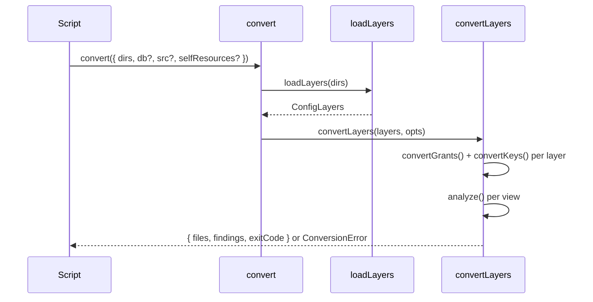

# Library API

Every step of `spinajs-authz-convert` is exported, so a migration script can run the conversion, inspect the result and write the files itself. Use `convert()` for the whole run; use the building blocks to preview one part or to feed layers that do not come from files.

The package registers nothing in DI and has no extension points: it is a one-off tool, not a runtime service.

## How it works



1. `convert(opts)` calls `loadLayers(opts.dirs)`, then `convertLayers(layers, opts)`.
2. `convertLayers()` runs `convertGrants()` and `convertKeys()` on each layer, collects refusals and throws `ConversionError` if there is any.
3. It applies the cross-layer rules (array keys, login strategy), runs `analyze()` on each view, and marks roles `assignable: false` when `opts.db` is given.
4. It renders each layer's roots with `configModule()` and the findings with `warningsMarkdown()`, and returns `ConvertResult`. Nothing is written to disk; `main()` does that.

## Entry points

| Export | Signature | Use |
| --- | --- | --- |
| `convert` | `(opts: ConvertOptions) => Promise<ConvertResult>` | The whole run from config dirs. Throws `ConversionError`. |
| `convertLayers` | `(layers: ConfigLayers, opts: Omit<ConvertOptions, 'dirs'> & { dirs?: readonly string[] }) => ConvertResult` | The conversion of already loaded layers. Synchronous. `dirs` only feeds the file headers. |
| `main` | `(argv: readonly string[], log?: (line: string) => void, error?: (line: string) => void) => Promise<number>` | The command, with arguments and output lines under your control. Returns the exit code; never throws. |

### `ConvertOptions`

| Field | Type | Default | Meaning |
| --- | --- | --- | --- |
| `dirs` | `readonly string[]` | (required) | Compiled config dirs, merged in order. |
| `db` | `DbFacts` | none | Rows from `readDbFacts()`. |
| `src` | `SourceFacts` | none | Model facts from `scanSources()`. |
| `selfResources` | `readonly string[]` | `DEFAULT_SELF_RESOURCES` (`['user']`) | Resources whose `:own` grants become relation `self`. |

### `ConvertResult`

| Field | Type | Meaning |
| --- | --- | --- |
| `files` | `readonly OutputFile[]` | `{ name, content }` per file; names come from `outputName(root, layer)`, the last one is `WARNINGS_FILE` (`authz-warnings.md`). |
| `findings` | `readonly Finding[]` | Every finding: `severity`, `code`, `message`, and `path` and `layer` when known. |
| `exitCode` | `0 \| 2` | `2` when any finding is `manual`. |

## Building blocks

| Area | Exports | Page |
| --- | --- | --- |
| Loading | `loadLayers(dirs)`, `ConfigLayers`, `mergeLayers(...layers)`, `mergeArrays` (the `mergeWith` customizer: arrays concatenate) | [Config loading and env layers](02-config-loading-and-env-layers.md) |
| Inputs | `readDbFacts(file)`, `DbFacts`, `scanSources(dir)`, `SourceFacts` | [Running the converter](01-running-the-converter.md#database-rows---db) |
| Grants | `convertGrants(rbac, opts, findings, ctx?)`, `GrantsResult`, `RoleOut`, `Grant`, `GrantObject`, `GrantFields`, `GrantsOptions`, `GrantsContext`, `VERBS`, `Verb`, `IMPERSONATE_RESOURCE`, `DEFAULT_SELF_RESOURCES` | [Grant and role conversion](04-grant-and-role-conversion.md) |
| Keys | `convertKeys(layer, merged, findings, common?)`, `KeyOutput`, `SCALAR_TO_ARRAY_KEYS` | [Config key mapping](03-config-key-mapping.md) |
| 2.x defaults | `RBAC_2X_DEFAULTS`, `RBAC_2X_ARRAYS`, `RBAC_2X_PACKAGE_GRANTS`, `RBAC_2X_PACKAGE_EXTENDS`, `RBAC_2X_PACKAGE_ROLES`, `HTTP_2X_COOKIE_SECRET` | [Config key mapping](03-config-key-mapping.md#2x-package-defaults) |
| Checks | `analyze(merged, layer, opts)`, `AnalyzeOptions` | [Findings and refusals](05-findings-and-refusals.md) |
| Findings | `Findings`, `Finding`, `Severity`, `ConversionError` | [Findings and refusals](05-findings-and-refusals.md) |
| Output | `configModule(value, header)`, `literal(value, indent?)`, `warningsMarkdown(findings, intro)`, `outputName(root, layer)`, `WARNINGS_FILE`, `OutputFile` | This page |

## Important behaviour

- `convert()` and `loadLayers()` run the app's config files in this process and in child processes. The child processes start in `process.cwd()`, so config files that build paths from it see the same dir; run from the app's root.
- `convertKeys()` and `convertGrants()` never throw on bad input: they call `findings.refuse()`. Check `findings.problems` before using their result.
- `Findings` drops a finding identical to one it already holds (same severity, code, path and message).
- `configModule()` writes a TypeScript literal of plain data. It quotes keys only where needed and escapes quotes, backslashes, line terminators and lone surrogates.
- `ConvertResult.files` holds the files in layer order: common first, then each env in the order of `layers.envs` (sorted by `loadLayers()`); within a layer `authz`, `users`, `authn`.

## Examples

### Convert with database rows and model sources, then write the files

```ts sample
import * as fs from 'node:fs';
import * as path from 'node:path';
import { ConversionError, convert, readDbFacts, scanSources } from '@spinajs/authz-convert';

export async function migrateConfig(outDir: string): Promise<void> {
  try {
    const result = await convert({
      dirs: ['lib/mjs/config'],
      db: readDbFacts('exports/rbac-facts.json'),
      src: scanSources('src'),
      selfResources: ['user', 'profile'],
    });
    fs.mkdirSync(outDir, { recursive: true });
    for (const file of result.files) fs.writeFileSync(path.join(outDir, file.name), file.content, 'utf-8');
    console.log(`exit code ${result.exitCode}, ${result.findings.length} finding(s)`);
  } catch (err) {
    if (!(err instanceof ConversionError)) throw err;
    for (const problem of err.problems) console.error(problem);
  }
}
```

### Convert config built in code

```ts sample
import { convertLayers, mergeLayers } from '@spinajs/authz-convert';
import type { ConfigLayers } from '@spinajs/authz-convert';

export function convertInMemory(): void {
  const common = { rbac: { defaultRole: 'customer', grants: { customer: { Order: { 'read:own': ['*'] } } } } };
  const prod = { rbac: { password: { blockAfterAttempts: 5 } } };
  const layers: ConfigLayers = {
    common,
    envs: new Map([['prod', prod]]),
    files: [],
    skipped: [],
    computed: new Map(),
    envReaders: [],
    probeErrors: [],
    view: (env) => (env === 'prod' ? mergeLayers(common, prod) : mergeLayers(common)),
  };
  const result = convertLayers(layers, {});
  for (const file of result.files) console.log(`--- ${file.name}\n${file.content}`);
}
```

## Related

- [Running the converter](01-running-the-converter.md): the command built on `main()`.
- [Findings and refusals](05-findings-and-refusals.md): what `findings` and `ConversionError.problems` hold.
