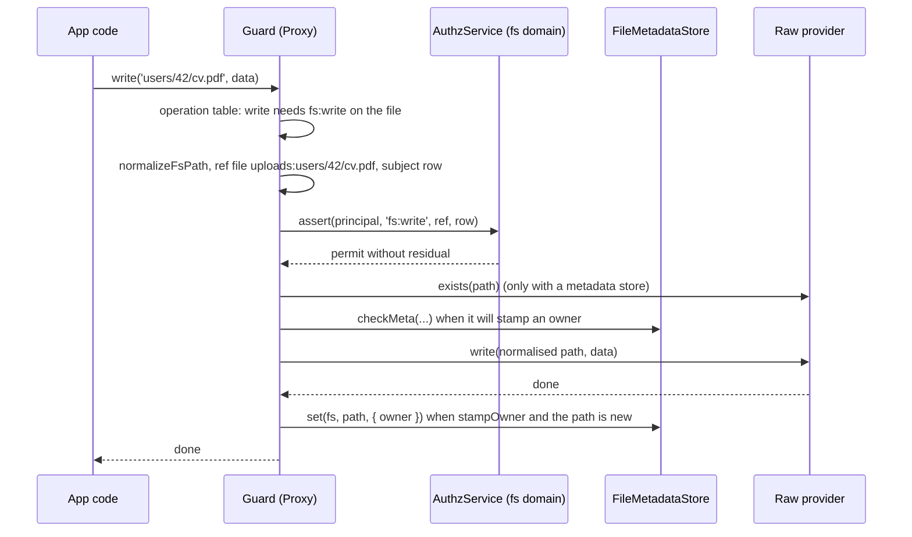

# Guarded file systems

`AuthzFsDecorator` wraps every `@spinajs/fs` provider that has an `authz.fs.<name>` entry in a guard. The guard checks the caller's `fs:*` permissions on every path before the provider runs. Use it to protect a filesystem from the principals of your app: users, API clients, share links.

A filesystem without an `authz.fs.<name>` entry, or with `mode: 'off'`, is **not** guarded: `getFs(name)` returns the raw provider.

## How it works

At boot:

1. Importing `@spinajs/authz-fs` registers, in the root container, `AuthzFsDecorator` as an `FsDecorator` (order `100`), `FsResourceAdapter`, `FsAuthzContributor`, `AuthzUploadMiddleware`, the two shipped `FileMetadataStore` classes and the `authz.fs` configuration schema.
2. `fsService.resolve()` creates the providers, then runs the decorators ([Provider decorators](../fs/07-provider-decorators.md)).
3. `AuthzFsDecorator.decorate(instance, entry)` reads `authz.fs.<entry.name>` with `fsAccessConfig()`. With mode `off` it returns the instance unchanged.
4. Otherwise it calls `assertFsDomainConfig()`, then `ensureFsDomain(domain)` ([File system domains](09-file-system-domains.md)), then `guardFs(instance, name, { config })`.
5. `guardFs()` returns a `Proxy` over the raw provider. `fsService` publishes the proxy, so `getFs()`, `@FileSystem()` and `fs://` URIs hand it out.

On every call of a guarded method:

1. The proxy looks the method up in the effective [operation table](03-operation-table.md). A method that is not there throws `AuthzConfigError` in `enforce` (unless the principal is `SYSTEM`) and warns in `audit`.
2. `normalizeFsPath(path, Options.basePath)` normalises each path argument ([Paths, refs and permissions](02-paths-refs-and-permissions.md)). A refused path throws `InvalidArgument`.
3. Each path becomes a ref (`{ type: 'file' | 'dir', id: '<fs>:<path>' }`, or `{ type: 'fs', id: '<fs>' }` for the root) and a subject row `{ id, type, fs, path }`. A destination on another filesystem is checked with that filesystem's own entry.
4. The principal is `FsGuardOptions.principal()`, else `currentPrincipal()`: the principal of the current request, else `UNATTENDED`.
5. For each path and permission the guard asks the `AuthzService` of the filesystem's domain:
   - `enforce`: `assert(principal, permission, ref, subject)`. A denial throws `AccessDenied`. A permit that leaves a residual (a condition the subject did not settle) also throws `AccessDenied`, with reason `needs_subject`.
   - `audit`: `check(...)`. A denial or a residual logs a warning, and the call goes on.
6. Before the IO, the guard plans the [owner metadata](04-file-owners.md) update and, for `signedUrl`, computes the URL lifetime ([Signed URLs](06-signed-urls.md)).
7. The raw method runs on the raw provider with the normalised paths. Guarded calls it makes until it settles are not checked again.
8. After the IO, the guard writes the metadata, and with `list: 'each'` it drops the entries the principal may not `fs:stat`.



## Configuration

`authz.fs.<name>`, where `<name>` is the `fs.providers[].name` of the provider. The schema `AUTHZ_FS_CONFIGURATION_SCHEMA` checks every entry at boot.

| Key | Type | Default | Allowed values | Meaning |
| --- | --- | --- | --- | --- |
| `authz.fs.<name>.mode` | `string` | required | `off`, `audit`, `enforce` | `off`: the raw provider. `audit`: check, warn on a denial, go on. `enforce`: a denial throws `AccessDenied`. |
| `authz.fs.<name>.domain` | `string` | `'root'` | an authz domain name | The domain the checks run in. See [File system domains](09-file-system-domains.md). |
| `authz.fs.<name>.operations` | `Record<string, Permission \| Permission[]>` | none | method name → permission(s) | Adds or replaces entries of the operation table. See [Operation table](03-operation-table.md#configuration). |
| `authz.fs.<name>.list` | `string` | `'dir'` | `dir`, `each` | `each`: `list` also checks `fs:stat` on every entry. See [Operation table](03-operation-table.md#configuration). |
| `authz.fs.<name>.metadata` | `string` | none | class name of a registered `FileMetadataStore` | The store that holds file owners. See [File metadata stores](05-file-metadata-stores.md). |
| `authz.fs.<name>.stampOwner` | `boolean` | `false` | `true`, `false` | Record the first writer as the owner; needs `metadata`. See [File owners](04-file-owners.md). |
| `authz.fs.<name>.signedUrl.defaultTtlSeconds` | `number` | `900` | `> 0` | URL lifetime when the caller asks none. See [Signed URLs](06-signed-urls.md). |
| `authz.fs.<name>.signedUrl.maxTtlSeconds` | `number` | none | `> 0` | Cap on every signed URL lifetime. |
| `authz.fs.<name>.resolver` | `string` | every `FsPathResolver` whose `fs` matches | class name of a registered `FsPathResolver` | Gives a path its domain parents. See [Inherited access](10-inherited-access.md). |
| `authz.fs.<name>.inherit` | `Record<'fs:<op>', string>` | none | `fs:` permission → action name | Access from the domain parents. Needs a domain other than `root`. |
| `authz.fs.<name>.policies` | `Policy[]` | none | ABAC policies with `fs:` permissions | Policies of this filesystem. Needs a domain other than `root`. See [File system policies](11-file-system-policies.md). |

```ts sample
const config = {
  fs: {
    defaultProvider: 'uploads',
    providers: [
      { service: 'fsNative', name: 'uploads', basePath: './data/uploads' },
      { service: 'fsNative', name: 'archive', basePath: './data/archive' },
    ],
  },
  authz: {
    fs: {
      // every call checked, a denial throws AccessDenied
      uploads: { mode: 'enforce' },
      // checks logged only, while the grants are being written
      archive: { mode: 'audit', list: 'each' },
    },
  },
};

export default config;
```

Schema rules that fail the boot with `InvalidConfiguration`:

- An entry without `mode`. An entry with policies but no mode must not be silently off.
- An unknown key in an entry or in `signedUrl`. A typo never turns a check off.
- `stampOwner: true` without `metadata`.
- An `inherit` key that is not `fs:<action>`, or a value that is not an action name.

`parseFsAccessConfig()` checks the same values again for a configuration no schema saw (`Configuration.set`, tests) and throws `AuthzConfigError`.

## Services and extension points

| Service | DI token and lifetime | Default implementation | Alternatives | How to replace or extend |
| --- | --- | --- | --- | --- |
| Provider guard | `FsDecorator` of `@spinajs/fs`, singleton, registered at import (`@Injectable(FsDecorator)`), `order` `100` | `AuthzFsDecorator` | none | Not replaceable: every `FsDecorator` registration runs. Change what it guards through `authz.fs`. Wrap a provider created outside `fsService` with `guardFs()`. |
| Configuration schema | `Bootstrapper`, `AuthzFsConfigBootstrapper`; also registered at import | `AUTHZ_FS_CONFIGURATION_SCHEMA` | none | none |

Functions:

| Function | Does |
| --- | --- |
| `guardFs(raw, fsName, opts?)` | The guard proxy over `raw`; `raw` itself for mode `off`. |
| `isGuardedFs(value)` | `true` for a proxy `guardFs()` built. |
| `fsAccessConfig(fsName, container?)` | The parsed `authz.fs.<fsName>` entry; mode `off` for a missing entry. Reads the configuration on every call. |
| `fsAccessConfigs(container?)` | Every entry, by filesystem name. |
| `parseFsAccessConfig(fsName, entry)` | One entry, checked and filled: `domain` defaults to `'root'`, a policy without `scope` gets the filesystem. |

`FsGuardOptions` of `guardFs()`:

| Option | Default | Meaning |
| --- | --- | --- |
| `config` | `authz.fs.<fsName>` of the configuration in `container` | The entry to apply. |
| `container` | `DI.RootContainer` | Where the configuration, the published providers and `AuthzDomains` are resolved. |
| `service` | `AuthzDomains.service(domain)` | The service that decides for a domain. |
| `principal` | `currentPrincipal` | Who is checked. |
| `log` | `engineLog('authz-fs')` | Receives the `audit` warnings and the metadata errors. |
| `metadataTimeoutMs` | `30000` | How long a `writeStream` `'close'` waits for the metadata store. |
| `now` | the `AuthzClock` of the domain | The time signed URL lifetimes count from. |

### Guard a provider you create yourself

`fsService` decorates only the providers it creates. Wrap any other `fs` instance with `guardFs()`.

```ts sample
import { guardFs } from '@spinajs/authz-fs';
import type { fs } from '@spinajs/fs';

// A provider built by a plugin loader, outside fs.providers.
export function exposeToPlugin(raw: fs): fs {
  return guardFs(raw, 'plugin-data', { config: { mode: 'enforce', domain: 'root' } });
}
```

## Important behaviour

- **Fail closed.** In `enforce` a conditional permit counts as a denial (`needs_subject`). Any mode other than `enforce` runs as `audit`.
- **Read once.** The decorator reads the entry when it wraps the provider. A later `Configuration.set` does not change a guard that exists. A destination filesystem's entry is read on every call.
- **Unattended.** Outside a request, and outside `runAs()`, the principal is `UNATTENDED`. Run background jobs with `authz().runAs(principal, reason, fn)`.
- **Order at boot.** Take providers after `fsService` resolved. Until the decorators ran, `fsService` publishes the raw providers, and a service that keeps one in a field keeps it unguarded.
- **Nested calls.** Every path an operation touches is checked before the provider runs, including a destination on another filesystem (`copy`, `move`, `zip`, `unzip` with `dstFs`). Guarded calls the provider makes inside the operation pass unchecked. Callbacks that run after it settled, such as a `'data'` listener on a returned stream, are checked again.
- **`zip` and `unzip` without `dstFs`.** The guard checks where the provider writes: `fsTemp` into itself, `fsNative` `unzip` into itself and `fsNative` `zip` into the published `fs-temp`. For other providers a destination path without `dstFs` throws `AuthzConfigError` in `enforce`.
- **Code, not principals.** Properties pass through unguarded (`fsTemp.Provider`, `fsS3.S3`). Objects the app hands to an operation run inside it, so their guarded calls are not checked.
- **Proxy.** `instanceof`, `Name` and `Options.basePath` work as on the raw provider.
- **Audit.** `audit` mode logs `authz.fs.<name>: <principal> lacks <permission> on <resource>; allowed in audit mode`.

## Best practices

- Start a new filesystem in `audit`, read the warnings, write the grants, then switch to `enforce`.
- Set `mode: 'off'` explicitly on internal filesystems (`fs-temp`, the upload temp filesystem). It documents the decision.
- Import `@spinajs/authz-fs` in the module that boots the app, before anything resolves `fsService`.

## Patterns and antipatterns

```ts
// Don't: FsDecorator of @spinajs/authz-fs is a contract stub, not the token fsService resolves
import { FsDecorator } from '@spinajs/authz-fs';

// Do: extend the class of @spinajs/fs
import { FsDecorator } from '@spinajs/fs';
```

```ts
// Don't: a provider read before fsService resolved stays raw
const uploads = getFs('uploads');   // at module load
await DI.resolve(fsService);

// Do: read it after the boot, or lazily with @FileSystem('uploads')
await DI.resolve(fsService);
const uploads = getFs('uploads');
```

## Examples

### Turn a denied download into a 404

```ts sample
import { AccessDenied } from '@spinajs/authz';
import { getFs } from '@spinajs/fs';

// Hide whether a file exists from a caller who may not read it.
export async function readInvoice(path: string): Promise<string | Buffer | null> {
  try {
    return await getFs('invoices').read(path);
  } catch (e) {
    if (e instanceof AccessDenied) return null;
    throw e;
  }
}
```

## Related

- [Provider decorators](../fs/07-provider-decorators.md): how `fsService` applies `AuthzFsDecorator`.
- [Providers and configuration](../fs/01-providers-and-configuration.md): `fs.providers` and `getFs()`.
- [Authorization in SpinaJS](../authz/README.md): principals, decisions, `AccessDenied` and domains.
- [Paths, refs and permissions](02-paths-refs-and-permissions.md): what the guard checks.
