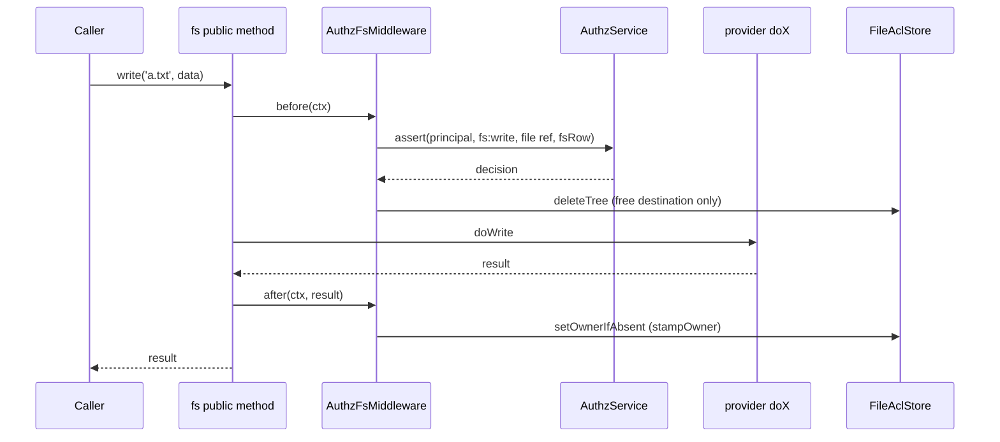

# Checks on file actions

`AuthzFsMiddleware` checks every path of every file action with a `fs:*` permission before the provider runs, then keeps the file ACL in step with the result.

## How it works

1. A caller invokes a public method of a provider, for example `getFs('uploads').read('a.txt')`. The fs core builds one target per path and calls `AuthzFsMiddleware.before(ctx)` (order 100) when `isEnabled(fs)` is `true` for the filesystem of any target (a `copy` from an `off` filesystem into an `enforce` one runs it).
2. `before` takes the principal from the async context, else `UNATTENDED`. `SYSTEM` passes unchecked.
3. A written path longer than 512 characters throws `InvalidArgument` before any IO: the ACL cannot hold it.
4. For each enabled target and each access of that target, the permission `fs:<access>` is checked on the ref from `fsRef(fs, path, kind)` with the subject `fsRow`, in the domain of the target's filesystem. `enforce` calls `assert`; a decision that is not definite (allowed with a residual other than `TRUE`) is `AccessDenied`. `audit` calls `check` and warns.
5. For `signedUrl`, the lifetime is computed and written into `ctx.args` (see [Signed URLs](#signed-urls)).
6. After every check passed, `before` probes the targets (`ctx.isDir`, `ctx.exists`, `ctx.hasEntries`) and clears stale ACL rows of a free write destination. A refused action leaves the ACL alone.
7. The provider's `doX` hook runs.
8. `after(ctx, result)` updates the ACL rows (see [File ACL](03-file-acl.md)) and, for `list` with `list: 'each'`, filters the entries. A failed row update is logged at `error` and rethrown.

## Permissions and refs

| Permission | Implies | Checked for |
| --- | --- | --- |
| `fs:read` | `fs:stat` | Reading content. |
| `fs:stat` | none | Existence and stats. |
| `fs:list` | none | Listing a directory. |
| `fs:write` | `fs:stat` | Creating or changing files and directories. |
| `fs:delete` | none | Removing files and directories. |
| `fs:share` | none | Signed URLs. |
| `fs:manage` | none | Changing ACL rows through [`FsAcl`](05-managing-acl-rows.md). |

They are listed in `FS_PERMISSIONS` and apply to the types `fs`, `dir` and `file`. What each method needs per target is the action table of [`@spinajs/fs`](../fs/07-middlewares.md).

A path is the ref `{ type: 'file' | 'dir', id: '<fs>:<path>' }`; the filesystem root is `{ type: 'fs', id: '<fs>' }`. Ancestors are the parent directories, then the `fs` ref, then global (`fsAncestors`). Helpers: `fsRef`, `parseFsRef`, `fsRow` and `fsRowOf`. The row is passed as the subject of every check, so relation grants and `resource.*` conditions answer definitely.

## Signed URLs

`signedUrl` and `getSignedUrl` check `fs:share`. The URL lives until the earliest of:

- the asked `until`, else now plus `defaultTtlSeconds` (900);
- now plus `maxTtlSeconds`;
- the `validUntil` of the permit.

Time counts from the `AuthzClock` of the filesystem's domain. An `until` that is not a valid luxon `DateTime` is an `InvalidArgument`. `audit` narrows the lifetime too.

## Important behaviour

- Each target uses the entry of its own filesystem; see [configuration](01-access-modes-and-configuration.md).
- `list: 'each'` checks `fs:stat` on every entry of a `list` result. `enforce` drops the entries without it; `audit` keeps them and warns.
- `upload(src, dest, { exclusive: true })` passes the options to every middleware as `ctx.args[1]`, unchanged. The destination is checked before the provider tests whether it exists: a caller without `fs:write` gets `AccessDenied` whether or not it exists, one with `fs:write` gets the provider's `ResourceDuplicated`.
- Calls made inside an action (provider internals, `fsTemp` to its backend, `copy` to `dstFs.upload`) skip middlewares.
- `IZipResult.unlink()` runs `rm` on the archive outside the zip action, so it is checked as `fs:delete`.
- `writeStream`: the ACL update runs when the stream emits `close`, and `close` waits for it (`fs.middlewareTimeoutMs`).
- `SYSTEM` is never checked.

## Errors

| Error | When |
| --- | --- |
| `AccessDenied` (403) | `enforce`: a missing permission or a conditional permit. |
| `InvalidArgument` | A path above the root, a NUL byte, a path outside the base path, a written path over 512 characters, an invalid signed URL `until`. |
| `AuthzConfigError` | A malformed `authz.fs` entry, an unknown domain, a missing `Configuration` while an `AuthzService` runs. |
| `InvalidConfiguration` | An unknown key at boot. |

## Related

- [Access modes and configuration](01-access-modes-and-configuration.md)
- [File ACL](03-file-acl.md)
- [`@spinajs/fs` middlewares](../fs/07-middlewares.md)
