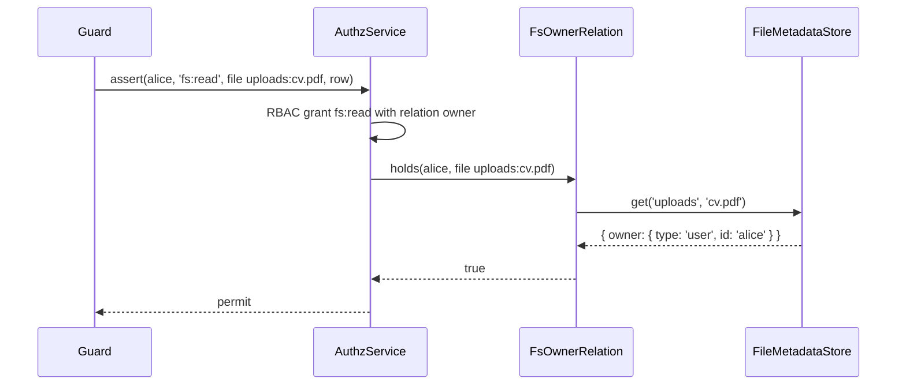

# File owners

With `stampOwner: true` the guard records the principal that creates a path as its owner, in the [file metadata store](05-file-metadata-stores.md) that `metadata` names. The `owner` relation then lets a grant such as "users read the files they uploaded" decide per file.

## How it works

1. Before the IO, `planMetadata()` resolves the store of each path argument (`fileMetadataStore()`), probes the path with the raw provider (`exists`, or `dirExists` for `mkdir` and `unzip`) and reads the rows it needs.
2. A path that existed keeps its metadata. A path that did not exist starts empty: rows left there (an `rm` outside the guard, a failed update) are deleted first.
3. For a new path with an owner to stamp, the store's `checkMeta()` runs, so a value the store cannot hold stops the call before any IO.
4. The raw method runs.
5. After the IO the guard writes the owner, unless an owner appeared there meanwhile (the first stamp wins). `writeStream` stamps when the stream closes.
6. A metadata update that fails after the IO is logged at error and its error is rethrown.

Effects per method:

| Method | Metadata effect |
| --- | --- |
| `write`, `writeStream`, `append`, `upload`, `copy` (destination), `zip` (archive) | Stamp the file when the call creates it. |
| `mkdir`, `unzip` (destination) | Stamp the directory when the call creates it. |
| `rm` | Delete the row of the path; of the whole tree when the provider reports a directory. |
| `move`, `rename` | Onto an existing path: the destination keeps its metadata, the source rows go. Otherwise the metadata moves along. |
| every other method | none |

Who becomes the owner:

- Only a definite allow stamps. An `audit` denial or a conditional permit writes no owner.
- The owner is the principal the decision ran for: under `inherit` delegation the delegate.
- Principals of the types in `FS_NO_OWNER_TYPES` own nothing: `system`, `unattended`, `anonymous`, `link`. Anonymous callers and the bearers of a link share one id.

### The owner relation

`FsResourceAdapter.relations()` serves `owner` on `file`, `dir` and `fs` through `FsOwnerRelation`. `holds(principal, ref)` is `true` when the store of the ref's filesystem records `{ type, id }` of the principal as the owner of that path.

- It reads the store, never the subject: a caller-built subject could claim any owner.
- The filesystem root and a filesystem without `metadata` have no owner.
- It does not hold for the `FS_NO_OWNER_TYPES` principals.



## Configuration

| Key | Type | Default | Allowed values | Meaning |
| --- | --- | --- | --- | --- |
| `authz.fs.<name>.metadata` | `string` | none | class name of a registered `FileMetadataStore` | Keeps metadata in sync on `rm`, `move` and `rename`, with or without `stampOwner`, and backs the `owner` relation. |
| `authz.fs.<name>.stampOwner` | `boolean` | `false` | `true`, `false` | Record the first writer as the owner. The schema refuses it without `metadata`. |

`FsGuardOptions.metadataTimeoutMs` (default `30000`) bounds how long a `writeStream` `'close'` waits for the store, for a guard built with `guardFs()`.

```ts sample
const config = {
  authz: {
    fs: { uploads: { mode: 'enforce', metadata: 'OrmFileMetadataStore', stampOwner: true } },
  },
};

export default config;
```

## Services and extension points

| Service | DI token and lifetime | Default implementation | Alternatives | How to replace or extend |
| --- | --- | --- | --- | --- |
| `owner` relation | Returned by `FsResourceAdapter.relations()`, one `FsOwnerRelation` per fs type | `FsOwnerRelation` | none | Store owners elsewhere through a custom [`FileMetadataStore`](05-file-metadata-stores.md#file-metadata-store-custom-implementation). |
| Metadata store | `FileMetadataStore`, picked by class name | none | `OrmFileMetadataStore`, `S3ObjectMetadataStore` | See [File metadata stores](05-file-metadata-stores.md). |

## Important behaviour

- **First writer, both ways.** An overwrite, `append` or `fs:write` on an existing file gives no owner rights. In a tree several principals share, whoever creates a path first (an empty file, a `writeStream` left open) owns what others later write there.
- **Directories.** The owner of a directory with an owner grant of `fs:delete` can `rm` it, files of others under it included, since `rm` is checked on the directory only.
- **Files put under a directory** by `unzip`, `copy` or `upload` get no owner of their own.
- **Moves between stores.** With one store on both sides the whole tree moves, also between filesystems. Between two stores only the row of the moved path travels; the files under a moved directory lose their owners, and a warning is logged. To a filesystem without a store the metadata is dropped.
- **Streams.** `writeStream` holds the `'close'` event back until the owner is written, at most `metadataTimeoutMs`. A stream that failed or was destroyed stamps nothing. A metadata failure goes to the stream's `'error'` listeners when it has any.
- **Not atomic with the IO.** The read before the IO and the write after it are separate store calls.
- **Unchecked nested calls** a provider makes inside an operation keep no metadata.
- **Key stores.** S3 reports every directory as existing, so a directory key is never stamped there.

## Best practices

- Where reads go by owner, grant `fs:write` on per-user prefixes (`uploads:users/{principal.id}`), not on one shared directory. Nobody can then pre-create a path another user will write.
- Pair an owner grant of `fs:read` with a plain grant of `fs:write`. Without `fs:write` nobody can create the file to own.
- Use [`fromFsPath`](08-route-checks-with-fromfspath.md) with `subject: 'load'` on routes, so an owner grant gives a definite answer there too.

## Patterns and antipatterns

```ts
// Don't: SYSTEM owns nothing, so files a job writes for a user are not the user's
await authz().runAs(SYSTEM, 'import', () => getFs('uploads').write(`users/${userId}/report.pdf`, pdf));

// Do: write as the user the file belongs to
await authz().runAs(user, 'import for the user', () => getFs('uploads').write(`users/${userId}/report.pdf`, pdf));
```

## Examples

### Let users read and delete only the files they uploaded

```ts sample
const config = {
  authz: {
    fs: { uploads: { mode: 'enforce', metadata: 'OrmFileMetadataStore', stampOwner: true } },
    rbac: {
      roles: {
        user: {
          grants: [
            { permission: 'fs:write', on: [{ type: 'fs', id: 'uploads' }] },
            { permission: 'fs:read', relation: 'owner', on: [{ type: 'fs', id: 'uploads' }] },
            { permission: 'fs:delete', relation: 'owner', on: [{ type: 'fs', id: 'uploads' }] },
          ],
        },
      },
    },
  },
};

export default config;
```

A write by `alice` stamps the new file with `user:alice`. A later read by `alice` passes the owner grant; a read by `bob` throws `AccessDenied`. An overwrite by `bob` keeps `alice` as the owner.

## Related

- [File metadata stores](05-file-metadata-stores.md): where owners live.
- [The RBAC model](../authz-rbac/README.md): grants with a `relation`.
- [`@spinajs/authz-orm`](../authz-orm/README.md): the `owner` relation of model rows, from an `@Owner()` column.
