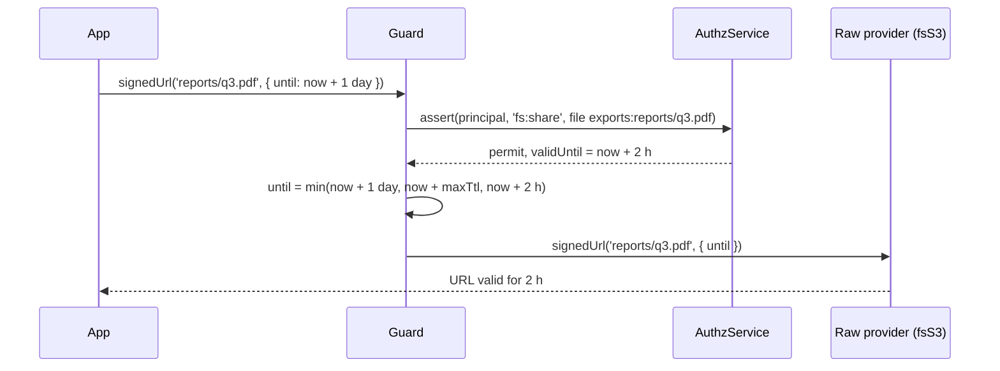

# Signed URLs

A signed URL lets anyone who holds it download a file without a further check. The guard checks `fs:share` on the file before the provider signs, and it caps the URL lifetime so the link never outlives the permission that allowed it.

## How it works

1. The caller calls `signedUrl(path, opts?)` or `getSignedUrl(path, until?)` on a guarded provider.
2. `askedUntil()` reads the asked expiry once: `opts.until` of `signedUrl`, or the second argument of `getSignedUrl`. A value that is not a valid luxon `DateTime` throws `InvalidArgument`.
3. The guard checks `fs:share` on the file, as any [operation](03-operation-table.md).
4. It reads now: `FsGuardOptions.now()`, else the `AuthzClock` of the filesystem's domain, else the system time.
5. `signingUntil()` takes the earliest of:
   - the asked `until`, or, when the caller asks none, now + `signedUrl.defaultTtlSeconds` (default `900`);
   - now + `signedUrl.maxTtlSeconds`, when set;
   - the `validUntil` of the `fs:share` decision (an expiring grant), when it has one.
6. The raw provider signs with that `until`, in the zone of the asked value: `signedUrl(path, { ...opts, until })`. `getSignedUrl` goes through the raw `signedUrl` when the provider has one, else it gets `until` as its second argument.



## Configuration

| Key | Type | Default | Allowed values | Meaning |
| --- | --- | --- | --- | --- |
| `authz.fs.<name>.signedUrl.defaultTtlSeconds` | `number` | `900` | `> 0` | Lifetime when the caller asks no `until`. 900 is the S3 signer's own default. |
| `authz.fs.<name>.signedUrl.maxTtlSeconds` | `number` | none | `> 0` | Cap on every URL lifetime, asked or not. |

```ts sample
const config = {
  authz: {
    fs: {
      exports: {
        mode: 'enforce',
        // links live 10 minutes unless the caller asks less; never more than a day
        signedUrl: { defaultTtlSeconds: 600, maxTtlSeconds: 86400 },
      },
    },
  },
};

export default config;
```

## Services and extension points

| Service | DI token and lifetime | Default implementation | Alternatives | How to replace or extend |
| --- | --- | --- | --- | --- |
| Clock | `AuthzClock` of `@spinajs/authz`, resolved in the filesystem's domain | the system time | your own `AuthzClock` | Register it in the domain; a guard built with `guardFs()` can pass `now`. |
| URL signer | the provider's own | see [Signed URLs of fs-s3](../fs-s3/04-signed-urls.md) | | The guard only narrows `until`; signing stays the provider's. |

## Important behaviour

- **Short by default.** A URL nobody asked a lifetime for lives at most 900 s, whatever the grants say.
- **Audit mode** narrows the lifetime too.
- **Only the file's decision counts** for `validUntil`.
- **Copy of the asked value.** The guard signs its own copy of `until`, never the caller's object.
- **Clock skew.** The S3 signer turns `until` into a lifetime with the wall clock. With a custom `AuthzClock` that runs ahead of the system time, S3 URLs live longer by that skew.
- **Revocation.** A URL signed before a grant was revoked stays valid until it expires.
- A provider with neither `signedUrl` nor `getSignedUrl` has nothing to call, as without the guard.

## Best practices

- Give `fs:share` through an assignment with an expiry when the share itself is temporary: the decision's `validUntil` then caps every URL.
- Keep `maxTtlSeconds` short on filesystems with personal data; revoking a grant does not revoke signed URLs.

## Patterns and antipatterns

```ts
// Don't: a long default outlives most permissions and every revocation
signedUrl: { defaultTtlSeconds: 7 * 86400 }

// Do: a short default, and an explicit until where a longer link is needed
signedUrl: { defaultTtlSeconds: 600, maxTtlSeconds: 86400 }
```

## Examples

### Link to a generated export for 30 minutes

```ts
import { DateTime } from 'luxon';
import { getFs } from '@spinajs/fs';

// Throws AccessDenied without fs:share on the file.
const url = await getFs('exports').signedUrl?.(`users/${userId}/export.zip`, { until: DateTime.now().plus({ minutes: 30 }) });
```

## Related

- [Signed URLs of fs-s3](../fs-s3/04-signed-urls.md): how `fsS3` signs and which signers exist.
- [Operation table](03-operation-table.md): `fs:share` on `signedUrl` and `getSignedUrl`.
- [Authorization in SpinaJS](../authz-rbac/README.md): expiring assignments and `validUntil`.
